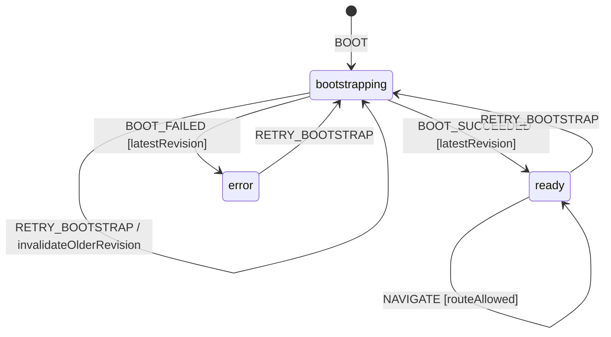
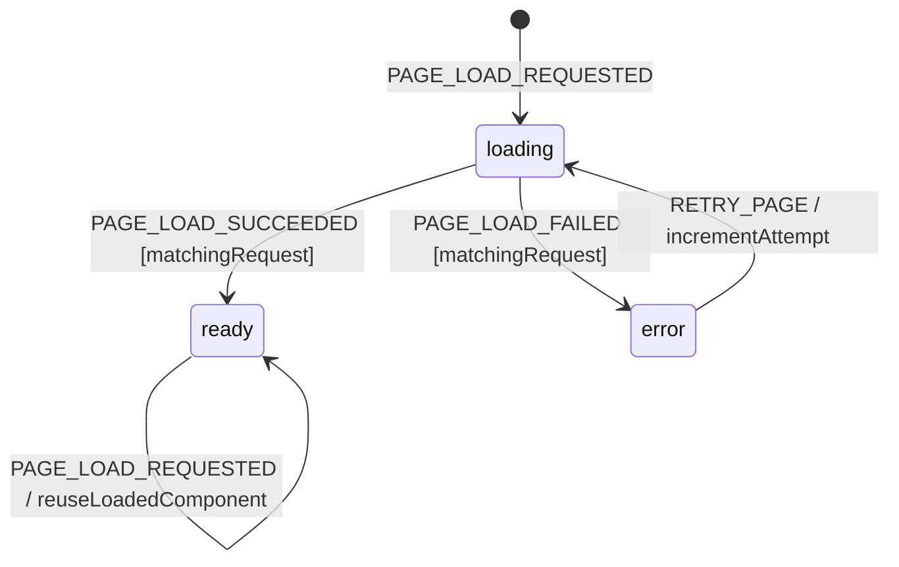
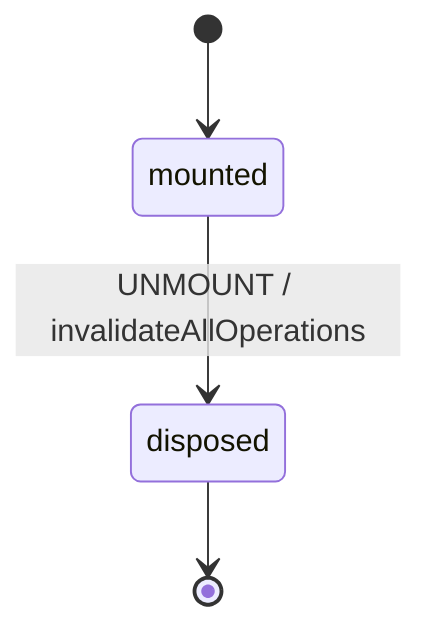

# Modèle de workflow de l'App Shell

Comportement faisant autorité pour le bootstrap du side panel, la navigation, le routage premium et le chargement paresseux (lazy loading) des pages. Ce modèle complète `launch-performance.model.md` : ce document détient les budgets temporels ; le présent document détient l'état et la récupération. `navigation-motion.model.md` détient la projection visuelle d'une route acceptée en pastilles (pills) extensibles et en mouvement directionnel de page.

## Portée et décisions

Le shell décide quelle page peut être affichée et si son chunk d'extension local est disponible. Il ne décide pas de l'état métier de la page, n'effectue pas d'I/O de connecteur, et ne lit pas directement IndexedDB/cookies. Toutes les lectures persistées passent par une façade et le bridge de messagerie du service worker.

Le bootstrap et le chargement de page sont des machines indépendantes. Un chunk de page peut échouer sans corrompre le bootstrap, et une nouvelle tentative (retry) de bootstrap ne réessaie pas implicitement chaque page en échec. Les composants de page restent responsables de leurs propres frontières de rendu (render boundaries) une fois le chunk chargé.

## Vocabulaire d'état et contexte

```ts
type Page = 'feed' | 'profile' | 'cv' | 'applications' | 'tjm' | 'settings' | 'onboarding';

type AppBootStatus = 'bootstrapping' | 'ready' | 'error';
type PageLoadStatus = 'loading' | 'ready' | 'error';
type AppShellLifecycle = 'mounted' | 'disposed';

interface PageLoadSnapshot {
  status: PageLoadStatus;
  requestId: string;
  attempt: number;
  error: string | null;
}

interface AppShellContext {
  lifecycle: AppShellLifecycle;
  bootStatus: AppBootStatus;
  bootstrapRevision: number;
  currentPage: Page;
  previousPageIndex: number;
  hasCompletedOnboarding: boolean;
  profilePresent: boolean;
  firstScanDone: boolean;
  onboardingCompleted: boolean;
  premiumAccessible: boolean;
  connection: 'online' | 'offline';
  pages: Partial<Record<Page, PageLoadSnapshot>>;
  bootError: string | null;
}
```

L'absence dans `pages` signifie qu'un chunk n'a pas été demandé. Une fois demandé, les seuls statuts de chargement de page sont exactement `loading`, `ready` et `error`. `disposed` appartient uniquement à `AppShellLifecycle` ; ce n'est jamais un alias d'un statut d'app-bootstrap ou de chargement de page.

## Événements

```ts
type AppShellEvent =
  | { type: 'BOOT' }
  | {
      type: 'BOOT_SUCCEEDED';
      revision: number;
      profilePresent: boolean;
      firstScanDone: boolean;
      onboardingCompleted: boolean;
    }
  | { type: 'BOOT_FAILED'; revision: number; error: string }
  | { type: 'RETRY_BOOTSTRAP' }
  | { type: 'NAVIGATE'; page: Page }
  | { type: 'PAGE_LOAD_REQUESTED'; page: Page; requestId: string }
  | { type: 'PAGE_LOAD_SUCCEEDED'; page: Page; requestId: string }
  | { type: 'PAGE_LOAD_FAILED'; page: Page; requestId: string; error: string }
  | { type: 'RETRY_PAGE'; page: Page; requestId: string }
  | { type: 'PROFILE_UPDATED' }
  | { type: 'PREMIUM_CHANGED'; accessible: boolean }
  | { type: 'NETWORK_CHANGED'; online: boolean }
  | { type: 'SERVICE_WORKER_RESTARTED' }
  | { type: 'UNMOUNT' };
```

Tous les identifiants de requête/révision sont créés par le Shell. L'heure et les IDs ne sont jamais créés dans la logique de transition du Core.

## Statecharts







Le cycle de vie (lifecycle) est orthogonal au bootstrap et au chargement par page. `UNMOUNT` fait passer l'instance à `disposed`, invalide chaque ID de révision/requête, et empêche tous les événements ultérieurs d'atteindre l'une ou l'autre des machines imbriquées.

## Gardes

| Garde             | Règle                                                                                                                                                                                |
| ----------------- | ------------------------------------------------------------------------------------------------------------------------------------------------------------------------------------ |
| `latestRevision`  | La révision de l'événement est égale à `bootstrapRevision` ; les résultats asynchrones plus anciens sont rejetés.                                                                    |
| `routeAllowed`    | Le bootstrap est `ready`, la page est connue, et le routage de l'onboarding est respecté. Une route premium verrouillée est autorisée afin que son explication puisse être affichée. |
| `canImportPage`   | La page n'est pas restreinte par un verrou premium, ou `premiumAccessible` est true. Une page refusée reste routée mais son chunk protégé n'est pas importé.                         |
| `matchingRequest` | La page et `requestId` correspondent au snapshot de chargement actuel de la page.                                                                                                    |
| `needsOnboarding` | Aucun profil, aucun premier scan complété, et aucune complétion de l'onboarding persistée.                                                                                           |
| `canRetryPage`    | La page demandée existe et son statut actuel est `error`.                                                                                                                            |

La route initiale est `onboarding` uniquement lorsque `needsOnboarding` est vérifié ; sinon c'est `feed`. Une navigation vers `cv`, `applications` ou `tjm` refusée pour cause de premium est acceptée uniquement pour afficher la surface de verrouillage déterministe ; `canImportPage` empêche l'import de la page protégée.

## Tables de transition

### Bootstrap et navigation

| De                    | Événement                  | Garde            | Vers                 | Effets                                                                                                              |
| --------------------- | -------------------------- | ---------------- | -------------------- | ------------------------------------------------------------------------------------------------------------------- |
| `bootstrapping`       | `BOOT_SUCCEEDED`           | `latestRevision` | `ready`              | Valider les flags, choisir la route initiale, effacer l'erreur.                                                     |
| `bootstrapping`       | `BOOT_FAILED`              | `latestRevision` | `error`              | Conserver le shell statique visible et stocker l'erreur typée.                                                      |
| `bootstrapping`       | `RETRY_BOOTSTRAP`          | —                | `bootstrapping`      | Incrémenter la révision et démarrer une lecture de remplacement.                                                    |
| `error`               | `RETRY_BOOTSTRAP`          | —                | `bootstrapping`      | Effacer l'erreur, incrémenter la révision, relire.                                                                  |
| `ready`               | `NAVIGATE`                 | `routeAllowed`   | `ready`              | Mettre à jour la page et la direction ; demander le chunk s'il est absent.                                          |
| `ready`               | `PROFILE_UPDATED`          | —                | `ready`              | Marquer l'onboarding comme complété ; conserver la page valide actuelle de l'utilisateur.                           |
| `ready`               | `PREMIUM_CHANGED`          | —                | `ready`              | Recalculer l'accès ; conserver la route et afficher le verrou au lieu de la page protégée en cas de refus.          |
| any pendant `mounted` | `NETWORK_CHANGED`          | —                | identique            | Projeter uniquement la connectivité ; le shell local reste utilisable.                                              |
| any pendant `mounted` | `SERVICE_WORKER_RESTARTED` | —                | identique            | Reconnecter le bridge ; ré-exécuter le bootstrap uniquement si les lectures locales ne peuvent pas être confirmées. |
| lifecycle `mounted`   | `UNMOUNT`                  | —                | lifecycle `disposed` | Invalider les IDs de révision/requête et désabonner les écouteurs.                                                  |

### Chargeur par page (Per-page loader)

| De        | Événement               | Garde                            | Vers      | Effets                                                                                               |
| --------- | ----------------------- | -------------------------------- | --------- | ---------------------------------------------------------------------------------------------------- |
| absent    | `PAGE_LOAD_REQUESTED`   | route autorisée, `canImportPage` | `loading` | Créer un snapshot et exécuter un import dynamique.                                                   |
| `loading` | requête dupliquée       | même page/requête                | `loading` | Réutiliser la promesse en cours (in-flight).                                                         |
| `loading` | `PAGE_LOAD_SUCCEEDED`   | `matchingRequest`                | `ready`   | Stocker le composant et émettre la marque page-loaded.                                               |
| `loading` | `PAGE_LOAD_FAILED`      | `matchingRequest`                | `error`   | Stocker l'erreur sécurisée et afficher une surface de nouvelle tentative, jamais un skeleton infini. |
| `error`   | `RETRY_PAGE`            | `canRetryPage`                   | `loading` | Nouvel ID de requête, incrémenter la tentative, ré-exécuter l'import.                                |
| `ready`   | navigation vers la page | —                                | `ready`   | Réutiliser le composant déjà chargé.                                                                 |

## Effets de bord et responsabilités (Side effects and ownership)

- **Side panel Shell :** appelle `getProfile`, `getFirstScanDone`, et
  `getOnboardingCompleted` via des façades ; possède les imports dynamiques, les
  abonnements, les marques de performance et la projection de rendu Svelte.
- **Service worker Shell :** possède les lectures persistées du profil/flags et
  envoie des réponses typées. Son redémarrage ne peut pas choisir une route ;
  il ne fournit que des faits.
- **Core :** contient les décisions pures de routage, de gardes et de transitions.
  Il n'importe aucun module Shell et reçoit les révisions, les flags et l'accès
  premium en entrées.
- **UI :** effectue le rendu de `bootstrapping`, `error`, de la page sélectionnée,
  ou d'un verrou premium. Elle émet des événements mais ne mute jamais directement
  le contexte de la machine.

Le contrat public de récupération consommé par le shell est
`retryBootstrap(): Promise<void>` ainsi que `retryPage(page): void`. La
projection de statut par page est `Partial<Record<Page, PageLoadStatus>>`.

## Frontière de persistance

`UserProfile` reste dans IndexedDB ; `first_scan_done` et
`onboarding_completed` restent dans `chrome.storage.local`. Le service worker est
l'unique propriétaire de la persistance. Les valeurs de composant de page, la
navigation actuelle, les erreurs, les IDs de requête et les imports en cours
sont éphémères et reconstruits à l'ouverture du side panel. Les faits persistés
l'emportent après un redémarrage du panel ou du worker.

## Permissions et comportement hors-ligne

Le rendu du shell et l'import de chunks packagés ne nécessitent aucune permission
d'hôte optionnelle. Le refus d'une permission spécifique à une fonctionnalité
est projeté à l'intérieur de cette fonctionnalité et ne peut pas faire planter
le shell. Le bootstrap utilise la persistance locale et doit fonctionner hors-ligne.
Les pages hors-ligne dépendantes du réseau peuvent afficher leur propre état
dégradé ; le shell reste `ready` et toutes les pages locales restent navigables.

## Nouvelle tentative, annulation, concurrence et redémarrage

- `retryBootstrap()` remplace la révision active ; les résultats tardifs
  provenant d'anciennes révisions sont ignorés.
- `retryPage(page)` n'existe que pour `error` et crée un nouvel ID de requête.
- `UNMOUNT` équivaut à une annulation : il invalide tous les résultats en attente
  et n'entraîne aucune persistance.
- Les tentatives concurrentes de bootstrap se réduisent à la révision la plus
  récente. Les imports concurrents pour une même page partagent une unique
  promesse ; les imports de pages distinctes peuvent s'exécuter en parallèle.
- Un redémarrage du service worker déclenche la reconnexion du bridge. Il ne
  réinitialise pas une page prête et ne fabrique pas un succès de bootstrap
  artificiel. Si un message a été perdu, le shell répète la lecture locale
  idempotente.

## États terminaux et ré-entrée

L'app shell a une longue durée de vie et n'a pas d'état terminal permanent. `ready`
et `error` sont des états stabilisés (settled) ; tous deux autorisent une
récupération explicite. L'état `ready` d'une page est stable jusqu'au démontage
du panel, tandis que `error` ne re-rentre dans `loading` que via `RETRY_PAGE`.
`disposed` est terminal pour l'instance démontée ; un nouveau panel crée une
nouvelle machine et de nouveaux IDs d'opération.

## Transitions interdites

- `BOOT_SUCCEEDED` ou `BOOT_FAILED` provenant d'une révision plus ancienne ne
  doit pas muter l'état.
- `NAVIGATE` pendant `bootstrapping`/`error` ou vers une page inconnue est rejeté ;
  une route verrouillée par le premium peut rendre son explication de verrouillage
  mais ne doit pas charger le composant protégé.
- Un succès/échec de page obsolète ne doit pas remplacer la requête de page actuelle.
- Un import dynamique rejeté ne doit pas laisser la page dans `loading`.
- `PROFILE_UPDATED` ne doit pas marquer silencieusement une tentative de
  persistance échouée comme réussie.
- Aucun événement n'est accepté après le cycle de vie `disposed` ; tout résultat
  tardif est ignoré.
- Aucune transition implicite ne peut être dérivée d'un texte d'interface (copy),
  d'un texte affiché ou d'un toast.

## Invariants

1. Exactement un `AppBootStatus` fait autorité à la fois.
2. Le succès dans l'UI n'est rendu qu'à partir d'états `ready` confirmés.
3. Le routage initial est une fonction pure de faits persistés.
4. Les imports de page sont du code local packagé ; l'état du réseau ne peut pas
   les conditionner.
5. Chaque résultat asynchrone transporte un ID de révision/requête correspondant.
6. Le side panel ne lit jamais directement IndexedDB ou les cookies.
7. Un LLM ne décide jamais d'une transition ; les événements de modèle et les
   gardes déterministes le font.
8. Shell appelle Core ; Core n'importe jamais Shell et ne crée jamais d'heure/IDs.
9. Les états de cycle de vie, de bootstrap et de chargement de page ont des
   responsabilités typées distinctes ; `disposed` ne peut jamais apparaître dans
   un `AppBootStatus` ou un `PageLoadStatus`.

## Checklist de revue

- [x] Le boot nominal, le routage initial, la navigation et la réutilisation de
      pages en cache sont explicites.
- [x] Les échecs de bootstrap et de chunks ont des états d'erreur visibles et
      réessayables.
- [x] Le refus de permission est contenu par la fonctionnalité propriétaire.
- [x] Le bootstrap hors-ligne et la navigation locale restent disponibles.
- [x] Les requêtes de bootstrap/import dupliquées et les résultats obsolètes sont
      déterministes.
- [x] L'annulation au démontage invalide les résultats en cours (in-flight).
- [x] Le redémarrage du service worker reconnecte ou relit sans fabriquer de
      succès artificiel.
- [x] La ré-entrée dans un état stabilisé nécessite une nouvelle tentative nommée
      ou une nouvelle instance de panel.
