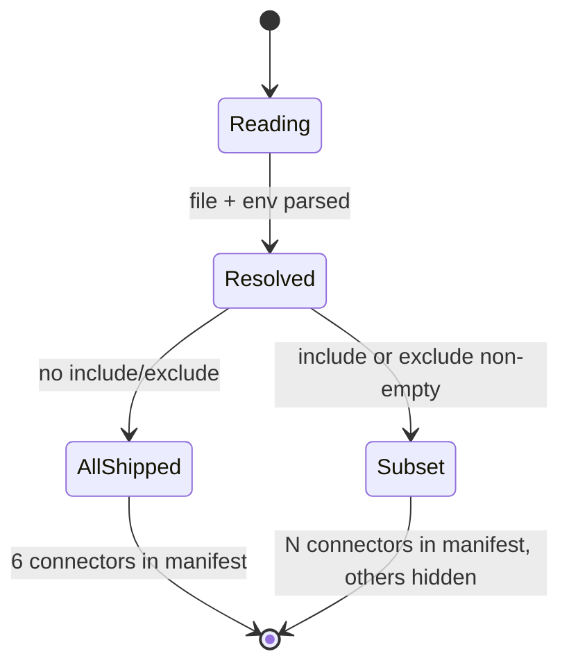

# Modèle de configuration des connecteurs au build

Source de vérité pour sélectionner les connecteurs de plateformes inclus dans un build de production donné de l'extension. Permet à un opérateur d'exclure les connecteurs cassés ou non souhaités (ex. Malt, Collective) au **moment du build du package**, afin que le ZIP produit ne les annonce jamais, ne demande aucune permission pour eux et ne les exécute jamais.

Il s'agit d'une décision au **build-time**, distincte de la configuration **runtime** existante `AppSettings.enabledConnectors` (qui permet à l'utilisateur final d'activer ou désactiver des connecteurs au sein d'un package déjà construit). Le build-time l'emporte : un connecteur absent du build ne peut pas être réactivé au runtime.

Le LLM ne décide jamais d'une transition. L'inclusion au build-time est résolue par une fonction pure à partir d'entrées déterministes (fichier de config + variable d'environnement) avant que Vite ne s'exécute. **Le LLM produit des signaux ; le modèle décide.**

## Pourquoi un modèle

Le catalogue de connecteurs est consommé à quatre endroits indépendants qui doivent rester synchronisés lorsqu'un connecteur est retiré :

1. `manifest.json` `host_permissions` — Chrome refuse les cookies/fetch vers des hôtes non autorisés ; inversement, distribuer des permissions d'hôtes non utilisées constitue un signal d'alerte pour la confidentialité et la revue du Chrome Web Store.
2. `getConnectorsMeta()` (`src/lib/shell/connectors/meta.ts`) — pilote le catalogue UI (FilterBar, ConnectorStatusList, cibles de synchronisation CV).
3. `CONNECTOR_REGISTRY` (`src/lib/shell/connectors/index.ts`) — pilote le scanner et la détection de session.
4. `DEFAULT_SETTINGS.enabledConnectors` (`src/lib/shell/storage/chrome-storage.ts`) — la valeur par défaut au runtime ; si elle référence un connecteur exclu du build, le scanner signale des erreurs fantômes.

Effectuer le filtrage de manière ad-hoc dans chaque consommateur risque d'engendrer des dérives. Ce modèle définit une fonction de résolution unique dont la sortie constitue l'unique source de vérité consommée par les quatre composants.

## Entrées

| Entrée                              | Source                                  | Priorité                                  |
| ----------------------------------- | --------------------------------------- | ----------------------------------------- |
| Catalogue                           | `meta.ts` `ALL_CONNECTOR_IDS`           | Vérité terrain des identifiants connus    |
| Fichier de configuration            | `apps/extension/connectors.config.json` | Par défaut                                |
| Variable d'env `CONNECTORS_INCLUDE` | Environnement de build                  | La plus élevée (l'emporte sur le fichier) |
| Variable d'env `CONNECTORS_EXCLUDE` | Environnement de build                  | La plus élevée (l'emporte sur le fichier) |

Structure de `connectors.config.json` (champs mutuellement exclusifs) :

```json
{ "exclude": ["malt", "collective"] }
```

ou

```json
{ "include": ["free-work", "lehibou", "hiway", "cherry-pick"] }
```

Les variables d'environnement sont des identifiants de connecteurs séparés par des virgules, par ex.
`CONNECTORS_EXCLUDE=malt,collective`.

## Fonction de résolution (pure)

Réside dans `apps/extension/scripts/resolve-connectors.ts` afin de pouvoir s'exécuter dans `vite.config.ts`, `verify-manifest.ts` et `build-extension.sh`. Elle fait partie du programme TypeScript de l'extension (`scripts/**/*.ts` figure dans `tsconfig.json`) et est importée directement par l'outillage de build.

```
resolveIncludedConnectors({ allIds, config, env }) → {
  included: ConnectorId[],     // ordered as in allIds
  excluded: ConnectorId[],     // known IDs that were removed
  warnings: string[],          // unknown IDs in include/exclude lists
  source: 'include-env' | 'exclude-env' | 'include-file' | 'exclude-file' | 'all'
}
```

### Algorithme

1. `includeEnv` = parser la variable d'env `CONNECTORS_INCLUDE` (non vide → ensemble / set).
2. `excludeEnv` = parser la variable d'env `CONNECTORS_EXCLUDE`.
3. `includeFile` / `excludeFile` = idem à partir du fichier JSON de config.
4. **Include l'emporte sur exclude.** Si l'une des sources include n'est pas vide :
   - `candidate = includeEnv ?? includeFile` (l'env l'emporte).
5. Sinon, si l'une des sources exclude n'est pas vide :
   - `candidate = allIds \ (excludeEnv ?? excludeFile)`.
6. Sinon `candidate = allIds`.
7. Intersection de `candidate` avec `allIds`. Tout ID absent de `allIds` → `warnings`.
8. Préserver l'ordre de `allIds` dans `included`.

### Invariants

- `included ∪ excluded === allIds` (égalité d'ensembles).
- `included ∩ excluded === ∅`.
- `warnings` est vide si et seulement si chaque ID fourni en entrée est un ID de connecteur connu.
- La sortie est déterministe pour `(allIds, config, env)`. Pas de `Date.now()`, pas de `Math.random()`, pas d'E/S. Le résolveur est une fonction pure (core FC&IS) ; le seul effet de bord — lire le fichier JSON — s'effectue dans son appelant léger.

## Câblage (build-time, imperative shell)

### `vite.config.ts`

Charge `resolveIncludedConnectors()` une fois au moment de l'évaluation de la configuration et :

1. **Filtre du manifest** — réécrit `manifest.host_permissions` pour ne conserver que les motifs appartenant à un connecteur `included`. L'appartenance est déclarée dans `meta.ts` (`ConnectorMeta.hostPermissions: string[]`). Les motifs appartenant à un connecteur exclu sont supprimés ; les motifs n'appartenant à aucun connecteur (par ex. l'hôte propre de l'extension `missionpulse.app`) sont toujours conservés. Les hôtes d'infrastructure appartenant à un connecteur sont déclarés dans le `hostPermissions` de ce connecteur pour être liés à lui — par ex. l'hôte REST Supabase de Hiway est listé sous Hiway et disparaît lorsque Hiway est exclu.
2. **Define à la compilation** — expose la liste résolue sous forme de `__PULSE_INCLUDED_CONNECTORS__` (littéral de tableau de chaînes) pour le code au runtime.

### Consommation au runtime

Un module accesseur léger `src/lib/shell/connectors/build-config.ts` :

```ts
declare const __PULSE_INCLUDED_CONNECTORS__: ConnectorId[] | undefined;
const FALLBACK: ConnectorId[] = ALL_CONNECTOR_IDS; // dev + test default
export const INCLUDED_CONNECTOR_IDS: ConnectorId[] =
  typeof __PULSE_INCLUDED_CONNECTORS__ === 'undefined' ? FALLBACK : __PULSE_INCLUDED_CONNECTORS__;
```

L'utilisation de `typeof` sur l'identifiant nu est sûre (ne lève pas d'exception sur les variables globales non définies), de sorte que vitest — qui n'applique pas le `define` — bascule vers le catalogue complet au lieu de lever une exception.

Les consommateurs effectuent un filtrage par rapport à `INCLUDED_CONNECTOR_IDS` :

- `meta.ts` `getConnectorsMeta()` → ne renvoie que les connecteurs inclus.
- `index.ts` `getConnectorIds()` → uniquement les connecteurs inclus ; `getConnector(id)` renvoie `null` pour les ID exclus (afin que le scanner signale "Connecteur introuvable" plutôt que de planter).
- `chrome-storage.ts` `DEFAULT_SETTINGS.enabledConnectors` → intersection avec `INCLUDED_CONNECTOR_IDS`.

### Élagage du code (code stripping)

Les imports statiques sont conservés (le service worker ne peut pas utiliser `import()` dynamique). Les classes des connecteurs exclus restent incluses dans le bundle mais ne sont jamais instanciées — ce qui est acceptable pour une extension MV3. Le comportement au runtime et les permissions du manifest constituent les garanties d'exactitude ; le tree-shaking n'est qu'un effort au mieux.

## États (résolution au build)



Il n'y a pas d'état "erreur" : les ID inconnus deviennent des avertissements, le build se poursuit avec le sous-ensemble connu. Un ensemble `included` vide est autorisé (construit un shell sans scan), mais consigne un avertissement.

## Modèle de permissions (moindre privilège)

Pour chaque connecteur `included`, **chaque** entrée de son tableau `hostPermissions` doit figurer dans le `manifest.host_permissions` distribué. Pour chaque connecteur `excluded`, **aucune** de ses entrées ne doit y figurer. `verify-manifest.ts` applique cette vérification sur la sortie du résolveur plutôt que sur une liste codée en dur.

## Plan de test (Vérification)

Résolveur pur (`resolve-connectors.test.ts`) :

- Config vide + pas d'env → tous les ID, `source: 'all'`.
- Fichier `exclude` uniquement → sous-ensemble.
- L'env `CONNECTORS_EXCLUDE` surcharge l'exclusion du fichier.
- Fichier `include` uniquement → ce sous-ensemble uniquement.
- L'env `CONNECTORS_INCLUDE` surcharge l'inclusion du fichier.
- `include` l'emporte sur `exclude` lorsque les deux sont présents (include fichier + exclude env → include l'emporte, l'env filtre-t-il uniquement au sein de include ? — non : la source include l'emporte purement et simplement ; documenté + testé).
- ID inconnus → collectés dans `warnings`, ignorés du résultat.
- L'ordre respecte `allIds`.
- Les invariants sont vérifiés pour chaque cas.

Câblage (`meta` / `build-config`) :

- `getConnectorsMeta()` filtre selon `INCLUDED_CONNECTOR_IDS`.
- `DEFAULT_SETTINGS.enabledConnectors` est un sous-ensemble de `INCLUDED_CONNECTOR_IDS`.
- `getConnector('malt')` renvoie `null` lorsque malt est exclu.

Couverture du manifest (`verify-manifest.test.ts`) :

- La vérification des `host_permissions` des connecteurs itère désormais sur l'ensemble inclus **résolu**, et non sur le catalogue complet — ainsi, exclure `malt` ne fait plus échouer l'assertion sur les host_permissions de Malt.
- Les motifs non liés aux connecteurs (l'hôte propre à l'extension `missionpulse.app`) sont toujours conservés. Les hôtes d'infrastructure appartenant à un connecteur (l'hôte REST Supabase de Hiway) sont déclarés sous leur connecteur propriétaire afin de disparaître avec lui.

## Changement OpenSpec

Cette modification est enregistrée dans `openspec/changes/connector-build-time-config/` (proposition) conformément au workflow piloté par les spécifications du projet.
