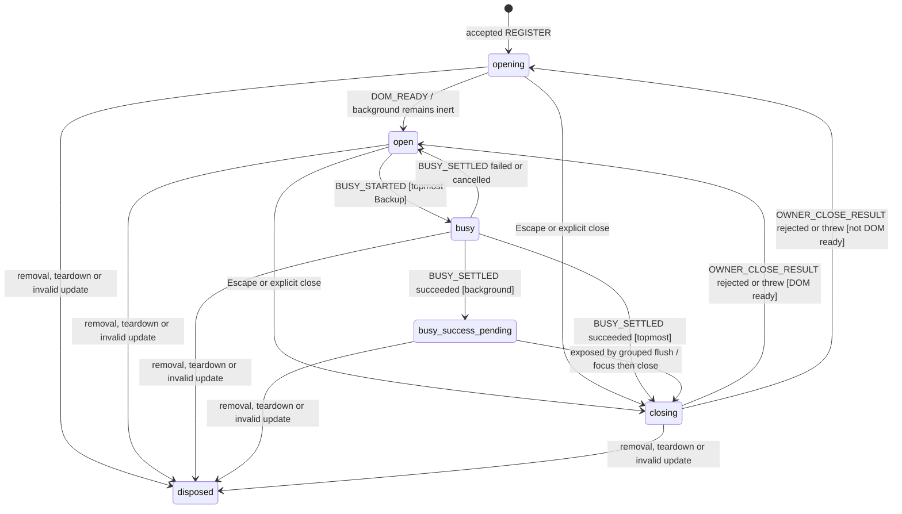
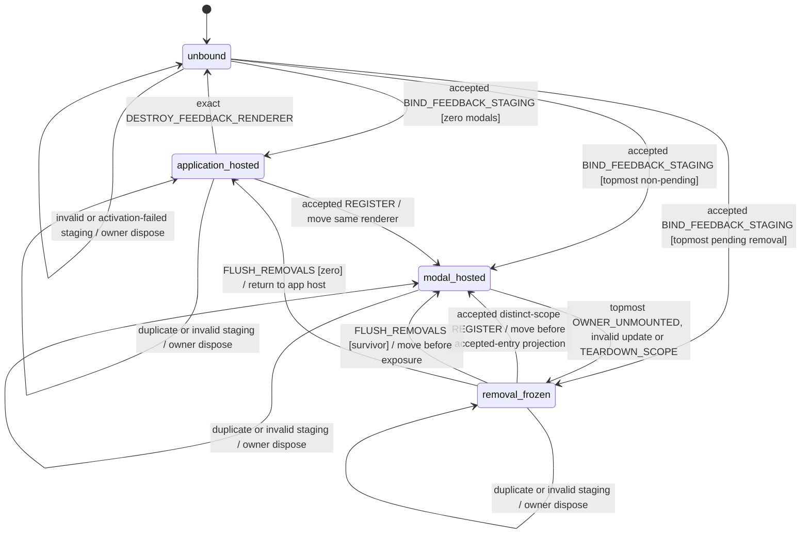

# Modèle de workflow du focus modal (Modal Focus)

Statut : **RÉVISION 4 DU MODÈLE — en attente de revue à froid indépendante ; implémentation interdite jusqu'à approbation**.

Pending behaviour SHA-256: `cc6fb80b6308744b6d7dac59f07ee28de08e20646176c82ad302a2df18ce7a0f`.

Convention de hachage : calculer le SHA-256 sur l'ensemble des octets bruts UTF-8/LF de ce fichier après avoir remplacé uniquement la valeur entre accents graves sur la ligne `Pending behaviour SHA-256` par le littéral `__PENDING_BEHAVIOUR_SHA256__` ; les accents graves environnants, le point et tous les autres octets restent inchangés. Le réviseur doit reproduire cette substitution avant de comparer le digest, de sorte que l'enregistrement du digest ne crée aucun cycle autoréférentiel.

La révision 2 a été rejetée de manière indépendante au hash de comportement UTF-8/LF normalisé `e24dbaa7b8836113eeafe52b7383382c9cb486619710bd59dd2d69b0e40f1a77`.
Sa piste de feedback ne définissait pas de `REGISTER` accepté à portée distincte alors que l'élément supérieur précédent (topmost) était gelé pour suppression (removal-frozen), et elle permettait à un candidat de liaison concurrent d'arriver déjà marqué/en cours de rendu, empêchant le rejet de prouver l'existence d'un unique renderer/région live. La révision 3 a fermé ces deux chemins.

La révision 3 a été rejetée de manière indépendante au hash de comportement UTF-8/LF normalisé `17687b1e1e77e3843aa5f85720da6571e1d605ea700dd2e07ad8272d201cca2e`.
Elle a résolu les deux constats de la révision 2, mais son diagramme d'état envoyait chaque liaison initiale acceptée avec un topmost actif vers `modal_hosted`, y compris un topmost déjà en attente de suppression. La révision 4 rend cet embranchement initial explicite :
topmost en attente de suppression -> `topmost-removal-frozen`/`removal_frozen`, tandis que seul un topmost non en attente -> `modal-hosted`. Tout le reste du comportement de la révision 3 est inchangé. Aucune approbation n'est transférée à cette révision ; aucune implémentation de registre de focus ou de toast n'est autorisée tant qu'un réviseur indépendant n'a pas approuvé ces octets normalisés exacts.

La régression d'origine reste le toast actionnable de suivi créé lorsque `MissionInvestigationDrawer` est au premier plan (topmost) : il restait dans l'hôte applicatif (application host), sous l'overlay du body, et son action **Annuler** ne pouvait pas être atteinte.

Ce modèle fait autorité en matière de focus et d'accessibilité pour chaque surface de MissionPulse affichant `aria-modal="true"` :

- `BackupRestoreModal` ;
- `MissionComparison` ;
- `MissionInvestigationDrawer` ; et
- `KeyboardShortcutsHelp`.

Il possède l'ordre visuel (painted topmost order), la projection inert/ARIA, le focus initial et de récupération, Tab, Escape, le comportement occupé (busy) de Backup, la suppression groupée et le positionnement de l'unique renderer de feedback applicatif. Les mutations métier modales, le cycle de vie des éléments de toast, les minuteurs et la sémantique des actions restent sous la responsabilité de leurs propriétaires. Aucune requête DOM, copie affichée, texte libre, z-index CSS ou sortie LLM ne choisit le topmost, la cible de feedback ou une transition métier ; les faits DOM validés demeurent uniquement des entrées pour les prédicats existants d'enregistrement, de projection et de focus.

## Périmètre et limites

| Couche                  | Responsabilité                                                                                                      |
| ----------------------- | ------------------------------------------------------------------------------------------------------------------- |
| Pure Core               | Validation, éligibilité des cibles, ordre du focus, Tab, transitions d'entrée et de la piste de feedback            |
| Registre par `Document` | Entrées actives, topmost unique, couches, commandes sérialisées, cible de feedback, écouteur et suppression groupée |
| Action Svelte partagée  | Capture complète DOM/config, projection, déplacements de portail, appels de focus et callbacks du propriétaire      |
| Composants              | Surface/variante/portée typées, dialog, déclencheur et intentions métier de fermeture/état occupé (busy)            |
| Propriétaire des toasts | Unique renderer, identité typée d'élément/action, minuteurs, rejet et invocation                                    |

Il y a exactement un registre par `Document` actif, conservé dans une `WeakMap<Document, ModalRegistry>`. Il ne possède aucune persistance, API Chrome, identité crypto, ledger de rejeu, superviseur d'accusé de réception ou protocole de timeout. Le tiroir d'arrivée du Feed est non modal et ne s'enregistre jamais. La piste de feedback est une projection éphémère de placement DOM uniquement : elle ne persiste, ne rejoue, n'interprète ni ne valide de toast, et ne peut pas autoriser de transition métier.

## Construction du registre, sérialisation et capacité

L'amorçage (bootstrap) de l'application crée un registre avec exactement un élément de repli (fallback) :

```ts
declare function createModalRegistry(
  document: Document,
  overlayRoot: HTMLElement,
  documentFallback: HTMLElement
): ModalRegistry;
```

Lors de la construction, `overlayRoot` doit satisfaire au contrat DOM exact ci-dessous. `documentFallback` doit appartenir à `document`, être connecté et satisfaire au prédicat d'éligibilité de récupération au niveau du document. Une construction invalide échoue avant qu'aucune liaison ne puisse s'enregistrer. Les deux nœuds sont ensuite la propriété du registre et sont immuables ; les enregistrements, entrées et mises à jour ne peuvent pas les remplacer. Si le repli devient ultérieurement inéligible, la récupération bascule vers `document.body`.

Le bootstrap de l'application expose un hôte applicatif stable, mais il ne construit **pas** de renderer ni de région live avant l'acceptation. L'action partagée crée d'abord une racine de transit (staging root) neutre, soumet la tentative marquée ci-dessous, et attend l'effet d'acceptation sérialisé. Les composants et producteurs de toasts ne peuvent pas construire ni expédier directement une tentative de staging.

```ts
interface ModalFeedbackHandle {
  readonly ordinal: number;
  // Identité d'objet privée ; constructible uniquement par ce registre.
}

interface ModalFeedbackStagingAttempt {
  readonly attemptIdentity: object;
  readonly applicationHost: HTMLElement;
  readonly stagingRoot: HTMLElement;
  readonly onRejected: (reason: ModalFeedbackRejectionReason) => void;
  // Valeur privée marquée créée et détenue uniquement par l'action partagée.
}

type ModalFeedbackLaneState = 'application-hosted' | 'modal-hosted' | 'topmost-removal-frozen';

type ModalFeedbackTarget =
  | { kind: 'application'; host: HTMLElement }
  | { kind: 'modal'; handle: ModalHandle; dialog: HTMLElement };

interface ModalFeedbackBinding {
  handle: ModalFeedbackHandle;
  applicationHost: HTMLElement;
  renderer: HTMLElement;
  state: ModalFeedbackLaneState;
  target: ModalFeedbackTarget;
  onRejected(reason: ModalFeedbackRejectionReason): void;
}
```

`applicationHost` et `stagingRoot` doivent être des éléments distincts et connectés dans le `Document` du registre ; le staging commence comme un enfant direct de l'hôte et `onRejected` doit être appelable. L'hôte applicatif est en dehors d'`overlayRoot`, en dehors de toute racine/dialog modale et est détenu pendant toute la durée de vie de l'application. La fabrique d'action privée ne génère de tentatives que pour cet unique hôte de bootstrap. Il est initialement non marqué/non live ; après acceptation, des racines de staging neutres en double ultérieures peuvent être ses enfants tant que son marqueur d'hôte accepté subsiste. Une identité d'hôte différente ou un marqueur d'hôte étranger est invalide.

Avant **chaque** tentative, y compris un doublon mis en file d'attente de manière concurrente, la marque privée de l'action partagée prouve ses faits de cycle de vie non liés au DOM et le registre revalide indépendamment sa neutralité DOM observable :

- il ne possède aucun marqueur `data-modal-feedback-host`, `data-modal-feedback-renderer`, `role`, `aria-live`, `aria-atomic` ou `aria-relevant` ;
- il a zéro nœud enfant et aucune collection de toasts montée, renderer Svelte, région live, souscription à un store, minuteur ou callback d'action ;
- son état d'action privé est exactement `staging`, jamais accepté ou rejeté auparavant ; et
- il est disjoint du DOM par rapport à l'overlay, au fallback, à chaque racine/dialog modale, au renderer accepté et à toute autre racine/dialog acceptée appartenant au registre.

Le registre revalide ces faits lorsque la file FIFO réduit effectivement la tentative. Une mutation de staging entre l'enfilage et la réduction est donc rejetée sans jamais devenir un renderer accepté. Étant donné que la file FIFO complète est vidée dans une seule pile d'appels, aucun candidat de staging en file d'attente ne peut s'afficher entre la validation et son acceptation ou la disposition par son propriétaire.

L'ordre de validation de liaison est fixe : marque privée / identité du propriétaire -> structure hôte/staging dans le même Document -> faits complets de staging neutre -> liaison acceptée existante. Ainsi, un candidat muté ou hostile est `INVALID_FEEDBACK_STAGING` même si une autre liaison existe déjà ; un second candidat neutre valide est `DUPLICATE_FEEDBACK_BINDING`. Les deux font l'objet d'une disposition par leur propriétaire avant notification.

Seule la tentative qui **mène à terme** l'acceptation reçoit un état observable et l'autorité DOM. En une seule commande, sans callback ni rendu entre les étapes, le registre/l'action :

1. réserve un handle privé provisoire qu'aucun consommateur ne peut observer ;
2. dérive la cible typée et y déplace la racine de staging encore vide, non marquée et non live ;
3. valide atomiquement la liaison, ajoute `data-modal-feedback-host` uniquement à son hôte applicatif et `data-modal-feedback-renderer` uniquement à sa racine de staging, et active l'unique souscription au store de toasts / renderer de région live ; et
4. autorise uniquement après ce commit réussi l'affichage des éléments de toast existants ou futurs.

La racine de staging devient dès lors le `renderer`. Si une modale existe déjà, l'étape 2 place la racine neutre dans le dialog typé topmost avant le commit d'acceptation, de sorte que même un élément de store existant ne peut pas s'afficher initialement dans l'hôte applicatif externe.

Si le positionnement de staging ou le commit d'activation atomique échoue, la même commande effectue un rollback avant tout affichage : arrêter/détacher toute souscription ou région live partielle, supprimer uniquement les marqueurs provisoires de cette tentative, effacer son handle/sa liaison provisoire, disposer par son propriétaire de sa racine de staging neutralisée, puis notifier `FEEDBACK_ACTIVATION_FAILED`. Du point de vue de tout observateur et de la frontière du reducer, la tentative n'a jamais été marquée, affichée ni acceptée. Le registre retourne à l'état `unbound` ; une nouvelle tentative ultérieure de staging peut réessayer. Aucun chemin d'échec ne laisse de renderer, de région live, de souscription de collection ou de handle accepté derrière lui.

Une deuxième liaison active ou une tentative de staging invalide est rejetée sans altérer l'hôte, le renderer, la souscription, la collection ou la cible acceptés. Avant qu'un callback de rejet utilisateur ne s'exécute, le registre émet un effet exact de disposition par le propriétaire ; l'action partagée supprime de manière synchrone sa propre racine de staging toujours neutre et marque cette tentative comme définitivement `rejected`. Elle ne supprime ni ne démarque jamais l'hôte applicatif partagé/accepté. Le registre appelle ensuite une seule fois le `onRejected` capturé de cette tentative. Un callback qui lève une exception est signalé après la disposition par le propriétaire et ne peut ni remplacer ni détruire la liaison acceptée. Les liaisons réentrantes issues de ce callback ne rejoignent la file FIFO qu'une fois que le staging rejeté n'existe plus.

Le propriétaire des toasts peut restituer zéro ou plusieurs éléments dotés d'une clé au sein de cet unique renderer, mais chaque identité d'élément, callback d'action, minuteur de fermeture et sous-arbre DOM live existe exactement une fois. Le déplacement de la piste utilise le même nœud renderer (ou un portail dont la cible de montage unique préserve cette identité de nœud) ; le clonage, la duplication en miroir, le double affichage et les stores de toasts modaux séparés sont interdits.

Toutes les commandes sont synchrones et non réentrantes par `Document` :

1. ajouter la commande à une file d'attente FIFO interne ;
2. si la réduction est active, retourner après l'enfilage ;
3. sinon, réduire jusqu'à ce que la file FIFO soit vide ; et
4. terminer les effets de projection/focus d'une commande avant de réduire la suivante.

Un callback qui réentre dans le registre met le travail en file d'attente et ne peut pas intercaler sa propre transition.

Le registre accepte au maximum **16 entrées actives**. L'identité d'un handle privé n'est acceptée que par le registre qui l'a créé.

```ts
interface ModalHandle {
  readonly ordinal: number;
  // Identité d'objet privée ; non constructible par un composant.
}

interface ModalRegistryContext {
  readonly document: Document;
  readonly overlayRoot: HTMLElement;
  readonly documentFallback: HTMLElement;
  nextOrdinal: number;
  nextFeedbackOrdinal: number;
  dispatching: boolean;
  entries: readonly ModalEntry[];
  feedbackBinding: ModalFeedbackBinding | null;
  pendingRemovalHandles: ReadonlySet<ModalHandle>;
  pendingTeardownPaths: readonly OwnerScopePath[];
  removalMicrotaskScheduled: boolean;
  keyboardListenerInstalled: boolean;
}
```

La première entrée acceptée installe un écouteur de capture `keydown` sur le document. La transition vers zéro entrée le retire dans la même transaction de suppression sérialisée. Un rejet n'installe jamais un écouteur autrement inutilisé.

## Portées de propriétaire (owner scopes) canoniques

```ts
type OwnerScopePath = readonly string[];
```

`parseOwnerScopePath` accepte un simple tableau de 1 à 16 chaînes de caractères. Chaque segment est tronqué de ses espaces (trimmed) et doit rester non vide, compter au plus 64 unités de code UTF-16, ne contenir aucun caractère `/`, caractère de contrôle ou saut de ligne, et être égal à sa normalisation NFC. Le tableau renvoyé est gelé (frozen).

`TEARDOWN_SCOPE(path)` supprime chaque entrée dont le chemin canonique commence par ce chemin, segment par segment. Ainsi, `['feed', '1']` ne correspond jamais à `['feed', '10']`. Une portée d'enregistrement invalide est rejetée ; une portée modifiée ou invalide lors d'une mise à jour invalide définitivement cette seule liaison.

Lors d'un `TEARDOWN_SCOPE`, le registre gèle immédiatement l'ensemble exact des handles actifs correspondants et projette ces entrées comme inert/hidden dans la même commande FIFO. Le chemin canonique demeure une barrière d'enregistrement jusqu'au `FLUSH_REMOVALS` : toute nouvelle portée débutant par ce chemin est rejetée en tant que `SCOPE_TEARDOWN_PENDING`. Après des vérifications en lecture seule d'identité et de structure, seule une racine candidate démontrée disjointe peut être projetée comme inert/hidden ; les attributs du dialog candidat restent intacts. Un DOM aliasé ou structurellement chevauchant n'est jamais muté. Le flush ne retire que les handles gelés, jamais via un nouveau scan ultérieur.
Ainsi, ni une ancienne correspondance ni un enregistrement réentrant sur la même portée ne peuvent devenir exposés entre le démontage et le flush.

Un enregistrement dont la portée canonique est démontrée disjointe de chaque chemin de démontage en attente n'est pas bloqué au seul motif qu'un autre topmost est gelé. Si ce candidat satisfait aux validations inchangées d'identité, de DOM, de style et de capacité, `REGISTER` l'ajoute après toutes les entrées existantes et il devient immédiatement le topmost typé avant même `FLUSH_REMOVALS`. L'ancien topmost gelé reste inert, masqué et en attente en arrière-plan. Si le feedback est lié, le même enregistrement sérialisé déplace son renderer de ce dialog gelé vers le nouveau dialog **avant** la projection d'accessibilité ou le focus de l'entrée acceptée. Le flush groupé ultérieur ne supprime que son ensemble initial gelé ; étant donné que le nouveau topmost et sa cible subsistent sans changement, ce flush ne déplace ni le feedback ni le focus.

## DOM de l'overlay exact et ordre d'affichage (painted order)

L'unique `overlayRoot` est l'enfant direct de `document.body` marqué `data-modal-surface-root`. Sa mise en page normalisée est fixe et déterministe : `position:fixed`, `inset:0`, `isolation:isolate` et un z-index applicatif fixe. Aucun ancêtre entre le body et l'overlay ne peut introduire de transform, filter, perspective, opacity, containment ou un autre contexte d'empilement (stacking context).

Chaque racine modale candidate doit être un **enfant élément direct** de cet overlay ; toutes les racines acceptées sont donc des frères et sœurs distincts, jamais des ancêtres ou des descendants les unes des autres. Son dialog est un descendant direct de sa propre racine et d'aucune autre racine acceptée. Aucun wrapper ne peut exister entre l'overlay et la racine.

Le registre normalise chaque racine avec `position:absolute`, `inset:0` et un z-index inline `z-index = MODAL_LAYER_BASE + stackIndex`. Hormis ce contexte d'empilement requis par le z-index positionné, une racine ne peut en créer un autre via transform, filter, perspective, opacité inférieure à 1, `mix-blend-mode`, `isolation`, containment de peinture ou `will-change`. La validation des styles calculés échoue de manière étanche (fails closed) à la moindre infraction. Le style des descendants du dialog ne peut pas participer à l'ordre des éléments frères.

Chaque enregistrement accepté est ajouté à la pile d'ouverture. Le registre compacte les valeurs de `stackIndex` actives sur `0..n-1` ; le positionnement inline et le z-index sont reprojetés de façon synchrone après un enregistrement ou une suppression.

```ts
interface RegistryLayer {
  stackIndex: number;
  projectedZIndex: number;
}
```

Après enregistrement ou suppression groupée, toutes les couches sont projetées avant la gestion inert/ARIA ou le focus. Le dernier survivant accepté possède la plus grande couche réellement affichée et constitue l'unique topmost pour ARIA, Tab et Escape. Un topmost fourni par l'appelant, un z-index calculé et l'ordre du DOM sont interdits en tant qu'entrées d'ordonnancement.

Le renderer de feedback ne reçoit jamais d'overlay fixe/body indépendant ni de z-index destiné à recouvrir `overlayRoot`. Tant qu'au moins une modale acceptée existe, sa cible est un descendant propre du `dialog` sélectionné comme topmost par le registre, de sorte qu'il participe au contexte d'empilement contrôlé de cette racine modale. Avec zéro modale acceptée, sa cible est exactement `applicationHost`. La visibilité affichée est donc dérivée du même ordre de pile typé qu'ARIA, Tab et Escape, et jamais de la comparaison de styles calculés ou de la recherche d'un dialog visible dans le DOM.

## État des entrées et configuration complète

```ts
type ModalSurface =
  'backup_restore' | 'mission_comparison' | 'mission_investigation' | 'keyboard_shortcuts_help';

type InitialFocusVariant =
  | 'backup_valid'
  | 'backup_error'
  | 'backup_validation_pending'
  | 'comparison'
  | 'investigation'
  | 'shortcuts_help';

type ModalEntryState =
  'opening' | 'open' | 'busy' | 'busy-success-pending' | 'closing' | 'disposed';

type ModalCloseReason = 'explicit' | 'escape' | 'business_success';
type ModalRejectionReason =
  | 'INVALID_CONFIG'
  | 'INVALID_SCOPE'
  | 'INVALID_STACKING_CONTEXT'
  | 'CAPACITY_EXHAUSTED'
  | 'SCOPE_TEARDOWN_PENDING'
  | 'DUPLICATE_ROOT'
  | 'DUPLICATE_DIALOG'
  | 'INVALID_UPDATE';

type ModalFeedbackRejectionReason =
  'INVALID_FEEDBACK_STAGING' | 'DUPLICATE_FEEDBACK_BINDING' | 'FEEDBACK_ACTIVATION_FAILED';

interface ModalCallbacks {
  onBeforeClose(reason: ModalCloseReason): unknown;
  onRejected(reason: ModalRejectionReason): void;
}

interface ModalRegistrationConfig extends ModalCallbacks {
  document: Document;
  root: HTMLElement;
  dialog: HTMLElement;
  trigger: HTMLElement | null;
  surface: ModalSurface;
  variant: InitialFocusVariant;
  ownerScopePath: OwnerScopePath;
}

interface ModalUpdate {
  config: ModalRegistrationConfig;
}

interface ModalEntry {
  handle: ModalHandle;
  surface: ModalSurface;
  variant: InitialFocusVariant;
  ownerScopePath: OwnerScopePath;
  root: HTMLElement;
  dialog: HTMLElement;
  trigger: HTMLElement | null;
  layer: RegistryLayer;
  state: ModalEntryState;
  domReady: boolean;
  closeCycle: number;
  pendingClose: {
    cycle: number;
    reason: ModalCloseReason;
    returnState: 'opening' | 'open';
  } | null;
  acceptedClose: { cycle: number; reason: ModalCloseReason } | null;
  busyOperation: object | null;
  callbacks: ModalCallbacks;
  rejectionNotified: boolean;
}
```

L'action recapture et normalise la configuration **complète** lors de chaque mise à jour Svelte. Cela rend chaque changement d'identité et de politique observable. Le registre autorise uniquement :

- une variante valide appartenant à la surface inchangée ; et
- des callbacks de remplacement valides.

Il revalide la connectivité de la racine et le contexte d'empilement contrôlé. Un changement de `Document`, de racine, de dialog, de déclencheur (trigger), de surface ou de portée canonique, une surface/variante/callback invalide, ou une racine quittant le contexte contrôlé constitue un `INVALID_UPDATE`. L'ancienne entrée acceptée est projetée inert et mise en file d'attente pour une suppression groupée définitive. Le registre ne mute jamais une racine ou un dialog nouvellement fourni qui appartiendrait à une autre entrée acceptée. La notification d'une mise à jour invalide utilise le dernier callback `onRejected` accepté ; une tentative de remplacement n'est installée qu'après la validation de l'intégralité de la mise à jour.

## Enregistrement unique de la racine et du dialog

Parmi les entrées actives acceptées, l'identité de la `root` et l'identité du `dialog` sont chacune uniques. La validation d'enregistrement suit un ordre fixe : type/portée normalisés et relation de surface ; identité en lecture seule de racine/dialog en double ; portée de démontage en attente ; même document de registre et contrat exact overlay/root/dialog ; style calculé de la racine ; capacité.

La commande synchrone `REGISTER` effectue d'abord des vérifications en lecture seule d'identité de racine/dialog et la vérification structurelle d'élément frère direct. C'est seulement après que ces vérifications ont prouvé qu'une racine candidate est distincte et disjointe dans le DOM de chaque racine/dialog acceptée que le registre peut projeter cette racine comme `inert`, `aria-hidden=true` et non focalisable. Aucun attribut du dialog candidat n'est écrit pendant la pré-validation. Comme la commande ne cède pas l'exécution ni n'effectue de rendu, une nouvelle racine ne peut pas devenir observable avant cette projection sécurisée de la racine.

La détection de doublon intervient avant toute mutation du DOM :

- `DUPLICATE_ROOT` est prioritaire lorsque les deux identités entrent en collision ;
- pour l'un ou l'autre motif de doublon, l'action rejetée libère uniquement sa tentative de liaison et invoque son propre `onRejected` une seule fois ;
- elle ne modifie jamais une racine aliasée ni aucun dialog candidat. Après les vérifications en lecture seule, une racine candidate distincte et frère direct peut être rendue inert/masquée ; aucun autre nœud candidat, couche ou focus n'est modifié.

Par conséquent, `DUPLICATE_DIALOG` avec une racine distincte laisse le dialog aliasé intact tandis que la racine candidate prouvée disjointe est rendue de façon synchrone inert, masquée et non focalisable. Une racine en double, la collision des deux identités ou toute racine non prouvée disjointe ne produit aucune mutation DOM.

Ce n'est qu'après que l'enregistrement a satisfait à la validation d'identité, de portée, de document, d'overlay, de style calculé et de capacité que la projection de l'entrée acceptée définit les attributs `aria-hidden` et `aria-modal` du dialog. Aucun chemin de pré-validation ne peut ainsi muter un dialog déjà détenu par une autre entrée.

Pour tout autre rejet dont la racine candidate est prouvée disjointe, le registre projette uniquement cette racine comme inert, masquée et non focalisable, laisse le dialog candidat intact, libère la liaison et appelle `onRejected` une fois. Un callback de rejet qui lève une exception est signalé après le nettoyage et ne peut pas réactiver la liaison. Aucun rejet ne laisse d'entrée de registre ou d'écouteur obsolète. Les attributs ARIA du dialog ne sont écrits que par la projection d'une entrée acceptée.

## Événements et effets

```ts
type ModalRegistryEvent =
  | { type: 'BIND_FEEDBACK_STAGING'; attempt: ModalFeedbackStagingAttempt }
  | { type: 'DESTROY_FEEDBACK_RENDERER'; handle: ModalFeedbackHandle }
  | { type: 'REGISTER'; config: ModalRegistrationConfig }
  | { type: 'DOM_READY'; handle: ModalHandle; facts: InitialFocusFacts }
  | { type: 'UPDATE'; handle: ModalHandle; update: ModalUpdate }
  | { type: 'TAB'; backwards: boolean; facts: TabDomFacts }
  | { type: 'ESCAPE' }
  | { type: 'EXPLICIT_CLOSE'; handle: ModalHandle }
  | {
      type: 'OWNER_CLOSE_RESULT';
      handle: ModalHandle;
      closeCycle: number;
      disposition: 'accepted' | 'rejected' | 'threw';
    }
  | { type: 'BUSY_STARTED'; handle: ModalHandle; operation: object }
  | {
      type: 'BUSY_SETTLED';
      handle: ModalHandle;
      operation: object;
      outcome: 'succeeded' | 'failed' | 'cancelled';
    }
  | { type: 'OWNER_UNMOUNTED'; handle: ModalHandle }
  | { type: 'TEARDOWN_SCOPE'; ownerScopePath: OwnerScopePath }
  | { type: 'FLUSH_REMOVALS' }
  | { type: 'FOCUS_TARGET_INVALIDATED'; handle: ModalHandle };

type ModalFocusEffect =
  | {
      type: 'project-entry';
      handle: ModalHandle;
      layer: RegistryLayer;
      inert: boolean;
      ariaHidden: boolean;
      ariaModal: boolean;
    }
  | {
      type: 'place-feedback-staging';
      attempt: ModalFeedbackStagingAttempt;
      feedbackHandle: ModalFeedbackHandle;
      target: ModalFeedbackTarget;
    }
  | {
      type: 'place-feedback-renderer';
      feedbackHandle: ModalFeedbackHandle;
      renderer: HTMLElement;
      target: ModalFeedbackTarget;
    }
  | {
      type: 'commit-feedback-renderer';
      feedbackHandle: ModalFeedbackHandle;
      renderer: HTMLElement;
      applicationHost: HTMLElement;
    }
  | {
      type: 'rollback-feedback-activation';
      attempt: ModalFeedbackStagingAttempt;
      feedbackHandle: ModalFeedbackHandle;
    }
  | {
      type: 'dispose-feedback-staging';
      attempt: ModalFeedbackStagingAttempt;
      outcome: 'rejected' | 'activation_failed';
    }
  | {
      type: 'deactivate-feedback-renderer';
      feedbackHandle: ModalFeedbackHandle;
      renderer: HTMLElement;
      applicationHost: HTMLElement;
    }
  | { type: 'focus-target'; target: HTMLElement }
  | { type: 'prevent-key-default' }
  | {
      type: 'invoke-owner-before-close';
      handle: ModalHandle;
      closeCycle: number;
      reason: ModalCloseReason;
    }
  | { type: 'notify-rejection'; handle: ModalHandle | null; reason: ModalRejectionReason }
  | { type: 'install-document-keyboard-listener' }
  | { type: 'remove-document-keyboard-listener' }
  | {
      type: 'notify-feedback-rejection';
      reason: ModalFeedbackRejectionReason;
      callback: (reason: ModalFeedbackRejectionReason) => void;
    }
  | { type: 'report-feedback-placement-error'; reason: string }
  | { type: 'report-focus-error'; reason: string }
  | {
      type: 'report-owner-close-error';
      handle: ModalHandle;
      closeCycle: number;
      reason: 'THREW' | 'INVALID_RETURN';
    };
```

L'effet appelle le `onBeforeClose` capturé exactement une fois et de manière synchrone. Seuls les résultats d'égalité stricte primitive `'accepted'` et `'rejected'` sont valides. `undefined`, `null`, les booléens, nombres, objets, chaînes emballées (boxed strings), fonctions, Promises et thenables mettent en file d'attente de façon déterministe `'rejected'` ; ils ne sont jamais attendus (awaited) et aucune suite n'y est attachée. Une exception met en file d'attente `'threw'`. Les retours invalides sont signalés mais récupérés via la transition rejetée ordinaire. Le callback ne modifie jamais directement l'état. Une discordance de handle, une modale ou un handle de feedback libéré, une disponibilité en double, un cycle de fermeture obsolète, une opération occupée (busy) obsolète et une frappe clavier sans topmost actif sont de stricts no-ops.

## Disponibilité (readiness) et projection

Chaque enregistrement accepté commence à l'état `opening`. `DOM_READY` pour son dialog exact le fait toujours passer à `open`, qu'il soit au premier plan ou en arrière-plan :

- si topmost unique, la projection le rend interactif et le focus initial s'exécute ;
- si en arrière-plan, la projection reste inert/hidden et aucun focus ne bouge ;
- lorsque cette entrée en arrière-plan est ultérieurement exposée, le focus de récupération s'exécute selon sa configuration complète actuelle.

Ainsi, la disponibilité n'abandonne jamais une entrée d'arrière-plan dans `opening`.

La projection des couches et de l'accessibilité est recalculée de manière atomique pour toutes les entrées actives après un enregistrement, un état prêt, une transition de cycle de vie ou une suppression groupée.

| Position / état de l'entrée                                               | Projection                                                             |
| ------------------------------------------------------------------------- | ---------------------------------------------------------------------- |
| Topmost unique, DOM ready, `open`/`busy`/`busy-success-pending`/`closing` | `inert=false`, `aria-hidden=false`, `aria-modal=true`                  |
| Topmost mais pas DOM ready                                                | `inert=true`, `aria-hidden=true`, `aria-modal=false` ; Tab est empêché |
| Toute entrée d'arrière-plan                                               | `inert=true`, `aria-hidden=true`, `aria-modal=false`                   |
| Suppression groupée en attente ou libérée                                 | `inert=true`, `aria-hidden=true`, `aria-modal=false`                   |

Si le topmost est en attente de suppression groupée, aucun survivant ne devient interactif avant `FLUSH_REMOVALS` ; Tab et Escape sont empêchés pendant cet intervalle. Ce guard prend fin immédiatement si un `REGISTER` valide à portée distincte ajoute un nouveau topmost typé non en attente : le positionnement du feedback précède ses règles ordinaires de projection non-prêt/prêt et de focus. L'ancienne entrée gelée reste masquée en arrière-plan jusqu'au flush d'origine.

## Piste de positionnement du feedback modal

La piste est une région de projection parallèle et éphémère du même registre sérialisé. Son état pur est `unbound` lorsque `feedbackBinding` est null ; sinon, c'est l'état `application-hosted`, `modal-hosted` ou `topmost-removal-frozen` de la liaison. Elle ne contient jamais le texte du toast, sa sévérité, son payload métier, ses callbacks d'action, ses délais ou une décision d'Undo.

La fonction de détermination de cible est totale et utilise uniquement l'état du registre :

```ts
declare function deriveModalFeedbackTarget(
  entries: readonly ModalEntry[],
  pendingRemovalHandles: ReadonlySet<ModalHandle>,
  applicationHost: HTMLElement
): { state: ModalFeedbackLaneState; target: ModalFeedbackTarget };
```

1. zéro entrée acceptée -> `application-hosted` au niveau de l'hôte applicatif immuable ;
2. un topmost unique non en attente de suppression -> `modal-hosted` au niveau du dialog de cette entrée exacte, indépendamment de `opening`, `open`, `busy`, succès en attente ou `closing` ;
3. un topmost en attente de suppression -> `topmost-removal-frozen` au niveau de ce dialog exact jusqu'à ce que le flush groupé choisisse un unique survivant final.

« Topmost » désigne toujours ici la dernière entrée courante acceptée. L'appartenance d'une entrée plus ancienne en arrière-plan à la suppression en attente ne gèle pas un topmost ultérieur accepté à portée disjointe et ne peut pas retarder le déplacement du feedback vers lui.

Aucun sélecteur, élément actif, attribut `aria-modal`, message affiché, libellé d'action, opacité ou z-index n'est pris en compte en entrée. Le renderer est déplacé de manière anticipée dès que la cible de la pile typée change, y compris lorsqu'il ne contient aucun élément à cet instant. Par conséquent, un toast avec une action typée non nulle ajouté alors qu'une modale est topmost s'affiche d'abord à l'intérieur de ce dialog. La même règle anticipée y place également les feedbacks non actionnables car scinder une collection dans un second renderer est interdit.

| État / événement de piste                                                  | Guard                                                          | Suivant / effet                                                                                                                                                                   |
| -------------------------------------------------------------------------- | -------------------------------------------------------------- | --------------------------------------------------------------------------------------------------------------------------------------------------------------------------------- |
| unbound + `BIND_FEEDBACK_STAGING`                                          | staging neutre/valide ; zéro entrée                            | réserver le handle ; garder/déplacer le staging neutre à l'hôte applicatif ; commit atomique de la liaison `application-hosted` et d'un unique renderer/région live               |
| unbound + `BIND_FEEDBACK_STAGING`                                          | staging neutre/valide ; topmost non en attente de suppression  | réserver le handle ; déplacer le staging neutre dans le dialog exact du topmost ; commit atomique de la liaison `modal-hosted` et d'un unique renderer/région live                |
| unbound + `BIND_FEEDBACK_STAGING`                                          | staging neutre/valide ; topmost en attente de suppression      | réserver le handle ; déplacer le staging neutre dans ce dialog inert/masqué ; commit atomique de la liaison `topmost-removal-frozen` et d'un unique renderer/région live          |
| bound + `BIND_FEEDBACK_STAGING`                                            | candidat concurrent marqué neutre valide                       | préserver la liaison acceptée ; libération par le propriétaire du staging neutre ; puis notifier `DUPLICATE_FEEDBACK_BINDING`                                                     |
| tout état + `BIND_FEEDBACK_STAGING` invalide                               | échec de vérification de marque/identité/document/neutralité   | préserver toute liaison acceptée ; libération par le propriétaire du candidat ; puis notifier `INVALID_FEEDBACK_STAGING` ; aucune mutation DOM acceptée                           |
| unbound + échec d'acceptation provisoire du staging                        | échec de positionnement ou de commit atomique                  | rollback inverse avant affichage ; libération par le propriétaire du staging ; notifier `FEEDBACK_ACTIVATION_FAILED` ; rester `unbound`                                           |
| `application-hosted` + `REGISTER` accepté                                  | la nouvelle entrée devient le topmost de la pile               | déplacer le renderer dans le nouveau dialog après acceptation sécurisée de la racine et avant que toute entrée ne devienne interactive                                            |
| `modal-hosted` + `REGISTER` accepté                                        | la nouvelle entrée devient le topmost de la pile               | déplacer le même renderer de l'ancien dialog vers le nouveau dialog avant la projection/focus de disponibilité                                                                    |
| `topmost-removal-frozen` + `REGISTER` accepté                              | le candidat est accepté et disjoint des barrières de démontage | déplacer le renderer immédiatement du dialog gelé vers le nouveau dialog typé topmost avant la projection d'accessibilité/focus de l'entrée acceptée ; entrer dans `modal-hosted` |
| tout état lié + `REGISTER` rejeté ou changement uniquement en arrière-plan | topmost typé inchangé                                          | strict no-op                                                                                                                                                                      |
| `modal-hosted` + transition de fermeture/état occupé/disponibilité         | même topmost actif                                             | rester dans le même dialog ; aucun redémarrage du cycle de vie du renderer ou des éléments                                                                                        |
| `modal-hosted` + topmost gelé pour suppression                             | le handle cible exact est gelé                                 | entrer dans `topmost-removal-frozen` ; conserver le renderer dans ce dialog désormais inert/masqué ; n'exposer aucune modale ou page sous-jacente                                 |
| `topmost-removal-frozen` + `FLUSH_REMOVALS`                                | un survivant final existe                                      | déplacer le renderer dans le dialog du survivant final avant la projection d'accessibilité du survivant et l'unique décision existante de focus de récupération                   |
| `topmost-removal-frozen` + `FLUSH_REMOVALS`                                | aucun survivant                                                | replacer le renderer dans l'hôte applicatif exact avant le retrait de l'écouteur et l'unique décision existante de focus de récupération                                          |
| `modal-hosted` + suppression groupée en arrière-plan uniquement            | le handle cible survit et reste topmost                        | aucun déplacement et aucun effet de focus                                                                                                                                         |
| `application-hosted` + `DESTROY_FEEDBACK_RENDERER`                         | handle de feedback privé exact ; zéro entrée                   | effacer définitivement les références de liaison ; le démontage de l'action possède le retrait de l'unique renderer et de tous les minuteurs/écouteurs de toast                   |
| `modal-hosted`/`topmost-removal-frozen` + `DESTROY_FEEDBACK_RENDERER`      | handle exact ; une ou plusieurs entrées subsistent             | signaler une erreur d'ordre de démontage ; préserver la liaison et le renderer jusqu'au flush de suppression des modales                                                          |
| état lié + `DESTROY_FEEDBACK_RENDERER` obsolète/étranger                   | discordance de handle                                          | strict no-op                                                                                                                                                                      |

La destruction du composant/action modale est représentée uniquement par l'`OWNER_UNMOUNTED` existant suivi de `FLUSH_REMOVALS` ; elle ne peut pas ajouter directement le renderer à `body` ou à l'hôte applicatif. La destruction de la liaison de feedback est l'événement final de démontage de l'App après que les actions modales ont expédié et nettoyé leurs propres événements de destruction. Re-lier après un fonctionnement normal à zéro modale est inutile. Après un véritable remontage de l'App, le registre par Document (nouveau ou réutilisé uniquement après la destruction exacte préalable) accepte un nouveau renderer et rejette tout handle de feedback obsolète.

La destruction exacte à zéro entrée arrête d'abord la souscription/région live acceptée, supprime son marqueur et nœud renderer, retire le marqueur d'hôte, puis efface la liaison et le handle. Elle ne reconvertit jamais cet ancien renderer en une tentative de staging réutilisable.

Le positionnement fait partie intégrante et synchrone de la commande du registre et utilise les identités d'éléments déjà validées. Pour un enregistrement accepté, l'ordre est : neutralisation sécurisée du candidat (inerting) -> acceptation de l'entrée / calcul de la couche -> déplacement du renderer -> projection ARIA/interactivité -> focus. Pour une suppression groupée, il s'agit de l'ordre exact indiqué ci-dessous. Il n'y a aucun affichage ni callback entre ces étapes. Une cible auparavant dans `topmost-removal-frozen` est donc recalculée immédiatement après l'ajout de l'entrée à portée disjointe et n'attend jamais le flush de suppression plus ancien. Une cible qui a changé inopinément de document, s'est déconnectée ou a cessé d'être le dialog accepté est traitée par le chemin terminal existant de mise à jour/suppression invalide ; une invalidation de renderer/hôte constitue une erreur de démontage de liaison de feedback et est signalée sans créer de renderer de remplacement. Les actions prises en charge doivent expédier leur commande typée de mise à jour/destruction avant de supprimer le DOM leur appartenant.

La piste n'émet aucun effet de focus propre. Lorsqu'il est hébergé dans une modale (modal-hosted), chaque bouton de toast actuellement interactif est un descendant propre de l'unique dialog topmost, doit satisfaire `isDialogTargetEligible(..., true)`, et participe à la même séquence `orderedFocusable` capturée que les autres contrôles. Les priorités de focus initial restent inchangées. Si un contrôle de toast focalisé est fermé, son intégration renderer expédie l'événement existant `FOCUS_TARGET_INVALIDATED` pour le handle topmost exact actuel ; la récupération utilise ensuite la politique existante. Un déplacement de portail lors d'un enregistrement ou d'une suppression ne peut pas ajouter une seconde décision de focus ni supplanter la récupération du déclencheur causal.

Le renderer conserve un unique sous-arbre de région live. Le changement de parent préserve chaque clé de toast, identité d'élément, callback d'action, minuteur et échéance de fermeture ; il n'invoque, ne ferme, ne recrée ni ne prolonge aucun élément. Un clic sur une action de toast émet l'intention d'action typée du propriétaire du toast exactement une fois. Seul ce propriétaire/modèle peut décider de la transition correspondante de suivi ou d'Undo. La généalogie DOM, le libellé **Annuler**, le texte du message, la présence du toast et l'état du focus ne sont jamais des guards métier.

## Prédicats distincts d'éligibilité DOM

Le focus initial et Tab utilisent le confinement au dialog :

```ts
declare function isDialogTargetEligible(
  node: HTMLElement | null,
  dialog: HTMLElement,
  requireTabStop: boolean
): boolean;
```

Le prédicat exige que le nœud et le dialog soient connectés au même `Document`, que le nœud soit contenu dans ce dialog, que le nœud soit activé (enabled), et que ni le nœud ni aucun ancêtre jusqu'au dialog ne soit masqué, `aria-hidden=true`, inert, `display:none` ou `visibility:hidden`.
`requireTabStop` exige en outre `tabIndex >= 0`. Le conteneur du dialog est le repli programmatique final et peut utiliser `tabIndex=-1`.

La récupération d'un déclencheur causal utilise un prédicat différent :

```ts
declare function isRecoveryTriggerEligible(
  node: HTMLElement | null,
  document: Document,
  survivingDialog: HTMLElement | null
): boolean;
```

Il exige la connectivité au même document, l'état activé (enabled) et aucun ancêtre masqué/inert. Si un survivant existe, le déclencheur **doit** être contenu dans le dialog survivant. S'il n'y a aucun survivant, tout déclencheur éligible dans le même document peut restaurer le focus. Il n'exige jamais le confinement dans le dialog supprimé.

Le repli du registre utilise l'éligibilité au niveau du document : même document, connecté, activé et aucun ancêtre masqué/inert, sans exigence de confinement dans un dialog. Ces trois prédicats ne sont pas interchangeables.

## Focus initial et de récupération exacts

```ts
interface InitialFocusFacts {
  dialog: HTMLElement;
  confirmationInput: HTMLElement | null;
  closeButton: HTMLElement | null;
  cancelButton: HTMLElement | null;
  firstEnabledButton: HTMLElement | null;
  firstMissionLink: HTMLElement | null;
  firstEnabledAction: HTMLElement | null;
  acknowledgementButton: HTMLElement | null;
}
```

| Variante                    | Ordre éligible exact                               |
| --------------------------- | -------------------------------------------------- |
| `backup_valid`              | confirmation input → first enabled button → dialog |
| `backup_error`              | close button → dialog                              |
| `backup_validation_pending` | cancel button → dialog                             |
| `comparison`                | close button → first mission link → dialog         |
| `investigation`             | close button → first enabled action → dialog       |
| `shortcuts_help`            | close button → acknowledgement button → dialog     |

Seules les variantes `backup_*` appartiennent à Backup ; chaque autre variante appartient exactement à sa surface nommée.

Après suppression groupée, la projection finale du topmost précède une unique décision de récupération :

1. déclencheur causal de fermeture normale, selon le prédicat de récupération ;
2. politique initiale actuelle du topmost survivant prêt côté DOM ;
3. conteneur dialog survivant ;
4. `documentFallback` unique détenu par le registre, s'il est toujours éligible au niveau du document ;
5. `document.body`, rendu temporairement focalisable par programmation si nécessaire.

Un démontage de propriétaire sans fermeture acceptée et un démontage de portée ne peuvent prétendre à l'étape 1 et commencent à l'étape 2. S'il n'y a aucun survivant, les étapes 2 et 3 sont ignorées. Si un nœud sélectionné disparaît, `FOCUS_TARGET_INVALIDATED` effectue une nouvelle capture synchrone et reprend au repli éligible suivant.

## Tab et Escape

```ts
interface TabDomFacts {
  activeElement: Element | null;
  orderedFocusable: readonly HTMLElement[];
  dialog: HTMLElement;
}
```

Le registre accepte les faits Tab uniquement pour l'unique dialog topmost exact et filtre chaque candidat via `isDialogTargetEligible(..., true)`.

| Condition                                                   | Décision Tab                                            |
| ----------------------------------------------------------- | ------------------------------------------------------- |
| Suppression en attente ou topmost non prêt côté DOM         | Empêcher ; ne pas s'échapper vers le contenu de la page |
| Aucun élément focalisable éligible                          | Empêcher et focaliser le conteneur du dialog            |
| Élément actif hors de l'ordre, avant/arrière                | Empêcher et focaliser le premier/dernier                |
| Vers l'avant sur le dernier / vers l'arrière sur le premier | Empêcher et boucler vers le premier/dernier             |
| Un seul élément éligible                                    | Empêcher et focaliser cet élément                       |
| Élément intermédiaire                                       | Autoriser le déplacement natif                          |

Seul le topmost unique reçoit Escape. `busy`, `busy-success-pending` et `closing` le consomment sans déclencher une autre fermeture. `open` ou `opening` initie une requête de fermeture corrélée ; l'arrière-plan ne reçoit aucun événement clavier.

## Résultat de fermeture corrélé du propriétaire

Initier une fermeture incrémente `closeCycle`, consigne `pendingClose`, entre dans `closing` et émet un `invoke-owner-before-close`. Aucune seconde fermeture ne commence tant que ce cycle est en attente ou accepté.

| Disposition exacte de `OWNER_CLOSE_RESULT` | Résultat                                                                                              |
| ------------------------------------------ | ----------------------------------------------------------------------------------------------------- |
| `accepted`                                 | Effacer pending ; consigner `acceptedClose` ; rester `closing` jusqu'au démontage par le propriétaire |
| `rejected`                                 | Effacer la fermeture en attente/acceptée ; retourner à `open` si prêt côté DOM, sinon `opening`       |
| `threw`                                    | Même récupération d'état que rejected, et signaler en plus l'erreur du propriétaire                   |

Pour `business_success`, les requêtes immédiates et différées proviennent toutes deux d'une entrée prête côté DOM, de sorte qu'un rejet ou une exception renvoie **exactement `open`**. Le résultat occupé réussi est consommé lorsque la requête de fermeture commence : `busyOperation` et l'état de succès différé sont effacés. Le retour à open ne peut pas demander automatiquement à nouveau une fermeture métier ; seule une nouvelle opération occupée et un nouveau succès peuvent le faire.

`DOM_READY` reçu alors qu'un callback de fermeture est en attente consigne l'état prêt sans déplacer le focus ; un rejet ultérieur renvoie donc open. Un résultat de fermeture obsolète, en double ou croisé est un strict no-op.

## Transitions d'état occupé (busy) de Backup

Seul Backup ouvert au premier plan accepte `BUSY_STARTED`, stockant l'opération par identité d'objet.

| État                                                        | Règlement correspondant | Résultat                                                                                                 |
| ----------------------------------------------------------- | ----------------------- | -------------------------------------------------------------------------------------------------------- |
| `busy`                                                      | failed/cancelled        | Effacer l'opération ; retourner à `open`                                                                 |
| `busy`, toujours topmost                                    | succeeded               | Consommer le succès et initier une fermeture corrélée immédiate `business_success`                       |
| `busy`, désormais en arrière-plan                           | succeeded               | Effacer l'opération ; entrer dans `busy-success-pending`                                                 |
| `busy-success-pending`, exposé ultérieurement comme topmost | flush groupé            | Projeter/focaliser le survivant, consommer le succès en attente, initier une fermeture corrélée différée |

Les événements occupés hors Backup, les identités d'opérations croisées et les règlements en double sont des no-ops. Tab reste piégé pendant l'état busy ; Escape n'annule jamais le travail.

## Suppression groupée et démontage de portée (scope teardown)

`OWNER_UNMOUNTED` et une mise à jour invalide terminale gèlent immédiatement leurs handles exacts. `TEARDOWN_SCOPE` gèle immédiatement toutes les correspondances canoniques actuelles et installe sa barrière de chemin. Chaque entrée gelée est projetée inert/hidden avant le retour de la commande ; aucune entrée sous-jacente n'est exposée. Le premier événement planifie une microtâche et les événements de suppression ultérieurs dans la même tâche réunissent davantage de handles gelés.

`FLUSH_REMOVALS` est une transaction sérialisée :

1. consommer l'ensemble de handles exacts déjà gelés ; ne pas rescanner les chemins de portée ;
2. capturer le topmost visuel précédant la suppression et sa cause de fermeture normale acceptée ;
3. projeter chaque entrée acceptée affectée comme inert/hidden ;
4. supprimer l'ensemble complet d'entrées logiques sans projection/focus intermédiaire ;
5. compacter les couches des survivants finaux et dériver l'unique cible typée finale de feedback ;
6. si liée et que l'identité de cible a changé, déplacer le même renderer de feedback dans le dialog du survivant final ou, en l'absence de survivant, le replacer dans l'hôte applicatif immuable ; une cible exacte inchangée est un no-op ;
7. projeter les couches et l'accessibilité des survivants finaux ;
8. prendre une unique décision de focus de récupération à l'aide des prédicats distincts ;
9. si le topmost final est `busy-success-pending`, commencer sa fermeture différée uniquement après le positionnement du feedback, la projection et le focus ; et
10. retirer l'écouteur clavier si le nombre d'entrées actives devient nul.

La transaction efface ensuite les barrières de chemin de démontage consommées. Un enregistrement mis en file d'attente après le flush peut utiliser cette portée normalement ; un enregistrement mis en file d'attente avant celui-ci a été rejeté de manière déterministe.

Une suppression portant uniquement sur l'arrière-plan qui ne modifie pas le topmost ne déplace aucun focus. Si plusieurs fermetures acceptées sont supprimées ensemble, seul le topmost antérieur à la suppression fournit un déclencheur causal. Le démontage supprime la restauration du déclencheur pour les entrées qu'il retire. Il ne crée jamais non plus de second renderer : un nœud de feedback précédemment hébergé par un dialog supprimé est réassigné une seule fois à la cible finale unique.

## Résumé des transitions d'état



Un résultat de propriétaire accepté reste en cours de fermeture (`closing`) jusqu'au démontage terminal. Le rejet d'enregistrement produit une liaison libérée (`disposed`) terminale sans entrer dans le diagramme.

La piste de feedback parallèle possède son propre diagramme d'état explicite et ne modifie jamais l'état métier ou de cycle de vie d'une entrée :



Les commandes de liaison rejetées ou étrangères, les suppressions non-topmost, la disponibilité, les événements d'état busy et de résultat de fermeture sont des transitions neutres (self/no-op) pour cette piste, à moins qu'ils ne modifient le topmost typé lors du flush groupé.

## Erreurs et comportement terminal

- Le rejet d'un doublon ne modifie jamais un DOM éventuellement accepté.
- Un staging de feedback en double ou invalide ne modifie jamais le renderer ou l'hôte accepté. Le candidat n'a pas de marqueurs, de collection ou de région live et son propriétaire le supprime avant la notification de rejet, de sorte que la concurrence ne crée jamais un second renderer ou sous-arbre de région live.
- L'échec d'activation du feedback annule par rollback son handle provisoire, ses marqueurs, son positionnement et sa souscription avant la libération par le propriétaire et la notification.
- Les autres rejets d'enregistrement et mises à jour invalides sont terminaux et signalés après la projection inert sécurisée et le nettoyage.
- Le rejet de fermeture par le propriétaire, un retour invalide ou une exception récupèrent de façon cohérente ; l'échec de succès métier ne peut pas boucler à l'infini.
- Escape est une demande de fermeture, jamais un démontage ni une annulation de Backup.
- Le démontage par le propriétaire et le démontage de portée sont terminaux pour les entrées concernées et regroupés par une microtâche.
- Un échec de focus bascule de manière synchrone ; il n'y a pas de protocole d'ACK ou de timeout.
- Avec zéro entrée, le registre est inactif et sans écouteur et peut accepter ultérieurement une nouvelle entrée ; tant que sa liaison de feedback reste active, le renderer exact est hébergé dans l'application (application-hosted). Sa clé WeakMap reste collectable après le démontage de l'App.
- La destruction du propriétaire modal, la mise à jour invalide et le démontage de portée utilisent le même chemin de suppression groupée gelée pour le placement du feedback ; aucun hook de destruction n'écrit directement dans `body`.
- La destruction exacte du renderer de feedback à zéro entrée efface l'unique liaison privée et toutes les références DOM. Une destruction prématurée est rejetée sans rompre la portée modale ; une destruction obsolète ou étrangère ne peut affecter une instance ultérieure de l'App.

## Invariants

1. Un registre unique par Document est la seule autorité pour le topmost et détient exactement un repli (fallback) de document immuable.
2. Les commandes sont sérialisées et non réentrantes ; l'activité de callback ne peut pas intercaler une transition.
3. Au maximum 16 entrées existent. Leurs racines uniques sont des enfants frères directs de l'unique overlay validé et reçoivent une position et un z-index déterministes ; aucun wrapper, relation d'ancêtre ou contexte d'empilement supplémentaire de racine ne participe.
4. Les identités de racine et de dialog sont chacune uniques. La pré-validation ne mute jamais un dialog ou une racine aliasée/chevauchante ; seule une racine de dialog en double prouvée disjointe devient inert, masquée et non focalisable. La projection ARIA du dialog ne commence qu'après acceptation.
5. Les topmosts visuel (painted), ARIA et clavier sont le même dernier survivant accepté.
6. `DOM_READY` passe toujours à open ; un arrière-plan prêt reste inert jusqu'à son exposition.
7. Au plus une entrée est interactive/`aria-modal=true` ; chaque entrée d'arrière-plan, non prête, en attente de suppression ou libérée est inert/masquée.
8. Les cibles initiales/Tab exigent le confinement dans le dialog actuel. Le déclencheur de récupération n'exige jamais le confinement dans le dialog supprimé et n'exige le confinement dans le survivant que lorsqu'un survivant existe.
9. Tab ne s'échappe jamais ; Escape démarre au maximum une fermeture active corrélée du propriétaire et n'annule jamais le travail de Backup.
10. Seules les décisions de fermeture littérales synchrones sont acceptées. Les callbacks de succès métier rejetés, invalides ou levant une exception retournent à open et ne peuvent boucler, tant dans le cas immédiat que différé.
11. Seul Backup entre en état busy et seule son opération exacte le règle.
12. La restauration du déclencheur est causale à la fermeture acceptée du topmost antérieur à la suppression ; le démontage ou la destruction ne peuvent la revendiquer.
13. Le démontage gèle les handles exacts et filtre les enregistrements correspondants avant que son flush groupé n'expose un unique survivant final sans projection intermédiaire. Un enregistrement à portée distincte est une commande sérialisée séparée et peut ajouter un topmost ultérieur avant ce flush.
14. La capture complète des mises à jour détecte chaque changement immuable d'identité ou de politique ; une mise à jour invalide est terminale.
15. L'écouteur clavier du document existe exactement tant que le décompte d'entrées actives est non nul.
16. Les handles libérés n'acceptent aucun événement et ne peuvent être réutilisés.
17. Aucun stockage, ID crypto, piste de livraison durable, superviseur d'ACK ou timeout ne participe. L'unique piste de feedback est un état de positionnement éphémère uniquement.
18. Au maximum une liaison de renderer de feedback existe par registre ; son unique renderer et chaque sous-arbre de toast/action doté d'une clé existent exactement une fois et ne sont jamais clonés ni dupliqués en miroir. Tout candidat concurrent non accepté reste vide, non marqué et non live.
19. Avec une modale active, le renderer est un descendant du dialog typé topmost ; avec zéro modale active, il est un enfant de l'hôte de feedback applicatif immuable. Il ne recouvre jamais la modale depuis un overlay externe du body.
20. Une notification actionnable née lorsqu'une modale est topmost est affichée d'abord à l'intérieur de ce dialog, suit l'imbrication et le rejet de fermeture, reste détenue par le topmost gelé inert lors de la suppression, et entre soit dans un topmost à portée disjointe nouvellement enregistré, soit dans le survivant final du flush avant sa projection d'accessibilité et son focus acceptés.
21. Les contrôles d'action de feedback participent aux règles existantes de confinement Tab et de récupération de focus invalidé ; le positionnement de feedback n'ajoute aucune seconde autorité de focus ni décision de récupération.
22. Le changement de parent préserve l'identité d'élément/toast, le callback d'action, le minuteur et l'échéance et n'invoque, ne ferme, ne duplique ni ne recrée jamais un toast.
23. Les événements de la pile typée choisissent seuls la cible de feedback. La généalogie DOM, le CSS, la copie affichée, le libellé d'action, la présence du toast, le texte libre et la sortie LLM ne décident jamais d'une transition modale, de suivi ou d'Undo.
24. L'autorité de marqueur, de renderer, de région live et de collection n'est accordée qu'après l'acceptation d'une tentative de staging. Les tentatives en double ou invalides sont libérées par leur propriétaire tant qu'elles sont neutres avant leur callback de rejet.
25. Un `REGISTER` accepté à portée distincte depuis `topmost-removal-frozen` déplace le même renderer vers le topmost nouvellement ajouté avant la projection d'accessibilité/focus de l'entrée acceptée ; le flush ultérieur en arrière-plan uniquement ne peut pas le déplacer en arrière ni refocaliser.
26. Le staging initial accepté de feedback dérive son état de l'appartenance du topmost typé exact à l'ensemble en attente : en attente entre dans `topmost-removal-frozen`, et seul un élément non en attente entre dans `modal-hosted`.

## Matrice de revue obligatoire

- chaque paire surface-variante valide/invalide et limite de portée canonique ;
- premier, 16e et 17e enregistrement rejeté ; réutilisation de suppression/capacité et cycle de vie premier/dernier de l'écouteur ;
- racine en double, dialog en double et collision des deux, prouvant l'absence de mutation DOM des nœuds aliasés et la priorité ; dialog en double avec uniquement sa racine prouvée disjointe rendue inert ; attributs de dialog inchangés jusqu'à acceptation ; configuration invalide sans doublon prouvant le nettoyage sécurisé en inert ;
- mise à jour valide complète et chaque document, racine, dialog, déclencheur, surface ou portée modifié, variante/callback/contexte invalide, y compris un nœud nouvellement fourni détenu par une autre modale ;
- contrat overlay directement sous le body ; racines frères directs ; rejet des wrappers, racines ancêtres et causes de contextes d'empilement supplémentaires ; position déterministe, couche affichée supérieure et compactage de suppression ;
- DOM_READY au premier plan et en arrière-plan, puis exposition de l'arrière-plan prêt ;
- chaque variante initiale, cibles manquantes, repli de dialog et ancêtres masqués/inert ;
- rejet de candidat initial/Tab hors dialog ; acceptation de déclencheur de récupération dans le survivant, rejet hors survivant, et déclencheur éligible dans le même document sans survivant hors du dialog supprimé ;
- repli unique valide, ultérieurement déconnecté/masqué, puis repli vers le body ;
- Tab avant/arrière, zéro/un élément, actif à l'extérieur, suppression dynamique et cible invalidée ;
- Escape pendant opening/open/busy/pending-success/closing et résultat de propriétaire accepté, rejeté, levant une exception, obsolète ou croisé ; retours de callback undefined/objet/Promise/thenable mappés de façon synchrone à rejected sans attente (await) ;
- échec/annulation de Backup, fermeture sur succès immédiat rejetée/levant une exception, succès en arrière-plan, exposition et fermeture différée rejetée/levant une exception, prouvant l'absence de boucle ;
- démontage exact, démontage de l'ancêtre canonique, non-correspondance de frères et `feed/1` contre `feed/10` ;
- enregistrement réentrant sur la même portée avant le flush, prouvant le rejet, la projection inert sécurisée, l'appartenance des handles gelés et la réutilisation ultérieure post-flush ;
- enregistrement accepté à portée distincte alors que l'ancien topmost est gelé pour suppression, prouvant le déplacement immédiat du renderer vers la nouvelle entrée avant sa projection d'accessibilité/focus acceptée et un flush ultérieur en arrière-plan uniquement sans déplacement ni focus ;
- plusieurs suppressions/démontages dans une même tâche, prouvant un seul flush, aucune exposition intermédiaire et une unique décision de focus ;
- suppression en arrière-plan uniquement prouvant l'absence de mouvement de focus ;
- les quatre surfaces imbriquées par paires dans les deux ordres d'ouverture, prouvant la propriété du dernier survivant accepté pour l'affichage, ARIA, Tab et Escape ;
- register/remove/update réentrants depuis les callbacks de fermeture et de rejet, prouvant la sérialisation FIFO ;
- acceptation de staging de feedback avec zéro entrée et chaque état de cycle de vie du topmost ; marqueurs/souscription/région live n'apparaissant qu'après acceptation ;
- staging initial accepté de feedback alors que le topmost typé est déjà en attente de suppression, prouvant le passage direct `unbound -> topmost-removal-frozen`, le positionnement dans son dialog inert et les deux issues ultérieures de flush ;
- deux tentatives de staging FIFO/réentrantes dans les deux ordres, plus mutation entre enfilage et réduction, prouvant exactement un unique renderer accepté tandis que chaque candidat en double ou invalide reste neutre et est libéré par son propriétaire avant son callback ; échec d'activation prouvant un rollback complet ;
- feedback actionnable et non actionnable nés sous chaque modale, prouvant le premier affichage à l'intérieur du dialog exact typé topmost et aucune piste de z-index externe ;
- ouverture de modales imbriquées dans les deux ordres, fermeture acceptée/rejetée/levant une exception, destruction par le propriétaire, mise à jour invalide, démontage de portée et suppression finale vers zéro, prouvant le déplacement exact du renderer vers le nouveau topmost, le topmost précédent ou l'hôte applicatif ;
- identité de nœud stable de toast/élément/action, callback, minuteur et échéance à travers chaque déplacement de portail, prouvant l'absence de double affichage ou de redémarrage de cycle de vie ;
- action de feedback dans l'ordre Tab avant/arrière, fermeture de l'action focalisée et `FOCUS_TARGET_INVALIDATED`, prouvant une unique portée de focus/ARIA et une unique récupération ;
- destruction de feedback exacte/obsolète et nouveau remontage de l'App, prouvant qu'aucun handle, écouteur, renderer ou élément obsolète ne survit ;
- tiroir d'arrivée sous chaque modale, prouvant qu'il reste non modal.

## Tests RED requis avant l'implémentation de la révision 4

La phase d'implémentation ne peut commencer qu'après que les tests suivants existent et échouent pour la raison attendue de positionnement/accessibilité contre le code actuel ; les échecs de type, d'import ou de configuration ne constituent pas des preuves RED acceptables.

1. **Régression réelle — Undo de suivi dans l'investigation.** Ouvrir `MissionInvestigationDrawer`, déclencher une mutation de statut de suivi typée qui crée le toast actionnable **Annuler**, et vérifier par assertion avant de cliquer que l'unique renderer et le bouton d'action sont des descendants du `dialog` exact de ce tiroir, et non des descendants de `body` ou de l'hôte applicatif en dehors de l'overlay. L'action doit être visible, atteignable au pointeur et au clavier ; un clic invoque l'intention d'action une fois et rétablit l'état de suivi précédent. Comportement RED actuellement attendu : le renderer reste sous l'hôte applicatif sous l'overlay modal `z=2147483000`, empêchant le bouton d'être activé.
2. **Un unique renderer et un unique élément.** Capturer l'instantané de l'identité du nœud renderer, de la clé/nœud de l'élément de toast, de l'espion du callback d'action et du minuteur avant d'ouvrir une modale ; après le positionnement app -> modal -> app, vérifier par assertion les mêmes identités, une seule occurrence dans le DOM, un seul enregistrement de callback et l'échéance d'origine. Comportement RED actuellement attendu : aucun changement de parent (reparenting) modal n'existe.
3. **Premier affichage anticipé.** Soumettre une racine de staging vide, non marquée et non live, prouver que l'acceptation la positionne avant d'activer le renderer, ouvrir chacune des quatre surfaces modales, puis ajouter un toast actionnable. Un observateur de mutation/rendu ne doit jamais observer cet élément dans l'hôte applicatif lorsque la modale est le topmost typé. Comportement RED actuellement attendu : l'élément s'affiche d'abord dans l'hôte global.
4. **Changements de topmost imbriqués.** Avec un toast actionnable actif dans la modale A, ouvrir la modale B et prouver que le même renderer se déplace dans B avant que B ne devienne interactive ; rejeter la fermeture de B et prouver qu'il reste dans B ; accepter/détruire B et prouver qu'un flush groupé le déplace dans A avant que A ne soit exposée. Exécuter les deux ordres d'imbrication pour toutes les paires de surfaces. Comportement RED actuellement attendu : le renderer ne suit jamais le topmost du registre.
5. **Fermeture de la dernière modale.** Fermer/détruire l'unique modale tant qu'un toast persiste ; après le flush groupé, vérifier par assertion que le même renderer est un enfant direct de l'hôte applicatif immuable, qu'aucune copie ne subsiste dans le dialog supprimé et que la récupération causale de focus existante s'est exécutée une fois. Comportement RED actuellement attendu : il n'y a pas de transition de retour détenue par le registre.
6. **Destruction du topmost et démontage de portée.** Détruire l'action topmost ou démonter sa portée canonique en présence d'un survivant. Jusqu'au flush, le feedback reste dans le dialog gelé inert et ni le survivant ni la page ne sont exposés ; au flush, il se déplace une fois vers le survivant final avant l'exposition ARIA. Comportement RED actuellement attendu : le placement du toast n'a aucun lien avec l'appartenance aux handles gelés.
7. **Enregistrement avant flush gelé.** Geler le topmost A pour une portée canonique, puis, avant `FLUSH_REMOVALS`, accepter la modale B sous une portée prouvée disjointe. Vérifier par assertion que le même renderer se déplace immédiatement du dialog A inert vers B avant la projection d'accessibilité/focus acceptée de B ; B peut achever `DOM_READY` normalement. Le flush d'origine ne supprime ensuite que A en arrière-plan et n'effectue aucun déplacement de renderer ni de focus. Répéter avec une portée identique ou descendante et prouver que le rejet laisse la piste gelée dans A. Comportement RED actuellement attendu : la révision 2 n'avait pas de transition `topmost-removal-frozen + REGISTER`.
8. **Confinement Tab/ARIA.** Tant que l'action du toast d'investigation est active, Tab avant/arrière doit l'inclure dans l'ordre exact du dialog topmost, ne jamais s'échapper vers l'hôte applicatif, et exposer une unique région live. Fermer l'élément focalisé doit expédier l'événement `FOCUS_TARGET_INVALIDATED` exact du topmost et utiliser l'unique décision de récupération existante. Comportement RED actuellement attendu : l'action est en dehors du confinement du dialog et filtrée.
9. **Aucune transition métier depuis la présentation.** Changer le parent du renderer, modifier le message du toast / le libellé d'action / le CSS et simuler un clone du DOM hors de la piste ; vérifier par assertion qu'aucun de ces changements n'expédie de transition de suivi, d'Undo ou de modale. Seule l'intention typée d'action de toast peut le faire, exactement une fois. Le résultat RED actuellement attendu doit démontrer que le nouveau reducer ignore tous ces faits de présentation, et pas seulement que la copie est inchangée.
10. **Acceptation/rejet de staging concurrents.** Mettre en file d'attente ou expédier de façon réentrante deux tentatives marquées de staging neutre avant que la file FIFO ne se vide. Prouver que seule la première racine acceptée reçoit les marqueurs d'hôte/renderer, la souscription au store, la collection et la région live. La seconde reste vide, non marquée et non live, son propriétaire la supprime exactement une fois avant `onRejected`, et une troisième tentative réentrante constate cette libération. Répéter après avoir muté un candidat en file d'attente et prouver `INVALID_FEEDBACK_STAGING` ; simuler un échec d'activation et prouver le rollback complet vers `unbound`. Comportement RED actuellement attendu : la révision 2 permettait à chaque candidat d'arriver déjà en cours de rendu, de sorte que le rejet de doublon pouvait débuter avec deux régions live.
11. **Démontage de la liaison.** La destruction finale exacte de l'App à zéro modale arrête la souscription/région live, supprime les marqueurs et le renderer, efface la liaison privée, et fait d'une destruction obsolète après un nouveau remontage de l'App un no-op. Comportement RED actuellement attendu : aucun cycle de vie de liaison typée n'existe.
12. **Coexistence non actionnable.** Avec une action et un feedback simple ensemble, prouver que l'unique renderer se déplace d'un bloc et qu'aucun élément n'est dupliqué ni scindé dans un second store spécifique aux modales. Comportement RED actuellement attendu : tous les éléments restent dans le renderer global externe.
13. **Première liaison lors d'un topmost gelé.** Geler l'unique topmost A actuel, puis soumettre et accepter le premier staging de feedback neutre avant `FLUSH_REMOVALS`. Vérifier par assertion que la liaison atomique entre dans `topmost-removal-frozen`/`removal_frozen`, place le renderer dans le dialog inert/masqué de A et n'entre jamais dans `modal-hosted`. Avec un survivant en arrière-plan, le flush doit le déplacer vers ce survivant avant exposition ; sans survivant, le flush doit le renvoyer à l'hôte applicatif. Comportement RED actuellement attendu : le diagramme de la révision 3 routait incorrectement chaque première liaison avec topmost actif vers `modal_hosted`.

## Correspondance avec la Task 9

| Interface Task 9                                             | Clause faisant autorité                             | Preuve RED requise avant implémentation                                                                              |
| ------------------------------------------------------------ | --------------------------------------------------- | -------------------------------------------------------------------------------------------------------------------- |
| Le dialog établit le focus initial                           | Disponibilité et focus initial exact                | Disponibilité premier plan / arrière-plan ; chaque cible préférée et repli                                           |
| Le dialog piège Tab                                          | Éligibilité du dialog et table Tab                  | Confinement, boucle, zéro/une cible, ancêtres masqués/inert                                                          |
| Escape ferme le dialog approprié                             | Couche du registre et résultat de fermeture corrélé | Les deux ordres d'imbrication ; seul le dernier callback accepté ; récupération sur rejet/exception                  |
| La fermeture restaure le focus                               | Suppression groupée et prédicat de récupération     | Déclencheur contenu dans le survivant, déclencheur externe sans survivant, repli unique / body                       |
| Les modales imbriquées exposent une seule modale accessible  | Projection atomique et flush groupé                 | Exactement un topmost ARIA ; l'arrière-plan prêt reste inert ; aucune exposition transitoire                         |
| La liaison partagée détecte les changements d'identité       | Configuration complète / mise à jour                | Un champ immuable modifié supprime définitivement l'ancienne liaison sans muter le DOM d'une autre modale            |
| Le toast actionnable reste utilisable                        | Piste de positionnement du feedback modal           | Premier affichage dans le dialog topmost ; Tab/clic ; imbrication/fermeture/destruction ; retour à l'hôte applicatif |
| Le topmost gelé accepte une modale disjointe                 | Barrière de portée et piste de feedback             | Déplacement avant la projection d'accessibilité acceptée ; le flush de l'ancien arrière-plan est inert               |
| Les liaisons de toasts concurrentes se réduisent à une seule | Acceptation de staging neutre                       | Une unique racine acceptée marquée/live ; staging rejeté libéré par le propriétaire avant callback                   |
| La première liaison observe le topmost gelé                  | Dérivation totale de la cible de feedback           | Entrée dans removal-frozen ; flush vers le dialog du survivant ou l'hôte applicatif                                  |

Les implémentations de la Task 9 doivent utiliser une seule action / un seul registre partagé à travers les quatre composants modaux et un renderer unique de feedback applicatif partagé. Les décisions locales à un composant pour Escape, le piège de focus, le fallback, `aria-modal`, l'overlay de toast par z-index ou un renderer de toast modal cloné contredisent ce modèle.

## Critères d'auto-revue (Self-review gate)

- Le registre, les états d'entrée, les commandes, les résultats, les effets, les chemins d'échec et terminaux sont explicites.
- L'unicité de racine/dialog et la propriété du fallback du registre sont sans ambiguïté.
- La disponibilité en arrière-plan, le rejet de fermeture métier et le confinement du focus utilisent des règles exactes et testables.
- Le démontage groupé expose une pile finale unique et déplace un unique renderer vers une cible finale unique sans clonage, livraison durable ou mécanisme d'ACK.
- Un `REGISTER` disjoint pendant l'état removal-frozen déplace le feedback vers son topmost nouvellement ajouté avant la projection d'accessibilité acceptée ; l'ancien flush ne concerne alors que l'arrière-plan.
- Les liaisons concurrentes commencent sous forme de staging neutre, et seule une tentative acceptée peut acquérir des marqueurs, une souscription, une collection et l'autorité de région live.
- La première liaison contre un topmost en attente de suppression entre dans removal-frozen ; seul un topmost non en attente entre dans modal-hosted.
- Le feedback actionnable se situe dans la portée de focus/ARIA du topmost typé avant son premier affichage et retourne à l'hôte applicatif immuable à zéro modale.
- Aucune transition ne dépend de la présentation DOM/texte/CSS ou d'un LLM.

**VERDICT DE L'AUTO-REVUE DE LA RÉVISION 4 : PRÊT POUR LA REVUE À FROID INDÉPENDANTE ; NON APPROUVÉ POUR L'IMPLÉMENTATION.**
