# Modèle de preuves d'état de préparation à la release (Release Readiness Evidence Model)

Statut : **EN ATTENTE DE REVUE INDÉPENDANTE — CLARIFICATION 11 ; IMPLÉMENTATION INTERDITE**.

Révision de clarification : `11`

Pending behavior SHA-256: `9afa97e0848b6c5c6540d33f38e29a409112a531f9ff2cd7124e50ef96511080`

Le hachage de comportement en attente (pending behavior hash) est le SHA-256 de l'intégralité des octets bruts UTF-8/LF de ce fichier après avoir remplacé uniquement la valeur sur la ligne `Pending behavior SHA-256` par le littéral `__PENDING_BEHAVIOR_SHA256__`. Toute modification sémantique requiert un nouveau hachage et une revue indépendante.

Le hachage de comportement en attente de la clarification 5 `045781b6e27afb334664b608fb62450610f0dd6645bd906a951ef62198f9329b` a été rejeté de manière indépendante car sa limite globale d'octets décodés dépassait la somme de l'ensemble des treize limites de champs, le producteur sélectionnait encore l'inventaire de scénarios V1, et le consommateur redéclarait une autorité de snapshot obsolète. La clarification 6 a conservé l'algorithme clos de vérification d'octets de la clarification 5 tout en rendant la limite globale atteignable, en basculant chaque dépendance de producteur vers l'inventaire V2 à treize entrées, et en amenant le consommateur à importer plutôt qu'à dupliquer l'autorité de snapshot parente. Aucun accord n'est transféré depuis la clarification 5.

La clarification 6 a été rejetée de manière indépendante au hachage de comportement UTF-8/LF normalisé `2fc6a80c2d525358b37b00c6d42a1b445f178123882bc1d7ffb9c6e69edd92bf`. Elle ne spécifiait aucun tuple d'autorité complet chemin/révision/comportement/revue/implémentation/vérification pour le harnais MV3 ou le modèle d'onglets packagés, ne lisait qu'un seul de ces deux blobs de modèle versionnés, épinglait toujours la révision 2 rejetée des onglets packagés, et formait un cycle d'implémentation avec le modèle de scénario enfant. La clarification 7 résout ces constatations avec deux identités de modèle exactes, trois reçus distincts par modèle, les deux blobs de modèle versionnés, une phase d'implémentation conjointe close et un CAS d'activation atomique. Aucun accord n'est transféré depuis la clarification 6.

La clarification 7 a été rejetée de manière indépendante au hachage de comportement UTF-8/LF normalisé `68fcad275f84b07f050cef96e01d4dc8402be06123d4509ad792e3dd5cd7d9df`. Son bac à sable de vérification exigeait une `ReviewedImplementedVerifiedModelAuthorityV1` déjà complète, créant un cycle d'amorçage dans lequel l'autorité de vérification était nécessaire pour produire des preuves de vérification. Elle laissait également implicites les ensembles ordonnés de revue, d'implémentation et de vérification ainsi que leurs préimages de condensats JCS, tandis que le point de contrôle Git/activation ne prouvait que deux des six blobs de modèle faisant autorité. La clarification 8 sépare les trois étapes d'autorité, fait de la preuve de vérification une valeur intermédiaire explicite, et requiert une matérialisation propre des objets Git ainsi qu'un recalcul d'activation sur les six blobs. Aucun accord n'est transféré depuis la clarification 7.

La clarification 8 a été rejetée de manière indépendante au hachage de comportement UTF-8/LF normalisé `59291b22722dbf67117f32a5ff6153da9d3885aa13e4e3574cad6898c238624f`. Ses reçus d'espace de travail Git comparaient les octets suivis avant et après l'exécution, mais les fichiers matérialisés et les parents restaient accessibles en écriture par le propriétaire pendant l'exécution des commandes. Un processus enfant hostile pouvait donc modifier, masquer ou remplacer temporairement des sources faisant autorité, produire `dist`, et restaurer les octets Git avant la recapture. La clarification 9 fait des points de montage source récursifs en lecture seule appliqués par l'OS, des points de montage de sortie distincts et clos, ainsi que des restrictions héritées de montage/capacités des prérequis pour chaque commande et reçu d'activation. Aucun accord n'est transféré depuis la clarification 8.

La clarification 9 a été retirée au hachage de comportement UTF-8/LF normalisé `8df2c60e71c02c279a167b78a4fb3b24931f069327d0137d26d461451418a9a5`. Bien qu'elle ait comblé la faille TOCTOU de modification temporaire des sources, son autorité ordonnée à six modèles épinglait toujours le modèle d'ancre accessible du CV à la révision 1 obsolète et les onglets packagés à la révision 6. Elle n'indiquait pas non plus les trois échecs concrets du workflow de release identifiés par le passage complet des tests unitaires : absence de Python 3.14.5 autorisé par contenu dans la CI, absence de la séquence locale obligatoire de validation dans `seal-candidate`, et un inspecteur de workflow rejetant le téléversement exact de diagnostic `test:mv3` non candidat. La dépendance initialement rédigée de la clarification 10 sur la révision 3 du CV et la révision 7 des onglets packagés a elle-même été retirée après qu'une revue du CV a révélé des règles manquantes concernant la capacité de callback et le payload de sauvegarde/formulaire-vers-brouillon. Un second candidat provisoire de clarification 10 exigeait la révision 4 du CV, la révision 8 des onglets packagés et une résolution fail-closed de ces trois lacunes du workflow.

Ce second candidat de clarification 10 a été retiré au hachage de comportement UTF-8/LF normalisé `371f1fd8d9ef83b3840aaecb860808b0ba54a44b66508153a566e35042588425`. La révision 4 du CV omettait toujours des lignes de transition active pour les règlements de callback obsolètes, inconnus ou incompatibles ; sa transition générique (wildcard) était restreinte aux intentions d'UI. Par conséquent, la révision 8 des onglets packagés et chaque autorité dépendante à six emplacements étaient incomplètes. Le prochain candidat de clarification 10 doit lier une révision 5 figée du CV et une révision 9 des onglets packagés avant de recevoir un nouveau hachage, tout en conservant la clôture fail-closed des trois lacunes de workflow. Aucun accord n'est transféré depuis la clarification 9 ou l'une des chaînes de dépendance provisoires.

La clarification 10 a été retirée au hachage de comportement UTF-8/LF normalisé `93dbf5768cf76dd25b467fd1d37177d98b736f8a17c6bba699b3687c1b344729`. Son en-tête attendait la révision 5 du CV et la révision 9 des onglets packagés, alors que ses identités normatives requises et son activation à six emplacements sélectionnaient encore la révision 4 du CV et la révision 8 des onglets packagés. Ces octets ne pouvaient donc pas admettre un ensemble d'autorités cohérent en interne. La clarification 11 conserve chaque contrat clos de release, de source immuable, d'inventaire, de snapshot, de transport et de clôture CI, et lie la révision 26 du harnais MV3, la révision 6 de l'ancre accessible du CV et la révision 11 des onglets packagés à leurs hachages de comportement normalisés exacts. Le code source de la révision 11 des onglets packagés a été approuvé indépendamment et commité sous la référence `ff9164c4`. Aucun accord n'est transféré depuis la clarification 10, tout candidat retiré d'onglets packagés ou tout prédécesseur du CV.

Un candidat précédent de la clarification 11 a été rejeté de manière indépendante au hachage de comportement UTF-8/LF normalisé `c684d808d1827f5cc7d5f688547c7da0feca30935956dcb16dc197301a461287`. Son blob de modèle brut était de 267 797 octets, mais `RELEASE_LIMITS` restreignait chacun des six emplacements de modèle conjoint à 262 144 octets via le nom spécifique aux onglets packagés `maxPackagedTabScenariosModelBytes`. La fabrique d'activation ne pouvait donc pas authentifier le modèle de release readiness qui la définissait. La clarification 11 révisée remplace cette limite accidentelle par une borne indépendante explicite de 512 Kio pour chaque blob de modèle conjoint. Aucun accord n'est transféré depuis le candidat rejeté de la clarification 11.

Cette révision d'auteur préserve la clarification 4 et remplace le hachage de contenu approuvé de la clarification 3 `9bc53cfc1e7936fb80b16f6ecdb68a49216d7140d365cc1e17899d9901352635` ; aucun accord n'est transféré aux octets modifiés. Le hachage de la clarification 2 `0fe91ce1d3bbd80ecf504fb6e14a9dfa827977ed0ff9933d119a15faa4605ea7` a été rejeté car `verificationId` et `authoritySha256` formaient un cycle de condensat. La clarification 3 a dérivé cet identifiant d'une préimage authentifiée indépendante avant de calculer l'auto-condensat d'autorité. La clarification 4 clôt le chemin constructeur/ingestion de scellement du producteur, l'autorité durable d'état terminal du producteur, la représentation canonique de l'identifiant d'exécution (run-ID) et le téléversement de diagnostic MV3 non candidat. La clarification 5 a fait de `ReleasePayloadByteSnapshotV1` et de `VerifiedReleasePayloadProjectionV1`, requis par le réducteur, une autorité du modèle parent, a clos chaque règle de source d'octets/projection/erreur/doublon, et a laissé inchangés le nombre de composants de transport du producteur et la topologie d'état du consommateur. La clarification 6 a exporté cette autorité exacte, ces types et ces limites pour une importation directe par le consommateur, a interdit toute duplication côté consommateur, et n'enregistre que les identifiants stables de snapshot/vérification/attestation ainsi que le hachage complet des événements acceptés une fois le snapshot temporaire consommé. La clarification 11 préserve ces contrats d'octets et de durée de vie sans modification tout en remplaçant la frontière d'admission inter-modèles. Le formatage et l'approbation indépendante du hachage exact de comportement en attente sont requis avant l'implémentation.

## Périmètre et non-revendications (Scope and non-claims)

Ce modèle sépare le travail de release local et déterministe des faits externes du Chrome Web Store.

- Le travail local peut progresser de `audited -> rc_built -> package_validated -> store_ready` en validant des reçus structurés immuables.
- Ce dépôt ne soumet, n'annule, ne réessaie, ne promeut ni n'effectue jamais de rollback d'une opération de fournisseur (provider). Il n'y a aucun événement de commande de fournisseur dans ce modèle.
- `submission`, le canary, la production et le rollback sont des faits ingérés après qu'un opérateur ou fournisseur les a exécutés ailleurs. Seuls les reçus structurés et signés définis ici font autorité ; une référence `EvidenceRef` générique, un libellé de tableau de bord, du texte libre ou une évaluation par LLM n'ont aucune autorité.
- La revendication maximale de la tâche 12 est `store_ready`, et uniquement après l'ingestion d'un bundle Store valide ainsi que d'un reçu d'autorisation valide. La sortie locale de la tâche 12 seule s'arrête normalement à `package_validated`. `canary`, `production` et `rolled_back` demeurent des points de contrôle externes et ne sont pas revendiqués par cette tâche.
- La version candidate actuelle est `0.2.2`, lue depuis le code source versionné plutôt qu'intégrée en dur dans le réducteur. Chaque candidat possède un SemVer canonique et un espace de noms de release immuable dérivé. Après la publication d'un artefact, un candidat ultérieur requiert une version versionnée strictement supérieure, un nouveau build propre, le passage complet du point de contrôle MV3 packagé, un nouveau scellement et un nouvel espace de noms ; les octets publiés ne sont jamais réutilisés ni écrasés.
- La construction de l'acteur est elle-même une admission par compare-and-swap globale au contrôleur : elle réserve l'identifiant de release et l'espace de noms auprès du catalogue de release durable, dérive la version et l'inventaire MV3 packagé depuis le commit propre spécifié, et ne publie ni acteur ni réservation en cas de conflit.
- La clarification 11 ne peut entrer dans la phase fermée d'implémentation conjointe qu'après qu'une revue indépendante a approuvé à la fois le hachage exact de comportement de `mv3-packaged-harness.model.md` régissant le processus MV3 de production et le hachage exact de comportement de `packaged-tab-scenarios.model.md` régissant l'inventaire V2 à treize identifiants. La revue autorise l'implémentation candidate, pas l'utilisation en release. L'inventaire V1 reste opérationnel jusqu'à ce qu'une implémentation revue ait produit des preuves explicites de vérification, six reçus de vérification et un ensemble vérifié activé de manière atomique ; après activation, la V1 perd toute autorité et ne peut être combinée avec des preuves V2. L'approbation de ce seul fichier ne transfère aucune autorité depuis l'une ou l'autre dépendance.

Si un fait ne peut être représenté par ces valeurs et ces gardes, il ne peut pas faire progresser l'état de préparation à la release.

## États exacts

```ts
type ReleaseReadinessState =
  | 'audited'
  | 'blocked'
  | 'rc_built'
  | 'package_validated'
  | 'store_ready'
  | 'canary'
  | 'production'
  | 'rolled_back';
```

`canary` signifie que le candidat soumis dispose d'un reçu valide de métriques et de réussite, et non simplement qu'un téléversement a débuté. `production` requiert un reçu de promotion. `rolled_back` requiert un reçu de rollback avec restauration saine et n'est accessible que depuis `canary` ou `production`.

Il n'y a aucun contexte public non initialisé. La fabrique valide et persiste de manière atomique `CandidateIdentityV1 + AuditReceiptV1 + candidate_reserved` sous la révision attendue du catalogue global, puis publie l'acteur directement dans `audited`. Un échec du constructeur ne publie ni acteur ni enregistrement de catalogue et n'introduit aucun neuvième état.

## Primitives canoniques et limites

````ts
type Sha256 = string; // exactly 64 lowercase hexadecimal ASCII characters
type CanonicalUtcTimestamp = string;
type CanonicalSemVer = string;
type CanonicalPositiveDecimalString = string; // /^(?:[1-9]\d*)$/, no coercion

const RELEASE_LIMITS = {
  maxIdAsciiBytes: 128,
  maxImmutableUriBytes: 2048,
  maxFiles: 20_000,
  maxDirectories: 20_000,
  maxFileBytes: 536_870_912,
  maxZipBytes: 2_147_483_648,
  maxExecutionImageArchiveBytes: 536_870_912,
  maxReleaseControllerBundleBytes: 16_777_216,
  maxControllerExecutionAuthorityBytes: 1_048_576,
  maxSealedCandidateTransportBytes: 1_073_741_824,
  maxAttestationBundleBytes: 16_777_216,
  maxTrustedRootJcsBytes: 262_144,
  maxCandidateIdentityJcsBytes: 2_097_152,
  maxAuditReceiptJcsBytes: 1_048_576,
  maxWorkflowBlobBytes: 262_144,
  maxJointModelBlobBytes: 524_288,
  maxPrivilegedWorkflowUses: 32,
  maxOciLayers: 128,
  maxEffectiveLoadedObjects: 8_192,
  maxControllerSources: 256,
  maxPathUtf8Bytes: 65_535,
  maxTotalPathUtf8Bytes: 16_777_216,
  maxScenarioIds: 512,
  maxSemVerAsciiBytes: 64,
  maxPermissionEntries: 128,
  maxPermissionAsciiBytes: 512,
  maxJournalEntries: 16,
  maxAuthorizationReceipts: 8,
  maxSigningKeysPerPolicy: 16,
  maxGlobalReplayTuples: 16,
  maxGlobalReplayRecordsPerTuple: 64,
  maxReleaseCatalogEntries: 256,
  maxPackageObservationEntries: 40_032,
} as const;

export const RELEASE_PAYLOAD_SNAPSHOT_LIMITS = Object.freeze({
  maxTotalDecodedBytes: 1_610_612_736,
  fieldDecodedBytes: Object.freeze({
    transportBytesBase64: 1_073_741_824,
    testedDistSealJcsBase64: 4_194_304,
    buildMetadataJcsBase64: 4_194_304,
    buildProvenanceJcsBase64: 4_194_304,
    controllerBundleBase64: 16_777_216,
    executionAuthorityJcsBase64: 4_194_304,
    ociArchiveBase64: 536_870_912,
    transportZipReceiptJcsBase64: 4_194_304,
    distTreeReceiptJcsBase64: 4_194_304,
    controllerSourceInventoryJcsBase64: 4_194_304,
    ociDescriptorGraphJcsBase64: 16_777_216,
    pythonRuntimeInventoryJcsBase64: 16_777_216,
    effectiveLoadedObjectsJcsBase64: 16_777_216,
  }),
});

export const RELEASE_PAYLOAD_SNAPSHOT_FIELD_LIMIT_SUM = 1_707_081_728;
export const RELEASE_PAYLOAD_SNAPSHOT_AGGREGATE_WITNESS = Object.freeze({
  decodedBytes: Object.freeze({
    transportBytesBase64: 977_272_832,
    testedDistSealJcsBase64: 4_194_304,
    buildMetadataJcsBase64: 4_194_304,
    buildProvenanceJcsBase64: 4_194_304,
    controllerBundleBase64: 16_777_216,
    executionAuthorityJcsBase64: 4_194_304,
    ociArchiveBase64: 536_870_912,
    transportZipReceiptJcsBase64: 4_194_304,
    distTreeReceiptJcsBase64: 4_194_304,
    controllerSourceInventoryJcsBase64: 4_194_304,
    ociDescriptorGraphJcsBase64: 16_777_216,
    pythonRuntimeInventoryJcsBase64: 16_777_216,
    effectiveLoadedObjectsJcsBase64: 16_777_216,
  }),
  totalDecodedBytes: 1_610_612_736,
});

export const PACKAGED_MV3_SCENARIO_INVENTORY_V2 = Object.freeze({
  path: 'apps/extension/tests/mv3/scenarios.v2.json',
  schema: 'missionpulse.packaged-mv3-scenario-inventory',
  version: 2,
  scenarioIds: Object.freeze([
    'harness.bootstrap-diagnostics',
    'harness.late-diagnostic',
    'harness.page-console',
    'harness.page-error',
    'harness.worker-rejection',
    'navigation.all-tabs',
    'navigation.cold-onboarding',
    'navigation.shortcuts-focus',
    'packaged-tabs.applications-tjm-settings-persistence',
    'packaged-tabs.feed-profile-cv-persistence',
    'packaged-tabs.offline-recovery',
    'packaged-tabs.onboarding-completion',
    'runtime.service-worker-reload',
  ]),
  blobSha256: 'b386a936abad72ccd4fe2b0dd5cdf2390a6762e3d2ce3e0b0e07635f16f6a1ef',
  scenarioIdsSha256: '2a9c9f67e0c19a0dae126f7db15c25a0c1411b0753e63ecad6eaa0824720f79a',
  modelPath: 'apps/extension/src/models/packaged-tab-scenarios.model.md',
} as const);

export interface RequiredModelIdentityV1 {
  modelPath: string;
  modelRevision: number;
  behaviorSha256: Sha256;
}

export const REQUIRED_MV3_HARNESS_MODEL_V26 = Object.freeze({
  modelPath: 'apps/extension/src/models/mv3-packaged-harness.model.md',
  modelRevision: 26,
  behaviorSha256: 'da2440b21f2c901b6afe1a309121e405844d73b3bf7d679d66b3154d1208c32b',
} as const satisfies RequiredModelIdentityV1);

export const REQUIRED_PACKAGED_TAB_MODEL_V11 = Object.freeze({
  modelPath: 'apps/extension/src/models/packaged-tab-scenarios.model.md',
  modelRevision: 11,
  behaviorSha256: '30b628046132da3222a7affb19044ed92d46ea71bf31192509f10a98e400ddb9',
} as const satisfies RequiredModelIdentityV1);

export const REQUIRED_CV_ACCESSIBLE_ANCHOR_MODEL_V6 = Object.freeze({
  modelPath: 'apps/extension/src/models/cv-experience-card-accessibility.model.md',
  modelRevision: 6,
  behaviorSha256: 'd9fbcd1c8af1d806692cefe19c7e877d82a6c1807da6a64c48eaedd402dc9b98',
} as const satisfies RequiredModelIdentityV1);

export const JOINT_MODEL_BLOB_RULES_V1 = Object.freeze([
  Object.freeze({
    slot: 'release_readiness',
    modelPath: 'apps/extension/src/models/release-readiness.model.md',
    modelRevision: 11,
    hashLineLabel: 'Pending behavior SHA-256:',
    placeholder: '__PENDING_BEHAVIOR_SHA256__',
  }),
  Object.freeze({
    slot: 'mv3_harness',
    modelPath: 'apps/extension/src/models/mv3-packaged-harness.model.md',
    modelRevision: 26,
    hashLineLabel: 'Pending behaviour SHA-256:',
    placeholder: '__PENDING_BEHAVIOUR_SHA256__',
  }),
  Object.freeze({
    slot: 'packaged_tabs',
    modelPath: 'apps/extension/src/models/packaged-tab-scenarios.model.md',
    modelRevision: 11,
    hashLineLabel: 'Pending behavior SHA-256:',
    placeholder: '__PENDING_BEHAVIOR_SHA256__',
  }),
  Object.freeze({
    slot: 'cv_accessible_anchor',
    modelPath: 'apps/extension/src/models/cv-experience-card-accessibility.model.md',
    modelRevision: 6,
    hashLineLabel: 'Pending behavior SHA-256:',
    placeholder: '__PENDING_BEHAVIOR_SHA256__',
  }),
  Object.freeze({
    slot: 'producer',
    modelPath: 'apps/extension/src/models/sealed-candidate-transport-producer.model.md',
    modelRevision: 11,
    hashLineLabel: 'Pending content SHA-256:',
    placeholder: '__PENDING_SHA256__',
  }),
  Object.freeze({
    slot: 'consumer',
    modelPath: 'apps/extension/src/models/sealed-candidate-transport-consumer.model.md',
    modelRevision: 12,
    hashLineLabel: 'Pending content SHA-256:',
    placeholder: '__PENDING_SHA256__',
  }),
] as const);

export interface ModelReviewReceiptV1 {
  schema: 'missionpulse.model-review-receipt';
  version: 1;
  receiptSha256: Sha256;
  model: RequiredModelIdentityV1;
  verdict: 'approved';
  reviewedRawBlobSha256: Sha256;
  reviewerIdentitySha256: Sha256;
  reviewedAt: CanonicalUtcTimestamp;
  signedPayloadSha256: Sha256;
  signatureAlgorithm: 'ed25519';
  signatureBase64: string;
}

export interface ModelImplementationReceiptV1 {
  schema: 'missionpulse.model-implementation-receipt';
  version: 1;
  receiptSha256: Sha256;
  model: RequiredModelIdentityV1;
  reviewReceiptSha256: Sha256;
  implementationCommit: string;
  implementationGitTreeObjectId: string;
  implementationSha256: Sha256;
  implementedAt: CanonicalUtcTimestamp;
  signedPayloadSha256: Sha256;
  signatureAlgorithm: 'ed25519';
  signatureBase64: string;
}

export interface ModelVerificationReceiptV1 {
  schema: 'missionpulse.model-verification-receipt';
  version: 1;
  receiptSha256: Sha256;
  model: RequiredModelIdentityV1;
  reviewReceiptSha256: Sha256;
  implementationReceiptSha256: Sha256;
  implementationCommit: string;
  implementationGitTreeObjectId: string;
  verificationEvidenceSha256: Sha256;
  verificationMatrixSha256: Sha256;
  result: 'passed';
  verifiedAt: CanonicalUtcTimestamp;
  signedPayloadSha256: Sha256;
  signatureAlgorithm: 'ed25519';
  signatureBase64: string;
}

export interface ReviewedModelAuthorityV1 {
  model: RequiredModelIdentityV1;
  reviewReceiptSha256: Sha256;
}

export interface ReviewedImplementedModelAuthorityV1 extends ReviewedModelAuthorityV1 {
  implementationReceiptSha256: Sha256;
}

export interface ReviewedImplementedVerifiedModelAuthorityV1
  extends ReviewedImplementedModelAuthorityV1 {
  verificationReceiptSha256: Sha256;
}

type ReleaseReadinessModelIdentityV11 = RequiredModelIdentityV1 & {
  modelPath: 'apps/extension/src/models/release-readiness.model.md';
  modelRevision: 11;
};
type Mv3HarnessModelIdentityV26 = typeof REQUIRED_MV3_HARNESS_MODEL_V26;
type PackagedTabModelIdentityV11 = typeof REQUIRED_PACKAGED_TAB_MODEL_V11;
type CvAccessibleAnchorModelIdentityV6 = typeof REQUIRED_CV_ACCESSIBLE_ANCHOR_MODEL_V6;
type ProducerModelIdentityV11 = RequiredModelIdentityV1 & {
  modelPath: 'apps/extension/src/models/sealed-candidate-transport-producer.model.md';
  modelRevision: 11;
};
type ConsumerModelIdentityV12 = RequiredModelIdentityV1 & {
  modelPath: 'apps/extension/src/models/sealed-candidate-transport-consumer.model.md';
  modelRevision: 12;
};

type AuthorityFor<
  TAuthority extends ReviewedModelAuthorityV1,
  TModel extends RequiredModelIdentityV1,
> = Omit<TAuthority, 'model'> & { model: TModel };

export type OrderedReviewedModelAuthorityTupleV1 = readonly [
  AuthorityFor<ReviewedModelAuthorityV1, ReleaseReadinessModelIdentityV11>,
  AuthorityFor<ReviewedModelAuthorityV1, Mv3HarnessModelIdentityV26>,
  AuthorityFor<ReviewedModelAuthorityV1, PackagedTabModelIdentityV11>,
  AuthorityFor<ReviewedModelAuthorityV1, CvAccessibleAnchorModelIdentityV6>,
  AuthorityFor<ReviewedModelAuthorityV1, ProducerModelIdentityV11>,
  AuthorityFor<ReviewedModelAuthorityV1, ConsumerModelIdentityV12>,
];

export type OrderedReviewedImplementedModelAuthorityTupleV1 = readonly [
  AuthorityFor<ReviewedImplementedModelAuthorityV1, ReleaseReadinessModelIdentityV11>,
  AuthorityFor<ReviewedImplementedModelAuthorityV1, Mv3HarnessModelIdentityV26>,
  AuthorityFor<ReviewedImplementedModelAuthorityV1, PackagedTabModelIdentityV11>,
  AuthorityFor<ReviewedImplementedModelAuthorityV1, CvAccessibleAnchorModelIdentityV6>,
  AuthorityFor<ReviewedImplementedModelAuthorityV1, ProducerModelIdentityV11>,
  AuthorityFor<ReviewedImplementedModelAuthorityV1, ConsumerModelIdentityV12>,
];

export type OrderedReviewedImplementedVerifiedModelAuthorityTupleV1 = readonly [
  AuthorityFor<ReviewedImplementedVerifiedModelAuthorityV1, ReleaseReadinessModelIdentityV11>,
  AuthorityFor<ReviewedImplementedVerifiedModelAuthorityV1, Mv3HarnessModelIdentityV26>,
  AuthorityFor<ReviewedImplementedVerifiedModelAuthorityV1, PackagedTabModelIdentityV11>,
  AuthorityFor<ReviewedImplementedVerifiedModelAuthorityV1, CvAccessibleAnchorModelIdentityV6>,
  AuthorityFor<ReviewedImplementedVerifiedModelAuthorityV1, ProducerModelIdentityV11>,
  AuthorityFor<ReviewedImplementedVerifiedModelAuthorityV1, ConsumerModelIdentityV12>,
];

export interface OrderedReviewedModelAuthoritySetV1 {
  schema: 'missionpulse.ordered-reviewed-model-authority-set';
  version: 1;
  setSha256: Sha256;
  phaseId: string;
  modelAuthorityReceiptPolicySha256: Sha256;
  authorities: OrderedReviewedModelAuthorityTupleV1;
}

export interface OrderedReviewedImplementedModelAuthoritySetV1 {
  schema: 'missionpulse.ordered-reviewed-implemented-model-authority-set';
  version: 1;
  setSha256: Sha256;
  phaseId: string;
  modelAuthorityReceiptPolicySha256: Sha256;
  sourceCommit: string;
  gitTreeObjectId: string;
  reviewedModelAuthoritySetSha256: Sha256;
  authorities: OrderedReviewedImplementedModelAuthorityTupleV1;
}

export interface OrderedReviewedImplementedVerifiedModelAuthoritySetV1 {
  schema: 'missionpulse.ordered-reviewed-implemented-verified-model-authority-set';
  version: 1;
  setSha256: Sha256;
  phaseId: string;
  modelAuthorityReceiptPolicySha256: Sha256;
  sourceCommit: string;
  gitTreeObjectId: string;
  implementedModelAuthoritySetSha256: Sha256;
  verificationEvidenceSetSha256: Sha256;
  authorities: OrderedReviewedImplementedVerifiedModelAuthorityTupleV1;
}

export interface JointModelVerificationEvidenceV1 {
  schema: 'missionpulse.joint-model-verification-evidence';
  version: 1;
  evidenceSha256: Sha256;
  phaseId: string;
  model: RequiredModelIdentityV1;
  reviewReceiptSha256: Sha256;
  implementationReceiptSha256: Sha256;
  sourceCommit: string;
  gitTreeObjectId: string;
  sandboxSha256: Sha256;
  immutableSourceExecutionAuthoritySha256: Sha256;
  commandReceiptSetSha256: Sha256;
  verificationMatrixSha256: Sha256;
  matrixEvidenceSha256: Sha256;
  result: 'passed';
  verifiedAt: CanonicalUtcTimestamp;
}

type VerificationEvidenceFor<TModel extends RequiredModelIdentityV1> = Omit<
  JointModelVerificationEvidenceV1,
  'model'
> & { model: TModel };

export type OrderedJointModelVerificationEvidenceTupleV1 = readonly [
  VerificationEvidenceFor<ReleaseReadinessModelIdentityV11>,
  VerificationEvidenceFor<Mv3HarnessModelIdentityV26>,
  VerificationEvidenceFor<PackagedTabModelIdentityV11>,
  VerificationEvidenceFor<CvAccessibleAnchorModelIdentityV6>,
  VerificationEvidenceFor<ProducerModelIdentityV11>,
  VerificationEvidenceFor<ConsumerModelIdentityV12>,
];

export interface JointModelVerificationEvidenceSetV1 {
  schema: 'missionpulse.joint-model-verification-evidence-set';
  version: 1;
  evidenceSetSha256: Sha256;
  phaseId: string;
  implementedModelAuthoritySetSha256: Sha256;
  sourceCommit: string;
  gitTreeObjectId: string;
  sandboxSha256: Sha256;
  immutableSourceExecutionAuthority: ImmutableGitSourceExecutionAuthorityV1;
  immutableSourceExecutionAuthoritySha256: Sha256;
  commandReceiptSetSha256: Sha256;
  commandReceipts: readonly [
    ImmutableGitSourceCommandReceiptV1,
    ...ImmutableGitSourceCommandReceiptV1[],
  ];
  evidence: OrderedJointModelVerificationEvidenceTupleV1;
}

export type ImmutableSourceWritableMountKindV1 =
  | 'dependencies'
  | 'cache'
  | 'dist'
  | 'browser_profile'
  | 'report';

export interface ImmutableSourceWritableMountV1 {
  kind: ImmutableSourceWritableMountKindV1;
  externalRootIdentitySha256: Sha256;
  executionMountPath: string;
  mountId: string;
  parentMountId: string;
  mountFlags: readonly ['rw', 'nodev', 'nosuid'];
  sourceMountPointKind: 'outside_source' | 'empty_untracked_mountpoint';
  gitTreeAbsenceProofSha256: Sha256;
  emptyPreMountObservationSha256: Sha256;
  trackedPathShadowCount: 0;
}

export interface ImmutableGitSourceExecutionAuthorityV1 {
  schema: 'missionpulse.immutable-git-source-execution-authority';
  version: 1;
  authoritySha256: Sha256;
  sourceCommit: string;
  gitTreeObjectId: string;
  materializationSha256: Sha256;
  mountNamespaceIdentitySha256: Sha256;
  executionRootMountId: string;
  executionSourceRoot: string;
  sourceMountId: string;
  sourceMountFlags: readonly ['ro', 'nodev', 'nosuid', 'noexec'];
  sourceAncestorMountIds: readonly [string, ...string[]];
  sourceAncestorMountsReadOnly: true;
  recursiveReadOnlyApplied: true;
  sourceFilesystemKind: 'bind';
  overlayMountCount: 0;
  writableMounts: readonly ImmutableSourceWritableMountV1[];
  mountTopologySha256: Sha256;
  seccompPolicySha256: Sha256;
  filesystemWritePolicySha256: Sha256;
  noNewPrivileges: true;
  effectiveCapabilities: readonly [];
  permittedCapabilities: readonly [];
  inheritableCapabilities: readonly [];
  ambientCapabilities: readonly [];
  capabilityBoundingSet: readonly [];
  inheritedDescriptorInventorySha256: Sha256;
  privilegedServiceSocketCount: 0;
  setuidOrFileCapabilityGainDisabled: true;
  installedAt: CanonicalUtcTimestamp;
}

export interface ImmutableGitSourceCommandReceiptV1 {
  schema: 'missionpulse.immutable-git-source-command-receipt';
  version: 1;
  receiptSha256: Sha256;
  immutableSourceExecutionAuthoritySha256: Sha256;
  commandId: string;
  commandPlanSha256: Sha256;
  executableSha256: Sha256;
  argvSha256: Sha256;
  environmentSha256: Sha256;
  cwd: string;
  processTreeSha256: Sha256;
  preExecMountTopologySha256: Sha256;
  postExitMountTopologySha256: Sha256;
  preExecCapabilityStateSha256: Sha256;
  postExitCapabilityStateSha256: Sha256;
  writableOutputInventorySha256: Sha256;
  deniedSourceMutationAttemptCount: number;
  result: 'passed';
  startedAt: CanonicalUtcTimestamp;
  completedAt: CanonicalUtcTimestamp;
}

export type JointReleaseModelImplementationStateV1 =
  | 'review_waiting'
  | 'implementing'
  | 'verification_pending'
  | 'evidence_frozen'
  | 'verified'
  | 'activated'
  | 'blocked';

export type JointReleaseModelImplementationEventV1 =
  | {
      type: 'JOINT_IMPLEMENTATION_STARTED';
      reviewedModelAuthoritySet: OrderedReviewedModelAuthoritySetV1;
    }
  | {
      type: 'JOINT_IMPLEMENTATION_COMPLETED';
      implementedModelAuthoritySet: OrderedReviewedImplementedModelAuthoritySetV1;
      sandbox: JointImplementationVerificationSandboxV1;
    }
  | {
      type: 'JOINT_VERIFICATION_EVIDENCE_FROZEN';
      evidenceSet: JointModelVerificationEvidenceSetV1;
    }
  | {
      type: 'JOINT_VERIFICATION_PASSED';
      verifiedModelAuthoritySet: OrderedReviewedImplementedVerifiedModelAuthoritySetV1;
    }
  | { type: 'JOINT_AUTHORITY_ACTIVATED'; activation: JointReleaseModelActivationV1 }
  | { type: 'JOINT_PHASE_FAILED'; phaseId: string; blockerSha256: Sha256 };

export interface JointImplementationVerificationSandboxV1 {
  schema: 'missionpulse.joint-implementation-verification-sandbox';
  version: 1;
  sandboxSha256: Sha256;
  phaseId: string;
  authorityMode: 'verification_only';
  sourceCommit: string;
  gitTreeObjectId: string;
  implementedModelAuthoritySet: OrderedReviewedImplementedModelAuthoritySetV1;
  immutableSourceExecutionAuthority: ImmutableGitSourceExecutionAuthorityV1;
  verificationCommandPlanSha256: Sha256;
  inventoryPath: 'apps/extension/tests/mv3/scenarios.v2.json';
  inventoryBlobSha256: Sha256;
  scenarioIdsSha256: Sha256;
  catalogKind: 'verification_only';
  namespace: string;
  capabilities: {
    executeClosedVerificationPlan: true;
    globalCatalogWrite: false;
    publishReadinessActor: false;
    exposeConsumerEndpoint: false;
    providerRequest: false;
    publishTransport: false;
    mintActivation: false;
  };
}

export interface JointReleaseModelActivationV1 {
  schema: 'missionpulse.joint-release-model-activation';
  version: 1;
  activationSha256: Sha256;
  activationId: string;
  phaseId: string;
  sourceCommit: string;
  gitTreeObjectId: string;
  modelAuthorityReceiptPolicySha256: Sha256;
  verifiedModelAuthoritySet: OrderedReviewedImplementedVerifiedModelAuthoritySetV1;
  verificationSourceExecutionAuthority: ImmutableGitSourceExecutionAuthorityV1;
  verificationSourceExecutionAuthoritySha256: Sha256;
  verificationCommandReceiptSetSha256: Sha256;
  verificationCommandReceipts: readonly [
    ImmutableGitSourceCommandReceiptV1,
    ...ImmutableGitSourceCommandReceiptV1[],
  ];
  inventoryPath: 'apps/extension/tests/mv3/scenarios.v2.json';
  inventoryBlobSha256: Sha256;
  scenarioIdsSha256: Sha256;
  priorCatalogRevision: number;
  activatedCatalogRevision: number;
  activatedAt: CanonicalUtcTimestamp;
}

Les trois schémas de reçus et les étapes d'autorité sont distincts. Leurs clés de signature proviennent uniquement d'une `SignaturePolicyV1` immuable globale au contrôleur avec l'objectif `external_receipt` ; son condensat de politique est conservé dans chaque ensemble et activation. Un tuple de modèle, reçu, candidat, audit ou appelant ne peut pas fournir ni remplacer cette politique. Chaque auto-condensat de reçu est le SHA-256 du JCS RFC 8785 avec uniquement `receiptSha256` omis ; chaque payload signé utilise son nom de schéma comme séparateur de domaine ASCII/octet zéro et omet uniquement les champs de signature. Le condensat de blob brut du reçu de revue doit être égal aux octets exacts du modèle commité. Un reçu d'implémentation ne peut être émis qu'à partir d'une autorité revue et lie un commit/arbre propre unique. Un reçu de vérification ne peut être émis qu'après acceptation de `JointModelVerificationEvidenceV1` ; il nomme la même autorité revue et implémentée, le même commit/arbre et la matrice fermée réussie. Un reçu ne peut pas être réutilisé pour un autre modèle, rôle, révision, hachage de comportement, commit ou arbre.

Chaque ensemble d'autorité ordonné a une préimage de condensat exacte :

```text
reviewedSet.setSha256 =
  SHA256(JCS(complete OrderedReviewedModelAuthoritySetV1
             with only setSha256 omitted))

implementedSet.setSha256 =
  SHA256(JCS(complete OrderedReviewedImplementedModelAuthoritySetV1
             with only setSha256 omitted))

verifiedSet.setSha256 =
  SHA256(JCS(complete OrderedReviewedImplementedVerifiedModelAuthoritySetV1
             with only setSha256 omitted))
````

L'ordre du tableau à six éléments est exactement : release readiness, harnais MV3, onglets packagés, ancre accessible du CV, producteur, consommateur. Il n'y a aucun tri, déduplication, substitution par dictionnaire/objet ou comparaison insensible à l'ordre. L'ensemble implémenté doit être la projection ordonnée exacte de l'ensemble revu avec uniquement un condensat d'implémentation valide ajouté par entrée et les champs communs de commit/arbre ajoutés au niveau de l'ensemble. L'ensemble vérifié doit être la projection ordonnée exacte de l'ensemble implémenté avec uniquement un condensat de vérification valide ajouté par entrée et le condensat de l'ensemble de preuves accepté ajouté au niveau de l'ensemble. Chaque champ inchangé, y compris `phaseId`, le condensat de politique, l'identité de modèle, le condensat de revue, le condensat d'implémentation, le commit source et l'arbre, est comparé octet par octet.

Chaque `evidenceSha256` est le SHA-256 du JCS de l'intégralité de `JointModelVerificationEvidenceV1` avec uniquement `evidenceSha256` omis. `evidenceSetSha256` est le SHA-256 du JCS de l'intégralité de `JointModelVerificationEvidenceSetV1` avec uniquement `evidenceSetSha256` omis. Le tableau de preuves a le même ordre à six emplacements et doit être une projection exacte de l'ensemble implémenté. Chaque condensat de matrice est spécifique au modèle ; aucun succès global ni code de sortie ne peut se substituer à un emplacement manquant. Le vérificateur charge chaque blob de preuves de matrice, valide `result:'passed'`, et délivre seulement ensuite le reçu de vérification signé de cet emplacement.

Chaque commande d'implémentation, de vérification, d'activation et de release s'exécute sous une `ImmutableGitSourceExecutionAuthorityV1` validée. Son `authoritySha256` est le SHA-256 du JCS RFC 8785 de l'autorité complète avec uniquement `authoritySha256` omis. L'autorité est construite dans un nouvel espace de noms de montage (mount namespace) Linux privé avant qu'aucun processus enfant non approuvé n'existe. Le contrôleur matérialise le commit/arbre Git complet dans un répertoire sous-jacent réservé au contrôleur, ouvre les descripteurs requis, et rend ce chemin sous-jacent ainsi que chaque descripteur sous-jacent inaccessibles aux enfants. Il crée ensuite une nouvelle racine d'exécution, effectue un montage lié (bind mount) récursif de la matérialisation complète en tant que `executionSourceRoot`, et applique de manière atomique la sémantique récursive `ro,nodev,nosuid,noexec` à ce montage source. Le montage de la racine d'exécution et chaque ancêtre de montage par lequel un enfant peut adresser la source sont en lecture seule. Le `cwd` de commande est toujours un répertoire résolu par descripteur à l'intérieur de cette vue source en lecture seule.

Les systèmes de fichiers overlay sont interdits. Aucun montage, bind, overlay, lien symbolique, lien physique, renommage, magasin virtuel de gestionnaire de paquets ou chemin généré ne peut recouvrir, remplacer ou précéder un chemin de source suivi, module, test, fixture, harnais, script, modèle, politique, manifeste, lockfile ou configuration. Les montages inscriptibles constituent une liste fermée de racines : `dependencies`, `cache`, `dist`, `browser_profile` et `report`. Chaque racine sous-jacente appartient au contrôleur et se trouve en dehors de la matérialisation source. Sa cible d'exécution se situe soit en dehors de `executionSourceRoot`, soit sur un point de montage exact prouvé absent de l'arbre Git complet et vide immédiatement avant le montage. Aucun point de montage inscriptible ne peut être un ancêtre d'un chemin suivi ni introduire de masquage de chemin suivi. Les montages inscriptibles inconnus, en doublon, imbriqués, chevauchants ou ajoutés tardivement sont rejetés. Toutes les sorties de commande sont des valeurs explicites du plan de commande et doivent se résoudre sous l'une de ces racines ; toute sortie côté source, tout repli implicite sur temp/cache et tout descripteur non répertorié sont rejetés avant l'exécution (spawn).

Le contrôleur supprime toutes les capacités effectives, autorisées, héritables, ambiantes et de l'ensemble de délimitation (bounding set), y compris `CAP_SYS_ADMIN`, active `no_new_privs`, et installe une politique seccomp/système de fichiers héritée avant de libérer tout enfant pour `exec`. La politique refuse `mount`, `umount2`, `move_mount`, `open_tree`, `mount_setattr`, `fsopen`, `fsmount`, `fspick`, `pivot_root`, `chroot`, `unshare` et `setns`, et interdit toute évasion par espace de noms utilisateur ou par programme auxiliaire (helper). Les écritures, troncatures, modifications de mode/propriété, liens physiques, liens symboliques, renommages et remplacements de tout chemin source échouent à la frontière de l'OS. Tous les descendants héritent du même espace de noms, de la même limite de capacités, de la même politique et du même ensemble fermé de descripteurs ; une jonction pidfd/cgroup empêche les descendants détachés de survivre à la capture de reçu.

La vue enfant ne contient aucun socket Docker/containerd/buildkit/systemd, périphérique FUSE, courtier privilégié, identifiant sudo, gain setuid ou gain de capacité de fichier par lequel elle pourrait demander à un autre processus de modifier ou remonter la source. Les adaptateurs de build/image appartenant au contrôleur qui requièrent véritablement un service privilégié se trouvent hors de la frontière de l'enfant du projet, n'acceptent qu'une requête fixe autorisée par son contenu, reçoivent un contexte de build en lecture seule capturé séparément plutôt que des chemins source/sous-jacents, n'exposent aucun callback/socket à l'enfant, et ne renvoient qu'un reçu typé dans un montage de sortie explicite. Leurs propres processus et descendants ne reçoivent toujours une source immuable que si une quelconque source est montée.

Chaque enfant utilise une négociation (handshake) d'arrêt préalable à exec (stop-before-exec). Pendant qu'il est arrêté, le parent de confiance valide son identité d'espace de noms, `/proc/{pid}/mountinfo`, les drapeaux de montage source et ancêtres, la liste exacte des montages inscriptibles, les ensembles de capacités `/proc/{pid}/status`, `no_new_privs`, l'état seccomp, le cwd et les descripteurs hérités. Seul ce processus validé peut s'exécuter. Une fois que l'arborescence complète des descendants a quitté, le parent répète les vérifications de montage, capacités, descripteurs et sorties. Chaque `ImmutableGitSourceCommandReceiptV1.receiptSha256` est le SHA-256 du JCS RFC 8785 du reçu complet avec uniquement `receiptSha256` omis. Sa topologie de montage avant exécution et après sortie doit être égale au `mountTopologySha256` de l'autorité ; les deux observations de capacités doivent prouver les mêmes ensembles vides et la même politique héritée. Le condensat de l'ensemble ordonné de reçus de commande est le SHA-256 du JCS du tableau complet et ordonné des reçus. Un enfant manquant, un changement de topologie/capacité, une sortie inattendue ou un descendant non rattaché provoque un rejet.

La recapture Git pré/post-exécution reste une défense en profondeur, mais ne confère aucune autorité de prévention : un attaquant restaurant les octets après une modification temporaire échoue toujours car les opérations de mutation, chmod, lien, lien symbolique, renommage, montage et remontage étaient impossibles pendant toute l'exécution des commandes. Le bac à sable intègre l'autorité source complète et le plan de commande. Ses preuves lient le condensat d'autorité identique ; l'ensemble de preuves intègre l'autorité complète identique à l'octet près, le tableau ordonné complet non vide de reçus de commande et son condensat d'ensemble. L'activation intègre cette même autorité complète et ce même tableau de reçus, répète les deux condensats et valide chaque reçu avant son CAS de catalogue ; ni un arbre propre a posteriori ni une restauration à l'octet près ne peuvent forger d'autorité.

Les identités requises et les règles de normalisation de blob sont fermées par `JOINT_MODEL_BLOB_RULES_V1` :

- release readiness est ce chemin exact, révision de clarification `11` ;
- harnais MV3 équivaut exactement à `REQUIRED_MV3_HARNESS_MODEL_V26` ;
- onglets packagés équivaut exactement à `REQUIRED_PACKAGED_TAB_MODEL_V11` ;
- ancre accessible du CV équivaut exactement à `REQUIRED_CV_ACCESSIBLE_ANCHOR_MODEL_V6` ;
- producteur est son chemin exact à la révision `11` ; et
- consommateur est son chemin exact à la révision `12`.

La machine d'implémentation conjointe globale au contrôleur est indépendante d'un acteur de release readiness. Ses seules transitions sont :

| État                   | Événement / garde                                                                                                                              | Suivant                | Effet                                                                                                                                                          |
| ---------------------- | ---------------------------------------------------------------------------------------------------------------------------------------------- | ---------------------- | -------------------------------------------------------------------------------------------------------------------------------------------------------------- |
| `review_waiting`       | `JOINT_IMPLEMENTATION_STARTED` ; ensemble revu ordonné exact                                                                                   | `implementing`         | réserve son identifiant de phase et ses six autorités immuables en revue seule ; ne publie aucune autorité de release                                          |
| `implementing`         | `JOINT_IMPLEMENTATION_COMPLETED` ; ensemble implémenté ordonné exact, bac à sable à source immuable et un commit/arbre propre unique           | `verification_pending` | conserve six autorités d'implémentation ; valide la frontière d'exécution de l'OS ; ne démarre que le bac à sable de vérification                              |
| `verification_pending` | `JOINT_VERIFICATION_EVIDENCE_FROZEN` ; preuves ordonnées exactes plus ensemble autorité source/reçus de commande issus de ce bac à sable       | `evidence_frozen`      | conserve des preuves bornées ; invoque les vérificateurs/signataires de reçus de vérification fixes à six emplacements ; ne délivre aucune autorité de release |
| `evidence_frozen`      | `JOINT_VERIFICATION_PASSED` ; six reçus de vérification et ensemble vérifié ordonné exact                                                      | `verified`             | conserve l'ensemble vérifié complet ; ne publie aucune autorité de release                                                                                     |
| `verified`             | `JOINT_AUTHORITY_ACTIVATED` ; l'activation intègre cet ensemble vérifié exact, l'autorité source/commande et la révision de catalogue attendue | `activated`            | un CAS durable de catalogue enregistre l'activation et fait basculer chaque consommateur d'inventaire vers la V2                                               |
| tout état non terminal | `JOINT_PHASE_FAILED` ; phase actuelle                                                                                                          | `blocked`              | fige le premier blocage ; ne publie aucune activation                                                                                                          |

`activated` et `blocked` sont définitifs pour cet identifiant de phase. L'approbation de revue n'autorise que l'implémentation candidate. Lorsque l'état est `implementing`, `verification_pending`, `evidence_frozen` ou `verified`, le code et les tests V2 peuvent coexister dans l'arbre candidat, mais la construction, le scellement et les transitions de release du candidat doivent le rejeter. Le CAS d'activation valide chaque octet d'ensemble et de reçu, recalcule **l'ensemble des six** blobs de modèle versionnés sous leurs règles distinctes, valide le blob/tableau d'inventaire V2 exact, la parité d'annotation et l'arbre partagé, puis incrémente la révision du catalogue exactement une fois. Il publie soit l'activation complète, soit rien ; aucun chemin parent-d'abord, enfant-d'abord, producteur-seul, consommateur-seul, double V1/V2 ou réparation-par-édition-de-reçu n'existe.

La vérification pré-activation utilise une `JointImplementationVerificationSandboxV1` scopée à la phase. Elle consomme l'intégralité de `OrderedReviewedImplementedModelAuthoritySetV1` ; elle ne peut pas accepter d'ensemble d'autorité vérifié ni de condensat de reçu de vérification. Elle peut invoquer les mêmes gardes pures, machines et adaptateurs contre l'arbre candidat figé, mais son type de catalogue est `verification_only`, son espace de noms est dérivé de `phaseId`, et elle ne peut pas écrire dans `GlobalReleaseCatalogV1`, publier d'acteur de préparation, exposer de point de terminaison de consommateur, téléverser de transport de candidat ou forger d'activation. Sa seule sortie d'autorité réussie est l'ensemble ordonné et borné de preuves consommé par les signataires de reçus de vérification. Le constructeur de production nominal est donc testable avant activation sans créer d'autorité de production ; une implémentation qui nécessiterait une mutation réelle du catalogue de release pour se vérifier est invalide.

`sandboxSha256` est le SHA-256 du JCS RFC 8785 avec uniquement `sandboxSha256` omis. L'ensemble implémenté intégré au bac à sable doit se valider indépendamment et correspondre à ses phase/commit/arbre. Son autorité complète de source immuable doit valider son propre condensat JCS, les mêmes commit/arbre/matérialisation, la topologie complète de montage, la source et les ancêtres en lecture seule, zéro overlay, des racines de sortie closes, des ensembles de capacités vides, la politique seccomp/système de fichiers héritée et l'inventaire fermé de descripteurs avant que le premier enfant ne soit exécuté. Le plan de commande nomme chaque exécutable, cwd et racine de sortie ; les preuves ultérieures doivent lier les reçus de commande ordonnés exacts issus de ce plan et le même condensat d'autorité. L'espace de noms est la projection canonique `verification:{phaseId}` et ne peut pas chevaucher un espace de noms de release. Chaque clé de capacité est obligatoire ; une clé supplémentaire, un booléen élargi, un ensemble erroné de phase/arbre/modèle, une source/ancêtre inscriptible, un masquage de chemin suivi ou une non-concordance de condensat provoque un rejet avant le premier effet de vérification.

Le bac à sable de scénarios packagés a `authorityMode:'verification_only'` et ne peut se terminer qu'à `verified_only` ; ce résultat est suffisant pour la vérification conjointe des modèles mais est structurellement interdit dans `PackagedMv3GateReceiptV1`. Après activation, chaque release candidate réelle réexécute l'ensemble des treize scénarios sous `authorityMode:'activated_release'`. Aucun résultat, rapport ou reçu de bac à sable n'est promu en preuve de candidat.

`activationSha256` est le SHA-256 du JCS RFC 8785 de l'activation complète avec uniquement `activationSha256` omis. Son ensemble vérifié intégré est l'unique source d'autorité de modèle ; les projections par modèle nommées dans le candidat, l'audit et le point de contrôle packagé sont dérivées d'index de tuple fixes et ne peuvent pas être fournies séparément. `verificationSourceExecutionAuthoritySha256` et `verificationCommandReceiptSetSha256` doivent être égaux aux valeurs acceptées du bac à sable/preuves, et chaque reçu de commande est revalidé par rapport à l'autorité avant que la transaction de catalogue d'activation ne commence. `activatedCatalogRevision` doit être égal à `priorCatalogRevision + 1`. Un rejeu exact renvoie l'activation identique à l'octet près sans révision supplémentaire ; un rejeu divergent, un conflit ou un tuple partiellement valide bloque sans mutation.

```ts
const RELEASE_TOOLCHAIN = {
  nodeVersion: '22.23.1',
  pnpmVersion: '10.32.1',
  pythonVersion: '3.14.5',
  releasePlatform: 'linux/amd64',
  nodeBaseImageManifestSha256: '8607a9064d4a571140998ae9e52a3b3fcf9cff361d04642d5971e6cd76d39e27',
  pythonStandaloneRelease: '20260510',
  pythonArchiveName:
    'cpython-3.14.5+20260510-x86_64-unknown-linux-gnu-install_only_stripped.tar.gz',
  pythonArchiveBytes: 35_955_046,
  pythonArchiveSha256: 'dc10977b0db3bef1ee2275107fde6fe9c148135b556fa352e83c6baa67d17ed6',
  pythonRuntimeEntryCount: 4_758,
  pythonRuntimeFileCount: 3_510,
  pythonRuntimeDirectoryCount: 201,
  pythonRuntimeSymlinkCount: 1_047,
  pythonRuntimeBytes: 100_940_658,
  pythonRuntimeTreeSha256: '82db8156fbb2fb988df9b609747e3e07b125133e702b55d076dd73419da10ba8',
  pythonExecutableSha256: 'a1512f9a07029c4a9b02a1bb63bbd156d36b0dcb26f49cb7f5ee175f19b222da',
  executionImageLocalRepository: 'missionpulse-release-runtime',
  executionImageLocalRefName: 'sealed-candidate',
  executionImageIndexName: 'docker.io/library/missionpulse-release-runtime:sealed-candidate',
  pnpmIntegrity:
    'sha512-pwaTjw6JrBRWtlY+q07fHR+vM2jRGR/FxZeQ6W3JGORFarLmfWE94QQ9LoyB+HMD5rQNT/7KnfFe8a1Wc0jyvg==',
  descriptorScannerProtocol: 'missionpulse.descriptor-scanner.v1',
  descriptorReadProtocol: 'missionpulse.descriptor-read.v1',
  descriptorWriteProtocol: 'missionpulse.descriptor-write.v1',
  safeExtractionProtocol: 'missionpulse.safe-extraction.v1',
  atomicRenameProtocol: 'missionpulse.atomic-rename-no-replace.v1',
  descriptorScannerSha256: 'e440610e7d2c490a7ebb1b70746ae2a9c243eccd7e4e845f95262ef3e4794c1a',
} as const;
```

La somme des treize plafonds individuels de champs décodés est exactement `1_707_081_728`. Le plafond global est strictement inférieur, à `1_610_612_736`, de sorte que des maxima individuels simultanés échouent de manière sécurisée (fail-closed). Sa frontière est néanmoins atteignable au niveau de la couche d'admission de longueur décodée : attribuer `977_272_832` octets décodés à `transportBytesBase64` et chacun des douze autres champs à son plafond individuel déclaré donne une somme exacte de `1_610_612_736`. Augmenter `transportBytesBase64` d'un seul octet décodé atteint alors `1_610_612_737` et est rejeté par la garde globale tandis que ce champ reste en deçà de son propre plafond. Ces constantes et cette arithmétique témoin constituent une autorité parente ; un consommateur peut les importer mais ne peut pas recalculer une politique globale différente.

`pythonRuntimeTreeSha256` est le SHA-256 de la chaîne UTF-8 `JSON.stringify(['missionpulse-python-runtime-tree', 1, entries])`. `entries` est l'inventaire final extrait du système de fichiers après `chmod -R a-w`, en excluant uniquement le répertoire racine synthétique `/opt/missionpulse-python/python` lui-même et en incluant chaque descendant. Les entrées sont triées par octets de chemin UTF-8 non signés et ont exactement l'une de ces formes :

- répertoire : `[relativePath, 'd', fourDigitOctalMode, 0, '']` ;
- fichier ordinaire : `[relativePath, 'f', fourDigitOctalMode, byteCount, sha256]` ;
- lien symbolique : `[relativePath, 'l', 'link', utf8TargetBytes, target]`.

Les chemins sont relatifs à `/opt/missionpulse-python`, de sorte que chaque entrée commence par `python/`. L'archive exacte autorisée par contenu, extraite et rendue en lecture seule dans l'image de base `linux/amd64` épinglée, a produit 4 758 entrées, 3 510 fichiers, 201 répertoires, 1 047 liens symboliques, 100 940 658 octets de fichiers ordinaires, un SHA-256 d'exécutable `a1512f9a07029c4a9b02a1bb63bbd156d36b0dcb26f49cb7f5ee175f19b222da`, et un SHA-256 d'arborescence `82db8156fbb2fb988df9b609747e3e07b125133e702b55d076dd73419da10ba8`. Les sondes au moment du build et dans le conteneur implémentent cette même définition d'octets ; une règle d'inclusion de racine différente, une normalisation de mode, un ordre ou une sérialisation différente constitue une non-concordance plutôt qu'un reçu équivalent.

```ts
const CANONICAL_UTC =
  /^(?:[2-9]\d{3})-(?:0[1-9]|1[0-2])-(?:0[1-9]|[12]\d|3[01])T(?:[01]\d|2[0-3]):[0-5]\d:[0-5]\d\.\d{3}Z$/;
const MIN_RELEASE_INSTANT_MS = 946_684_800_000;
const MAX_RELEASE_INSTANT_MS = 253_402_300_799_999;
const CANONICAL_SEMVER =
  /^(0|[1-9]\d*)\.(0|[1-9]\d*)\.(0|[1-9]\d*)(?:-((?:0|[1-9]\d*|\d*[A-Za-z-][0-9A-Za-z-]*)(?:\.(?:0|[1-9]\d*|\d*[A-Za-z-][0-9A-Za-z-]*))*))?(?:\+([0-9A-Za-z-]+(?:\.[0-9A-Za-z-]+)*))?$/;
```

Les identifiants comportent 1..128 octets d'ASCII canonique `[A-Za-z0-9][A-Za-z0-9._:-]*`. Les nonces comportent exactement 32 octets encodés sous la forme de 43 caractères base64url sans remplissage (unpadded). Les signatures Ed25519 comportent exactement 64 octets encodés en base64 avec remplissage canonique ; les clés publiques Ed25519 comportent exactement 32 octets encodés en base64 avec remplissage canonique. Les décomptes, tailles en octets et séquences d'émetteurs sont des entiers sûrs non négatifs respectant les limites ci-dessus. Les validateurs rejettent avant l'allocation ; ils ne tronquent jamais.

Chaque `runId` et `workflowRunId` est une `CanonicalPositiveDecimalString` : 1..32 octets ASCII, correspond à `/^(?:[1-9]\d*)$/`, et est comparé octet par octet. Un jeton entier JSON de fournisseur est analysé par le parseur sans perte rejetant les clés en doublon directement depuis son lexème décimal canonique brut vers cette chaîne ; il n'est jamais matérialisé sous la forme d'un nombre JavaScript. Une chaîne JSON de fournisseur doit pouvoir être sérialisée et désérialisée (round-trip) selon la même grammaire. Les fractions, exposants, signes, zéro et zéros non significatifs provoquent un rejet. Cela préserve délibérément les identifiants au-delà de la plage des entiers sûrs de JavaScript. `runAttempt` demeure un entier sûr positif.

Tout autre champ se terminant par `JcsBase64` est du base64 avec remplissage canonique RFC 4648 sans espace et effectue un aller-retour (round-trip) à l'octet près. Sa longueur encodée est rejetée avant décodage lorsqu'elle pourrait dépasser la limite décodée applicable. Le bundle Sigstore se décode en au plus `maxAttestationBundleBytes` ; la racine de confiance se décode en au plus `maxTrustedRootJcsBytes`. Les deux sont des octets JCS RFC 8785, et l'analyse ainsi que la resérialisation doivent reproduire exactement ces octets décodés. `workflowBlobUtf8Base64` utilise les mêmes règles de base64 canonique avec remplissage, est rejeté selon la longueur encodée avant décodage, se décode en au plus `maxWorkflowBlobBytes`, et doit effectuer un aller-retour en UTF-8 strict sans BOM.

Un `CanonicalSemVer` comporte 1..64 octets ASCII, correspond à `CANONICAL_SEMVER`, s'analyse comme SemVer 2.0.0, et effectue un aller-retour à l'octet près via le sérialiseur SemVer versionné. Les identifiants numériques ne comportent aucun zéro non significatif, et chaque composant numérique tient dans un entier sûr. L'espace de noms de release est exactement `"v" + committedVersion` ; la grammaire en fait un segment de chemin sûr unique. La précédence de version applique la précédence SemVer, de sorte qu'une modification limitée aux métadonnées de build ne constitue pas une incrémentation de version.

Les noms de permissions et motifs de correspondance (match patterns) Chrome sont en ASCII canonique dans la limite déclarée ; les motifs doivent pouvoir être analysés et resérialisés à l'octet près par le validateur de manifeste versionné. Les tableaux sont bornés, sans doublon et triés par octets non signés.

Chaque chemin d'arbre canonique ou de ZIP comporte 1..65 535 octets UTF-8, ne contient aucun octet de contrôle ASCII C0, DEL, guillemet double, barre oblique inverse, segment vide, segment `.`, segment `..`, préfixe absolu ou barre oblique finale, et effectue un aller-retour à l'octet près via le validateur de chemin UTF-8/POSIX versionné. Cette règle d'imprimabilité/sans-échappement-JSON rend les limites de reçus JCS constructives tout en évitant les noms de journaux/contrôles ambigus. Il s'agit de la limite exacte d'un nom de fichier ZIP 16 bits non signé ; un chemin plus long est rejeté avant la construction du ZIP, afin que le contrat non-ZIP64 soit exécutable. L'ensemble dérivé de répertoires parents uniques est borné par `maxDirectories` et est validé avant l'allocation du snapshot. La somme des octets UTF-8 pour l'ensemble des chemins de fichiers, de répertoires dérivés, de reçus ZIP et d'observations est d'au plus `maxTotalPathUtf8Bytes` par valeur.

Les identifiants de commit/arbre Git comportent exactement 40 caractères hexadécimaux en minuscules pour `sha1` et 64 pour `sha256` ; les deux valeurs sont lues depuis le candidat extrait et propre, et ne sont jamais réétiquetées comme SHA-256 de contenu.

Un horodatage n'est valide que lorsqu'il comporte exactement 24 octets ASCII, correspond à `CANONICAL_UTC`, se résout en un entier sûr compris dans les bornes inclusives, et effectue un aller-retour via `new Date(ms).toISOString()`. Les comparaisons temporelles utilisent uniquement les millisecondes epoch analysées, jamais de comparaison lexicale. Chaque champ se terminant par `At` applique ce contrat.

La sérialisation canonique désigne les octets UTF-8 du JCS RFC 8785. Pour `AuthorizationReceiptV1` et `ExternalReceiptEnvelopeV1` :

```text
canonicalPayloadSha256 = SHA256(JCS(receipt with exactly
  canonicalPayloadSha256 and detachedSignatureBase64 omitted))

authorizationSignedBytes =
  ASCII("missionpulse.release-authorization.v1") || 0x00 ||
  hexDecode(canonicalPayloadSha256)

externalSignedBytes =
  ASCII("missionpulse.external-release-receipt.v1") || 0x00 ||
  hexDecode(canonicalPayloadSha256)
```

`hexDecode` produit exactement 32 octets. Ed25519 signe directement la chaîne d'octets applicable ; il n'y a aucun hachage supplémentaire, saut de ligne, préfixe de longueur, BOM ou hexadécimal converti en chaîne. Le condensat d'enveloppe canonique utilisé pour les contrôles de doublon/rejeu est le SHA-256 sur le JCS du reçu complet avec snapshot de descripteur, y compris `canonicalPayloadSha256`, la signature et chaque référence imbriquée.

## Candidat, manifeste, permissions et preuves locales (Candidate, manifest, permissions, and local evidence)

```ts
interface ImmutableBlobRefV1 {
  schema: 'missionpulse.immutable-blob';
  version: 1;
  kind: string;
  immutableUri: string;
  sha256: Sha256;
  bytes: number;
}

interface SignaturePolicyV1 {
  schema: 'missionpulse.signature-policy';
  version: 1;
  purpose: 'authorization' | 'external_receipt';
  policySha256: Sha256;
  allowedProvider: 'missionpulse_release_authority' | 'chrome_web_store_api';
  keys: readonly {
    issuerId: string;
    issuerKeyId: string;
    signatureAlgorithm: 'ed25519';
    publicKeyBase64: string;
  }[];
}

interface PinnedPrivilegedWorkflowUseV1 {
  stepId: string;
  usesLiteral: string;
  repository: string;
  actionPath: string | null;
  commitSha: string; // exactly 40 lowercase hexadecimal characters
}

interface Mv3DiagnosticArtifactPolicyV1 {
  schema: 'missionpulse.mv3-diagnostic-artifact-policy';
  version: 1;
  purpose: 'diagnostic_only';
  jobId: 'test-mv3';
  permissions: { contents: 'read' };
  jobProjectionSha256: Sha256;
  stepId: 'upload-mv3-evidence';
  ifExpression: 'always()';
  usesLiteral: 'actions/upload-artifact@cf430e030ddbb5b0abf93d22962f4752f3646cd9';
  inputs: {
    nameExpression: 'missionpulse-mv3-evidence-${{ github.run_id }}-${{ github.run_attempt }}';
    path: 'output/playwright/';
    ifNoFilesFound: 'error';
    overwrite: false;
    retentionDays: 14;
  };
  candidateAuthority: false;
}

type SealCandidateHostGateCommandIdV1 =
  | 'format'
  | 'lint'
  | 'typecheck'
  | 'unit'
  | 'verify-source-manifest'
  | 'build-ui'
  | 'build-extension'
  | 'verify-built-manifest-before-mv3'
  | 'playwright-packaged-mv3'
  | 'verify-built-manifest-after-mv3';

interface SealCandidateWorkflowClosurePolicyV1 {
  schema: 'missionpulse.seal-candidate-workflow-closure-policy';
  version: 1;
  privilegedJobId: 'seal-candidate';
  python: {
    version: '3.14.5';
    platform: 'linux/amd64';
    standaloneRelease: '20260510';
    archiveName: 'cpython-3.14.5+20260510-x86_64-unknown-linux-gnu-install_only_stripped.tar.gz';
    archiveBytes: 35_955_046;
    archiveSha256: 'dc10977b0db3bef1ee2275107fde6fe9c148135b556fa352e83c6baa67d17ed6';
    runtimeTreeSha256: '82db8156fbb2fb988df9b609747e3e07b125133e702b55d076dd73419da10ba8';
    executableSha256: 'a1512f9a07029c4a9b02a1bb63bbd156d36b0dcb26f49cb7f5ee175f19b222da';
  };
  pythonMaterialReceiptRequiredBeforeExecutionImageBuild: true;
  orderedHostGateCommandIds: readonly [
    'format',
    'lint',
    'typecheck',
    'unit',
    'verify-source-manifest',
    'build-ui',
    'build-extension',
    'verify-built-manifest-before-mv3',
    'playwright-packaged-mv3',
    'verify-built-manifest-after-mv3',
  ];
  commandPlanSha256: Sha256;
  extensionProductionBuildCount: 1;
  mv3DiagnosticPurpose: 'diagnostic_only';
  mv3DiagnosticJobProjectionSha256: Sha256;
}

interface GitHubTransportAttestationPolicyV1 {
  schema: 'missionpulse.github-transport-attestation-policy';
  version: 1;
  policySha256: Sha256;
  provider: 'github-artifact-attestations';
  oidcIssuer: 'https://token.actions.githubusercontent.com';
  sourceRepository: string;
  sourceRef: 'refs/heads/main';
  workflowPath: '.github/workflows/ci.yml';
  workflowBlobUtf8Base64: string;
  workflowBlobSha256: Sha256;
  privilegedJobId: 'seal-candidate';
  privilegedJobProjectionSha256: Sha256;
  privilegedJobUses: readonly PinnedPrivilegedWorkflowUseV1[];
  mv3DiagnosticArtifact: Mv3DiagnosticArtifactPolicyV1;
  ciClosure: SealCandidateWorkflowClosurePolicyV1;
  predicateType: 'https://slsa.dev/provenance/v1';
  trustedRootJcsBase64: string;
  trustedRootJcsSha256: Sha256;
}

interface ProducerTerminalReadAuthorityV1 {
  schema: 'missionpulse.producer-terminal-read-authority';
  version: 1;
  authoritySha256: Sha256;
  catalogPortPolicySha256: Sha256;
  origin: 'https://release-control.missionpulse.app';
  pathTemplate: '/v1/catalog/producer-terminals/{actorId}/{runId}/{runAttempt}';
  pathEncoding: 'rfc3986-uppercase-percent-v1';
  method: 'GET';
  credentials: 'omit';
  redirects: 'forbidden';
  responseMediaType: 'application/vnd.missionpulse.producer-terminal.v1+json';
  tlsSpkiSha256: readonly [Sha256, ...Sha256[]];
  receiptKeys: readonly [
    {
      issuer: 'missionpulse-release-catalog';
      keyId: string;
      algorithm: 'ed25519';
      publicKeyBase64: string;
    },
    ...{
      issuer: 'missionpulse-release-catalog';
      keyId: string;
      algorithm: 'ed25519';
      publicKeyBase64: string;
    }[],
  ];
  maxResponseBytes: 25_165_824;
}

interface ManifestAuthorityV1 {
  schema: 'missionpulse.manifest-authority';
  version: 1;
  manifestVersion: 3;
  extensionVersion: CanonicalSemVer;
  minimumChromeVersion: string;
  manifestSha256: Sha256;
  permissions: readonly string[];
  hostPermissions: readonly string[];
  optionalHostPermissions: readonly string[];
  permissionSetSha256: Sha256;
}

interface CommittedMv3ScenarioInventoryV2 {
  schema: 'missionpulse.packaged-mv3-scenario-inventory';
  version: 2;
  scenarioIds: readonly string[];
}

interface CandidateIdentityV1 {
  schema: 'missionpulse.candidate-identity';
  version: 1;
  releaseId: string;
  sourceCommit: string;
  gitObjectFormat: 'sha1' | 'sha256';
  gitTreeObjectId: string;
  committedVersion: CanonicalSemVer;
  releaseNamespace: string;
  lockfileSha256: Sha256;
  connectorConfigSha256: Sha256;
  includedConnectorIds: readonly string[];
  manifest: ManifestAuthorityV1;
  mv3ScenarioInventoryPath: 'apps/extension/tests/mv3/scenarios.v2.json';
  mv3ScenarioInventoryBlobSha256: Sha256;
  expectedMv3ScenarioIds: readonly string[];
  expectedMv3ScenarioInventorySha256: Sha256;
  mv3HarnessModelAuthority: ReviewedImplementedVerifiedModelAuthorityV1;
  packagedTabScenariosModelAuthority: ReviewedImplementedVerifiedModelAuthorityV1;
  jointModelActivationSha256: Sha256;
  transportAttestationPolicy: GitHubTransportAttestationPolicyV1;
  producerTerminalReadAuthority: ProducerTerminalReadAuthorityV1;
  authorizationPolicy: SignaturePolicyV1 & { purpose: 'authorization' };
  externalReceiptPolicy: SignaturePolicyV1 & { purpose: 'external_receipt' };
}

type ReleaseCatalogRecordKind = 'candidate_reserved' | 'candidate_abandoned' | 'artifact_published';

interface GlobalReleaseCatalogRecordV1 {
  catalogSequence: number;
  kind: ReleaseCatalogRecordKind;
  actorId: string;
  releaseId: string;
  sourceCommit: string;
  committedVersion: CanonicalSemVer;
  releaseNamespace: string;
  artifactId: string | null;
  artifactSha256: Sha256 | null;
  recordedAt: CanonicalUtcTimestamp;
}

interface GlobalReleaseCatalogV1 {
  schema: 'missionpulse.global-release-catalog';
  version: 1;
  revision: number;
  catalogSha256: Sha256;
  records: readonly GlobalReleaseCatalogRecordV1[];
}

interface ReleaseReadinessProducerCorrelationV1 {
  repository: string;
  workflowPath: '.github/workflows/ci.yml';
  workflowJobId: 'seal-candidate';
  sourceRef: 'refs/heads/main';
  headSha: string;
  runId: CanonicalPositiveDecimalString;
  runAttempt: number;
  actorId: string;
  releaseId: string;
}

interface CreateReleaseReadinessActorRequestV1 {
  schema: 'missionpulse.create-release-readiness-actor-request';
  version: 1;
  requestSha256: Sha256;
  idempotencyKey: string; // exactly `sha256:${requestSha256}`
  expectedCatalogRevision: number;
  candidateJcsBase64: string;
  candidateJcsSha256: Sha256;
  auditReceiptJcsBase64: string;
  auditReceiptJcsSha256: Sha256;
  admittedAt: CanonicalUtcTimestamp;
  correlation: ReleaseReadinessProducerCorrelationV1;
}

interface ReleaseReadinessActorConstructionReceiptV1 {
  schema: 'missionpulse.release-readiness-actor-construction-receipt';
  version: 1;
  receiptSha256: Sha256;
  requestSha256: Sha256;
  idempotencyKey: string;
  priorCatalogRevision: number;
  resultingCatalogRevision: number;
  reservationCatalogSequence: number;
  reservationRecordSha256: Sha256;
  candidateJcsSha256: Sha256;
  auditReceiptJcsSha256: Sha256;
  actorId: string;
  resultingState: 'audited';
  releaseContextSha256: Sha256;
  correlation: ReleaseReadinessProducerCorrelationV1;
  committedAt: CanonicalUtcTimestamp;
  issuer: 'missionpulse-release-catalog';
  keyId: string;
  signedPayloadSha256: Sha256;
  signatureAlgorithm: 'ed25519';
  signatureBase64: string;
}

interface IngestReleaseCandidateSealRequestV1 {
  schema: 'missionpulse.ingest-release-candidate-seal-request';
  version: 1;
  requestSha256: Sha256;
  idempotencyKey: string; // exactly `sha256:${requestSha256}`
  expectedContextSha256: Sha256;
  sealJcsBase64: string;
  sealJcsSha256: Sha256;
  eventSha256: Sha256;
  ingestedAt: CanonicalUtcTimestamp;
  correlation: ReleaseReadinessProducerCorrelationV1;
}

interface ReleaseReadinessRcSealIngestionReceiptV1 {
  schema: 'missionpulse.release-readiness-rc-seal-ingestion-receipt';
  version: 1;
  receiptSha256: Sha256;
  requestSha256: Sha256;
  idempotencyKey: string;
  actorId: string;
  releaseId: string;
  expectedContextSha256: Sha256;
  resultingContextSha256: Sha256;
  priorState: 'audited';
  resultingState: 'rc_built';
  sealJcsSha256: Sha256;
  eventSha256: Sha256;
  catalogRevision: number;
  correlation: ReleaseReadinessProducerCorrelationV1;
  committedAt: CanonicalUtcTimestamp;
  issuer: 'missionpulse-release-catalog';
  keyId: string;
  signedPayloadSha256: Sha256;
  signatureAlgorithm: 'ed25519';
  signatureBase64: string;
}

interface AuditReceiptV1 {
  schema: 'missionpulse.release-audit';
  version: 1;
  receiptId: string;
  releaseId: string;
  sourceCommit: string;
  committedVersion: CanonicalSemVer;
  releaseNamespace: string;
  mv3ScenarioInventoryBlobSha256: Sha256;
  expectedMv3ScenarioInventorySha256: Sha256;
  mv3HarnessModelAuthority: ReviewedImplementedVerifiedModelAuthorityV1;
  packagedTabScenariosModelAuthority: ReviewedImplementedVerifiedModelAuthorityV1;
  jointModelActivationSha256: Sha256;
  coveredDomains: readonly (
    | 'workflows'
    | 'security'
    | 'permissions'
    | 'metadata'
    | 'ci'
    | 'runtime'
    | 'artifact'
    | 'store'
    | 'canary'
    | 'rollback'
  )[];
  openP0Count: 0;
  openP1Count: 0;
  recordedAt: CanonicalUtcTimestamp;
  report: ImmutableBlobRefV1;
}

interface LocalGateReceiptV1 {
  schema: 'missionpulse.local-gate';
  version: 1;
  receiptId: string;
  releaseId: string;
  sourceCommit: string;
  immutableSourceExecutionAuthoritySha256: Sha256;
  commandReceiptSetSha256: Sha256;
  startedAt: CanonicalUtcTimestamp;
  completedAt: CanonicalUtcTimestamp;
  format: 'passed';
  lint: 'passed';
  typecheck: 'passed';
  unit: 'passed';
  sourceManifest: 'passed';
  report: ImmutableBlobRefV1;
}

interface CanonicalFileEntryV2 {
  path: string;
  bytes: number;
  sha256: Sha256;
  mode: '0644';
}

interface CanonicalTreeReceiptV2 {
  algorithm: 'missionpulse-tree-sha256-v2';
  fileCount: number;
  treeSha256: Sha256;
  manifestSha256: Sha256;
  entries: readonly CanonicalFileEntryV2[];
}

interface SealedCandidatePayloadInventoryV1 {
  schema: 'missionpulse.sealed-candidate-payload-inventory';
  version: 1;
  inventorySha256: Sha256;
  entries: readonly [
    {
      path: 'build-metadata.json';
      kind: 'blob';
      bytes: number;
      sha256: Sha256;
    },
    {
      path: 'build-provenance.json';
      kind: 'blob';
      bytes: number;
      sha256: Sha256;
    },
    {
      path: 'dist';
      kind: 'tree';
      fileCount: number;
      bytes: number;
      sha256: Sha256;
    },
    {
      path: 'release-controller.bundle.mjs';
      kind: 'blob';
      bytes: number;
      sha256: Sha256;
    },
    {
      path: 'release-execution-authority.json';
      kind: 'blob';
      bytes: number;
      sha256: Sha256;
    },
    {
      path: 'release-execution-image.oci.tar';
      kind: 'blob';
      bytes: number;
      sha256: Sha256;
    },
  ];
}

interface ReleaseExecutionAuthorityV1 {
  schema: 'missionpulse.release-execution-authority';
  version: 1;
  authorityId: string;
  sourceCommit: string;
  platform: 'linux/amd64';
  startedAt: CanonicalUtcTimestamp;
  completedAt: CanonicalUtcTimestamp;
  recipePath: 'apps/extension/release/Dockerfile';
  recipeBlobSha256: Sha256;
  buildContextInventorySha256: Sha256;
  buildMetadata: ImmutableBlobRefV1 & { kind: 'release-execution-buildkit-metadata' };
  buildProvenance: ImmutableBlobRefV1 & { kind: 'release-execution-slsa-provenance' };
  provenancePredicateType: 'https://slsa.dev/provenance/v1';
  provenanceSubjectManifestSha256: Sha256;
  provenanceMaterialsSha256: Sha256;
  nodeBaseImageManifestSha256: Sha256;
  pythonArchive: {
    pythonVersion: '3.14.5';
    release: '20260510';
    name: string;
    bytes: number;
    sha256: Sha256;
  };
  pythonRuntime: {
    entryCount: number;
    fileCount: number;
    directoryCount: number;
    symlinkCount: number;
    regularFileBytes: number;
    treeSha256: Sha256;
    executableSha256: Sha256;
    effectiveLoadedObjectsSha256: Sha256;
  };
  controllerBundle: ImmutableBlobRefV1 & { kind: 'release-controller-bundle' };
  controllerBundleSourceInventorySha256: Sha256;
  descriptorScannerProtocol: 'missionpulse.descriptor-scanner.v1';
  descriptorScannerSha256: Sha256;
  invocationPolicySha256: Sha256;
  image: {
    format: 'oci-image-layout-tar-v1';
    archive: ImmutableBlobRefV1 & { kind: 'release-execution-image-oci' };
    indexSha256: Sha256;
    manifestSha256: Sha256;
    configSha256: Sha256;
    layerSha256: readonly Sha256[];
    diffIdSha256: readonly Sha256[];
    finalRootInventorySha256: Sha256;
  };
}

interface RuntimeEvidenceFileAuthorityV1 {
  path:
    | 'build-metadata.json'
    | 'build-provenance.json'
    | 'release-execution-authority.json'
    | 'tested-dist-seal.json'
    | 'transport-zip-receipt.json';
  bytes: number;
  sha256: Sha256;
}

interface VerifiedExecutionImageAuthorityV1 {
  schema: 'missionpulse.verified-execution-image-authority';
  version: 1;
  platform: 'linux/amd64';
  indexSha256: Sha256;
  manifestSha256: Sha256;
  configSha256: Sha256;
  layerSha256: readonly Sha256[];
  diffIdSha256: readonly Sha256[];
  finalRootInventorySha256: Sha256;
  baseImageObjects: readonly {
    path: string;
    bytes: number;
    sha256: Sha256;
  }[];
  baseImageObjectsSha256: Sha256;
}

interface ReleaseControllerExecutionAuthorityV1 {
  schema: 'missionpulse.release-controller-execution-authority';
  version: 1;
  authoritySha256: Sha256;
  executionImage: VerifiedExecutionImageAuthorityV1;
  controllerBundleSha256: Sha256;
  controllerSourceInventorySha256: Sha256;
  candidateArtifactTree: CanonicalTreeReceiptV2;
  evidenceInventory: readonly [
    RuntimeEvidenceFileAuthorityV1 & { path: 'build-metadata.json' },
    RuntimeEvidenceFileAuthorityV1 & { path: 'build-provenance.json' },
    RuntimeEvidenceFileAuthorityV1 & { path: 'release-execution-authority.json' },
    RuntimeEvidenceFileAuthorityV1 & { path: 'tested-dist-seal.json' },
    RuntimeEvidenceFileAuthorityV1 & { path: 'transport-zip-receipt.json' },
  ];
  payload: {
    verificationId: string;
    releaseId: string;
    sealId: string;
    sealSha256: Sha256;
    sourceCommit: string;
    transportSha256: Sha256;
    transportZipReceiptSha256: Sha256;
    payloadInventorySha256: Sha256;
    ociArchiveSha256: Sha256;
    verifiedAt: CanonicalUtcTimestamp;
  };
  invocationPolicySha256: Sha256;
  effectiveLoadedObjectsSha256: Sha256;
}

interface ReleaseRuntimeLogicalInvocationPolicyV2 {
  schema: 'missionpulse.release-runtime-logical-invocation-policy';
  version: 2;
  policySha256: Sha256;
  executable: 'docker';
  argv: readonly [
    'run',
    '--rm',
    '--pull=never',
    '--platform=linux/amd64',
    '--read-only',
    '--network=none',
    '--cap-drop=ALL',
    '--security-opt=no-new-privileges:true',
    '--user=65532:65532',
    '--pids-limit=64',
    '--mount',
    'type=bind,src={DIST_DESCRIPTOR},dst=/inputs/dist,readonly',
    '--mount',
    'type=bind,src={CONTROLLER_DESCRIPTOR},dst=/inputs/release-controller.bundle.mjs,readonly',
    '--mount',
    'type=bind,src={EVIDENCE_DESCRIPTOR},dst=/inputs/evidence,readonly',
    '--tmpfs',
    '/outputs:rw,noexec,nosuid,nodev,size=67108864,mode=0700,uid=65532,gid=65532',
    '--tmpfs',
    '/tmp:rw,noexec,nosuid,nodev,size=67108864,mode=0700,uid=65532,gid=65532',
    `missionpulse-release-runtime@sha256:${string}`,
  ];
}

declare const verifiedTransportPayloadBrand: unique symbol; // module-private
declare const releaseRuntimeHostAdmissionBrand: unique symbol; // module-private

interface VerifiedTransportPayloadCapabilityV1 {
  readonly [verifiedTransportPayloadBrand]: true;
}

interface ReleaseRuntimeHostAdmissionCapabilityV1 {
  readonly [releaseRuntimeHostAdmissionBrand]: true;
}

declare function authorizeReleaseRuntimeHostAdmission(
  verifiedPayload: VerifiedTransportPayloadCapabilityV1
): Promise<ReleaseRuntimeHostAdmissionCapabilityV1>;

declare function executeVerifiedOciRuntime(
  admission: ReleaseRuntimeHostAdmissionCapabilityV1
): Promise<ReleaseExecutionPayloadVerificationV1>;

interface GitHubTransportAttestationV1 {
  schema: 'missionpulse.github-transport-attestation';
  version: 1;
  provider: 'github-artifact-attestations';
  attestationId: string;
  subjectName: 'missionpulse-sealed-candidate';
  subjectDigest: Sha256;
  predicateType: 'https://slsa.dev/provenance/v1';
  sigstoreBundleJcsBase64: string;
  sigstoreBundleJcsSha256: Sha256;
  sourceRepository: string;
  sourceRef: 'refs/heads/main';
  workflowPath: '.github/workflows/ci.yml';
  signerWorkflowRef: string;
  signerWorkflowSha: string;
  runId: CanonicalPositiveDecimalString;
  runAttempt: number;
  headSha: string;
}

interface SealedCandidateTransportObservationV1 {
  schema: 'missionpulse.sealed-candidate-transport-observation';
  version: 1;
  artifactName: 'missionpulse-sealed-candidate';
  transportFormat: 'missionpulse-canonical-zip-v1';
  transportBytes: number;
  transportSha256: Sha256;
  payloadInventorySha256: Sha256;
  capturedAt: CanonicalUtcTimestamp;
  preUploadAttestation: GitHubTransportAttestationV1;
  uploaderOutputDigest: Sha256;
  artifactId: string;
  artifactDigest: Sha256; // GitHub `sha256:` prefix stripped before validation
  downloadedTransportSha256: Sha256;
  requestedRetentionDays: 30;
  workflowPath: '.github/workflows/ci.yml';
  runId: CanonicalPositiveDecimalString;
  runAttempt: number;
  headSha: string;
  conclusion: 'success';
  artifactCreatedAt: CanonicalUtcTimestamp;
  artifactExpiresAt: CanonicalUtcTimestamp;
  observedAt: CanonicalUtcTimestamp;
}

interface ReleaseExecutionPayloadVerificationV1 {
  schema: 'missionpulse.release-execution-payload-verification';
  version: 1;
  verificationId: string;
  verificationSha256: Sha256;
  releaseId: string;
  sealId: string;
  sealSha256: Sha256;
  sourceCommit: string;
  transportSha256: Sha256;
  transportZipReceiptSha256: Sha256;
  payloadInventorySha256: Sha256;
  controllerBundleSha256: Sha256;
  controllerBundleSourceInventorySha256: Sha256;
  buildMetadataSha256: Sha256;
  buildProvenanceSha256: Sha256;
  executionAuthoritySha256: Sha256;
  controllerExecutionAuthoritySha256: Sha256;
  ociArchiveSha256: Sha256;
  ociIndexSha256: Sha256;
  ociManifestSha256: Sha256;
  ociConfigSha256: Sha256;
  layerSha256: readonly Sha256[];
  diffIdSha256: readonly Sha256[];
  finalRootInventorySha256: Sha256;
  pythonRuntimeTreeSha256: Sha256;
  pythonExecutableSha256: Sha256;
  effectiveLoadedObjectsSha256: Sha256;
  verifiedAt: CanonicalUtcTimestamp;
}

export interface VerifiedReleasePayloadProjectionV1 {
  readonly transportSha256: Sha256;
  readonly transportZipReceiptSha256: Sha256;
  readonly sealSha256: Sha256;
  readonly payloadInventorySha256: Sha256;
  readonly controllerBundleSha256: Sha256;
  readonly controllerBundleSourceInventorySha256: Sha256;
  readonly buildMetadataSha256: Sha256;
  readonly buildProvenanceSha256: Sha256;
  readonly executionAuthoritySha256: Sha256;
  readonly controllerExecutionAuthoritySha256: Sha256;
  readonly ociArchiveSha256: Sha256;
  readonly ociIndexSha256: Sha256;
  readonly ociManifestSha256: Sha256;
  readonly ociConfigSha256: Sha256;
  readonly layerSha256: readonly Sha256[];
  readonly diffIdSha256: readonly Sha256[];
  readonly finalRootInventorySha256: Sha256;
  readonly pythonRuntimeTreeSha256: Sha256;
  readonly pythonExecutableSha256: Sha256;
  readonly effectiveLoadedObjectsSha256: Sha256;
}

export interface ReleasePayloadByteSnapshotV1 {
  readonly schema: 'missionpulse.release-payload-byte-snapshot';
  readonly version: 1;
  readonly snapshotId: string;
  readonly transportBytesBase64: string;
  readonly testedDistSealJcsBase64: string;
  readonly buildMetadataJcsBase64: string;
  readonly buildProvenanceJcsBase64: string;
  readonly controllerBundleBase64: string;
  readonly executionAuthorityJcsBase64: string;
  readonly ociArchiveBase64: string;
  readonly transportZipReceiptJcsBase64: string;
  readonly distTreeReceiptJcsBase64: string;
  readonly controllerSourceInventoryJcsBase64: string;
  readonly ociDescriptorGraphJcsBase64: string;
  readonly pythonRuntimeInventoryJcsBase64: string;
  readonly effectiveLoadedObjectsJcsBase64: string;
}

interface ReleaseControllerSourceInventoryEntryV1 {
  readonly repositoryPath: string;
  readonly gitBlobObjectId: string;
  readonly bytes: number;
  readonly sha256: Sha256;
}

type ReleaseControllerSourceInventoryV1 = readonly ReleaseControllerSourceInventoryEntryV1[];

type ReleasePythonRuntimeInventoryEntryV1 =
  | readonly [path: string, kind: 'd', mode: string, bytes: 0, content: '']
  | readonly [path: string, kind: 'f', mode: string, bytes: number, content: Sha256]
  | readonly [path: string, kind: 'l', mode: 'link', bytes: number, content: string];

type ReleasePythonRuntimeInventoryV1 = readonly ReleasePythonRuntimeInventoryEntryV1[];

interface ReleaseEffectiveLoadedObjectV1 {
  readonly path: string;
  readonly authority: 'python-runtime' | 'base-image';
  readonly bytes: number;
  readonly sha256: Sha256;
}

type ReleaseEffectiveLoadedObjectsV1 = readonly ReleaseEffectiveLoadedObjectV1[];

interface BuildReceiptV1 {
  schema: 'missionpulse.candidate-build';
  version: 1;
  receiptId: string;
  buildId: string;
  releaseId: string;
  sourceCommit: string;
  immutableSourceExecutionAuthoritySha256: Sha256;
  commandReceiptSetSha256: Sha256;
  producingCommandReceiptSha256: Sha256;
  nodeVersion: string;
  pnpmVersion: string;
  pnpmIntegrity: string;
  startedAt: CanonicalUtcTimestamp;
  completedAt: CanonicalUtcTimestamp;
  distTree: CanonicalTreeReceiptV2;
  manifest: ManifestAuthorityV1;
  report: ImmutableBlobRefV1;
}

interface PackagedMv3GateReceiptV1 {
  schema: 'missionpulse.packaged-mv3-gate';
  version: 1;
  receiptId: string;
  releaseId: string;
  sourceCommit: string;
  immutableSourceExecutionAuthoritySha256: Sha256;
  commandReceiptSetSha256: Sha256;
  buildId: string;
  startedAt: CanonicalUtcTimestamp;
  completedAt: CanonicalUtcTimestamp;
  expectedScenarioInventoryBlobSha256: Sha256;
  expectedScenarioInventorySha256: Sha256;
  mv3HarnessModelAuthority: ReviewedImplementedVerifiedModelAuthorityV1;
  packagedTabScenariosModelAuthority: ReviewedImplementedVerifiedModelAuthorityV1;
  jointModelActivationSha256: Sha256;
  executedScenarioIds: readonly string[];
  passedScenarioCount: number;
  skippedScenarioCount: 0;
  failedScenarioCount: 0;
  retriedScenarioCount: 0;
  runtimeDiagnosticFindingCount: 0;
  treeBeforeSuite: CanonicalTreeReceiptV2;
  treeAfterSuite: CanonicalTreeReceiptV2;
  rawPlaywrightReport: ImmutableBlobRefV1;
  report: ImmutableBlobRefV1;
}

interface TestedDistSealV1 {
  schema: 'missionpulse.tested-dist-seal';
  version: 1;
  sealId: string;
  sealSha256: Sha256;
  releaseId: string;
  sourceCommit: string;
  committedVersion: CanonicalSemVer;
  buildId: string;
  lockfileSha256: Sha256;
  connectorConfigSha256: Sha256;
  includedConnectorIds: readonly string[];
  immutableSourceExecutionAuthority: ImmutableGitSourceExecutionAuthorityV1;
  releaseCommandReceiptSetSha256: Sha256;
  releaseCommandReceipts: readonly [
    ImmutableGitSourceCommandReceiptV1,
    ...ImmutableGitSourceCommandReceiptV1[],
  ];
  localGate: LocalGateReceiptV1;
  build: BuildReceiptV1;
  mv3Gate: PackagedMv3GateReceiptV1;
  executionAuthority: ReleaseExecutionAuthorityV1;
  payloadInventory: SealedCandidatePayloadInventoryV1;
  testedTree: CanonicalTreeReceiptV2;
  manifest: ManifestAuthorityV1;
  worktreeCleanBeforeGate: true;
  worktreeCleanAfterGate: true;
  sealedAt: CanonicalUtcTimestamp;
}

export declare function verifyPayloadByteSnapshot(
  snapshot: ReleasePayloadByteSnapshotV1,
  authority: Readonly<{
    candidate: CandidateIdentityV1;
    seal: TestedDistSealV1;
    observation: SealedCandidateTransportObservationV1;
    verification: ReleaseExecutionPayloadVerificationV1;
  }>
): VerifiedReleasePayloadProjectionV1;
```

La `immutableSourceExecutionAuthority` complète du scellement se valide indépendamment et son condensat doit être égal à chaque reçu local, de build et de point de contrôle MV3 packagé imbriqué. Les trois tableaux ordonnés de reçus de commande sont validés indépendamment et leur condensat JCS concaténé et clos est égal à `releaseCommandReceiptSetSha256`. `BuildReceiptV1.producingCommandReceiptSha256` sélectionne exactement un reçu dans cet ensemble dont la sortie explicite est la racine `dist` montée séparément ; aucune autre commande ne peut prétendre avoir produit ces octets. Chaque observation imbriquée de montage et de capacités avant/après correspond à l'autorité scellée. Les deux booléens de propreté de l'arbre de travail restent des observations de défense en profondeur et n'ont aucun pouvoir de compenser une autorité de source immuable manquante, une source ou un ancêtre inscriptible, un overlay, un masquage de chemin suivi, une évasion de capacités ou un reçu de commande.

### Snapshot normatif d'octets de payload et projection vérifiée (Normative payload byte snapshot and verified projection)

Les symboles exportés par le parent `RELEASE_PAYLOAD_SNAPSHOT_LIMITS`, `RELEASE_PAYLOAD_SNAPSHOT_FIELD_LIMIT_SUM`, `RELEASE_PAYLOAD_SNAPSHOT_AGGREGATE_WITNESS`, `ReleasePayloadByteSnapshotV1`, `VerifiedReleasePayloadProjectionV1` et `verifyPayloadByteSnapshot` constituent l'unique autorité de vérification d'octets en aval. Le même module exporte également `ReleasePayloadVerifiedIngestedV1` et `AcceptedPayloadVerificationLocalEventV1` respectivement en tant qu'enveloppe d'ingestion transitoire et projection d'acceptation durable. Un consommateur les importe depuis le module d'autorité de release readiness parent. Il ne doit pas copier leurs champs, limites numériques, dérivation, parseur, vérificateur, événement ou projection dans un miroir de compatibilité. Le vérificateur exporté est l'algorithme pur spécifié ci-dessous ; le remplacer par une fonction locale structurellement similaire n'est pas une importation et ne possède aucune autorité.

`ReleasePayloadByteSnapshotV1` est l'entrée d'octets complète et close vers la garde pure `validPayloadVerification`. Elle comporte exactement les seize clés déclarées ci-dessus. Avant le gel, `Object.getPrototypeOf(snapshot)` est exactement `Object.prototype`, `Reflect.ownKeys(snapshot)` correspond exactement à ces seize clés de chaînes, et chaque descripteur propre est un descripteur de données ; les prototypes nuls ou personnalisés, clés inconnues, optionnelles, personnalisées héritées, accesseurs, symboles ou clés filaires en doublon sont invalides. `snapshotId` est exactement :

```text
"payload:" + SHA256(JCS([
  "missionpulse.release-payload-byte-snapshot-id",
  1,
  candidate.releaseId,
  seal.sealSha256,
  observation.preUploadAttestation.attestationId,
  verification.verificationId,
  verification.verificationSha256
]))
```

Le résultat comporte 72 octets ASCII canoniques et satisfait la grammaire commune d'identifiant. Il s'agit d'une identité dérivée de valeurs déjà authentifiées, et non d'un auto-condensat du snapshot. La réutiliser avec des octets d'événement différents constitue donc un reçu local divergent plutôt qu'un second snapshot.

Chaque valeur Base64 est du RFC 4648 avec remplissage canonique non vide et sans espace. Avant décodage, sa longueur doit être divisible par quatre et non supérieure à `4 * ceil(fieldDecodedBytes[field] / 3)`. Le décodeur canonique doit reproduire l'entrée exacte lors du réencodage, la longueur décodée ne doit pas dépasser la limite de ce champ, et la somme incrémentalement vérifiée des longueurs décodées ne doit pas dépasser `RELEASE_PAYLOAD_SNAPSHOT_LIMITS.maxTotalDecodedBytes`. La validation applique un arrêt immédiat sur échec (fail-fast) et ne tronque jamais. Chaque champ dont le nom contient `JcsBase64` se décode en UTF-8 strict sans BOM ni octets de fin, rejette les clés JSON en doublon et les nombres sujets à perte de précision, s'analyse comme une valeur unique exacte, et doit pouvoir être resérialisé à l'octet près via le JCS RFC 8785. Une valeur JSON générique, un reformatage sémantiquement équivalent, un chemin d'accès, une référence de blob immuable ou un substitut limité au condensat est invalide.

La source décodée faisant autorité de chaque champ est close :

| Champ du snapshot                    | Source unique d'octets                                                                                                                                                                                                                                                                            |
| ------------------------------------ | ------------------------------------------------------------------------------------------------------------------------------------------------------------------------------------------------------------------------------------------------------------------------------------------------- |
| `transportBytesBase64`               | L'unique tampon de téléchargement GitHub complet, borné et sans identifiants dont le SHA-256 est égal au sujet d'attestation signée, à la jointure de publication du producteur, à la sortie du téléverseur, au condensat d'artefact du fournisseur et à `observation.downloadedTransportSha256`. |
| `testedDistSealJcsBase64`            | Octets exacts de l'entrée `tested-dist-seal.json` issue de ce transport ; il s'agit d'un JCS exact, respectant la règle d'auto-condensat et correspondant à l'octet près au `TestedDistSealV1` déjà accepté du contexte.                                                                          |
| `buildMetadataJcsBase64`             | Octets exacts de l'entrée `build-metadata.json` issue de ce transport.                                                                                                                                                                                                                            |
| `buildProvenanceJcsBase64`           | Octets exacts de l'entrée `build-provenance.json` issue de ce transport.                                                                                                                                                                                                                          |
| `controllerBundleBase64`             | Octets exacts de l'entrée `release-controller.bundle.mjs` issue de ce transport.                                                                                                                                                                                                                  |
| `executionAuthorityJcsBase64`        | Octets exacts de l'entrée `release-execution-authority.json` issue de ce transport.                                                                                                                                                                                                               |
| `ociArchiveBase64`                   | Octets exacts de l'entrée `release-execution-image.oci.tar` issue de ce transport.                                                                                                                                                                                                                |
| `transportZipReceiptJcsBase64`       | JCS exact du `CanonicalZipReceiptV1` complet recalculé de manière déterministe à partir de `transportBytesBase64` ; il ne s'agit pas d'un huitième composant de transport.                                                                                                                        |
| `distTreeReceiptJcsBase64`           | JCS exact du `CanonicalTreeReceiptV2` complet recalculé relativement au descripteur à partir des octets extraits de manière sécurisée de `dist/` ; il doit être égal à l'octet près au `testedTree` du scellement accepté.                                                                        |
| `controllerSourceInventoryJcsBase64` | JCS exact du `ReleaseControllerSourceInventoryV1` complet intégré en tant que données immuables revues dans le contrôleur autonome transporté et conservé par la preuve producteur/contrôleur qui a défini `controllerBundleSourceInventorySha256`.                                               |
| `ociDescriptorGraphJcsBase64`        | JCS exact de `VerifiedExecutionImageAuthorityV1` dérivé en parcourant le tampon de l'archive OCI capturée, y compris le graphe unique index/manifeste/config/couches, l'inventaire racine et les objets de l'image de base.                                                                       |
| `pythonRuntimeInventoryJcsBase64`    | JCS exact du `ReleasePythonRuntimeInventoryV1` complet dérivé de la racine OCI capturée, après la normalisation approuvée en lecture seule et avec les décomptes et modes exacts à 4 758 entrées.                                                                                                 |
| `effectiveLoadedObjectsJcsBase64`    | JCS exact du `ReleaseEffectiveLoadedObjectsV1` complet conservé dans le résultat privé d'exécution qui a produit le reçu de vérification accepté ; il n'est jamais reconstruit à partir d'un journal, d'un chemin, d'un nom de module ou d'une liste fournie par l'appelant.                      |

Le producteur publie toujours exactement le transport à sept composants et ne publie jamais ce snapshot en tant que composant supplémentaire. Son contrôleur autorisé par contenu intègre l'inventaire complet et trié des sources du contrôleur comme données inertes revues, et sa preuve de producteur recoupe le condensat JCS de cet inventaire avant scellement. Le consommateur assemble seul le snapshot après vérification du transport, extraction sécurisée, dérivation d'autorité du contrôleur et postflight réussi de l'exécution OCI. Il ne copie que les octets détenus par son enregistrement privé de descripteurs/tampons. Le module d'autorité d'exécution conserve le JCS des objets effectivement chargés dans ce même enregistrement privé à usage unique avant de renvoyer le reçu public ; il n'y a aucun getter exporté, repli sur les chemins, second canal de résultat ou émetteur de snapshot structurellement falsifiable.

`ReleaseControllerSourceInventoryV1` est non vide, borné par `maxControllerSources`, trié par octets UTF-8 non signés de `repositoryPath`, et unique sous comparaison octet/casse/Unicode. Les chemins satisfont la grammaire canonique de chemin de dépôt, chaque identifiant de blob Git possède le format d'objet et la longueur exacts du candidat, et les décomptes/condensats d'octets sont recalculés à partir des octets de source revus intégrés par le build du contrôleur. Sa liaison est :

```text
controllerBundleSourceInventorySha256 =
  SHA256(JCS(controllerSourceInventory))
```

`ReleasePythonRuntimeInventoryV1` est le tableau de tuples triés exact défini par le contrat de runtime autonome ci-dessus. Les décomptes, modes, chemins, somme des octets des fichiers ordinaires, cibles de liens et entrée d'exécutable sont redérivés depuis la racine OCI. Son condensat d'arborescence utilise la préimage de domaine non-JCS déjà figée :

```text
pythonRuntimeTreeSha256 = SHA256(UTF8(JSON.stringify([
  "missionpulse-python-runtime-tree",
  1,
  pythonRuntimeInventory
])))
```

`ReleaseEffectiveLoadedObjectsV1` est non vide, borné par `maxEffectiveLoadedObjects`, trié par octets de chemin UTF-8 non signés et sans doublon. Chaque entrée est un objet ordinaire exact provenant soit de l'inventaire prouvé du runtime Python, soit de l'ensemble d'objets prouvé de l'image de base ; son autorité, son décompte d'octets et son SHA-256 doivent être égaux à cette source. Aucun hôte ambiant, point de montage lié, couche inscriptible ou objet de chargement non prouvé n'est légal. Sa liaison est :

```text
effectiveLoadedObjectsSha256 = SHA256(JCS(effectiveLoadedObjects))
```

L'algorithme pur `verifyPayloadByteSnapshot` ne reçoit que le snapshot figé plus le candidat exact, le scellement accepté, l'observation signée du transport et le reçu de vérification d'exécution. Il n'effectue aucune I/O et, dans cet ordre :

1. valide la forme exacte de l'objet, le `snapshotId` dérivé, le Base64 canonique, les limites par champ et globales ainsi que les allers-retours (round-trips) JCS exacts ;
2. vérifie le transport canonique directement à partir des octets décodés du transport, dérive son reçu ZIP complet ainsi que ses sept composants exacts, et exige que chaque champ de snapshot transporté soit égal aux octets de son composant ;
3. redérive le scellement, l'inventaire de payload à six entrées, l'arbre dist extrait, l'inventaire des sources du contrôleur, les métadonnées/provenance normalisées, l'autorité d'exécution, le graphe OCI, l'inventaire Python et l'inventaire des objets effectivement chargés à partir des champs décodés, et exige que chaque condensat dérivé soit égal à son parent scellement/contrôleur/runtime authentifié indépendamment ;
4. redérive le `verificationId` acyclique et la `ReleaseControllerExecutionAuthorityV1` complète, y compris son auto-condensat, à partir des mêmes valeurs ; aucun des deux n'est accepté depuis le snapshot ;
5. renvoie un objet ordinaire figé comportant exactement les vingt clés de `VerifiedReleasePayloadProjectionV1`, sans extension de prototype, accesseurs, symboles ou champ additionnel.

La projection renvoyée est égale selon un JCS exact à cette projection de `ReleaseExecutionPayloadVerificationV1` analysée :

```text
{
  transportSha256,
  transportZipReceiptSha256,
  sealSha256,
  payloadInventorySha256,
  controllerBundleSha256,
  controllerBundleSourceInventorySha256,
  buildMetadataSha256,
  buildProvenanceSha256,
  executionAuthoritySha256,
  controllerExecutionAuthoritySha256,
  ociArchiveSha256,
  ociIndexSha256,
  ociManifestSha256,
  ociConfigSha256,
  layerSha256,
  diffIdSha256,
  finalRootInventorySha256,
  pythonRuntimeTreeSha256,
  pythonExecutableSha256,
  effectiveLoadedObjectsSha256
}
```

Supprimer exactement `transportSha256`, `transportZipReceiptSha256`, `sealSha256` et `controllerExecutionAuthoritySha256` de cette preuve doit produire une projection de payload à seize champs égale selon un JCS exact à l'inventaire de payload du scellement accepté et à `ReleaseExecutionAuthorityV1`. Les tableaux sont comparés dans leur ordre déclaré. `sealSha256` est l'auto-condensat avec omission d'un champ du scellement ; `transportZipReceiptSha256` hache le JCS du reçu complet dérivé ; et `controllerExecutionAuthoritySha256` est l'auto-condensat avec omission d'un champ de l'autorité du contrôleur. Ces préimages distinctes ne doivent jamais être interverties.

Le snapshot est délibérément une entrée de validation transitoire. Le condensat complet de l'événement V inclut chaque octet Base64 et `snapshotId` ; le contexte durable de l'acteur stocke l'observation acceptée, le reçu de vérification et ce condensat d'événement accepté, mais ne stocke ni le snapshot multi-gigaoctet ni une projection vérifiée en doublon. `snapshotId`, `verificationId` et l'identifiant d'attestation sont tous des identités stables à affectation unique et l'événement accepté les consigne dans l'ordre exact `[attestationId, verificationId, snapshotId]` via exactement un `AcceptedPayloadVerificationLocalEventV1`. Ce tuple à trois identifiants et `eventSha256` constituent la projection d'acceptation durable complète de vérification du snapshot ; aucun des seize champs du snapshot ni des vingt champs de la projection vérifiée n'appartient au contexte durable de l'acteur. Un rejeu exact de l'événement complet est une opération sans effet (no-op) ; la réutilisation de toute identité stable avec des octets d'événement canoniques différents constitue `LOCAL_RECEIPT_DIVERGENT`. Les gardes ultérieures de journal/package utilisent les reçus durables et le condensat d'événement sans jamais prétendre réexécuter la vérification d'octets à partir d'octets de snapshot absents. Un crash après V sans journal suit le protocole obligatoire d'abandon/nouveau candidat du modèle consommateur ; un journal non nul n'est récupérable qu'à partir du protocole existant d'observation locale bornée, jamais en reconstruisant ce snapshot.

L'échec de snapshot d'octets ou de projection est terminal pour la tentative actuelle du consommateur et ne modifie jamais la release readiness :

| Classe d'échec                                                                                                                          | Résultat de préparation (readiness)                                                                                                                                                 |
| --------------------------------------------------------------------------------------------------------------------------------------- | ----------------------------------------------------------------------------------------------------------------------------------------------------------------------------------- |
| non-concordance de forme, clé, Base64, limite, UTF-8/JCS, `snapshotId` ou source faisant autorité                                       | rejette `PAYLOAD_VERIFICATION_INVALID` ; préserve le contexte exact de l'acteur préalable à V                                                                                       |
| clé de projection manquante/en trop, scalaire modifié, tableau réordonné/modifié, non-concordance de projection scellement/vérification | rejette `PAYLOAD_VERIFICATION_INVALID` ; ne persiste aucune observation, vérification ou identité d'événement partielle                                                             |
| identité stable de snapshot/vérification/attestation réutilisée avec des octets d'événement différents                                  | rejette `LOCAL_RECEIPT_DIVERGENT` ; ne bascule jamais vers la matrice état/événement                                                                                                |
| autorité de descripteur/octets privés perdue avant le commit de V                                                                       | n'émet aucun événement V ; le consommateur applique sa règle typée non autoritaire `EPHEMERAL_AUTHORITY_LOST`/redémarrage                                                           |
| conflit CAS de contexte d'acteur                                                                                                        | ne modifie rien ; autorise uniquement la relecture exacte du modèle consommateur plus une resoumission identique à l'octet près ou un acquittement accepté identique à l'octet près |

Aucun réessai ne peut réinterpréter les mêmes octets capturés invalides, et aucun `BLOCKERS_INGESTED`, texte libre ou sortie LLM ne peut réparer un snapshot rejeté.

`transportAttestationPolicy.policySha256` est le SHA-256 du JCS de la politique complète avec uniquement `policySha256` omis. `trustedRootJcsSha256` est le SHA-256 des octets de racine de confiance JCS exacts décodés. `workflowBlobSha256` est le SHA-256 des octets exacts de blob Git du workflow en UTF-8 borné décodés depuis `workflowBlobUtf8Base64`. `producerTerminalReadAuthority.authoritySha256` est le SHA-256 du JCS de cette autorité complète avec uniquement `authoritySha256` omis. Son origine, son modèle de chemin GET littéral, son encodage de chemin RFC 3986 en majuscules, sa politique sans identifiants/sans redirection, ses épinglages TLS, sa limite de réponse et ses clés de reçu sont figés dans le candidat ; une enveloppe de terminal ne peut ni les fournir ni les remplacer.
La construction de l'acteur exige que ces octets soient égaux au blob à l'emplacement `workflowPath` dans le commit et l'arbre source exacts du candidat. Elle les analyse avec l'inspecteur strict de workflow versionné, rejette les clés YAML en doublon, alias, clés de fusion et structures dynamiques non prises en charge, et dérive les permissions exactes et la projection ordonnée des étapes du job privilégié désigné. `privilegedJobProjectionSha256` est le SHA-256 du JCS de cette projection complète dérivée. La projection contient chaque identifiant d'étape, les octets exacts de `run` ou le littéral de `uses`, les conditions, les entrées et l'environnement affectant le job ; elle ne peut omettre aucune étape. La construction de l'acteur vérifie et conserve la politique complète versionnée, et non seulement ses hachages ; les vérifications Sigstore et du workflow sont des primitives pures injectées paramétrées par ces octets, racines et revendications exacts. Une racine, un émetteur, un dépôt, une référence, un octet de workflow, un épinglage d'action, une permission ou un prédicat modifié requiert une nouvelle politique candidate versionnée et donc une nouvelle identité de candidat.

`privilegedJobUses` est non vide, ordonné exactement comme les étapes dérivées du job, sans doublon par identifiant d'étape, et borné par `maxPrivilegedWorkflowUses`. Chaque étape `uses` dans `seal-candidate` apparaît exactement une fois et chaque entrée doit être une référence littérale d'action de dépôt GitHub sous la forme `propriétaire/dépôt[/chemin-action]@<SHA de commit hexadécimal de 40 caractères en minuscules>` dont les projections correspondent à `usesLiteral` ; les étiquettes (tags), branches, SHA raccourcis, expressions, références Docker, workflows réutilisables et actions ambiantes ou locales sont interdits. Les identifiants d'étapes, les projections de dépôt et de chemin d'action sont en ASCII canonique borné ; propriétaire/dépôt est en minuscules, et les segments de chemin vides/point/point-point/répétés sont invalides. Réciproquement, chaque entrée de politique doit désigner une étape réelle. Une étape `run` n'est autorisée qu'en tant qu'octets exacts à l'intérieur du blob de workflow lié et ne peut invoquer de source versionnée qu'à `candidate.sourceCommit` ; les utilitaires exécutables téléchargés ou générés doivent déjà être autorisés par contenu par les reçus de release ci-dessous. Le job privilégié ne dispose d'aucun service non projeté, conteneur, inclusion de matrice ou capacité `uses` au niveau du job. Toute exécution préalable/postérieure déclarée par une action admise fait partie intégrante de cette capacité exacte épinglée de dépôt/chemin/commit et aucune autre version d'action n'est approuvée.

La clarification 11 fait en outre de `ciClosure` une politique obligatoire et fail-closed de la fabrique de candidats, liée à ce même blob de workflow versionné. Elle est invalide à moins que l'ensemble des conditions suivantes ne soient satisfaites avant le scellement :

1. `seal-candidate` autorise par contenu CPython `3.14.5` pour `linux/amd64` à partir de l'archive exacte de release autonome, du nombre d'octets, du condensat de l'archive, du condensat de l'arborescence de runtime et du condensat de l'exécutable dans `ciClosure.python`, à l'aide du Dockerfile de release revu et du contexte BuildKit clos à deux fichiers ; elle émet un reçu borné de matériel/image et revalide ce reçu avant la construction de l'image d'exécution ou tout effet de contrôleur dépendant de Python. Un interpréteur issu du `PATH` de l'exécuteur, un cache d'action de configuration, une chaîne de version YAML, une sonde portant uniquement sur la version ou un téléchargement sans reçu n'a aucune autorité.
2. Le workflow privilégié invoque le contrôleur producteur clos exactement une fois avec le `ciClosure.commandPlanSha256` revu ; il ne formule ni ne possède de manière indépendante dix commandes YAML brutes. À l'intérieur de cette frontière du producteur, le plan de contrôle hôte s'exécute une fois et dans cet ordre : `format`, `lint`, `typecheck`, `unit`, `verify-source-manifest`, `build-ui`, `build-extension`, `verify-built-manifest-before-mv3`, `playwright-packaged-mv3`, puis `verify-built-manifest-after-mv3`. La politique exacte argv/cwd/environnement/sorties reste la propriété du modèle producteur aligné et approuvé indépendamment ; l'invocation inspectée du contrôleur par le workflow, le plan décodé du producteur et les reçus ordonnés de commandes à source immuable doivent tous être égaux à cette politique. L'omission, le réordonnancement, l'alias, la substitution par script global, un second build de l'extension ou un reçu non produit par le job inspecté bloque la construction de l'acteur ou l'ingestion du scellement.
3. Le téléverseur `test-mv3` projeté séparément a `purpose:'diagnostic_only'`, correspond exactement à `mv3DiagnosticArtifact` et est absent du plan de commande privilégié, de l'inventaire des candidats, du scellement, du sujet d'attestation, du transport et de chaque préimage de transition de release. Le décodeur de politique, la fabrique de candidats et l'inspecteur acceptent cette unique étape de diagnostic épinglée et bornée exacte, et rejettent tout autre téléverseur, épinglage modifiable, chemin élargi, rétention modifiée, nom/forme de candidat ou reçu de diagnostic proposé comme autorité candidate.

Le workflow actuel ne dispose pas du reçu Python autorisé par contenu ni de l'exécution exacte à dix commandes de `seal-candidate`, et l'inspecteur actuel rejette le téléverseur de diagnostic borné par ailleurs valide. Il s'agit de trois blocages d'implémentation indépendants. Une réussite sans rapport aux tests unitaires, la suppression de l'étape de preuve diagnostique ou sa requalification en transport candidat ne peuvent réparer aucun d'entre eux. En particulier, le workflow actuel `seal-candidate` mentionne `scripts/build-sealed-candidate-transport.ts`, qui n'existe pas, de sorte que le contrôleur producteur clos n'est pas exécutable. Les mécanismes hérités CPython `3.14.6`, `setup-python` et `PULSE_RELEASE_PYTHON` du chemin de release historique doivent être migrés ou retirés ; ils ne peuvent pas coexister comme autorité de secours aux côtés de la preuve matérielle/Dockerfile `3.14.5` autorisée par son contenu. Inversement, l'étape actuelle de téléversement de `test-mv3` correspond déjà à la forme diagnostique bornée prévue ; la modification d'implémentation requise consiste en sa projection distincte et stricte de politique/contrats/fabrique, et non en une édition ou suppression YAML masquant les diagnostics.

Le même inspecteur de workflow dérive séparément la projection exacte du job `test-mv3` en lecture seule et exige l'égalité avec `mv3DiagnosticArtifact`. Ce job ne dispose que de `contents: read`. Sa seule publication de preuve est l'étape `upload-mv3-evidence`, la condition `always()`, le littéral de téléverseur épinglé ci-dessus, et exactement les entrées bornées nom/chemin/erreur/écrasement/14 jours dans `Mv3DiagnosticArtifactPolicyV1`. `output/playwright/` est une preuve diagnostique issue de ce job ; elle n'est jamais nommée `missionpulse-sealed-candidate`, n'utilise jamais `archive:false`, ne fournit jamais de scellement, passage de relais, sujet d'attestation, jointure de producteur, observation de transport, entrée de package ou transition d'état de préparation. L'absence de diagnostics fait échouer ce job de CI car `if-no-files-found` est à `error`, mais ni le succès ni l'échec ne modifie l'état du candidat. Aucun autre job non privilégié ne peut téléverser d'artefact. Cette capacité de diagnostic explicite n'ajoute pas d'étape, de permission, d'entrée ou de sortie à `seal-candidate` et ne peut satisfaire aucune des gardes de ce job privilégié.

Le point de contrôle du candidat est un unique job de CI sur checkout propre. Il installe la chaîne d'outils épinglée exacte avec le lockfile figé, enregistre les contrôles locaux, effectue exactement un build de production, inspecte ce build avant et après la suite MV3 packagée, fige `dist`, empaquette le contrôleur de release, construit/prouve l'image d'exécution de release, crée l'entrée finale de point de contrôle et le scellement, puis fige, atteste et téléverse le payload exact à sept éléments du candidat scellé défini ci-dessous. Aucun autre job ou workflow ne peut reconstruire des octets présentés ultérieurement comme étant ce candidat.

Les références aux rapports locaux, de build, bruts de Playwright et dérivés de MV3 packagé ne sont pas des booléens déclaratifs. Avant de créer un scellement, le scelleur ouvre chaque rapport référencé avec une sémantique sans suivi de liens (no-follow), applique sa limite d'octets avant lecture, recalcule sa longueur en octets et son SHA-256, et analyse son schéma structuré exact. Le scelleur parcourt lui-même les octets JSON bruts de Playwright, exige que chaque test exécuté porte exactement une annotation `scenario-id`, dérive le tableau exact des résultats de scénarios ainsi que le nombre de constatations diagnostiques d'exécution, et exige que l'ensemble des annotations soit égal à l'octet près à l'inventaire V2 versionné à treize identifiants. Les octets du rapport dérivé de MV3 packagé doivent être égaux à ces valeurs dérivées par le scelleur ; ils ne peuvent se substituer à la référence de rapport brut scellé ni lui survivre. Un décompte déclaré de succès, un tableau de scénarios, un décompte de réessais/abandons/échecs ou un décompte de diagnostics qui n'est pas dérivable du rapport brut ne peut pas faire franchir le point de contrôle.

`lockfileSha256` est le SHA-256 des octets exacts du `pnpm-lock.yaml` versionné et `connectorConfigSha256` est le SHA-256 des octets exacts du `apps/extension/connectors.config.json` versionné. `includedConnectorIds` est l'ensemble trié et unique de connecteurs au moment du build dérivé de cette configuration. L'entrée du point de contrôle, le scellement, le rapport de build, le filtrage de manifeste construit et le commit propre doivent s'accorder sur ces trois valeurs. Les versions de Node et pnpm sont égales à `RELEASE_TOOLCHAIN` à l'octet près ; une version limitée à la majeure ou à la mineure est invalide.

`ManifestAuthorityV1` contient les tableaux exacts de permissions effectives du manifeste construit après le filtrage de build des connecteurs. Les tableaux sont sans doublon et triés par octets UTF-8 non signés. `permissionSetSha256` est le SHA-256 de la sérialisation JCS des trois tableaux. Le manifeste source, le manifeste construit, le manifeste de l'arborescence, le scellement, le package et chaque reçu externe doivent s'accorder sur la version, le condensat du manifeste et le condensat de l'ensemble de permissions.

`candidate.committedVersion` est lue depuis le code source exact et propre du package d'extension versionné, est égale à l'octet près à `candidate.manifest.extensionVersion`, franchit avec succès l'aller-retour SemVer canonique, et dérive `candidate.releaseNamespace = "v" + candidate.committedVersion`. L'audit, le scellement, l'artefact, le reçu du Store et chaque enveloppe externe doivent porter cette même valeur ; aucune entrée d'exécution ni surcharge d'environnement ne peut la choisir.

`GlobalReleaseCatalogV1` est un état durable global au contrôleur, distinct des acteurs de release. Son condensat est le SHA-256 du JCS avec uniquement `catalogSha256` omis. Les enregistrements sont en ajout seul dans l'ordre exact `catalogSequence`, commencent à un, ne créent jamais de branche (fork), troncature, réécriture, éviction ou réutilisation d'un `releaseId`, et sont bornés par `maxReleaseCatalogEntries`. Une réservation est active après `candidate_reserved` jusqu'à ce que le même acteur/release dispose d'exactement un enregistrement ultérieur `candidate_abandoned` ou `artifact_published`. Les espaces de noms publiés sont définitivement occupés. Un espace de noms abandonné ne peut être réservé à nouveau que parce que la garde d'abandon a déjà prouvé qu'aucun chemin final accepté ni journal de package actif ne subsiste.

La seule commande filaire de construction du producteur est `CreateReleaseReadinessActorRequestV1`. Ses deux champs Base64 se décodent en octets bornés, déjà en JCS, s'analysant comme exactement une `CandidateIdentityV1` et un `AuditReceiptV1` ; les octets du candidat sont d'au plus `maxCandidateIdentityJcsBytes`, les octets de l'audit d'au plus `maxAuditReceiptJcsBytes`, et leurs condensats recalculés doivent correspondre à la requête. La préimage de `requestSha256` est le JCS RFC 8785 de la requête complète avec exactement `requestSha256` et `idempotencyKey` omis, et `idempotencyKey` est exactement `sha256:{requestSha256}`. Aucun constructeur public n'accepte d'objet candidat, de reçu de réservation, de contexte d'acteur, d'état ou d'enregistrement de catalogue en dehors de cette requête fermée.

La construction de l'acteur reçoit l'identifiant d'acteur de la requête, la révision attendue du catalogue, le candidat, l'audit, le `admittedAt` canonique et la corrélation producteur authentifiée. Dans un unique CAS durable du contrôleur, elle valide le commit/arbre Git propre exact, dérive la version versionnée, le manifeste et l'inventaire des scénarios, vérifie la révision/capacité du catalogue, rejette un identifiant de release réutilisé ou un espace de noms actif/publié, charge l'exacte `JointReleaseModelActivationV1` déjà commitée, exige que le candidat et l'audit répètent ses tuples d'autorité exacts du harnais MV3 et des onglets packagés plus le condensat d'activation, exige les constantes de blob/tableau V2 et prouve que chaque consommateur d'inventaire de release n'utilise que la V2, puis ajoute `candidate_reserved`. Une phase conjointe revue, implémentée ou vérifiée mais non activée est rejetée avant ce CAS. Si un quelconque artefact a été préalablement publié, la précédence SemVer du candidat doit être strictement supérieure au SemVer publié le plus élevé ; l'égalité via les métadonnées de build est insuffisante. Elle persiste ensuite le contexte de l'acteur et l'audit dans la même transaction. Un conflit ou un échec de validation ne publie ni acteur ni réservation ; `audit.recordedAt <= admittedAt`. La publication d'artefact répète la vérification de version/espace de noms par rapport au catalogue actuel et ajoute de manière atomique `artifact_published` ; un candidat inférieur ayant perdu une course face à une version publiée supérieure échoue de manière sécurisée (fail-closed) et ne peut pas publier.

Chaque CAS réussi sur le catalogue compare une révision attendue, ajoute un ou plusieurs enregistrements consécutifs, incrémente la révision du catalogue exactement une fois et recalcule son condensat. La réservation de fabrique utilise `recordedAt=admittedAt` ; la publication utilise `recordedAt=artifact.validatedAt` ; le remplacement de candidat utilise son unique `catalogedAt` pour tout abandon requis et pour la nouvelle réservation, après `audit.recordedAt <= catalogedAt`. Une erreur de conflit/capacité ne modifie ni l'acteur ni le catalogue. Un doublon local exact déjà accepté est détecté avant le CAS et ne consomme pas de révision supplémentaire.

`candidate_reserved` et `candidate_abandoned` ont des champs d'artefact nuls ; `artifact_published` possède l'exact `artifactId` validé et le SHA-256 du ZIP. Seule une réservation active peut être abandonnée ou publiée, et ces deux types d'enregistrements terminaux sont mutuellement exclusifs pour une même release.

La même transaction émet un `ReleaseReadinessActorConstructionReceiptV1`. `resultingCatalogRevision` est exactement `priorCatalogRevision + 1`, la réservation est l'unique nouvel enregistrement de cette transaction, `resultingState` est `audited`, et `releaseContextSha256` est le SHA-256 du JCS RFC 8785 du contexte complet d'acteur persisté après construction. Le reçu est rendu durable extérieurement avant que le succès ne soit renvoyé. Son `receiptSha256` n'omet que lui-même. `signedPayloadSha256` est le SHA-256 sur `ASCII("missionpulse.release-readiness-controller-receipt.v1") || 0x00 || JCS(reçu avec receiptSha256, signedPayloadSha256, signatureAlgorithm et signatureBase64 omis)`, et Ed25519 signe ces mêmes octets séparés par domaine. L'émetteur/clé doit être une clé exacte figée dans l'autorité de lecture de terminal producteur du candidat.

Une fois que le producteur a construit le `TestedDistSealV1` final exact, la seule commande filaire de scellement est `IngestReleaseCandidateSealRequestV1`. Le Base64 du scellement doit se décoder en ses octets JCS bornés exacts, reproduire `sealJcsSha256`, et `eventSha256` doit être égal à `SHA256(JCS({eventType:"RC_SEAL_INGESTED",payload:{seal}}))`. Les préimages du condensat de la requête et de l'idempotence utilisent la même règle d'omission de deux champs que la construction. Un CAS durable du contexte d'acteur exige que le condensat du contexte actuel soit égal à `expectedContextSha256`, l'état actuel `audited`, tous les champs locaux au candidat ultérieurs nuls, et l'identité exacte du constructeur. Il exécute `validFinalSeal`, persiste le scellement et le condensat d'événement, et passe l'état à `rc_built` sans modifier la révision du catalogue global. Le succès émet un `ReleaseReadinessRcSealIngestionReceiptV1` signé selon les mêmes règles de domaine et de clé de reçu. Son `resultingContextSha256` est recalculé à partir du contexte post-événement complet persisté. Un rejeu exact renvoie des octets de reçu identiques ; un scellement/événement différent sous le même acteur, une discordance de contexte ou tout autre état échoue sans modification. Il n'existe aucun chemin partant du stockage local au producteur, d'un code de sortie d'événement ou d'un champ de relais menant directement à `rc_built`.

Avant qu'une autorité distante d'attestation/téléversement n'existe, une défaillance du producteur avec zéro effet distant prouvé ne peut clore le candidat que par une transaction combinée du contrôleur : elle applique un CAS de contexte à l'acteur audité ou rc-built exact, applique l'événement canonique `BLOCKERS_INGESTED` et persiste l'état `blocked`, tandis que le même CAS de catalogue ajoute `candidate_abandoned`. Le reçu de disposition signé lie les deux condensats de contexte, le condensat d'événement et la révision/séquence du catalogue. Ni le blocage de l'acteur ni l'abandon ne peut être commité isolément. Un effet distant possible ou confirmé laisse en revanche l'acteur et la réservation inchangés sous la qualification de réconciliation requise ; un terminal producteur durable exact le laisse en état rc-built pour le consommateur. Cela clôt les chemins d'échec du constructeur sans orpheliner un acteur apparemment utilisable sur un espace de noms abandonné.

Chaque politique de signature est figée dans le candidat, comporte au plus 16 paires émetteur/clé uniques, et hache la politique JCS avec uniquement `policySha256` omis. Le réducteur dispose ainsi des clés publiques exactes sur liste autorisée nécessaires pour la vérification pure de signature ; il ne récupère jamais de matériel de clé sur le réseau.

La seule autorité pour `candidate.expectedMv3ScenarioIds` est le blob Git V2 situé à `PACKAGED_MV3_SCENARIO_INVENTORY_V2.path` dans `candidate.sourceCommit` et `candidate.gitTreeObjectId`. Ses octets sont exactement les octets UTF-8 du JCS RFC 8785 suivants, sans BOM ni saut de ligne final :

```text
{"scenarioIds":["harness.bootstrap-diagnostics","harness.late-diagnostic","harness.page-console","harness.page-error","harness.worker-rejection","navigation.all-tabs","navigation.cold-onboarding","navigation.shortcuts-focus","packaged-tabs.applications-tjm-settings-persistence","packaged-tabs.feed-profile-cv-persistence","packaged-tabs.offline-recovery","packaged-tabs.onboarding-completion","runtime.service-worker-reload"],"schema":"missionpulse.packaged-mv3-scenario-inventory","version":2}
```

Ces octets s'analysent comme exactement une `CommittedMv3ScenarioInventoryV2` ; leur SHA-256 est `b386a936abad72ccd4fe2b0dd5cdf2390a6762e3d2ce3e0b0e07635f16f6a1ef` et doit être égal à `candidate.mv3ScenarioInventoryBlobSha256`. Les treize identifiants exacts constituent le tuple figé dans `PACKAGED_MV3_SCENARIO_INVENTORY_V2`, sont strictement croissants par octets ASCII non signés et sont copiés à l'octet près dans le candidat. La liaison exacte du tableau est :

```text
candidate.expectedMv3ScenarioInventorySha256 =
  SHA256(JCS(candidate.expectedMv3ScenarioIds)) =
  2a9c9f67e0c19a0dae126f7db15c25a0c1411b0753e63ecad6eaa0824720f79a
```

La fabrique lit **l'ensemble des six** blobs de modèles versionnés exacts dans l'ordre fixe défini par `JOINT_MODEL_BLOB_RULES_V1`. Avant analyse ou normalisation, chaque blob brut est borné indépendamment par `RELEASE_LIMITS.maxJointModelBlobBytes`, soit exactement 524 288 octets (512 Kio). Cette limite par emplacement s'applique séparément et de manière identique à release readiness, harnais MV3, onglets packagés, ancre accessible du CV, producteur et consommateur. Il ne s'agit ni d'un total partagé sur les six blobs, ni d'une tolérance spécifique aux onglets packagés : chacun des six blobs peut occuper jusqu'à la totalité des 512 Kio, et la capacité inutilisée dans un emplacement ne peut pas autoriser un blob surdimensionné dans un autre. Chaque blob provient des `sourceCommit` et `gitTreeObjectId` de l'activation, requiert un UTF-8 strict avec fins de ligne LF et sans BOM, et possède exactement une ligne dont le préfixe et la règle de substitution correspondent à son emplacement. Le décodeur exige une valeur enregistrée de 64 caractères hexadécimaux en minuscules entre accents graves (backticks), remplace uniquement ces 64 octets par la valeur de substitution littérale de la règle et laisse tous les autres octets inchangés avant SHA-256. Une ligne de hachage absente, dupliquée, de casse incorrecte ou ambiguë, CRLF, BOM, un placeholder encore présent, une non-concordance chemin/révision, un blob brut plus grand que sa limite indépendante de 512 Kio ou un emplacement d'autorité excédentaire provoque un rejet.

Pour chaque emplacement, le SHA-256 du blob Git brut doit être égal au `reviewedRawBlobSha256` du reçu de revue correspondant ; le condensat normalisé de comportement/contenu recalculé doit être égal à l'identité du modèle dans la même entrée ordonnée de l'ensemble vérifié. MV3, les onglets packagés et le CV doivent en outre être égaux à leurs constantes requises figées. La fabrique charge l'ensemble des dix-huit blobs de reçus désignés par les six entrées vérifiées, décode exactement un reçu de revue, un d'implémentation et un de vérification par emplacement, et applique les règles exactes d'inter-reçus, d'ensemble de preuves, de commit et d'arbre ci-dessus. Le candidat, l'audit et le point de contrôle packagé portent des projections d'index fixes identiques à l'octet près issues de l'ensemble vérifié de l'activation ainsi que son condensat d'activation ; aucun ne peut fournir de tuple alternatif.

L'activation doit mentionner ce hachage de comportement de la clarification 11, le même commit/arbre source, les deux condensats de scénarios, les condensats exacts de source immuable et d'ensemble de reçus de commande, ainsi que les autorités ordonnées exactes producteur/consommateur. L'admission est interdite pour un placeholder, une révision antérieure, un reçu inter-rôles, une phase non activée, une discordance de reçu, un blob de modèle omis, une implémentation hachée différemment, une source/ancêtre inscriptible ou un reçu de montage/capacité non vérifié. Ni la requête de construction de l'acteur, ni l'arbre de travail, ni l'environnement ni un fichier généré ne peut sélectionner ou approuver un hachage de modèle.

L'activation V2 est atomique à travers le chargeur de scénarios versionné, le collecteur d'annotations Playwright, le scelleur, la fabrique de candidats, la projection de politique de workflow, le point de contrôle packagé et les tests de release. Chacun d'eux doit désigner `apps/extension/tests/mv3/scenarios.v2.json`, exiger la version de schéma `2`, le condensat exact de blob, le condensat exact de tableau et l'ensemble des treize identifiants. Un chemin `scenarios.v1.json`, `CommittedMv3ScenarioInventoryV1`, une version de schéma `1`, le condensat antérieur à neuf identifiants, une union V1/V2, un chemin V2 avec des octets V1, ou deux consommateurs d'inventaire simultanément souverains constitue `MV3_SCENARIO_INVENTORY_INVALID` avant activation conjointe, publication d'acteur ou réservation au catalogue. La conservation d'une fixture V1 historique inerte n'est autorisée que lorsque la projection de consommateur versionnée et fermée prouve qu'aucun code, workflow ou test pertinent pour la release ne la lit.

Le point de contrôle packagé n'est complet que lorsque ses condensats de blob et de tableau attendus sont égaux aux condensats du candidat ; les deux tuples d'autorité de modèles intégrés et `jointModelActivationSha256` sont égaux au candidat et à l'audit ; `executedScenarioIds` est égal à l'octet près au tableau du candidat (mêmes valeurs et même ordre), `passedScenarioCount` est égal à la longueur de ce tableau, et les décomptes de réessais, d'abandons, d'échecs et de diagnostics d'exécution sont tous à zéro. Des scénarios manquants, excédentaires, en doublon, réordonnés ou ignorés silencieusement échouent de manière sécurisée (fail-closed). Chacun des quatre nouveaux scénarios `packaged-tabs.*` s'exécute exactement une fois ; un réessai Playwright sous la même annotation ou une autre est un échec de point de contrôle, et non une seconde preuve.

`sealSha256` hache la sérialisation JCS du scellement complet avec uniquement la propriété `sealSha256` omise. Il ne s'agit pas d'une revendication de code de sortie. Le rapport local, le rapport de build, le rapport MV3 agrégé complet, l'inventaire des scénarios attendu et les arbres avant/après suite sont obligatoires. Les sorties individuelles par test ne peuvent se substituer au point de contrôle agrégé.

La chronologie locale exacte est :

```text
audit.recordedAt
<= localGate.startedAt <= localGate.completedAt
<= build.startedAt <= build.completedAt
<= mv3Gate.startedAt <= mv3Gate.completedAt
<= executionAuthority.startedAt <= executionAuthority.completedAt
<= seal.sealedAt
```

Tous les reçus désignent la même release, le même commit source, le même build le cas échéant, la même version canonique et le même espace de noms, le même manifeste, le même ensemble de permissions, la même configuration et le même inventaire de scénarios. L'autorité d'exécution est un reçu postérieur au navigateur détenu par le scellement, jamais par `BuildReceiptV1` ; son intervalle ne commence qu'après le point de contrôle MV3 packagé complet et s'achève avant `sealedAt`.

La chronologie de transport est séparément exacte :

```text
seal.sealedAt
<= transport.capturedAt
<= transport.artifactCreatedAt
<= transport.observedAt
<= payloadVerification.verifiedAt
< transport.artifactExpiresAt
```

L'attestation précède le téléversement selon l'ordre topologique exact des étapes du workflow versionné : l'action d'attestation épinglée doit se terminer et exposer son identifiant d'attestation avant que l'étape du téléverseur épinglé ne soit éligible pour démarrer. Aucune valeur d'horloge de signature synthétique n'est déduite de la validité du certificat. `artifactCreatedAt` et `artifactExpiresAt` sont des faits d'API d'artefacts GitHub pour le téléversement d'un fichier unique ; `observedAt` est l'observation ultérieure de l'API. L'entrée du téléverseur versionnée requiert exactement 30 jours, tandis que l'expiration de l'API est enregistrée plutôt que retraduite en un paramètre revendiqué `retention-days`. Aucun temps de transport n'est intégré au payload déjà scellé. La vérification du payload se termine avant `PackageJournalV1.reserved.at` et donc avant la première écriture spécifique au package.
`build.distTree == mv3.treeBeforeSuite == mv3.treeAfterSuite == seal.testedTree`.

## Artefact et journal réservés au package (Package-only artifact and journal)

Après `sealedAt`, le runner est réservé au package (package-only). L'installation, le build, l'incrémentation de version, l'édition de manifeste, la résolution de connecteurs, la suppression de `dist`, ainsi que toute commande capable de réécrire les octets testés sont interdits.

```ts
type PackagePhase =
  | 'reserved'
  | 'staging_created'
  | 'snapshot_verified'
  | 'archive_built'
  | 'archive_verified'
  | 'bundle_renamed'
  | 'published'
  | 'cleaned';

interface PackageJournalEntryV1 {
  phase: PackagePhase;
  at: CanonicalUtcTimestamp;
  renameIntentAt: CanonicalUtcTimestamp | null;
  ownedDirectoryIdentitySha256: Sha256 | null;
  ownershipMarkerSha256: Sha256 | null;
  treeSha256: Sha256 | null;
  archiveSha256: Sha256 | null;
  bundleInventorySha256: Sha256 | null;
}

interface PackageJournalV1 {
  schema: 'missionpulse.package-journal';
  version: 1;
  journalId: string;
  releaseId: string;
  sealId: string;
  artifactId: string;
  releaseNamespace: string;
  ownershipTokenSha256: Sha256;
  stagingBundlePath: string;
  finalBundlePath: string;
  ownershipMarkerRelativePath: '.missionpulse-owner.json';
  workRelativePath: '.missionpulse-work';
  zipRelativePath: 'missionpulse.zip';
  sidecarRelativePath: 'missionpulse.zip.sha256';
  validationRelativePath: 'validation.json';
  verifiedZipReceipt: CanonicalZipReceiptV1 | null;
  history: readonly PackageJournalEntryV1[];
}

interface CanonicalZipEntryReceiptV1 {
  path: string;
  utf8NameSha256: Sha256;
  crc32Hex: string;
  uncompressedBytes: number;
  compressedBytes: number;
  compressionMethod: 0;
  generalPurposeBitFlag: 0x0800;
  versionNeeded: 20;
  versionMadeBy: 0x031e;
  dosTime: 0x0000;
  dosDate: 0x0021;
  internalFileAttributes: 0;
  externalFileAttributes: 0x81a40000;
  localExtraFieldBytes: 0;
  centralExtraFieldBytes: 0;
  entryCommentBytes: 0;
  localHeaderOffset: number;
}

interface CanonicalZipReceiptV1 {
  schema: 'missionpulse.canonical-zip';
  version: 1;
  zipSha256: Sha256;
  zipBytes: number;
  entryCount: number;
  compression: 'store';
  normalizedTimestamp: '1980-01-01T00:00:00.000Z';
  zip64: false;
  dataDescriptor: false;
  archiveCommentBytes: 0;
  diskNumber: 0;
  centralDirectoryStartDisk: 0;
  entriesOnDisk: number;
  entries: readonly CanonicalZipEntryReceiptV1[];
  entryInventorySha256: Sha256;
  localHeaderOrderSha256: Sha256;
  centralDirectoryOrderSha256: Sha256;
  twinBuildSha256: Sha256;
  twinReceiptSha256: Sha256;
}

interface ChecksumSidecarReceiptV1 {
  filename: 'missionpulse.zip.sha256';
  bytes: 83;
  sha256: Sha256;
}

interface PackageValidationRecordV1 {
  schema: 'missionpulse.package-validation';
  version: 1;
  artifactId: string;
  releaseId: string;
  sealId: string;
  sealSha256: Sha256;
  committedVersion: CanonicalSemVer;
  releaseNamespace: string;
  sourceTreeSha256: Sha256;
  extractedTreeSha256: Sha256;
  ownershipMarkerSha256: Sha256;
  zipSha256: Sha256;
  sidecarSha256: Sha256;
  entryInventorySha256: Sha256;
  canonicalZipReceiptSha256: Sha256;
  validatedAt: CanonicalUtcTimestamp;
}

interface ValidatedZipArtifactV1 {
  schema: 'missionpulse.validated-zip-artifact';
  version: 1;
  artifactId: string;
  releaseId: string;
  sealId: string;
  sealSha256: Sha256;
  sourceCommit: string;
  committedVersion: CanonicalSemVer;
  releaseNamespace: string;
  manifest: ManifestAuthorityV1;
  sourceTree: CanonicalTreeReceiptV2;
  snapshotTree: CanonicalTreeReceiptV2;
  extractedTree: CanonicalTreeReceiptV2;
  zip: CanonicalZipReceiptV1;
  checksumSidecar: ChecksumSidecarReceiptV1;
  bundleDirectoryPath: string;
  zipPath: string;
  sidecarPath: string;
  validationPath: string;
  validationRecord: PackageValidationRecordV1;
  validationJsonSha256: Sha256;
  bundleInventorySha256: Sha256;
  journalId: string;
  publishedAt: CanonicalUtcTimestamp;
  validatedAt: CanonicalUtcTimestamp;
}

interface ObservedPackageEntryV1 {
  path: string;
  kind: 'regular' | 'directory' | 'symlink' | 'other';
  bytes: number | null;
  sha256: Sha256 | null;
}

interface ObservedPackagePathV1 {
  kind: 'absent' | 'directory' | 'non_directory';
  directoryIdentitySha256: Sha256 | null;
  ownershipMarkerSha256: Sha256 | null;
  entries: readonly ObservedPackageEntryV1[];
  completeInventorySha256: Sha256 | null;
}

interface LocalReleaseObservationV1 {
  schema: 'missionpulse.local-release-observation';
  version: 1;
  observationId: string;
  restartId: string;
  releaseId: string;
  journalId: string | null;
  observedAt: CanonicalUtcTimestamp;
  sourceTree: CanonicalTreeReceiptV2 | null;
  staging: ObservedPackagePathV1;
  final: ObservedPackagePathV1;
  observationSha256: Sha256;
}
```

L'arborescence canonique n'accepte que des fichiers ordinaires, avec lecture sans suivi de liens (no-follow). Les chemins sont en UTF-8 POSIX relatifs, uniques sous comparaison octet/casse/Unicode, et triés par octets UTF-8 non signés (`LC_ALL=C`). Les liens symboliques, alias de liens physiques, traversées de répertoires, barres obliques inverses, fichiers spéciaux, surprises liées aux fichiers creux (sparse) et identités changeantes de fichiers sont rejetés.

Pour chaque entrée triée, tree v2 hache les octets ASCII/UTF-8 exacts `path + NUL + decimalByteLength + NUL + lowercaseFileSha256 + LF` ; `treeSha256` est le SHA-256 de la concaténation. La longueur décimale ne comporte aucun signe ni zéro non significatif sauf la valeur zéro. La liste complète des entrées est toujours conservée.

Les observations de package sont produites uniquement par le scanner local sans suivi de liens en réponse à une requête de redémarrage corrélée. Pour un répertoire, les entrées constituent un inventaire récursif complet trié par octets de chemin UTF-8 non signés et borné par `maxPackageObservationEntries` ; les fichiers ordinaires portent les octets/SHA-256 exacts, les répertoires portent deux valeurs nulles, et tout lien symbolique ou autre objet rend l'observation non adoptable. Les paires périphérique/inode répétées ou les décomptes de liens supérieurs à un sont classés non adoptables plutôt que comme des fichiers ordinaires. `completeInventorySha256` est le SHA-256 du JCS des entrées. Pour `absent`, l'identité et les condensats sont nuls et les entrées sont vides ; pour `non_directory`, l'identité de répertoire est nulle et l'observation échoue toujours de manière sécurisée (fail-closed). Le condensat du marqueur est nul à moins que le marqueur exact ne soit une entrée ordinaire. `observationSha256` est le SHA-256 du JCS de l'observation complète avec uniquement ce champ omis ; les entrées complètes avec snapshot de descripteur sont donc directement accessibles au réducteur pur sans déréférencer un rapport.

`completeInventorySha256` est le condensat d'observation et ne doit pas être confondu avec le `bundleInventorySha256` destiné aux quatre consommateurs. Lorsqu'un bundle exact est attendu, le réducteur projette en outre les quatre entrées de fichiers ordinaires observées vers le tableau ordonné `{path,bytes,sha256}` déclaré ci-dessous, recalcule `bundleInventorySha256`, et exige à la fois l'égalité d'inventaire complet (aucun objet supplémentaire) et l'égalité d'inventaire du bundle.

L'identité indépendante du chemin du répertoire supérieur est exactement le SHA-256 du JCS de `{deviceDecimal,inodeDecimal,kind:"directory"}` obtenu depuis `fstat` sur un descripteur de répertoire ouvert avec une sémantique sans suivi de liens. Les chaînes décimales périphérique/inode sont des entiers canoniques en base 10 non négatifs sans zéro non significatif sauf zéro et comportant au plus 32 octets ASCII. Le descripteur reste ouvert à travers chaque vérification/mutation active ; après redémarrage, le condensat stocké, le condensat exact du marqueur et l'inventaire complet doivent tous correspondre avant que tout chemin possédé ne puisse être repris ou nettoyé.

Les scans de source canonique, snapshots, vérification de bundle et extractions ancrent la racine et chaque répertoire traversé avec des descripteurs de répertoire sans suivi de liens. Les ouvertures d'enfants sont relatives au descripteur parent déjà ouvert ; les chemins ne sont jamais résolus à nouveau depuis une racine ambiante après admission. Le nombre de répertoires uniques ouverts est borné par `maxDirectories` avant descente. Les tailles de JSON, rapport, sidecar et ZIP sont bornées d'après les métadonnées de descripteur avant toute lecture complète ou allocation ; la limite canonique par fichier est exactement de 512 Mio.

Aucun processus Python de release n'exécute un interpréteur résolu depuis le `PATH` de l'hôte, un gestionnaire de paquets hôte, un cache d'outils modifiable, un chemin fourni par un opérateur ou une sonde portant uniquement sur la version. Python fait partie intégrante d'une image d'exécution de release autorisée par son contenu. La seule plateforme de release prise en charge est `linux/amd64` ; tout autre hôte ou architecture échoue avant toute lecture ou écriture spécifique au candidat.

Le point de contrôle hôte et l'image d'exécution de release ont des responsabilités disjointes. Le point de contrôle exact `ubuntu-24.04` effectue l'installation des dépendances figées, le build et l'ensemble des treize scénarios V2 Playwright/Chrome sous `LocalGateReceiptV1`, `BuildReceiptV1` et `PackagedMv3GateReceiptV1`. Son champ racine `packageManager` inclut la version exacte de pnpm plus l'intégrité SHA-512 versionnée, et Corepack vérifie ces octets. Après le point de contrôle de navigateur, l'hôte fige `dist` et utilise le binaire esbuild lié au lockfile pour produire un bundle ESM autonome de contrôleur de release à partir d'un inventaire de sources versionné exact. La taille du bundle, ses octets, le condensat de l'inventaire de sources et le SHA-256 sont enregistrés. Aucun répertoire de dépendances ni aucun navigateur n'est monté dans l'image de release, et cette image n'installe, ne construit ni n'exécute jamais les scénarios de navigateur packagés ; elle effectue uniquement la preuve d'arborescence post-test, le scellement, la construction réservée au package et la vérification du consommateur contre les entrées figées.

La recette de l'image démarre à partir du condensat exact du manifeste de base Node par plateforme dans `RELEASE_TOOLCHAIN`, jamais de son étiquette (tag) multi-plateformes. Avant que l'artefact candidat ou le bundle du contrôleur ne soit monté, le workflow télécharge le nom littéral d'archive Python de release immuable issue de la release `20260510`, exige le décompte d'octets et le SHA-256 en minuscules ci-dessus, et fournit exactement deux entrées régulières de contexte de build : la recette d'image revue et cette archive. Leur projection ordonnée `{path,bytes,sha256}` détermine `buildContextInventorySha256` ; tout objet de contexte supplémentaire bloque. La recette répète la preuve de taille/condensat et extrait uniquement l'arbre `python/`. Les chemins absolus, chemins canoniques répétés, entrées de périphérique/FIFO/socket, liens physiques et liens symboliques dont la résolution normalisée s'échappe de `python/` sont rejetés avant l'extraction. Les cibles de liens symboliques relatifs ne peuvent contenir `.` ou `..` que si la normalisation exacte à l'octet près reste à l'intérieur de cette racine. L'inventaire final doit correspondre au condensat commité. Tous les bits d'écriture de répertoires et de fichiers ordinaires sont ensuite supprimés. L'archive constitue l'autorité de contenu pour l'interpréteur, la bibliothèque standard, les modules d'extension et les bibliothèques dynamiques intégrées ; s'auto-déclarer `3.14.5` ne confère aucune autorité.

L'inventaire de runtime normalisé contient chaque répertoire, fichier ordinaire et lien symbolique sous `python/`, trié par octets de chemin relatif UTF-8 non signés. Chaque entrée est exactement `[path,kind,mode,bytes,content]` : `kind` est `d`, `f` ou `l` ; pour les répertoires et fichiers ordinaires, `mode` est `stats.mode & 0o7777` observé sur le système de fichiers Linux extrait final après que `chmod -R a-w` s'est achevé avec succès, restitué sous la forme de quatre chiffres d'autorisation octaux en minuscules. Aucun masquage ou normalisation synthétique supplémentaire n'est autorisé. Le mode de lien symbolique est le littéral `link` car Linux ne peut pas appliquer chmod à un lien symbolique lui-même. Les répertoires utilisent un contenu zéro/vide ; le contenu d'un fichier ordinaire est le SHA-256 en minuscules ; le contenu d'un lien symbolique est la cible UTF-8 exacte et `bytes` est sa longueur UTF-8. Les chemins d'entrées utilisent la grammaire canonique de chemin sûr ; les cibles de liens utilisent la règle de normalisation-interne-à-la-racine ci-dessus. Aucun alias final de lien physique/périphérique n'est autorisé. Le SHA-256 de la chaîne UTF-8 `JSON.stringify(['missionpulse-python-runtime-tree',1,entries])` doit être égal au condensat d'arborescence versionné et ses décomptes de fichiers/répertoires/liens symboliques ainsi que le total d'octets de fichiers ordinaires doivent être égaux aux limites versionnées. `python/bin/python3.14` doit être un fichier ordinaire natif doté du SHA-256 d'exécutable versionné. Cet inventaire est vérifié pendant la construction de l'image et à nouveau à l'intérieur de l'image en cours d'exécution avant tout accès à l'artefact candidat figé.

BuildKit écrit un blob de métadonnées borné et une déclaration SLSA provenance v1 distincte. Le contrôleur analyse rigoureusement ces sorties brutes non approuvées et émet leurs projections JCS RFC 8785 bornées sous les chemins littéraux de transport `build-metadata.json` et `build-provenance.json` ; les octets JSON bruts de BuildKit ne sont jamais présumés canoniques. Leurs valeurs `ImmutableBlobRefV1.immutableUri` sont exactement ces chemins internes et ne contiennent aucune référence d'identifiant/condensat d'artefact, attestation, observation de transport, scellement ou autorité. Les projections strictes lient le blob de recette, le contexte à deux entrées, le manifeste de base exact, la plateforme cible, les condensats de manifeste/config OCI résultants et les descripteurs de couches ordonnés. Le sujet de provenance est exactement le manifeste d'image OCI ; sa projection ordonnée de matériel JCS est exactement les condensats du manifeste de base, de la recette, de l'archive Python et du contexte de build, et produit `provenanceMaterialsSha256`. La provenance peut faire référence à la projection de métadonnées, mais aucune des deux projections ne fait référence à l'autorité, au scellement ou à l'artefact GitHub. Aucun matériel de build récupéré sur le réseau autre que l'archive déjà capturée et l'image de base adressée par condensat n'est légal. Le noyau hôte, le démon Docker local, le processus BuildKit, l'orchestration de l'exécuteur GitHub Actions et le service d'attestation OIDC/Sigstore de GitHub constituent la base informatique de confiance (trusted computing base) explicite ; les étiquettes de registre, journaux de build et labels de conteneur auto-déclarés ne constituent pas une autorité.

Le contrôleur enregistre également l'inventaire racine final, les `rootfs.diff_ids` ordonnés de config, et le condensat de chaque objet effectif mappé après qu'une sonde a importé l'union de tous les modules utilisés par les utilitaires de release. Les objets de l'arborescence Python utilisent l'inventaire du runtime ; les objets du chargeur et de la bibliothèque système sont liés à la fois par leurs octets et par la chaîne manifeste de base/couches. Des métadonnées de build inconnues, un matériel/couche supplémentaire, un chargeur/bibliothèque remplacé ou une couche finale non dérivable des recette/contexte/provenance revus provoque un blocage.

L'image prouvée avec succès est émise exactement une fois sous forme de tar de disposition d'image OCI (OCI image-layout tar) d'au plus `maxExecutionImageArchiveBytes`. Le tar comporte les entrées racines exactes `oci-layout`, `index.json` et `blobs/sha256/*` ; `oci-layout` déclare la version `1.0.0` ; `index.json` a la version de schéma 2 et exactement un manifeste d'image `linux/amd64`, sans manifeste d'attestation ni descripteur supplémentaire. Cet unique descripteur porte exactement les deux annotations de chargement seul `io.containerd.image.name = docker.io/library/missionpulse-release-runtime:sealed-candidate` et `org.opencontainers.image.ref.name = sealed-candidate` ; il ne comporte aucun horodatage de création ni autre annotation. Chaque nom de blob est égal au SHA-256 de ses octets. Le manifeste d'image comporte exactement une config et un tableau ordonné de couches non vide et borné. `manifestSha256` est le condensat hexadécimal de 64 caractères en minuscules utilisé par la seule référence d'exécution locale autorisée, tandis que `configSha256` est le condensat hexadécimal distinct de 64 caractères en minuscules du blob de config ; les deux omettent le préfixe `sha256:`. L'OS/architecture de config et les `diff_ids` ordonnés doivent correspondre au reçu d'autorité. Les annotations de chargement créent un espace de noms local déterministe mais n'accordent aucune autorité d'image par elles-mêmes.

Le scellement porte un `payloadInventory` exact à six entrées, trié par octets de chemin UTF-8 non signés. Les entrées de blob lient les octets littéraux des métadonnées BuildKit canoniques, de la provenance SLSA canonique, du bundle de contrôleur, du fichier d'autorité d'exécution JCS et du tar OCI. L'entrée `dist` lie `testedTree.treeSha256`, la somme des octets de ses fichiers et le décompte de ses fichiers. `payloadInventory.inventorySha256` est le SHA-256 du JCS de l'inventaire complet avec uniquement `inventorySha256` omis. Chaque entrée concorde à l'octet près avec le reçu/référence correspondant. Le scellement n'inventorie délibérément pas ses propres octets complets : `sealSha256` reste le SHA-256 du JCS du scellement complet avec uniquement `sealSha256` omis. Cela rend le graphe acyclique : métadonnées/provenance lient les entrées de build et le manifeste OCI ; l'autorité lie métadonnées, provenance, contrôleur et OCI ; le scellement lie l'autorité plus les six composants hors scellement ; l'observation de transport lie le transport postérieur au scellement.

Après `sealedAt`, le contrôleur crée un blob de transport borné et déterministe au format ZIP dont le nom de fichier et le sujet d'artefact GitHub sont tous deux exactement `missionpulse-sealed-candidate`. Le transport comprend sept composants logiques de premier niveau : `tested-dist-seal.json`, `dist/` figé, `release-controller.bundle.mjs`, `release-execution-authority.json`, `build-metadata.json`, `build-provenance.json` et `release-execution-image.oci.tar`. Son inventaire complet de fichiers applique les mêmes règles canoniques non-ZIP64 d'en-tête/ordre/horodatage/UTF-8 définies pour les ZIP de package, avec des chemins enracinés sous ces sept noms, et se valide par rapport à l'inventaire à six entrées du scellement plus les octets de scellement JCS exacts. Le contrôleur capture une fois l'intégralité des octets de transport, les borne par `maxSealedCandidateTransportBytes`, et émet leur SHA-256 en tant que sortie protégée d'étape de runner ; un chemin, un rehachage ultérieur ou un résultat de téléversement ne peut remplacer cet engagement préalable au téléversement.

Avant le téléversement, `actions/attest` au commit revu exact pour la v4.2.2 (`1e69f48acb82d1966a394da916b4c1698aa569d6`) ne reçoit que les paramètres explicites `subject-name: missionpulse-sealed-candidate` et `subject-digest: sha256:<condensat capturé>` ; `subject-path`, la détection de sommes de contrôle et la détection automatique d'artefacts sont interdits. GitHub OIDC/Sigstore signe ce condensat et l'identité de workflow/exécution avant qu'aucun chemin d'artefact ne soit lu par un téléverseur. Les seules audiences OIDC autorisées de l'action épinglée sont ses requêtes revues `nobody` et `sigstore`. Elles sont disjointes de l'unique audience `missionpulse-release-catalog` du courtier de catalogue producteur : aucun jeton, audience, URL de requête ou valeur bearer n'est partagé ni relayé entre ces capacités. Le job `seal-candidate` accorde exactement `contents: read`, `id-token: write` et `attestations: write` ; aucune permission de métadonnées d'artefact, de package, de release ou d'écriture sur le dépôt n'est présente. Avant que le job privilégié ne soit admis, son blob de workflow complet, la projection exacte de ses permissions et chaque étape d'action distante ont déjà concordé avec la politique du candidat ; chaque littéral `uses` est un épinglage SHA40 complet revu, y compris les actions de configuration, checkout, attestation et téléversement. Une étiquette d'action modifiable ou une action locale/dynamique supplémentaire rend le candidat invalide avant toute étape porteuse d'OIDC. Le bundle Sigstore borné de l'action est analysé strictement en tant que JSON détaché ordinaire et vérifié immédiatement. `sigstoreBundleJcsSha256` est le SHA-256 du JCS RFC 8785 de ce bundle complet analysé ; les espaces d'un fichier brut, un LF final ou un sérialiseur d'API ne constitue pas sa préimage. Ces octets JCS complets sont encodés en `sigstoreBundleJcsBase64` et acheminés à l'intérieur de l'événement V, dans la limite convenue ; une référence de blob ou un auto-hachage isolé est invalide. Le réducteur décode et vérifie la signature DSSE, la chaîne de certificats et le matériel de transparence via le vérificateur pur configuré par `candidate.transportAttestationPolicy`, puis dérive plutôt que de faire confiance à chaque projection. Ses revendications authentifiées projettent les `sourceRef`, `signerWorkflowRef` et `signerWorkflowSha` exacts ; ils doivent correspondre au workflow et au `headSha` versionnés de la branche principale (main). Ce n'est qu'alors qu'il est projeté dans `GitHubTransportAttestationV1`, et ce n'est qu'alors que `actions/upload-artifact` au commit v7.0.2 revu exact (`cf430e030ddbb5b0abf93d22962f4752f3646cd9`) téléverse le blob unique avec `archive:false`, sans écrasement et avec une rétention demandée d'exactement 30 jours. Son condensat de sortie doit être égal au condensat capturé et attesté dans le même job, sinon l'exécution échoue. Une substitution avant ou pendant le téléversement produit donc un condensat d'artefact non signé et ne peut devenir une observation valide de candidat scellé.

Après le téléversement, le producteur commite d'abord la saga terminale complète de jointure chaîne/publication sous la forme de l'enregistrement signé immuable régi par `producerTerminalReadAuthority` ; une chaîne locale au runner ou une sortie d'action isolée ne constitue pas une preuve durable de release readiness. Chaque consommateur dérive le chemin GET exact de l'autorité à partir de l'acteur chargé plus le run ID/tentative canonique, récupère cet enregistrement unique sans identifiants ni redirection, vérifie TLS, JCS, les condensats d'enregistrement/enveloppe/chaîne et la signature de catalogue autorisée, puis obtient indépendamment l'exacte `SealedCandidateTransportObservationV1` à partir des API GitHub Actions et d'attestation d'artefacts. Il vérifie cryptographiquement le bundle Sigstore et l'identité du signataire, exige que le sujet d'attestation, le condensat de transport capturé, la sortie du téléverseur, le condensat d'artefact REST et le condensat du fichier unique fraîchement téléchargé soient tous égaux, et exige que le nom/identifiant d'artefact/expiration d'API, le run/tentative d'origine, la conclusion réussie, la référence source main, la référence/SHA du workflow signataire et le SHA de tête correspondent au commit scellé demandé. Les octets complets du workflow versionné à ce SHA de tête doivent être égaux au blob et au hachage intégrés du candidat, et la projection du job privilégié redérivée strictement ainsi que l'inventaire exhaustif d'actions SHA40 doivent être égaux à sa politique à l'octet près. Ce job accorde à lui seul les trois permissions déclarées ; le prédicat SLSA GitHub n'est pas censé contenir d'identifiant de job. Une ambiguïté de signature/API, une attestation manquante, une action modifiable/non répertoriée, un workflow/référence/blob alternatif, une substitution de chemin ou une discordance d'octets provoque un blocage avant toute analyse de ZIP ou exécution.

Des tests contradictoires (adversarial) de transport remplacent chaque SHA de `uses` privilégié par une étiquette (tag), une branche, un SHA raccourci ou une expression ; ajoutent, suppriment et réordonnent des étapes d'action/exécution ; injectent des exécutions locales, Docker, de workflows réutilisables, de services et de matrices ; modifient les permissions, les octets de workflow ou les condensats de projection ; et forgent chaque revendication projetée tout en conservant un tuple dépôt/référence/run valide. Chaque mutation doit être rejetée avant l'ingestion d'attestation, l'extraction de transport ou l'exécution du contrôleur.

Les jobs ultérieurs de package et de vérification par le consommateur vérifient d'abord l'attestation de transport GitHub et le condensat complet du transport téléchargé, puis extraient de manière sécurisée le transport canonique à sept composants, valident son inventaire de scellement/payload, et vérifient seulement ensuite la provenance BuildKit/SLSA transportée. Ils ouvrent le tar OCI sans suivi de liens, bornent sa taille, capturent l'ensemble des octets une fois, et vérifient l'archive plus le graphe complet de descripteurs OCI à partir de ce tampon capturé. Ils n'invoquent pas encore Docker. Ce n'est qu'après le succès de l'admission de capacité, d'autorité du contrôleur et de descripteur ci-dessous qu'ils transmettent ces octets exacts en mémoire à `docker load` via stdin ; Docker ne reçoit ni ne rouvre jamais de chemin d'accès d'archive. Le chargement doit créer exactement le nom local `missionpulse-release-runtime:sealed-candidate`. Le vérificateur exige ensuite que la sélection `linux/amd64` locale pour ce nom soit égale au `manifestSha256` capturé, et que ce manifeste désigne le `configSha256`, les couches et la plateforme capturés. L'unique référence d'exécutable est dérivée, jamais acceptée en entrée : `missionpulse-release-runtime@sha256:<manifestSha256>`. Immédiatement avant l'invocation, elle est réinspectée avec la plateforme explicite `linux/amd64`, doit toujours se résoudre sur le même graphe manifeste/config, et Docker est appelé avec `--pull=never`. Reconstruire une recette équivalente, invoquer le tag seul ou un condensat brut de config, autoriser un pull de registre, charger des octets non vérifiés ou accepter un index/manifeste/config différent est interdit.

Après ces vérifications, seul le consommateur de transport peut créer une `VerifiedTransportPayloadCapabilityV1`. La capacité est un jeton figé opaque enregistré dans un `WeakSet` privé au module et un `WeakMap` privé au module associé ; son enregistrement n'est pas un DTO public et aucun constructeur exporté, cast, propriété de marqueur (brand), accesseur (getter), proxy, chemin d'accès, condensat ou variable d'environnement ne peut le créer ou le peupler. L'enregistrement n'intervient qu'après que l'observation de transport signée, le reçu ZIP complet, l'extraction stricte et sécurisée, le scellement et l'inventaire de payload à six entrées ont tous été vérifiés. L'enregistrement détient ou copie les octets authentifiés exacts pour le JCS du scellement, le reçu ZIP de transport, l'autorité d'exécution de release, les métadonnées de build, la provenance de build, l'archive OCI, le bundle de contrôleur et l'observation de transport signée. Il conserve également les descripteurs déjà ouverts et les snapshots complets pour l'arborescence `dist` extraite de manière sécurisée et chaque fichier ordinaire extrait ; aucun chemin d'accès ultérieur ne rouvre une entrée. Le jeton est à usage unique : une admission réussie ou échouée le supprime des deux registres privés avant de retourner.

Le consommateur dérive de manière déterministe une `ReleaseControllerExecutionAuthorityV1` bornée à partir de cet enregistrement privé. Le `evidenceInventory` exact à cinq entrées, dans l'ordre de tuple déclaré par l'interface, contient `build-metadata.json`, `build-provenance.json`, `release-execution-authority.json`, `tested-dist-seal.json` et `transport-zip-receipt.json` ; chaque décompte d'octets et SHA-256 est recalculé à partir des octets détenus. Ces cinq entrées sont distinctes deux à deux et constituent les seules entrées authentifiées de fichiers de preuves. `candidateArtifactTree` est égal à l'octet près au `testedTree` complet du scellement, et non seulement par condensat d'arbre. `controllerBundleSha256`, `controllerSourceInventorySha256`, le graphe complet archive/descripteurs OCI, le commit source, les identités de release/scellement/transport, l'inventaire de payload, l'autorité d'image d'exécution, la politique d'invocation et le condensat des objets effectivement chargés doivent chacun être égaux à chaque valeur correspondante de scellement, payload, transport, métadonnées de build, provenance et `ReleaseExecutionAuthorityV1`. Tout remplacement absent, excédentaire ou seulement cohérent en interne bloque la dérivation.

`authoritySha256` est le SHA-256 du JCS RFC 8785 de la `ReleaseControllerExecutionAuthorityV1` complète avec uniquement `authoritySha256` omis. L'objet complet incluant ce condensat est ensuite sérialisé exactement une fois selon le JCS RFC 8785, doit être d'au plus `RELEASE_LIMITS.maxControllerExecutionAuthorityBytes`, et ces octets exacts sont les seuls octets écrits sous le nom `release-controller-execution-authority.json`. Il s'agit d'un sixième fichier dérivé dans le snapshot privé de preuves monté sur `/inputs/evidence` ; il n'est délibérément pas ajouté au `evidenceInventory` authentifié à cinq entrées. L'inventaire complet du répertoire de preuves à six fichiers est recalculé après sa création exclusive relative au descripteur et doit contenir exactement ces six fichiers ordinaires. Le fichier d'autorité est capturé sans suivi de liens et doit être égal aux octets JCS détenus par le consommateur à l'octet près avant le chargement et l'exécution Docker.

Le `verificationId` du payload d'autorité est dérivé avant l'auto-condensat d'autorité et est déterministe et borné : `"payload:" + sha256(JCS(["missionpulse.release-payload-verification-id", 1, releaseId, sealSha256, transportSha256, payloadInventorySha256, executionAuthoritySha256]))`. Chaque membre de la préimage est déjà authentifié et recalculé indépendamment à partir de l'enregistrement de transport privé ; `executionAuthoritySha256` est le SHA-256 exact des octets de `release-execution-authority.json` transportés. Ni `authoritySha256` ni aucun champ qui en dérive ne figure dans cette préimage d'identifiant. L'identifiant est donc conforme à la grammaire canonique, ne peut pas être fourni par un appelant au runtime, et n'introduit aucun cycle de condensat. Le reçu de contrôleur finalisé doit répéter cet identifiant exact et le condensat d'autorité calculé subséquemment sous `controllerExecutionAuthoritySha256` ; son `executionAuthoritySha256` transporté demeure un champ distinct.

L'API d'exécution de production ne comporte exactement qu'un seul chemin. Elle vérifie `process.platform === "linux"` et `process.arch === "x64"` avant d'inspecter le jeton ou son enregistrement privé, puis `authorizeReleaseRuntimeHostAdmission(verifiedPayload)` n'accepte qu'un jeton actif présent dans ce `WeakSet` privé au module avec un enregistrement privé associé. Elle consomme le jeton une fois, dérive et vérifie l'autorité ci-dessus, et renvoie une `ReleaseRuntimeHostAdmissionCapabilityV1` opaque et figée stockée dans un second `WeakSet` et `WeakMap` privés. `executeVerifiedOciRuntime(admission)` accepte et consomme de la même manière uniquement cet enregistrement d'admission à usage unique. Aucune des deux API n'accepte de DTO bruts, chemins, tampons d'octets, ports optionnels, surcharges, points d'ancrage de test ou objets structurellement similaires. Aucune variable d'environnement ni solution de repli ambiante ne peut contourner l'une ou l'autre capacité.

Tous les descripteurs d'entrée de production sont ouverts sous Linux avec `O_RDONLY|O_NOFOLLOW` ; les racines de répertoires utilisent en outre `O_DIRECTORY` et toutes les ouvertures descendantes sont relatives à un descripteur de répertoire déjà détenu. Avant la dérivation d'autorité, chaque descripteur source existant fait l'objet d'un snapshot sous forme de valeurs exactes `dev`, `ino`, `mode`, `size`, `mtimeNs` et `ctimeNs` plus les octets/SHA-256 complets du fichier ou l'arborescence canonique complète du répertoire. Ces descripteurs restent ouverts tout au long de la dérivation d'autorité, du chargement Docker, de l'achèvement de l'enfant Docker et du postflight. Le fichier d'autorité nouvellement dérivé et le répertoire de preuves à six fichiers sont ouverts et font l'objet d'un snapshot immédiatement après leur création exclusive relative au descripteur et restent ouverts pendant le même intervalle restant. Immédiatement avant le démarrage de l'enfant Docker et à nouveau après son achèvement, l'identité `fstat` et le snapshot complet sont recalculés pour chaque descripteur conservé ; toute dérive, fermeture, réutilisation de numéro de descripteur, objet manquant ou divergence d'octets/arbre échoue de manière sécurisée (fail-closed). Les sources de montage Docker sont dérivées uniquement à partir de ces descripteurs conservés sous la forme `/proc/<hostPid>/fd/<fd>` ; aucun chemin d'accès ambiant d'origine ou reconstruit n'est jamais rouvert.

Les doublures de test (test doubles) vivent derrière une frontière de module réservée aux tests que le code source et les workflows de production ont l'interdiction statique d'importer. Les marques de capacité de production, registres privés et parcours de descripteurs ne sont pas exportés à travers cette frontière ; le parcours de descripteurs de production est toujours `/proc/self/fd` ou l'opération exacte relative au descripteur décrite ci-dessus.

Le contrôleur autorisé par son contenu n'émet une `ReleaseExecutionPayloadVerificationV1` qu'après que ces contrôles au niveau des octets et les sondes de runtime/objets effectifs dans le conteneur ont réussi. Chaque condensat et tableau ordonné couches/diff-ID doit être égal à la fois au payload extrait et à `ReleaseExecutionAuthorityV1` ; `transportZipReceiptSha256` lie le reçu ZIP canonique complet. `verificationSha256` est le SHA-256 du JCS RFC 8785 de l'intégralité du reçu avec uniquement `verificationSha256` omis. Le réducteur n'ouvre jamais de fichier : `RELEASE_PAYLOAD_VERIFIED_INGESTED` achemine ce signal avec snapshot de descripteur conjointement avec l'observation de transport signée, et ses gardes pures croisent les deux reçus avec le scellement avant qu'aucun journal de package ne puisse être admis. Le signal ne remplace pas le vérificateur ; il n'est valide que lorsqu'il est produit par le contrôleur transporté exact à l'intérieur de l'image prouvée et lorsque tous les condensats listés peuvent être recalculés à partir des mêmes octets capturés.

Le workflow lance l'image via la référence exacte dépôt-local-plus-condensat-de-manifeste dérivée ci-dessus, jamais par un tag ou un condensat brut de config, avec `--pull=never` et l'ensemble de ces contrôles : système de fichiers racine en lecture seule, réseau désactivé, toutes les capacités Linux abandonnées, `no-new-privileges`, aucun socket Docker, aucun montage d'exécution hôte/cache d'outils, `dist` figé et bundle de contrôleur montés en lecture seule, et seuls des emplacements de sortie nommés et bornés accessibles en écriture. Les emplacements temporaires sont de nouveaux montages `tmpfs` bornés. Le runtime Python exact et le chargeur/bibliothèques système de l'image de base demeurent donc dans des couches d'image adressées par contenu et en lecture seule. Le contrôleur analyse `/proc/self/mountinfo`, prouve que le chemin de runtime se trouve sur la racine en lecture seule, et prouve que les tentatives de création, renommage, suppression (unlink), chmod et écriture sur place de même taille contre la racine de runtime échouent sans modifier son inventaire. Un overlay inscriptible ou un montage non prouvé bloque avant tout accès au candidat.

`ReleaseRuntimeLogicalInvocationPolicyV2.policySha256` est le SHA-256 du JCS RFC 8785 de l'objet de politique complet avec uniquement `policySha256` omis. Son dernier membre `argv` n'est pas un joker (wildcard) : il doit être exactement `missionpulse-release-runtime@sha256:<executionImage.manifestSha256>`, en utilisant le condensat de manifeste hexadécimal de 64 caractères en minuscules déjà prouvé par l'autorité du contrôleur. Chaque autre membre du tuple est la séquence d'octets et l'ordre littéraux déclarés par l'interface. Les trois jetons `{DIST_DESCRIPTOR}`, `{CONTROLLER_DESCRIPTOR}` et `{EVIDENCE_DESCRIPTOR}` sont les seules valeurs symboliques ; ils n'acceptent pas de chemins d'accès ou numéros de descripteurs fournis par l'appelant.

Le constructeur de commande de production dérive le PID hôte décimal positif canonique et trois numéros de descripteurs conservés décimaux non négatifs canoniques à partir de l'enregistrement privé admis. Il substitue exactement le fragment source de chaque argument de montage correspondant par `/proc/<hostPid>/fd/<fd>` et ne modifie aucun autre octet ni position d'argument. Pour valider la commande effective, le vérificateur exige que l'exécutable soit le littéral `docker`, que le nombre d'arguments soit exact, et que chacun des trois arguments de montage corresponde à sa source unique attendue `/proc/<hostPid>/fd/<fd>` et à son descripteur conservé. Il remplace uniquement ces trois fragments de source exacts par les jetons symboliques correspondants ; une seconde occurrence, une orthographe alternative de `/proc`, un chemin relatif, un zéro non significatif, un PID/FD différent, un drapeau réordonné, un argument supplémentaire, une destination modifiée ou une option de montage modifiée provoque un rejet. Le hachage JCS de cet objet normalisé doit reproduire le `policySha256` authentifié avant `docker run`. Le condensat de politique effective renvoyé est ce même condensat logique ; aucun condensat portant sur des chemins d'accès ambiants ou des numéros spécifiques aux processus n'a d'autorité.

Le contrôleur de release détient une capacité d'exécution globale au processus après cette preuve. Chaque sonde de version et utilitaire de protocole utilise uniquement `/opt/missionpulse-python/python/bin/python3.14`, le rouvre avec une sémantique sans suivi de liens, et exige l'identité/condensat d'exécutable versionné. Chaque appel utilise littéralement `-I -E -S -B`, l'environnement fixe sur liste autorisée, et aucun `PYTHONPATH`, `PYTHONHOME`, `PYTHONSTARTUP`, site utilisateur, `LD_PRELOAD`, `LD_LIBRARY_PATH`, `DYLD_*` ou injection de chargeur ambiant. L'image du conteneur lie la bibliothèque standard, les modules d'extension, le chargeur dynamique et les bibliothèques système ; une chaîne de version ne peut pas se substituer à ces preuves de contenu.

Le code source du scanner de descripteurs commité est lu une fois à travers un descripteur sans suivi de liens, borné, validé en aller-retour UTF-8 et mis en correspondance avec le condensat commité. Ses octets capturés sont passés comme argument `-c` ; le processus enfant ne rouvre jamais le chemin ou le descripteur du script de l'espace de travail. Tous les autres utilitaires Python sont des octets de code source littéraux capturés depuis le module TypeScript revu et utilisent la même capacité d'exécution. Ainsi, une permutation de script de l'espace de travail ou une réécriture sur le même inode après capture ne peut pas modifier les octets des utilitaires exécutés.

L'invocation directe du scellement/empaquetage de release en dehors de cette image d'exécution exacte, la perte de la preuve de lecture seule, la dérive de l'arborescence de runtime, la dérive d'archive, la dérive index/manifeste/config/référence, la réutilisation de descripteur, un `CLOEXEC` inattendu ou tout repli sur un chemin ambiant échoue de manière sécurisée (fail-closed) avant de lire les octets de payload de `dist`/contrôleur figés ou d'écrire la sortie du package. Le checkout, l'installation figée, le build et l'exécution du navigateur relèvent du point de contrôle hôte séparément acté par reçu ci-dessus et ne revendiquent aucune appartenance à l'image de release.

La vérification contradictoire (adversarial) doit couvrir la dérive de condensat d'archive/exécutable/arborescence ; un imposteur natif renvoyant `3.14.5` ; la permutation/restauration de chemin hôte, la redirection de lien symbolique, l'enveloppeur (wrapper), la suppression et le renommage ; les réécritures de même taille de l'interpréteur, stdlib, modules d'extension, bibliothèques dynamiques et utilitaires ; un overlay de runtime inscriptible ; un index, manifeste, config, dépôt local, référence de tag seul/condensat de config, politique de pull, plateforme ou drapeaux de montage OCI erronés ; des descripteurs fermés/réutilisés ; une preuve `/proc` manquante ; et l'injection de `PYTHON*`, site utilisateur, `LD_*` ou `DYLD_*`. Elle doit également tenter un DTO brut, un cast structurel, une marque forgée, un proxy, un getter, une seconde utilisation de jeton, une seconde utilisation d'admission, un contournement d'environnement et une admission hors Linux ; modifier chacun des cinq fichiers de preuves authentifiés et le sixième fichier d'autorité dérivé avant le démarrage et pendant l'exécution ; fournir une autorité alternative cohérente avec elle-même ; modifier chaque champ d'identité de descripteur ; et exercer des fragments de montage `/proc` alternatifs, dupliqués et réordonnés. Elle doit modifier le scanner de l'espace de travail immédiatement après la capture des octets. Chaque test d'attaque affirme qu'une sentinelle malveillante unique n'a jamais été créée, et pas simplement qu'une vérification postflight ultérieure a échoué. Un test d'intégration Linux construit l'image exacte, l'exécute avec les restrictions Docker déclarées, prouve les utilitaires légitimes de scanner/lecture/écriture/extraction, puis prouve les cas négatifs de mutation et d'injection avant que le contrôleur de scellement/package ne puisse consommer les reçus de point de contrôle hôte déjà achevés.

Les lectures et écritures relatives aux descripteurs exigent en outre les protocoles littéraux `missionpulse.descriptor-read.v1` et `missionpulse.descriptor-write.v1`. L'utilitaire reçoit le descripteur racine déjà ouvert, valide l'inventaire complet attendu, ouvre chaque descendant avec des opérations `dir_fd` sans suivi de liens, et relit ou effectue un fsync sur les objets exacts admis. La sortie du protocole est strictement bornée et un objet manquant, supplémentaire, réordonné, remplacé ou dérivant échoue de manière sécurisée (fail-closed).

Un verrou exclusif couvre la vérification des sources, la copie sans suivi de liens dans un snapshot privé, la normalisation, la construction d'archives jumelles (twin archives), l'extraction sécurisée, la vérification finale et la publication. Les fichiers de snapshot sont en `0644`, les répertoires en `0755`, et les horodatages fixés comme ci-dessus. Le chemin de snapshot est exactement le `.missionpulse-work/snapshot` possédé ; il n'y a aucun chemin temporaire de package en dehors du répertoire de staging lié à l'identité.

Le contrat ZIP est à l'octet près, et pas simplement équivalent à l'extraction. Il y a exactement une entrée ZIP pour chaque fichier de l'arborescence canonique et aucune entrée de répertoire. Les en-têtes locaux et les enregistrements de répertoire central ont le même ordre que `sourceTree.entries`. Pour chaque entrée, les octets du nom de fichier sont exactement les 1..65 535 octets UTF-8 du chemin canonique, les deux champs de longueur de nom de fichier non signés sur 16 bits sont égaux à cette longueur en octets, le condensat de nom et le CRC-32 sont recalculés, la taille compressée est égale à la taille non compressée, le décalage (offset) local est exact, et les valeurs suivantes sont littérales : méthode STORE `0`, drapeau UTF-8 `0x0800` sans aucun autre drapeau, version requise `20`, version de création `0x031e`, heure/date DOS `0x0000/0x0021`, attributs internes `0`, attributs externes `0x81a40000` correspondant à un fichier ordinaire Unix `0644`, et zéro octet de champ supplémentaire local, de champ supplémentaire central et de commentaire d'entrée. L'archive comporte zéro octet de commentaire, un numéro de disque à zéro, des décomptes d'entrées sur un seul disque, des décalages/tailles canoniques de répertoire central, aucune structure ZIP64, aucun descripteur de données, aucun octet ajouté au début ou à la fin, et aucun UID/GID ambiant. Les barres obliques inverses, NUL, UTF-8 invalide, traversées et noms non égaux à l'octet près à l'arborescence sont rejetés. `crc32Hex` comporte exactement huit caractères ASCII hexadécimaux en minuscules ; `localHeaderOffset` est un entier sûr non négatif. `entryCount`, `entriesOnDisk`, la longueur du tableau d'entrées et le décompte de fichiers de l'arborescence canonique sont exactement égaux et non nuls.

Les liaisons d'inventaire et d'ordre sont exactes :

```text
entryInventorySha256 = SHA256(JCS(zip.entries))
framedNames = concat(for each canonical path:
  uint32be(utf8(path).byteLength) || utf8(path))
localHeaderOrderSha256 = SHA256(framedNames)
centralDirectoryOrderSha256 = SHA256(framedNames)
```

Les deux archives sont construites indépendamment à partir du snapshot scellé dans les répertoires possédés frais et préalablement absents `.missionpulse-work/zip-a` et `.missionpulse-work/zip-b` ; l'extraction sécurisée utilise `.missionpulse-work/extracted`. Aucun chemin de travail de package n'existe en dehors du répertoire de staging lié à l'identité. L'observation complète couvre donc chaque résidu de plantage. La racine de travail est supprimée avant `archive_verified`, dont l'inventaire de staging contient exactement le marqueur et trois fichiers consommateurs. Soit `firstZipSha256` égal à `zip.zipSha256` et `secondZipSha256` égal au second build :

```text
zip.twinBuildSha256 = secondZipSha256 = firstZipSha256
zip.twinReceiptSha256 = SHA256(JCS({
  firstZipSha256,
  secondZipSha256,
  entryInventorySha256: zip.entryInventorySha256
}))
validationRecord.canonicalZipReceiptSha256 = SHA256(JCS(zip))
```

Chaque jumeau rouvre et relit indépendamment le snapshot ancré par descripteur dans son propre répertoire de build, écrit sa propre archive, applique fsync, relit l'archive depuis le disque et valide les octets relus. Réutiliser un tableau d'entrées en mémoire ou cloner une archive vers le second chemin ne constitue pas un jumeau indépendant.

Toute divergence d'en-tête, d'ordre, de décalage, de CRC, de taille, d'inventaire ou de jumeau constitue `ZIP_NON_CANONICAL`.

L'extraction sécurisée utilise le répertoire possédé vide nouvellement créé `.missionpulse-work/extracted` et le même inspecteur canonique. Le descripteur racine d'extraction reste ouvert ; chaque répertoire parent est créé et rouvert sans suivi de liens relativement à son parent admis, et chaque fichier de sortie est créé exclusivement relativement à ce descripteur. Il n'existe aucune fenêtre pour un lien symbolique parent.
La progression exige :

```text
seal.testedTree == source-before-copy == snapshotTree
== extractedTree == source-after-archive
```

Les décomptes de fichiers, listes d'entrées, octets de manifeste, version, permissions et SHA-256 doivent tous concorder. Les octets du sidecar sont exactement `<zipSha256>  missionpulse.zip\n` en minuscules : deux espaces ASCII, un LF, aucun CR, BOM ou octet supplémentaire ; leur longueur est exactement de 83 et leur SHA-256 est recalculé. Les octets de validation sont exactement `JCS(artifact.validationRecord)`, sans BOM ni saut de ligne final, et `validationJsonSha256` est leur SHA-256. L'enregistrement de validation ne contient pas son propre condensat ni le condensat de l'inventaire du bundle.

Le bundle final contient exactement le marqueur de propriété immuable plus les trois fichiers consommateurs. Son inventaire complet est lié dans cet ordre :

```text
bundleInventorySha256 = SHA256(JCS([
  { path: ".missionpulse-owner.json", bytes: byteLength(markerBytes),
    sha256: ownershipMarkerSha256 },
  { path: "missionpulse.zip", bytes: zip.zipBytes, sha256: zip.zipSha256 },
  { path: "missionpulse.zip.sha256", bytes: 83, sha256: checksumSidecar.sha256 },
  { path: "validation.json", bytes: byteLength(JCS(validationRecord)),
    sha256: validationJsonSha256 }
]))
```

`finalBundlePath` est exactement `apps/extension/releases/${candidate.releaseNamespace}` et doit être absent. `stagingBundlePath` est exactement `apps/extension/releases/.${candidate.releaseNamespace}.${artifactId}.staging`. Le chemin du bundle de l'artefact est égal au chemin final du journal, et ses trois chemins consommateurs sont exactement ce chemin joint aux trois noms de fichiers relatifs déclarés. La publication rouvre et rehache les quatre fichiers stagés exacts via le descripteur de répertoire possédé immédiatement avant la publication, exige que l'inventaire complet et l'identité du marqueur de propriété restent inchangés, applique fsync aux quatre fichiers et au répertoire de staging, puis effectue un renommage atomique **sans remplacement** (no-replace) sur le même système de fichiers du bundle de staging vers le bundle final et applique fsync au parent. Le rehachage final, le fsync et le renommage sont tous ancrés aux descripteurs déjà ouverts du staging et du parent des releases ; ni le chemin de staging ni aucun chemin d'enfant n'est résolu à nouveau depuis une racine ambiante. Immédiatement avant l'appel système sans remplacement, le nom de base source relatif au parent ouvert doit toujours identifier le descripteur de staging détenu. L'appel système doit échouer de manière atomique lorsque la destination existe au moment du commit (sémantique `RENAME_EXCL`/`RENAME_NOREPLACE`) ; une vérification préalable d'existence suivie d'un renommage avec remplacement ordinaire est interdite, et l'absence de cette capacité échoue de manière sécurisée (fail-closed) avant l'empaquetage. Il n'installe jamais trois fichiers indépendants. Les répertoires d'espaces de noms acceptés et leur contenu sont immuables et ne sont jamais des cibles de nettoyage.

Le runner prouve la prise en charge du renommage atomique sans remplacement avant de créer un verrou de release, un journal, un répertoire de staging ou tout octet spécifique au candidat. La sonde utilise une paire source/destination temporaire isolée et vérifie qu'une destination préexistante n'est jamais remplacée ; un échec laisse l'espace de noms de release intact.

Les entrées du journal de package sont en ajout seul, consécutives, liées à l'identité et strictement ordonnées :

```text
seal.sealedAt
<= reserved.at < staging_created.at < snapshot_verified.at < archive_built.at
< validationRecord.validatedAt < archive_verified.at
= archive_verified.renameIntentAt = bundle_renamed.at = artifact.publishedAt
< artifact.validatedAt = published.at
```

Chaque horodatage de protocole nouvellement échantillonné doit être strictement supérieur à l'échantillon précédent et aucun horodatage ne peut précéder `seal.sealedAt`. Les égalités ci-dessus réutilisent un horodatage déjà durable et n'échantillonnent pas de nouvelle valeur.

`renameIntentAt` est nul jusqu'à `archive_built`. L'ajout de `archive_verified` le choisit durablement comme étant exactement le `at` de cette entrée ; chaque entrée ultérieure non nettoyée porte la même valeur. Ainsi, l'adoption après plantage survenue après le renommage réutilise l'horodatage d'intention déjà durable et n'échantillonne ni n'invente jamais de valeur d'horloge. `artifact.publishedAt` est cet instant de protocole durable, et non un horodatage déduit du système de fichiers.

L'entrée `reserved` a une identité de répertoire et un condensat de marqueur nuls. Elle réserve durablement les chemins exacts et le jeton de propriété avant la création exclusive sans suivi de liens du répertoire de staging. Après avoir ajouté `reserved`, le runner applique fsync au répertoire parent des releases et ne tente pas le `mkdir` de staging avant que cette barrière de durabilité parente ne soit achevée. Le runner écrit ensuite et applique fsync à un marqueur de propriété dont les octets sont exactement le JCS de `{schema:"missionpulse.package-owner",version:1,journalId,releaseId,sealId,artifactId,releaseNamespace,ownershipTokenSha256}`. Il calcule le condensat du marqueur et l'identité d'objet de répertoire sans suivi de liens indépendante du chemin, et ajoute durablement `staging_created` avec ces deux valeurs **avant la première copie d'octet source ou toute autre modification du contenu du bundle**. Chaque entrée ultérieure non nettoyée comporte ces valeurs exactes. Le nettoyage les exige. Si le processus meurt après mkdir/marqueur mais avant cet ajout, `reserved` contient toujours des champs identité/marqueur nuls ; le redémarrage doit traiter tout chemin de staging présent comme ambigu et ne peut ni l'adopter ni le supprimer.

L'entrée `archive_verified` lie également durablement le `bundleInventorySha256` exact à quatre fichiers, le condensat d'archive et un `renameIntentAt` non nul avant d'autoriser la publication. À ce même ajout, `journal.verifiedZipReceipt` passe exactement une fois de nul au reçu validé complet, dont le condensat JCS est égal à `validationRecord.canonicalZipReceiptSha256` ; chaque valeur ultérieure du journal le préserve à l'octet près. Les phases antérieures ont un reçu et un inventaire de bundle nuls. Un ajout de récupération `bundle_renamed` n'est valide qu'avec l'intention et l'inventaire identiques.

La progression autorisée est `reserved -> staging_created -> snapshot_verified -> archive_built -> archive_verified -> bundle_renamed -> published` ; toute phase de `staging_created` à `archive_verified` peut à la place se terminer par `cleaned`. `reserved` ne peut devenir `cleaned` que lorsque le chemin de staging est absent. Aucun autre branchement, répétition ou saut de phase n'est valide. `archive_verified` n'autorise que le renommage unique du répertoire ; `bundle_renamed` enregistre ce renommage ; `published` enregistre l'identité postérieure au renommage et la vérification du bundle.

`cleaned` n'est autorisé qu'avant un renommage et un artefact accepté. Depuis `reserved`, une observation corrélée doit prouver que les deux chemins sont absents et que tous les champs identité/condensats restent nuls. Depuis toute phase éligible ultérieure, le journal, le marqueur, le jeton de propriété et l'identité d'objet sans suivi de liens doivent prouver que le runner possède la sortie temporaire, suivi d'une seconde observation prouvant que les deux chemins sont absents. Les chemins étrangers ou ambigus ne sont jamais adoptés, modifiés ou supprimés. Son entrée préserve chaque valeur non nulle d'identité/arborescence/archive/inventaire/intention issue de la phase précédente ; le nettoyage ne réécrit jamais les preuves historiques.

## Reçus du Store et d'autorisation (Store and authorization receipts)

```ts
type AuthorizedAction =
  | 'mark_store_ready'
  | 'ingest_submission'
  | 'ingest_canary_pass'
  | 'ingest_production_promotion'
  | 'ingest_rollback';

interface AuthorizationReceiptV1 {
  schema: 'missionpulse.release-authorization';
  version: 1;
  receiptId: string;
  provider: 'missionpulse_release_authority';
  releaseId: string;
  artifactId: string;
  actorId: string;
  scope: 'release_readiness';
  action: AuthorizedAction;
  nonce: string;
  issuerId: string;
  issuerKeyId: string;
  issuerSequence: number;
  signatureAlgorithm: 'ed25519';
  policySha256: Sha256;
  authorizedPayloadSha256: Sha256;
  issuedAt: CanonicalUtcTimestamp;
  expiresAt: CanonicalUtcTimestamp;
  canonicalPayloadSha256: Sha256;
  detachedSignatureBase64: string;
}

interface KnownGoodRollbackTargetV1 {
  targetId: string;
  extensionVersion: CanonicalSemVer;
  artifactSha256: Sha256;
  manifestSha256: Sha256;
  permissionSetSha256: Sha256;
  validationReceipt: ImmutableBlobRefV1;
  lastKnownHealthyAt: CanonicalUtcTimestamp;
}

interface StoreReadinessReceiptV1 {
  schema: 'missionpulse.store-readiness';
  version: 1;
  receiptId: string;
  releaseId: string;
  artifactId: string;
  artifactSha256: Sha256;
  sourceCommit: string;
  committedVersion: CanonicalSemVer;
  manifestSha256: Sha256;
  permissionSetSha256: Sha256;
  listingComplete: true;
  privacyDisclosureComplete: true;
  permissionJustificationComplete: true;
  credentialPresence: {
    chromeExtensionId: true;
    chromeClientId: true;
    chromeClientSecret: true;
    chromeRefreshToken: true;
  };
  rollbackTarget: KnownGoodRollbackTargetV1;
  completedAt: CanonicalUtcTimestamp;
  record: ImmutableBlobRefV1;
}
```

Une autorisation n'est acceptée que lorsque sa signature et sa politique versionnée sont vérifiées, que les identités correspondent au candidat/artefact, que l'acteur et l'action sont autorisés, que son condensat de cible exact correspond, que son identité globale nonce/reçu est nouvelle (fraîche), que sa séquence émetteur/clé dépasse strictement le niveau haut (high-water) global au contrôleur, que le registre global dispose de capacité, et que `issuedAt <= ingestedAt < expiresAt`. Elle et son enregistrement de rejeu sont ajoutés de manière atomique avec l'événement qu'elle autorise. Elle est requise avant de marquer `store_ready` et avant d'accepter chaque reçu externe. Les booléens de présence n'exposent jamais les valeurs des identifiants (credentials).

`STORE_READINESS_INGESTED` exige en outre `artifact.validatedAt <= store.completedAt <= event.ingestedAt`. Le reçu structuré du Store, la cible de rollback et l'autorisation `mark_store_ready` sont tous persistés de manière atomique.

## Reçus externes structurés (Structured external receipts)

```ts
type ExternalReceiptAction = 'submission' | 'canary_pass' | 'production_promotion' | 'rollback';

interface ExternalReceiptEnvelopeV1<Action extends ExternalReceiptAction, Payload> {
  schema: 'missionpulse.external-release-receipt';
  version: 1;
  receiptId: string;
  provider: 'chrome_web_store_api';
  providerOperationId: string;
  action: Action;
  releaseId: string;
  artifactId: string;
  artifactSha256: Sha256;
  sourceCommit: string;
  extensionVersion: CanonicalSemVer;
  manifestSha256: Sha256;
  permissionSetSha256: Sha256;
  requestNonce: string;
  issuerId: string;
  issuerKeyId: string;
  issuerSequence: number;
  signatureAlgorithm: 'ed25519';
  policySha256: Sha256;
  occurredAt: CanonicalUtcTimestamp;
  issuedAt: CanonicalUtcTimestamp;
  verifiedAt: CanonicalUtcTimestamp;
  canonicalPayloadSha256: Sha256;
  detachedSignatureBase64: string;
  providerRecord: ImmutableBlobRefV1;
  payload: Payload;
}

interface SubmissionPayloadV1 {
  extensionId: string;
  channel: 'trusted_testers';
  uploadedZipSha256: Sha256;
  submittedAt: CanonicalUtcTimestamp;
  acceptedAt: CanonicalUtcTimestamp;
}

interface CanaryPassPayloadV1 {
  submissionReceiptId: string;
  windowStartedAt: CanonicalUtcTimestamp;
  windowEndedAt: CanonicalUtcTimestamp;
  sampleSize: number;
  crashRate: number;
  errorRate: number;
  criticalFindingCount: 0;
  thresholdPolicySha256: Sha256;
  metricsSha256: Sha256;
  passed: true;
  passedAt: CanonicalUtcTimestamp;
}

interface ProductionPromotionPayloadV1 {
  canaryReceiptId: string;
  extensionId: string;
  promotedArtifactSha256: Sha256;
  promotedAt: CanonicalUtcTimestamp;
}

interface RollbackPayloadV1 {
  deploymentReceiptId: string;
  rollbackTargetId: string;
  rollbackTargetArtifactSha256: Sha256;
  rolledBackAt: CanonicalUtcTimestamp;
  restorationHealth: {
    checkedAt: CanonicalUtcTimestamp;
    healthy: true;
    criticalFindingCount: 0;
    metricsSha256: Sha256;
  };
}

type SubmissionReceiptV1 = ExternalReceiptEnvelopeV1<'submission', SubmissionPayloadV1>;
type CanaryPassReceiptV1 = ExternalReceiptEnvelopeV1<'canary_pass', CanaryPassPayloadV1>;
type ProductionPromotionReceiptV1 = ExternalReceiptEnvelopeV1<
  'production_promotion',
  ProductionPromotionPayloadV1
>;
type RollbackReceiptV1 = ExternalReceiptEnvelopeV1<'rollback', RollbackPayloadV1>;

type ReplayProtectedProvider = 'missionpulse_release_authority' | 'chrome_web_store_api';

interface GlobalReplayRecordV1 {
  kind: 'authorization' | 'external_receipt';
  provider: ReplayProtectedProvider;
  issuerId: string;
  issuerKeyId: string;
  providerOperationId: string | null;
  nonceSha256: Sha256;
  receiptId: string;
  action: AuthorizedAction | ExternalReceiptAction;
  issuerSequence: number;
  canonicalEnvelopeSha256: Sha256;
  authorizedPayloadSha256: Sha256;
  releaseId: string;
  artifactId: string;
}

interface GlobalReplayHighWaterTupleV1 {
  provider: ReplayProtectedProvider;
  issuerId: string;
  issuerKeyId: string;
  highestConsumedSequence: number;
  consumed: readonly GlobalReplayRecordV1[];
}

interface GlobalReplayRegistryV1 {
  schema: 'missionpulse.global-replay-registry';
  version: 1;
  revision: number;
  registrySha256: Sha256;
  tuples: readonly GlobalReplayHighWaterTupleV1[];
}
```

La cible d'autorisation est exacte. Pour l'événement Store, `target` est le `StoreReadinessReceiptV1` complet avec snapshot de descripteur ; pour un événement externe, il s'agit du reçu externe signé complet avec snapshot de descripteur. Le type d'événement est le discriminant d'événement littéral indiqué ci-dessous :

```text
authorization.authorizedPayloadSha256 = SHA256(JCS({
  eventType,
  releaseId: target.releaseId,
  artifactId: target.artifactId,
  payload: target
}))
```

`authorization`, `ingestedAt` et `expectedRegistryRevision` ne font pas partie de cette cible. `mark_store_ready` ne lie que `STORE_READINESS_INGESTED` ; chaque autre action d'autorisation ne lie que son événement externe au nom correspondant. Une autorisation valide pour tout autre condensat de cible ou type d'événement est sans effet.

La validation externe est pure : schéma, limites, condensat JCS, signature Ed25519, politique de fournisseur/émetteur/clé sur liste autorisée, identité exacte candidat/artefact/manifeste/permissions, nonce, séquence, prédécesseur et chronologie sont contrôlés sans I/O réseau. Une référence locale générique ne peut remplir aucun champ externe.

Tous les reçus externes exigent :

```text
artifact.validatedAt <= receipt.occurredAt
receipt.occurredAt <= receipt.issuedAt <= receipt.verifiedAt <= event.ingestedAt
authorization.issuedAt <= event.ingestedAt < authorization.expiresAt
```

La chronologie spécifique à l'action est :

```text
submission.submittedAt <= submission.acceptedAt
submission.acceptedAt <= canary.windowStartedAt <= canary.windowEndedAt <= canary.passedAt
canary.passedAt <= production.promotedAt
(state == canary ? stored canaryPass.occurredAt : stored productionPromotion.occurredAt)
<= rollback.rolledBackAt <= rollback.restorationHealth.checkedAt
```

L'horodatage de l'action est à source unique : `occurredAt` de l'enveloppe doit être égal respectivement à `submission.acceptedAt`, `canary.passedAt`, `production.promotedAt` ou `rollback.rolledBackAt`. Un horodatage croisé est rejeté.

Le condensat d'artefact de l'enveloppe demeure toujours le condensat du ZIP candidat. L'identité de la cible de rollback réside uniquement dans le payload de rollback et doit être égale exactement au `KnownGoodRollbackTargetV1` stocké.

`GlobalReplayRegistryV1` est un état durable du contrôleur, distinct de chaque acteur de release. Son condensat est le SHA-256 du JCS avec uniquement `registrySha256` omis ; les tuples sont triés par octets UTF-8 non signés de `provider + NUL + issuerId + NUL + issuerKeyId`, et les enregistrements au sein de chaque tuple sont triés par `issuerSequence` croissante (qui y est unique). Une autorisation ou un reçu externe frais exige une séquence sûre strictement croissante pour son tuple fournisseur/émetteur/clé. Sauf pendant la détection de doublon exact, à travers l'ensemble du registre, le fournisseur plus l'identifiant d'opération (lorsqu'il est non nul), le condensat de nonce, l'identifiant de reçu, le condensat d'enveloppe canonique et le condensat de cible d'autorisation doivent chacun être inutilisés. Un enregistrement d'autorisation utilise `providerOperationId=null`, hache `authorization.nonce` et enregistre le condensat complet de l'enveloppe d'autorisation. Un enregistrement externe hache `requestNonce` et enregistre son opération de fournisseur et le condensat complet de l'enveloppe externe. Les deux enregistrent le condensat exact de cible d'autorisation.

Chaque événement protégé transporte `expectedRegistryRevision`. L'acceptation est une transaction de type compare-and-swap (CAS) durable unique : comparer cette révision, ajouter l'enregistrement d'autorisation et, pour une ingestion externe, l'enregistrement externe, mettre à jour le niveau haut (high-water) du tuple, modifier les reçus/l'état de l'acteur, incrémenter la révision du registre exactement une fois et recalculer son condensat. Un conflit de CAS ne modifie rien et renvoie `GLOBAL_REPLAY_CAS_CONFLICT` ; l'appelant peut relire et resoumettre l'événement d'ingestion, mais le dépôt ne réessaie jamais une opération de fournisseur. L'épuisement de la capacité de tuples ou d'enregistrements renvoie `GLOBAL_REPLAY_CAPACITY_EXHAUSTED`. Le registre n'évince, ne tronque, ne recycle ni ne réinitialise jamais d'enregistrements, y compris entre candidats et acteurs terminaux.

Un doublon externe exact possède le même type d'événement et des octets JCS identiques à l'octet près pour le reçu externe complet et son autorisation complète, et les deux condensats exacts d'enveloppe existent déjà dans le registre global et l'acteur. Un doublon Store exact applique la même règle au reçu Store complet et à son autorisation, son enregistrement de rejeu d'autorisation et sa valeur Store d'acteur étant déjà présents. Ce n'est qu'alors que l'événement protégé constitue une opération sans effet (no-op) dans chaque état, indépendamment d'une révision attendue obsolète. Il ne consomme jamais deux fois l'état de rejeu. La réutilisation d'un nonce, d'une séquence, d'une opération de fournisseur, d'un identifiant de reçu ou d'une cible d'autorisation avec des octets différents est croisée/divergente et est rejetée sans aucune progression. Un reçu valide pour un autre candidat, artefact, manifeste, ensemble de permissions, prédécesseur ou état est également rejeté.

## Contexte et événements (Context and events)

```ts
export interface AcceptedPayloadVerificationLocalEventV1 {
  eventType: 'RELEASE_PAYLOAD_VERIFIED_INGESTED';
  stableIds: readonly [attestationId: string, verificationId: string, snapshotId: string];
  eventSha256: Sha256;
}

interface AcceptedOtherLocalReleaseEventV1 {
  eventType: Exclude<ReleaseReadinessEvent['type'], 'RELEASE_PAYLOAD_VERIFIED_INGESTED'>;
  stableIds: readonly string[];
  eventSha256: Sha256;
}

type AcceptedLocalReleaseEventV1 =
  AcceptedPayloadVerificationLocalEventV1 | AcceptedOtherLocalReleaseEventV1;

interface ReleaseReadinessContextV1 {
  state: ReleaseReadinessState;
  actorId: string;
  candidate: CandidateIdentityV1;
  audit: AuditReceiptV1;
  seal: TestedDistSealV1 | null;
  transportObservation: SealedCandidateTransportObservationV1 | null;
  payloadVerification: ReleaseExecutionPayloadVerificationV1 | null;
  packageJournal: PackageJournalV1 | null;
  artifact: ValidatedZipArtifactV1 | null;
  store: StoreReadinessReceiptV1 | null;
  authorizations: readonly AuthorizationReceiptV1[];
  submission: SubmissionReceiptV1 | null;
  canaryPass: CanaryPassReceiptV1 | null;
  productionPromotion: ProductionPromotionReceiptV1 | null;
  rollback: RollbackReceiptV1 | null;
  pendingRestart: {
    restartId: string;
    restartedAt: CanonicalUtcTimestamp;
  } | null;
  lastLocalObservation: LocalReleaseObservationV1 | null;
  acceptedLocalEvents: readonly AcceptedLocalReleaseEventV1[];
  lastError: ReleaseReadinessError | null;
}

export interface ReleasePayloadVerifiedIngestedV1 {
  readonly type: 'RELEASE_PAYLOAD_VERIFIED_INGESTED';
  readonly transportObservation: SealedCandidateTransportObservationV1;
  readonly payloadVerification: ReleaseExecutionPayloadVerificationV1;
  readonly payloadByteSnapshot: ReleasePayloadByteSnapshotV1;
}

type ReleaseReadinessEvent =
  | { type: 'BLOCKERS_INGESTED'; releaseId: string; error: ReleaseReadinessError }
  | { type: 'RC_SEAL_INGESTED'; seal: TestedDistSealV1 }
  | ReleasePayloadVerifiedIngestedV1
  | {
      type: 'PACKAGE_JOURNAL_INGESTED';
      journal: PackageJournalV1;
      recoveryObservationId: string | null;
    }
  | {
      type: 'PACKAGE_VALIDATED_INGESTED';
      artifact: ValidatedZipArtifactV1;
      expectedCatalogRevision: number;
      recoveryObservationId: string | null;
    }
  | {
      type: 'STORE_READINESS_INGESTED';
      store: StoreReadinessReceiptV1;
      authorization: AuthorizationReceiptV1;
      ingestedAt: CanonicalUtcTimestamp;
      expectedRegistryRevision: number;
    }
  | {
      type: 'SUBMISSION_RECEIPT_INGESTED';
      receipt: SubmissionReceiptV1;
      authorization: AuthorizationReceiptV1;
      ingestedAt: CanonicalUtcTimestamp;
      expectedRegistryRevision: number;
    }
  | {
      type: 'CANARY_PASS_RECEIPT_INGESTED';
      receipt: CanaryPassReceiptV1;
      authorization: AuthorizationReceiptV1;
      ingestedAt: CanonicalUtcTimestamp;
      expectedRegistryRevision: number;
    }
  | {
      type: 'PRODUCTION_PROMOTION_RECEIPT_INGESTED';
      receipt: ProductionPromotionReceiptV1;
      authorization: AuthorizationReceiptV1;
      ingestedAt: CanonicalUtcTimestamp;
      expectedRegistryRevision: number;
    }
  | {
      type: 'ROLLBACK_RECEIPT_INGESTED';
      receipt: RollbackReceiptV1;
      authorization: AuthorizationReceiptV1;
      ingestedAt: CanonicalUtcTimestamp;
      expectedRegistryRevision: number;
    }
  | { type: 'LOCAL_EVIDENCE_INVALIDATED'; error: ReleaseReadinessError }
  | {
      type: 'SERVICE_RESTARTED';
      releaseId: string;
      restartId: string;
      restartedAt: CanonicalUtcTimestamp;
    }
  | { type: 'LOCAL_RELEASE_OBSERVATION_INGESTED'; observation: LocalReleaseObservationV1 }
  | {
      type: 'NEW_CANDIDATE_INGESTED';
      candidate: CandidateIdentityV1;
      audit: AuditReceiptV1;
      catalogedAt: CanonicalUtcTimestamp;
      expectedCatalogRevision: number;
    };

type ReleaseReadinessErrorCode =
  | 'BLOCKERS_OPEN'
  | 'IDENTITY_MISMATCH'
  | 'TIMESTAMP_INVALID'
  | 'TIMESTAMP_ORDER_INVALID'
  | 'LOCAL_GATE_INVALID'
  | 'BUILD_RECEIPT_INVALID'
  | 'MV3_GATE_INVALID'
  | 'MV3_SCENARIO_INVENTORY_INVALID'
  | 'SEAL_INVALID'
  | 'PAYLOAD_VERIFICATION_INVALID'
  | 'PACKAGE_ONLY_VIOLATION'
  | 'ATOMIC_NO_REPLACE_UNAVAILABLE'
  | 'VERSION_NAMESPACE_REUSED'
  | 'RELEASE_CATALOG_CAS_CONFLICT'
  | 'RELEASE_CATALOG_CAPACITY_EXHAUSTED'
  | 'JOURNAL_INVALID'
  | 'JOURNAL_OWNERSHIP_AMBIGUOUS'
  | 'TREE_MISMATCH'
  | 'ZIP_NON_CANONICAL'
  | 'CHECKSUM_MISMATCH'
  | 'RESTART_OBSERVATION_INVALID'
  | 'STORE_RECEIPT_INVALID'
  | 'AUTHORIZATION_INVALID'
  | 'AUTHORIZATION_EXPIRED'
  | 'GLOBAL_REPLAY_CAS_CONFLICT'
  | 'GLOBAL_REPLAY_CAPACITY_EXHAUSTED'
  | 'EXTERNAL_RECEIPT_INVALID'
  | 'EXTERNAL_RECEIPT_REPLAY'
  | 'EXTERNAL_RECEIPT_DIVERGENT'
  | 'LOCAL_RECEIPT_DIVERGENT'
  | 'SUBMISSION_ALREADY_SET'
  | 'EVENT_NOT_PERMITTED_FROM_STATE';

interface ReleaseReadinessError {
  code: ReleaseReadinessErrorCode;
  releaseId: string;
  stage: string;
  occurredAt: CanonicalUtcTimestamp;
  expectedSha256: Sha256 | null;
  observedSha256: Sha256 | null;
}
```

Le constructeur atomique définit `state='audited'`, stocke `actorId` ainsi que le candidat/audit validé, initialise chaque reçu/journal ultérieur à null et les collections d'audit d'autorisations et d'événements locaux acceptés de l'acteur à vide, initialise l'état de redémarrage/observation à null, et ajoute la réservation exacte au catalogue dans le même CAS. Le contrôleur fournit le `GlobalReplayRegistryV1` durable actuel à la validation des événements protégés et le commite dans la même transaction ; aucun des deux registres/catalogues globaux n'est copié dans le contexte de l'acteur. Le registre de rejeu ne peut être vide que lors de la première installation et n'est jamais réinitialisé par la création d'acteur, le remplacement de candidat ou l'archivage en état terminal.

Tous les payloads sont bornés, validés par schéma, avec snapshot de descripteur et figés avant réduction.

Pour la livraison locale, le condensat d'événement canonique est `SHA256(JCS({eventType, payload}))`, où `payload` est l'événement figé entier avec `type` retiré ; aucun champ n'est omis. Les auto-condensats à l'intérieur d'un scellement, journal ou artefact sont d'abord vérifiés indépendamment, puis restent partie intégrante de ces octets. Un doublon local exact a le même type d'événement, les mêmes identifiants stables de release/build/scellement/journal/artefact/reçu qui s'appliquent, et un payload JCS identique à l'octet près à un événement déjà accepté ; il s'agit d'une opération sans effet (no-op). Réutiliser tout identifiant local stable avec un condensat d'événement différent renvoie `LOCAL_RECEIPT_DIVERGENT`. Pour `RELEASE_PAYLOAD_VERIFIED_INGESTED`, `snapshotId`, `verificationId` et l'identifiant d'attestation sont des identités stables à affectation unique ; le condensat d'événement canonique couvre le `payloadByteSnapshot` complet ainsi que les deux reçus. Un doublon exact est une opération sans effet et tout reçu ou snapshot différent après affectation est divergent. Les octets du snapshot eux-mêmes ne sont pas copiés dans le contexte de l'acteur. Pour `PACKAGE_JOURNAL_INGESTED`, une relivraison identique à l'octet près est un doublon, alors que seul le prochain ajout valide unique constitue une progression ; une bifurcation (fork), une réécriture, une troncature, un saut de phase ou une entrée antérieure modifiée est divergent. Pour `SERVICE_RESTARTED`, `restartId` est l'identité stable de vol unique (single-flight) : une relivraison exacte est une opération sans effet dans chaque état, une réutilisation avec des octets différents est divergente, et un nouveau redémarrage différent est rejeté lorsqu'un redémarrage est en attente. Une observation locale utilise `observationId` comme identité stable et n'est acceptée que pour l'exact `restartId` en attente avec `restartedAt <= observedAt`.

## Diagramme d'états (Statechart)

```mermaid
stateDiagram-v2
  [*] --> audited: constructeur atomique(candidate + audit + réservation catalogue) [auditClear]
  audited --> blocked: BLOCKERS_INGESTED
  audited --> rc_built: RC_SEAL_INGESTED [validFinalSeal]
  rc_built --> rc_built: RELEASE_PAYLOAD_VERIFIED_INGESTED [validTransportObservation && validPayloadVerification]
  rc_built --> rc_built: PACKAGE_JOURNAL_INGESTED [validJournalProgress]
  rc_built --> package_validated: PACKAGE_VALIDATED_INGESTED [validPackage]
  blocked --> blocked: PACKAGE_JOURNAL_INGESTED [validObservedRecovery]
  blocked --> blocked: PACKAGE_VALIDATED_INGESTED [validObservedRecovery]
  package_validated --> store_ready: STORE_READINESS_INGESTED [validStoreReadiness && validAuthorization(mark_store_ready)]

  store_ready --> store_ready: SUBMISSION_RECEIPT_INGESTED [validFirstSubmission && validAuthorization(ingest_submission)]
  store_ready --> canary: CANARY_PASS_RECEIPT_INGESTED [submission != null && validCanaryPass && validAuthorization(ingest_canary_pass)]
  canary --> production: PRODUCTION_PROMOTION_RECEIPT_INGESTED [validProductionPromotion && validAuthorization(ingest_production_promotion)]
  canary --> rolled_back: ROLLBACK_RECEIPT_INGESTED [validRollback && validAuthorization(ingest_rollback)]
  production --> rolled_back: ROLLBACK_RECEIPT_INGESTED [validRollback && validAuthorization(ingest_rollback)]

  audited --> blocked: LOCAL_EVIDENCE_INVALIDATED
  rc_built --> blocked: BLOCKERS_INGESTED
  rc_built --> blocked: LOCAL_EVIDENCE_INVALIDATED
  package_validated --> blocked: BLOCKERS_INGESTED
  package_validated --> blocked: LOCAL_EVIDENCE_INVALIDATED
  store_ready --> blocked: BLOCKERS_INGESTED
  store_ready --> blocked: LOCAL_EVIDENCE_INVALIDATED
  canary --> canary: BLOCKERS_INGESTED [recordDiagnosticOnly]
  canary --> canary: LOCAL_EVIDENCE_INVALIDATED [recordDiagnosticOnly]
  production --> production: BLOCKERS_INGESTED [recordDiagnosticOnly]
  production --> production: LOCAL_EVIDENCE_INVALIDATED [recordDiagnosticOnly]
  audited --> audited: SERVICE_RESTARTED [requestObservationOnly]
  blocked --> blocked: SERVICE_RESTARTED [requestObservationOnly]
  rc_built --> rc_built: SERVICE_RESTARTED [requestObservationOnly]
  package_validated --> package_validated: SERVICE_RESTARTED [requestObservationOnly]
  store_ready --> store_ready: SERVICE_RESTARTED [requestObservationOnly]
  canary --> canary: SERVICE_RESTARTED [requestObservationOnly]
  production --> production: SERVICE_RESTARTED [requestObservationOnly]
  rolled_back --> rolled_back: SERVICE_RESTARTED [requestObservationOnly]
  audited --> audited: LOCAL_RELEASE_OBSERVATION_INGESTED [validObservation]
  audited --> blocked: LOCAL_RELEASE_OBSERVATION_INGESTED [invalidObservation]
  rc_built --> rc_built: LOCAL_RELEASE_OBSERVATION_INGESTED [validObservation]
  rc_built --> blocked: LOCAL_RELEASE_OBSERVATION_INGESTED [invalidObservation]
  blocked --> blocked: LOCAL_RELEASE_OBSERVATION_INGESTED [validObservation]
  blocked --> blocked: LOCAL_RELEASE_OBSERVATION_INGESTED [invalidObservation; recordDiagnostic]
  package_validated --> package_validated: LOCAL_RELEASE_OBSERVATION_INGESTED [validObservation]
  package_validated --> blocked: LOCAL_RELEASE_OBSERVATION_INGESTED [invalidObservation]
  store_ready --> store_ready: LOCAL_RELEASE_OBSERVATION_INGESTED [validObservation]
  store_ready --> blocked: LOCAL_RELEASE_OBSERVATION_INGESTED [invalidObservation]
  canary --> canary: LOCAL_RELEASE_OBSERVATION_INGESTED [validObservation]
  canary --> canary: LOCAL_RELEASE_OBSERVATION_INGESTED [invalidObservation; recordDiagnostic]
  production --> production: LOCAL_RELEASE_OBSERVATION_INGESTED [validObservation]
  production --> production: LOCAL_RELEASE_OBSERVATION_INGESTED [invalidObservation; recordDiagnostic]
  rolled_back --> rolled_back: LOCAL_RELEASE_OBSERVATION_INGESTED [validObservation]
  rolled_back --> rolled_back: LOCAL_RELEASE_OBSERVATION_INGESTED [invalidObservation; recordDiagnostic]
  blocked --> audited: NEW_CANDIDATE_INGESTED [freshCandidate && auditClear]
```



Les matrices état x événement suivantes sont normatives et exhaustives pour les événements frais et non dupliqués. Légende : `B`=`BLOCKERS_INGESTED`, `S`=`RC_SEAL_INGESTED`, `V`=`RELEASE_PAYLOAD_VERIFIED_INGESTED`, `J`=`PACKAGE_JOURNAL_INGESTED`, `P`=`PACKAGE_VALIDATED_INGESTED`, `R`=`STORE_READINESS_INGESTED`, `U`=`SUBMISSION_RECEIPT_INGESTED`, `C`=`CANARY_PASS_RECEIPT_INGESTED`, `D`=`PRODUCTION_PROMOTION_RECEIPT_INGESTED`, `K`=`ROLLBACK_RECEIPT_INGESTED`, `I`=`LOCAL_EVIDENCE_INVALIDATED` et `N`=`NEW_CANDIDATE_INGESTED`. « Rejet » (reject) signifie `EVENT_NOT_PERMITTED_FROM_STATE` sans aucune modification d'acteur, de catalogue ou de registre de rejeu.

| État                | B                             | S          | V                        | J                                        | P                                   | R             | U                        | C        | D            | K             | I                             | N                       |
| ------------------- | ----------------------------- | ---------- | ------------------------ | ---------------------------------------- | ----------------------------------- | ------------- | ------------------------ | -------- | ------------ | ------------- | ----------------------------- | ----------------------- |
| `audited`           | `blocked`                     | `rc_built` | rejet                    | rejet                                    | rejet                               | rejet         | rejet                    | rejet    | rejet        | rejet         | `blocked`                     | rejet                   |
| `blocked`           | reste ; remplace l'erreur     | rejet      | rejet                    | reste ; récupération observée uniquement | reste ; artefact récupéré/catalogue | rejet         | rejet                    | rejet    | rejet        | rejet         | reste ; remplace l'erreur     | `audited` si frais/clos |
| `rc_built`          | `blocked`                     | rejet      | reste ; affecte une fois | reste ; suivant uniquement               | `package_validated`                 | rejet         | rejet                    | rejet    | rejet        | rejet         | `blocked`                     | rejet                   |
| `package_validated` | `blocked`                     | rejet      | rejet                    | rejet                                    | rejet                               | `store_ready` | rejet                    | rejet    | rejet        | rejet         | `blocked`                     | rejet                   |
| `store_ready`       | `blocked`                     | rejet      | rejet                    | rejet                                    | rejet                               | rejet         | reste ; affecte une fois | `canary` | rejet        | rejet         | `blocked`                     | rejet                   |
| `canary`            | reste ; enregistre diagnostic | rejet      | rejet                    | rejet                                    | rejet                               | rejet         | rejet                    | rejet    | `production` | `rolled_back` | reste ; enregistre diagnostic | rejet                   |
| `production`        | reste ; enregistre diagnostic | rejet      | rejet                    | rejet                                    | rejet                               | rejet         | rejet                    | rejet    | rejet        | `rolled_back` | reste ; enregistre diagnostic | rejet                   |
| `rolled_back`       | rejet                         | rejet      | rejet                    | rejet                                    | rejet                               | rejet         | rejet                    | rejet    | rejet        | rejet         | rejet                         | rejet                   |

Le redémarrage est un protocole explicite à deux événements : `X`=`SERVICE_RESTARTED` et `O`=`LOCAL_RELEASE_OBSERVATION_INGESTED`.

| État                | X                                                      | O : observation valide exacte                                           | O : observation invalide/ambiguë |
| ------------------- | ------------------------------------------------------ | ----------------------------------------------------------------------- | -------------------------------- |
| `audited`           | reste ; enregistre requête et émet commande de scanner | reste ; persiste observation                                            | `blocked` ; erreur typée         |
| `blocked`           | reste ; enregistre requête et émet commande de scanner | reste ; autorise uniquement les événements de récupération J/P énumérés | reste ; remplace l'erreur typée  |
| `rc_built`          | reste ; enregistre requête et émet commande de scanner | reste ; autorise uniquement la récupération/progression énumérée        | `blocked` ; erreur typée         |
| `package_validated` | reste ; enregistre requête et émet commande de scanner | reste ; vérifie le bundle immuable exact                                | `blocked` ; erreur typée         |
| `store_ready`       | reste ; enregistre requête et émet commande de scanner | reste ; vérifie le bundle immuable exact                                | `blocked` ; erreur typée         |
| `canary`            | reste ; enregistre requête et émet commande de scanner | reste ; vérifie le bundle immuable exact                                | reste ; enregistre diagnostic    |
| `production`        | reste ; enregistre requête et émet commande de scanner | reste ; vérifie le bundle immuable exact                                | reste ; enregistre diagnostic    |
| `rolled_back`       | reste ; enregistre requête et émet commande de scanner | reste ; vérifie le bundle immuable exact                                | reste ; enregistre diagnostic    |

`X` ne lit jamais le système de fichiers et ne modifie jamais la release readiness. Un rejeu exact d'un `restartId` accepté est une opération sans effet ; un identifiant concurrent en cours d'attente échoue de manière sécurisée (fail-closed). `O` doit correspondre à l'identifiant en attente, aux identités journal/release, à la chronologie numérique, à l'auto-condensat et au contrat d'inventaire sans suivi de liens. Il efface de manière atomique `pendingRestart` ; seule une observation valide exacte devient `lastLocalObservation`. Une preuve invalide ou ambiguë n'est conservée que dans l'historique d'événements/diagnostiques en ajout seul et ne peut pas autoriser de récupération. `O` ne peut pas lui-même inventer un journal ou un artefact. Chaque livraison structurellement valide et correctement corrélée de `O` consomme et efface `pendingRestart` dans la même transaction, tant sur la branche de contenu valide que sur la branche invalide, dans l'ensemble des huit états. Une livraison malformée ou mal corrélée est rejetée comme n'étant pas cette observation en attente.
Tout `J` ou `P` de récupération doit désigner cette observation et pouvoir en être dérivé à l'octet près. Un `P` de récupération bloqué persiste l'artefact exact et la publication au catalogue mais reste délibérément `blocked` ; il ne revendique jamais l'état de préparation local.

La matrice d'événements métier suppose `pendingRestart == null`. Pendant qu'un redémarrage est en attente, seuls les doublons exacts et son `O` corrélé sont acceptés ; tout autre événement frais échoue avec `RESTART_OBSERVATION_INVALID` et ne modifie rien. Cela empêche toute dérive de journal, d'artefact, de catalogue ou d'état externe entre la requête d'observation et le snapshot.

Avant cette matrice, la détection de doublons d'événements locaux ou protégés s'exécute. Un doublon exact est un succès/opération sans effet dans chaque état ; une identité réutilisée avec des octets différents est rejetée comme divergente et ne bascule jamais vers la matrice. Chaque cible nommée ci-dessus requiert toujours sa garde ; l'échec de la garde rejette sans appliquer la transition affichée. Le redémarrage est donc cohérent même en `production` : `X` ne requiert qu'un scan local et `O` vérifie des faits immuables déjà durables ; aucun des deux ne sonde, ne commande, ne réessaie ou ne modifie l'état du fournisseur.

`rolled_back` est terminal pour le candidat. Un candidat ultérieur est créé comme un nouvel acteur par le contrôleur ; il ne modifie jamais cet enregistrement terminal. Le chemin intra-acteur `NEW_CANDIDATE_INGESTED` n'existe que pour un acteur bloqué localement.

Aucun événement de ce vocabulaire ne demande ni ne contrôle une opération de fournisseur.

## Gardes (Guards)

| Garde                        | Règle déterministe                                                                                                                                                                                                                                                                                                                                                                                                                                                                                                                                                                                                                                                                                                                                                                                                                                                                                                                                                                                                                                                                                                                                                                                                                                                                                                                                                                                                                                                                                                                                                                                                                                                                                                                                                                                                                                                                         |
| ---------------------------- | ------------------------------------------------------------------------------------------------------------------------------------------------------------------------------------------------------------------------------------------------------------------------------------------------------------------------------------------------------------------------------------------------------------------------------------------------------------------------------------------------------------------------------------------------------------------------------------------------------------------------------------------------------------------------------------------------------------------------------------------------------------------------------------------------------------------------------------------------------------------------------------------------------------------------------------------------------------------------------------------------------------------------------------------------------------------------------------------------------------------------------------------------------------------------------------------------------------------------------------------------------------------------------------------------------------------------------------------------------------------------------------------------------------------------------------------------------------------------------------------------------------------------------------------------------------------------------------------------------------------------------------------------------------------------------------------------------------------------------------------------------------------------------------------------------------------------------------------------------------------------------------------ |
| `auditClear`                 | L'audit couvre chaque domaine déclaré, correspond à release/commit/version/espace de noms du candidat, répète les projections exactes de la révision 26 de MV3 et de la révision 11 des onglets packagés issues de l'ensemble vérifié ordonné plus le condensat d'activation conjointe commité, correspond aux deux hachages de scénarios V2 exacts, a zéro P0/P1, et est accepté uniquement à l'intérieur du CAS de catalogue de fabrique/remplacement correspondant. Des reçus manquants/inter-rôles, une phase non activée, une autorité d'inventaire V1 ou mixte provoquent un rejet avant réservation.                                                                                                                                                                                                                                                                                                                                                                                                                                                                                                                                                                                                                                                                                                                                                                                                                                                                                                                                                                                                                                                                                                                                                                                                                                                                                |
| `validExecutionAuthority`    | Garde pure au niveau du reçu : chronologie exacte postérieure à MV3, plateforme linux/amd64, constantes recette/contexte/base/Python, références canoniques de métadonnées/provenance, condensats de matériels/sujet, reçu d'index/manifeste/config/diff-ID/racine OCI, annotations exactes de chargement, condensats runtime/exécutable/objets effectifs, condensats contrôleur/inventaire des sources/politique d'invocation et toutes les limites sont cohérents en interne. Chaque blob référencé est une entrée exacte de l'inventaire de payload, aucune référence n'atteint le scellement/transport, et l'identité index/manifeste/config est unique et dérivée du contenu. Cette garde ne prétend pas avoir rouvert les octets référencés ; cette preuve obligatoire relève de `validPayloadVerification` avant l'empaquetage.                                                                                                                                                                                                                                                                                                                                                                                                                                                                                                                                                                                                                                                                                                                                                                                                                                                                                                                                                                                                                                                     |
| `validFinalSeal`             | `validExecutionAuthority` réussit. L'auto-condensat complet de l'autorité de source immuable, la source et les ancêtres récursifs en lecture seule, zéro overlay/masquage, les montages de sortie fermés, les ensembles de capacités vides, la politique seccomp/système de fichiers héritée et chaque reçu ordonné de commande avant/après sont validés ; tous les condensats d'autorité locale/build/MV3 sont égaux au scellement et le reçu produisant le build désigne le montage dist séparé. Les reçus locaux/build/MV3, le scellement SHA-256, l'identité exacte, les arborescences, le manifeste, les permissions et l'inventaire de payload exact à six entrées hors scellement sont validés. Le candidat, l'audit et le point de contrôle packagé portent des projections d'index fixes identiques à l'octet près de la révision 26 de MV3 et de la révision 11 des onglets packagés issues de l'ensemble vérifié ordonné de l'activation conjointe, chacune avec des reçus distincts et valides de revue/implémentation/vérification. Le tableau de scénarios du candidat est le tuple V2 exact activé à treize identifiants ; ses condensats de blob et de tableau JCS sont égaux aux deux constantes figées et à chaque reçu. Les identifiants exécutés lui sont égaux à l'octet près et une fois chacun ; le décompte des succès est de treize ; les décomptes de réessais/abandons/échecs/diagnostics sont à zéro. Une source/ancêtre inscriptible, un montage de sortie/inscriptible inattendu, un overlay, un montage lié/masquage par lien symbolique de chemin suivi, une dérive de montage/capacité, un reçu manquant ou une tentative de modification de cible source invalide le scellement même si les octets Git post-exécution concordent. L'arbre de travail et les vérifications de chronologie complète audit/local/build/MV3/autorité/scellement réussissent. |
| `validTransportObservation`  | Les octets du transport canonique à sept composants sont validés par rapport au scellement et à l'inventaire de payload. Le `sigstoreBundleJcsBase64` borné complet se décode en octets JCS exacts dont le condensat correspond ; le vérificateur pur utilise la politique hachée exacte et les racines de confiance du candidat pour vérifier DSSE, la chaîne de certificats et le matériel de transparence, puis dérive plutôt que de faire confiance aux revendications de certificat/dépôt/référence main/référence+SHA du workflow signataire/run/tentative/SHA de tête et au prédicat SLSA. Le blob de workflow borné intégré est égal au blob et au hachage exacts du commit source ; l'analyse stricte redérive la projection exacte de permissions/étapes/entrées/environnement et l'inventaire ordonné exhaustif de `uses`, et chaque action distante est un épinglage SHA40 littéral correspondant à la politique sans alternative dynamique/locale/au niveau du job. Aucune revendication d'identifiant de job n'est déduite. `transportSha256 == attestation.subjectDigest == uploaderOutputDigest == artifactDigest == downloadedTransportSha256` ; le téléverseur épinglé exact a utilisé archive=false, sans écrasement et requestedRetentionDays=30, et la création/expiration d'API plus la chronologie exacte réussissent. Toute API/signature indisponible, action modifiable, projection non vérifiée ou discordance est rejetée avant l'extraction.                                                                                                                                                                                                                                                                                                                                                                                                                  |
| `validPayloadVerification`   | La forme exacte de `ReleasePayloadByteSnapshotV1`, l'identifiant dérivé, le Base64/JCS/limites et les treize règles de source d'octets réussissent. Le vérificateur pur renvoie exactement une `VerifiedReleasePayloadProjectionV1` à vingt clés ; elle est égale selon un JCS exact à la projection de vérification, et ses seize champs de payload seul sont égaux selon un JCS exact à la projection du scellement accepté. L'auto-condensat de vérification, l'identité release/scellement/source et la chronologie réussissent. Les condensats et tableaux ordonnés transport/ZIP/inventaire de payload, contrôleur/inventaire des sources, métadonnées/provenance canoniques, fichier d'autorité, archive/index/manifeste/config/couches/diff-ID/racine OCI, runtime/exécutable Python et objets effectivement chargés sont égaux aux octets téléchargés capturés, à l'autorité dérivée du contrôleur, à la preuve de runtime et à l'autorité du scellement. Tout recalcul d'octet manquant, source/vérificateur/image alternative, objet supplémentaire, tableau réordonné ou divergence de condensat rejette `PAYLOAD_VERIFICATION_INVALID` sans modification.                                                                                                                                                                                                                                                                                                                                                                                                                                                                                                                                                                                                                                                                                                                     |
| `validJournalProgress`       | L'observation de transport et la vérification de payload du contexte à affectation unique sont déjà présentes, sont désignées par l'événement V accepté dont le condensat durable couvrait le snapshot transitoire complet, et désignent ce scellement. Les vérifications d'identité/auto-condensat au niveau du reçu peuvent être répétées ; le vérificateur d'octets n'est jamais réexécuté sans octets de snapshot. Le `reserved.at` initial est strictement postérieur à la vérification du payload ; chaque ajout préserve ces reçus de contexte à l'octet près. L'identité/marqueur/propriété du journal correspond au scellement, à l'espace de noms et à l'artefact ; l'historique est un ajout unique borné exact ; chaque champ racine est immuable à l'exception de l'affectation unique de nul vers complet de `verifiedZipReceipt` à `archive_verified`. `staging_created` précède la copie ; `archive_verified` lie durablement le reçu ZIP, l'inventaire du bundle et `renameIntentAt` ; les horodatages sont exacts ; le renommage est sans remplacement et l'espace de noms est à usage unique. La récupération doit désigner l'observation stockée ; dans l'état `blocked`, aucune progression ordinaire non observée n'est acceptée.                                                                                                                                                                                                                                                                                                                                                                                                                                                                                                                                                                                                                                    |
| `validPackage`               | L'observation de transport et la vérification de payload à affectation unique du contexte plus le condensat d'événement V accepté prouvent l'achèvement de la vérification d'octets transitoire et désignent ce scellement/candidat et les octets téléchargés consommés par l'empaquetage ; seules leurs liaisons durables au niveau du reçu sont revérifiées. Le journal est à `published` ; son reçu ZIP vérifié est égal à l'octet près à `artifact.zip` ; l'artefact correspond au scellement/candidat ; les arborescences source/snapshot/extraite, les décomptes, manifeste/version/permissions correspondent ; chaque règle d'en-tête/ordre/décalage/inventaire/jumeau ZIP réussit ; le sidecar et les octets de validation JCS exacts réussissent ; le bundle possède l'exacte liaison inventaire/chemin à quatre fichiers ; la chronologie est exacte. Le CAS de catalogue voit toujours cette réservation active, l'absence d'espace de noms publié, la capacité, et une version strictement supérieure au maximum actuellement publié.                                                                                                                                                                                                                                                                                                                                                                                                                                                                                                                                                                                                                                                                                                                                                                                                                                          |
| `validLocalObservation`      | L'identifiant de redémarrage/release/journal en attente et la chronologie numérique correspondent ; l'auto-condensat d'observation, les limites de chemin, l'arbre source et les inventaires complets de staging/final sans suivi de liens sont validés. L'absence attendue spécifique à la phase, l'identité de répertoire, le marqueur, les condensats d'arbre/archive/bundle correspondent tous. `reserved + staging présent`, tout objet non-répertoire/lien symbolique/spécial/étranger ou des octets inexpliqués échouent de manière sécurisée (fail-closed).                                                                                                                                                                                                                                                                                                                                                                                                                                                                                                                                                                                                                                                                                                                                                                                                                                                                                                                                                                                                                                                                                                                                                                                                                                                                                                                        |
| `validObservedRecovery`      | L'état est `blocked` ; l'événement `recoveryObservationId` désigne l'observation valide exacte stockée ; le J/P proposé est la prochaine valeur déterministe unique de la table de récupération et ne modifie aucun reçu de fournisseur. Il ne peut pas démarrer/reprendre la copie, l'archive ou le renommage. J ne peut que reconstruire un effet déjà observé ou nettoyer ; `cleaned` requiert une observation post-nettoyage prouvant que les deux chemins sont absents plutôt que l'observation qui a simplement autorisé la suppression. P exige l'observation de transport et la vérification de payload déjà persistées, leur condensat d'événement V accepté, un journal `published`, un package valide et le CAS de catalogue. La vérification de snapshot n'est ni reconstruite ni réexécutée. L'état demeure `blocked`.                                                                                                                                                                                                                                                                                                                                                                                                                                                                                                                                                                                                                                                                                                                                                                                                                                                                                                                                                                                                                                                        |
| `validAuthorization(action)` | L'autorisation signée correspond au candidat/artefact, à la politique versionnée, à l'acteur/périmètre/action et au condensat exact de la cible d'événement ; l'ordre émission/ingestion/expiration réussit. Sauf s'il s'agit d'un doublon protégé exact, les contrôles globaux de nonce/reçu/séquence et le CAS de révision attendue doivent réussir.                                                                                                                                                                                                                                                                                                                                                                                                                                                                                                                                                                                                                                                                                                                                                                                                                                                                                                                                                                                                                                                                                                                                                                                                                                                                                                                                                                                                                                                                                                                                     |
| `validStoreReadiness`        | Le reçu structuré du Store correspond à l'artefact et inclut la fiche de magasin (listing), la confidentialité, la justification des permissions, les quatre booléens de présence d'identifiants, la cible de rollback exacte, l'enregistrement immuable, la chronologie et une autorisation dont la cible est exactement cet événement Store.                                                                                                                                                                                                                                                                                                                                                                                                                                                                                                                                                                                                                                                                                                                                                                                                                                                                                                                                                                                                                                                                                                                                                                                                                                                                                                                                                                                                                                                                                                                                             |
| `validExternalEnvelope`      | Validation pure du schéma, des limites, du condensat de payload canonique, des octets de domaine de signature exacts, de l'opération de fournisseur, de la liste autorisée de politique, de l'identité candidat/artefact/manifeste/permissions, de l'ordre des horodatages et de l'enregistrement de fournisseur immuable.                                                                                                                                                                                                                                                                                                                                                                                                                                                                                                                                                                                                                                                                                                                                                                                                                                                                                                                                                                                                                                                                                                                                                                                                                                                                                                                                                                                                                                                                                                                                                                 |
| `freshExternalReceipt`       | `validExternalEnvelope` réussit ; toutes les identités de registre sont inutilisées ; la séquence augmente strictement ; la capacité existe ; la cible d'autorisation exacte correspond ; la révision attendue du registre et le CAS atomique peuvent être committés.                                                                                                                                                                                                                                                                                                                                                                                                                                                                                                                                                                                                                                                                                                                                                                                                                                                                                                                                                                                                                                                                                                                                                                                                                                                                                                                                                                                                                                                                                                                                                                                                                      |
| `exactProtectedDuplicate`    | Le type d'événement et les octets JCS complets du reçu plus l'autorisation sont égaux à un événement d'acteur déjà accepté, et les deux enregistrements de rejeu global correspondants existent. La révision attendue obsolète est ignorée ; aucune modification.                                                                                                                                                                                                                                                                                                                                                                                                                                                                                                                                                                                                                                                                                                                                                                                                                                                                                                                                                                                                                                                                                                                                                                                                                                                                                                                                                                                                                                                                                                                                                                                                                          |
| `exactLocalDuplicate`        | Le type d'événement, les identifiants stables applicables et les octets complets du payload JCS figé sont égaux à un événement local déjà accepté. La relivraison de journal est exacte, et non un ajout concurrent. Aucune modification.                                                                                                                                                                                                                                                                                                                                                                                                                                                                                                                                                                                                                                                                                                                                                                                                                                                                                                                                                                                                                                                                                                                                                                                                                                                                                                                                                                                                                                                                                                                                                                                                                                                  |
| `crossedOrDivergent`         | Tout identifiant local stable ou identité protégée de nonce/séquence/reçu/opération de fournisseur/cible est réutilisé avec un contenu canonique différent, ou le candidat/artefact/prédécesseur/état externe diffère. Rejet sans modification d'acteur ou de registre.                                                                                                                                                                                                                                                                                                                                                                                                                                                                                                                                                                                                                                                                                                                                                                                                                                                                                                                                                                                                                                                                                                                                                                                                                                                                                                                                                                                                                                                                                                                                                                                                                    |
| `validFirstSubmission`       | La soumission du contexte est nulle ; l'action d'enveloppe fraîche est `submission` ; le SHA téléversé est égal au ZIP de l'artefact ; le canal des testeurs de confiance (trusted_testers) et la chronologie exacte réussissent. Si la soumission est non nulle, seul `exactProtectedDuplicate` réussit ; toute autre soumission valide fraîche renvoie `SUBMISSION_ALREADY_SET` sans consommer d'autorisation ni d'état de registre.                                                                                                                                                                                                                                                                                                                                                                                                                                                                                                                                                                                                                                                                                                                                                                                                                                                                                                                                                                                                                                                                                                                                                                                                                                                                                                                                                                                                                                                     |
| `validCanaryPass`            | L'unique soumission affectée exacte est stockée ; le reçu la désigne ; les métriques sont bornées, immuables, liées à la politique de seuil, avec zéro constatation critique, `passed=true`, et la chronologie réussit.                                                                                                                                                                                                                                                                                                                                                                                                                                                                                                                                                                                                                                                                                                                                                                                                                                                                                                                                                                                                                                                                                                                                                                                                                                                                                                                                                                                                                                                                                                                                                                                                                                                                    |
| `validProductionPromotion`   | Le passage en canary exact est stocké ; la promotion le désigne ainsi que la même extension/artefact ; la chronologie réussit.                                                                                                                                                                                                                                                                                                                                                                                                                                                                                                                                                                                                                                                                                                                                                                                                                                                                                                                                                                                                                                                                                                                                                                                                                                                                                                                                                                                                                                                                                                                                                                                                                                                                                                                                                             |
| `validRollback`              | L'état actuel est `canary` ou `production`. Depuis `canary`, `deploymentReceiptId` est égal au `canaryPass.receiptId` stocké ; depuis `production`, il est égal au `productionPromotion.receiptId` stocké. La cible est égale à la cible saine connue stockée ; la restauration est saine avec zéro constatation critique ; la chronologie réussit.                                                                                                                                                                                                                                                                                                                                                                                                                                                                                                                                                                                                                                                                                                                                                                                                                                                                                                                                                                                                                                                                                                                                                                                                                                                                                                                                                                                                                                                                                                                                        |
| `freshCandidate`             | La nouvelle identité de release/source/audit et le blob de scénarios versionné sont complets. L'espace de noms est égal à `v` plus la version versionnée canonique. Aucun remplacement n'est autorisé tant que l'ancien journal est non terminal : il doit être nul, ou `cleaned` avec une observation exacte corrélée prouvant que les deux chemins sont absents, ou `published` avec artefact/catalogue déjà persistés. Réutiliser l'ancien espace de noms lorsque le journal est nul exige en outre une observation corrélée prouvant que son chemin final est absent ; aucun chemin de staging possédé n'existe sans journal. Dans un unique CAS de catalogue, abandonner l'ancienne réservation uniquement lorsqu'elle est encore active, puis réserver la nouvelle ; un enregistrement publié n'est jamais abandonné. Si un quelconque artefact a été publié globalement, la précédence de version est strictement supérieure à la version publiée la plus élevée. Les espaces de noms publiés ne sont jamais réassignés.                                                                                                                                                                                                                                                                                                                                                                                                                                                                                                                                                                                                                                                                                                                                                                                                                                                            |

La vérification de signature, la vérification du bundle/DSSE/chaîne de certificats/transparence Sigstore et la dérivation des revendications authentifiées, l'analyse et la projection strictes du workflow, le SHA-256, le JCS, la comparaison d'ensembles, les limites et l'analyse temporelle sont des primitives pures injectées. Le réducteur n'effectue aucun fetch, consultation de fournisseur, opération sur le système de fichiers ou appel LLM.

## Effets (Effects)

| Événement accepté                                  | Effet atomique                                                                                                                                                                                                                                                                                                                                                                                                                           |
| -------------------------------------------------- | ---------------------------------------------------------------------------------------------------------------------------------------------------------------------------------------------------------------------------------------------------------------------------------------------------------------------------------------------------------------------------------------------------------------------------------------- |
| `BLOCKERS_INGESTED` / `LOCAL_EVIDENCE_INVALIDATED` | Préserve toutes les identités et reçus nécessaires au diagnostic et stocke l'erreur typée. Passe à `blocked` uniquement depuis les quatre états locaux jusqu'à `store_ready` ; en `canary` ou `production`, préserve l'état prouvé extérieurement et enregistre uniquement le diagnostic comme l'exige la matrice. Ne synthétise jamais de réessai.                                                                                      |
| `RC_SEAL_INGESTED`                                 | Persiste le scellement exact et le condensat d'événement local, puis passe à `rc_built` ; aucune autorité ZIP n'existe encore.                                                                                                                                                                                                                                                                                                           |
| `RELEASE_PAYLOAD_VERIFIED_INGESTED`                | Valide le snapshot d'octets transitoire complet et la projection vérifiée exacte, puis persiste de manière atomique l'observation de transport signée, le reçu de vérification de payload et le condensat d'événement local complet comme valeurs de contexte à affectation unique ; demeure `rc_built`. Ne persiste pas le snapshot/projection eux-mêmes. Aucun journal/chemin de package n'existe encore.                              |
| `PACKAGE_JOURNAL_INGESTED`                         | Remplace uniquement par la valeur unique suivante exacte de journal en ajout seul et persiste son condensat d'événement local. La progression normale demeure `rc_built` ; la récupération corrélée en `blocked` demeure `blocked`.                                                                                                                                                                                                      |
| `PACKAGE_VALIDATED_INGESTED`                       | Uniquement tant que les reçus de transport/payload persistés restent valides, persiste dans un CAS de catalogue l'artefact immuable, ajoute `artifact_published`, lie le journal terminal/condensat d'événement local, et passe à `package_validated`. La récupération corrélée depuis `blocked` effectue la même persistance mais demeure `blocked`.                                                                                    |
| `STORE_READINESS_INGESTED`                         | Dans un unique CAS, persiste les reçus Store et d'autorisation, l'enregistrement de rejeu d'autorisation, la révision/condensat du registre et l'état de l'acteur ; passe à `store_ready` ; ne déduit aucune soumission.                                                                                                                                                                                                                 |
| `SUBMISSION_RECEIPT_INGESTED`                      | Uniquement lorsqu'il n'est pas encore affecté, un CAS persiste l'unique soumission, l'autorisation, les deux enregistrements de rejeu, la révision/condensat du registre et l'état de l'acteur ; demeure `store_ready`.                                                                                                                                                                                                                  |
| `CANARY_PASS_RECEIPT_INGESTED`                     | Un CAS persiste le reçu, l'autorisation, les deux enregistrements de rejeu, la révision/condensat du registre et l'état de l'acteur ; passe à `canary`.                                                                                                                                                                                                                                                                                  |
| `PRODUCTION_PROMOTION_RECEIPT_INGESTED`            | Un CAS persiste le reçu, l'autorisation, les deux enregistrements de rejeu, la révision/condensat du registre et l'état de l'acteur ; passe à `production`.                                                                                                                                                                                                                                                                              |
| `ROLLBACK_RECEIPT_INGESTED`                        | Un CAS persiste le reçu, l'autorisation, les deux enregistrements de rejeu, la révision/condensat du registre et l'état de l'acteur ; passe à l'état terminal `rolled_back`.                                                                                                                                                                                                                                                             |
| doublon exact                                      | Renvoie succès/opération sans effet ; ne modifie pas l'état, les reçus, l'autorisation, le journal, le catalogue d'artefacts, la révision du registre de rejeu ou le condensat de rejeu.                                                                                                                                                                                                                                                 |
| reçu croisé/divergent                              | Renvoie un rejet typé et aucune modification. Une contradiction authentifiée peut en outre déclencher un événement explicite séparé de revue des preuves locales, jamais une transition depuis l'événement rejeté lui-même.                                                                                                                                                                                                              |
| `SERVICE_RESTARTED`                                | Persiste une corrélation de redémarrage en attente et émet uniquement `SCAN_LOCAL_RELEASE_FILES(restartId)` ; n'effectue aucune lecture du système de fichiers et aucune transition de release/fournisseur. Un rejeu accepté exact n'émet rien une deuxième fois.                                                                                                                                                                        |
| `LOCAL_RELEASE_OBSERVATION_INGESTED`               | Valide l'observation complète corrélée et efface la requête en attente. La persiste en tant que `lastLocalObservation` uniquement lorsqu'elle est exacte/valide ; sinon, efface ce champ et ne conserve que les diagnostics typés/l'historique des événements. Des preuves valides n'autorisent que la récupération énumérée ; des preuves invalides ne modifient jamais les faits du fournisseur.                                       |
| `NEW_CANDIDATE_INGESTED`                           | Uniquement après la garde de journal clos, conserve de manière atomique le snapshot complet de l'ancien acteur dans l'historique en ajout seul, ajoute `candidate_abandoned` uniquement pour une réservation active non publiée, dérive/fige le nouveau candidat/audit, ajoute sa réservation sous CAS de catalogue, et efface les reçus actuels locaux au candidat. Le rejeu global et les enregistrements publiés demeurent inchangés. |

## Plantage et redémarrage (Crash and restart)

`SERVICE_RESTARTED` émet uniquement la commande corrélée de scanner. Chaque ligne ci-dessous est évaluée après un `LOCAL_RELEASE_OBSERVATION_INGESTED` avec snapshot de descripteur ; les classifications du système de fichiers ne sont jamais inventées à l'intérieur du réducteur. Dans l'état `blocked`, seul un `J` ou `P` désignant l'observation stockée peut exécuter la récupération indiquée, et l'état reste `blocked`.
Dans l'état `blocked`, la récupération ne démarre ni ne reprend jamais d'effets secondaires de copie/archivage/renommage : elle ne peut que nettoyer un chemin de staging préalable au renommage exactement possédé, reconstruire une entrée de journal pour un effet dont l'exécution est déjà prouvée, et persister un enregistrement d'artefact/catalogue déjà publié. La formulation de reprise vers l'avant dans le tableau s'applique uniquement à `rc_built`.

| Observation locale durable                                                    | Récupération totale                                                                                                                                                                                                                                                     |
| ----------------------------------------------------------------------------- | ----------------------------------------------------------------------------------------------------------------------------------------------------------------------------------------------------------------------------------------------------------------------- |
| Aucun journal                                                                 | Aucune sortie de package n'est possédée ; demeure `rc_built` lors d'une progression vers l'avant ou demeure `blocked` lors d'une récupération corrélée.                                                                                                                 |
| `reserved`, staging absent                                                    | Le chemin final doit également être absent. Le runner peut effectuer la création exclusive, l'écriture/fsync du marqueur, la capture d'identité et le commit de `staging_created`.                                                                                      |
| `reserved`, staging existe sous une forme quelconque                          | Le plantage a pu se produire après mkdir/marqueur mais avant l'identité durable. La propriété est inprouvable : bloquer, ne rien adopter, ne rien ajouter et ne rien supprimer même si les octets du marqueur semblent exacts.                                          |
| `staging_created`                                                             | Rouvrir uniquement l'identité exacte de répertoire/marqueur sans suivi de liens, puis démarrer ou reprendre la copie ; tout contenu inattendu non journalisé bloque.                                                                                                    |
| `snapshot_verified`                                                           | Revalider scellement/source/snapshot et reprendre la construction indépendante d'archive canonique ; toute dérive bloque.                                                                                                                                               |
| `archive_built`                                                               | Valider les deux archives jumelles, la structure ZIP exacte et l'extraction sécurisée avant la validation du bundle ; la sortie temporaire possédée invalide peut être nettoyée.                                                                                        |
| `archive_verified`, staging exact présent et final absent                     | Revalider les quatre fichiers exacts, la propriété et l'inventaire durable du bundle, effectuer le renommage atomique sans remplacement du répertoire, puis ajouter `bundle_renamed` avec `at=renameIntentAt`.                                                          |
| `archive_verified`, staging absent et identité finale exacte présente         | Le plantage s'est produit après le renommage mais avant l'ajout au journal. Vérifier le marqueur, l'identité d'objet de répertoire, l'ensemble des quatre fichiers et l'inventaire, puis ajouter le `bundle_renamed` reconstruit avec le `renameIntentAt` déjà durable. |
| `archive_verified`, les deux chemins présents/absents ou final est incohérent | Observation ambiguë/étrangère : bloquer et ne rien supprimer.                                                                                                                                                                                                           |
| `bundle_renamed`                                                              | Revalider le marqueur final/l'identité d'objet, les chemins consommateurs exacts et l'inventaire complet du bundle, puis ajouter `published` ; ne jamais modifier les octets finaux.                                                                                    |
| `published` avec artefact exact                                               | Rejouer l'exact `PACKAGE_VALIDATED_INGESTED` avec corrélation CAS de catalogue/observation ; un rejeu accepté identique est une opération sans effet.                                                                                                                   |
| `published` sans artefact exact reconstructible                               | Bloquer ; ne pas inventer de champs, ne pas reconditionner, ne pas écraser ni supprimer la sortie.                                                                                                                                                                      |
| `cleaned`                                                                     | Prouve qu'aucune sortie finale acceptée n'existe ; l'espace de noms final doit être absent ; demeure `rc_built` lors d'une progression vers l'avant ou demeure `blocked` lors d'une récupération corrélée.                                                              |
| Tout chemin, marqueur, identité, espace de noms ou inventaire étranger/ambigu | Bloquer et ne rien supprimer.                                                                                                                                                                                                                                           |

Chaque effet secondaire sur le système de fichiers est autorisé par la phase durable précédente : `reserved` n'autorise que la création exclusive de mkdir/marqueur, `staging_created` autorise la copie, et `archive_verified` n'autorise que le renommage atomique sans remplacement lié à son inventaire durable et à `renameIntentAt`. L'entrée de journal postérieure à l'effet secondaire est ensuite ajoutée de manière durable. Comme le système de fichiers et le stockage de l'acteur ne partagent pas nécessairement une transaction, le redémarrage ne reconstruit une entrée postérieure à l'effet secondaire manquante qu'à partir du marqueur exact, de l'identité d'objet sans suivi de liens et des octets immuables tels qu'énumérés ci-dessus. Les bundles acceptés ne sont jamais supprimés.

`NEW_CANDIDATE_INGESTED` est rejeté tout au long de `reserved` jusqu'à `bundle_renamed`. Il ne devient éligible qu'après `cleaned` plus une observation corrélée prouvant que les deux chemins sont absents, ou après `published` plus la publication durable de l'artefact et au catalogue. Par conséquent, le remplacement ne peut pas orpheliner un répertoire de staging, perdre la preuve de propriété ou masquer un bundle renommé.

L'ingestion protégée est une transaction compare-and-swap unique contenant le reçu, l'autorisation, les enregistrements/niveau haut/révision/condensat de rejeu global et l'état de l'acteur. Un plantage avant commit laisse tout absent et un rejeu face à une révision rafraîchie est frais. Un plantage après commit laisse tout présent et un rejeu exact est une opération sans effet. L'acceptation partielle est impossible à représenter. Le redémarrage n'effectue aucune requête, réessai, annulation ou émission auprès d'un fournisseur.

## Invariants

1. Le vocabulaire d'états comprend exactement les huit valeurs déclarées ci-dessus.
2. L'automatisation locale ne peut pas progresser au-delà de `store_ready` ; la tâche 12 ne peut pas revendiquer le canary, la production ou le rollback à partir de preuves locales.
3. Chaque valeur est liée à une unique release, un commit source, un SemVer versionné canonique, un espace de noms dérivé, un build, un scellement, un condensat de manifeste, un condensat d'ensemble de permissions effectives et un SHA d'artefact. La valeur actuelle est `0.2.2`, et non une constante au niveau du type.
4. `rc_built` requiert une chaîne complète et fraîche locale/build/MV3 et un scellement SHA-256 à partir d'octets testés inchangés. L'autorité de scénarios attendue est exclusivement le blob V2 lié au modèle approuvé à `scenarios.v2.json`, SHA-256 de blob exact `b386a936abad72ccd4fe2b0dd5cdf2390a6762e3d2ce3e0b0e07635f16f6a1ef` et condensat JCS exact à treize identifiants `2a9c9f67e0c19a0dae126f7db15c25a0c1411b0753e63ecad6eaa0824720f79a`. Il est égal au tableau exécuté avec chaque scénario réussi une fois et zéro saut/échec/réessai/diagnostic. Une autorité V1 ou mixte est invalide. Il ne porte aucune autorité ZIP.
5. La tâche 12 est réservée au package (package-only) après scellement. Tout rebuild, installation, édition de manifeste, nouvelle résolution de connecteurs, incrémentation de version ou modification de `dist` l'invalide.
6. `package_validated` requiert un inventaire canonique de fichiers ordinaires, un snapshot privé, le contrat exact d'archive ZIP jumelle (twin ZIP) au niveau des octets, une extraction sécurisée, l'égalité exacte arbre/manifeste/version/permissions, des octets exacts de sidecar et de validation JCS, des noms UTF-8 bornés et un renommage atomique sans remplacement d'un espace de noms de bundle versionné préalablement absent.
7. Tous les horodatages de reçus locaux et de journaux satisfont l'ordre numérique UTC déclaré. `renameIntentAt` est durable avant renommage et constitue l'unique horodatage de publication récupéré. Toutes les chronologies d'actions externes et expirations d'autorisations le font également.
8. `store_ready` requiert à la fois un état de préparation structuré au Store et une autorisation signée, non expirée et spécifique à l'action. Il n'implique aucune soumission au fournisseur.
9. Les états externes progressent uniquement par ingestion. Aucun workflow de fournisseur d'action/annulation/réessai/réconciliation/clôture (fence)/tombstone n'existe dans ce modèle.
10. Aucune référence de preuve de forme libre ou générique ne peut se substituer à une soumission, des métriques/réussite de canary, une promotion en production, un rollback, une santé de restauration ou une autorisation.
11. Chaque autorisation et reçu externe est signé sur les octets exacts du domaine déclaré et sur la cible d'événement exacte, lié à l'artefact, protégé par nonce/séquence, horodaté, validé de manière pure et consommé atomiquement dans le registre de rejeu global au contrôleur par CAS de révision.
12. Le registre de rejeu global est distinct des acteurs, survit à chaque état candidat/terminal, enregistre l'opération de fournisseur, le nonce, le reçu, la séquence, les condensats d'enveloppe et de cible, et n'évince jamais rien. Un conflit ou un épuisement de capacité échoue de manière sécurisée (fail-closed).
13. La soumission est à affectation unique par candidat. Seul un rejeu identique à l'octet près de la soumission acceptée plus l'autorisation est une opération sans effet ; une autre soumission fraîche est rejetée sans consommer d'état de rejeu.
14. La livraison exacte de doublons locaux et protégés est une opération sans effet sous les définitions d'octets explicites. Une identité croisée ou divergente est rejetée et ne fait jamais progresser l'état ni ne consomme l'état de rejeu deux fois.
15. `rolled_back` n'est accessible que depuis `canary` ou `production` et uniquement lorsque la cible saine connue exacte stockée et une restauration saine sont prouvées.
16. La récupération du journal est totale et sûre quant à la propriété. `staging_created` avec un marqueur/identité exact est durable avant la copie ; la fenêtre de plantage du marqueur avant ajout échoue de manière sécurisée (fail-closed) ; un plantage après renommage n'est adopté que par preuve exacte. Une sortie ambiguë ou étrangère n'est jamais adoptée ni supprimée.
17. La fabrique d'acteurs, la publication et le remplacement de candidats utilisent le CAS durable du catalogue global de releases. La réservation d'espace de noms est globale, les enregistrements publiés ne disparaissent jamais, et un candidat/version postérieur à la publication est strictement supérieur au SemVer publié le plus élevé.
18. `NEW_CANDIDATE_INGESTED` ne peut pas écarter un journal actif. Il requiert l'absence de journal, un nettoyage terminal observé avec les deux chemins absents, ou une publication durable de l'artefact et au catalogue.
19. Le redémarrage est le protocole exact `X -> O corrélé`. Le réducteur pur n'effectue aucune I/O de système de fichiers/fournisseur et `X` ne modifie jamais l'état de préparation ; ses effets prescrits dans le Shell peuvent persister de manière atomique la corrélation en attente et émettre exactement une commande locale `SCAN_LOCAL_RELEASE_FILES(restartId)`. Seules des données d'observation bornées sans suivi de liens peuvent autoriser la récupération, y compris dans `blocked`, et aucun des deux événements ne pilote d'opération de fournisseur.
20. Chaque utilitaire Python de release est lié à l'image d'exécution exacte autorisée par son contenu, en lecture seule pour `linux/amd64`, à l'inventaire de runtime autonome, au condensat d'exécutable, aux octets d'utilitaire et à l'environnement fixe. Une exécution basée sur le PATH hôte, portant uniquement sur la version, sur un runtime inscriptible ou sur une plateforme non prise en charge ne confère aucune capacité de release.
21. Le job de workflow porteur d'OIDC est lié au blob de workflow borné versionné exact, à la projection stricte de permissions/étapes et à l'inventaire exhaustif ordonné d'actions. Chaque action distante est un épinglage SHA40 littéral revu ; une exécution modifiable, dynamique, locale ou non répertoriée échoue avant l'attestation.
22. Un LLM ne détermine jamais une transition. Il ne peut pas créer, réparer, classifier ou autoriser des reçus de release.
23. L'ingestion V requiert la `ReleasePayloadByteSnapshotV1` transitoire exacte à seize clés et la `VerifiedReleasePayloadProjectionV1` exacte à vingt clés. L'ensemble des treize sources décodées, limites par champ et globales, identifiant dérivé, égalités de projection transport/scellement/reçu et tableaux ordonnés réussissent avant que l'observation et la vérification ne puissent être affectées.
24. Le producteur n'émet toujours que sept composants de transport. Le consommateur assemble seul le snapshot à partir des octets authentifiés conservés ; l'acteur persiste le condensat complet de l'événement V mais pas le snapshot/projection. La perte du snapshot ne peut jamais être réparée à partir d'un chemin, condensat de reçu, journal ou LLM, et un redémarrage post-V sans journal abandonne ce candidat.
25. La somme des treize plafonds de champs est de `1_707_081_728` ; le plafond global atteignable est exactement de `1_610_612_736`, strictement inférieur à cette somme. Aucun composant en aval ne peut élargir, dupliquer ou réinterpréter l'une ou l'autre valeur.
26. L'approbation indépendante des octets exacts de la révision 26 du harnais MV3 et de la révision 11 des onglets packagés n'autorise que leur phase fermée d'implémentation conjointe ; elle n'autorise pas la construction de candidats ni l'utilisation en release.
27. Les autorités de revue seule, de revue plus implémentation et complètes vérifiées sont des ensembles distincts ordonnés à six entrées avec des préimages JCS exactes. Le bac à sable ne consomme que l'ensemble implémenté et produit des preuves ordonnées ; l'émission de reçus consomme des preuves ; l'activation ne consomme que l'ensemble vérifié.
28. Le candidat, l'audit et le point de contrôle MV3 packagé répètent des projections d'index fixes identiques à l'octet près issues d'un unique ensemble vérifié plus un unique condensat d'activation conjointe. Chaque tuple projeté dispose de reçus distincts de revue, d'implémentation et de vérification, et seul le CAS atomique d'activation peut rendre opérationnelle l'autorité V2 à treize scénarios.
29. Chaque processus enfant pouvant influencer la vérification, `dist`, les preuves de release ou l'activation s'exécute avec la source Git complète et tous ses ancêtres adressables de manière récursive en lecture seule à la frontière de l'OS. Seuls les cinq types de racines de sortie fermées peuvent être accessibles en écriture ; aucun overlay, masquage de chemin suivi, capacité, appel système d'espace de noms/remontage, descripteur hérité ou restauration a posteriori d'octets ne peut contourner cette frontière. Chaque commande et le scellement final lient des reçus correspondants de montage et de capacités avant et après exécution.

## Vérification de contrat de la clarification 11 (Clarification 11 contract verification)

L'activation de la release et l'admission du candidat sont interdites jusqu'à ce que des tests ciblés prouvent l'ensemble des éléments suivants en plus de la suite de release existante. Les modèles approuvés ne peuvent être implémentés qu'à l'intérieur de la phase conjointe inactive pendant la construction de ces tests :

1. Les octets exacts de l'inventaire V2 se hachent en `b386a936abad72ccd4fe2b0dd5cdf2390a6762e3d2ce3e0b0e07635f16f6a1ef`, le tableau exact à treize identifiants se hache en `2a9c9f67e0c19a0dae126f7db15c25a0c1411b0753e63ecad6eaa0824720f79a`, et les deux sont égaux au candidat, à l'audit, à la dérivation brute de Playwright, au point de contrôle de build et au scellement.
2. Le chemin/schéma/hachage V1, l'union ou l'intersection V1/V2, un consommateur obsolète, un chemin V2 contenant des octets V1, des identifiants manquants/en trop/réordonnés/en doublon, un réessai, un mauvais chemin/révision/hachage MV3/package, un reçu inter-rôles/manquant et une phase conjointe non activée échouent chacun avant la construction de l'acteur ou la réservation au catalogue.
3. Le parseur de snapshot accepte exactement les seize clés de données propres déclarées et rejette toute clé manquante/en trop/héritée personnalisée/accesseur/symbole, instance de tableau/null/prototype nul/classe, mauvais schéma/version et toute dérivation invalide de `snapshotId`.
4. Chaque champ Base64 éprouve indépendamment les cas vide, mauvais alphabet, espaces, remplissage, aller-retour non canonique, contrôle préalable de longueur encodée, frontière décodée exacte et débordement d'un octet. Un test de contrat arithmétique distinct prouve la somme des plafonds individuels `1_707_081_728`, l'inégalité stricte globale `1_610_612_736 < 1_707_081_728`, le témoin exact de frontière déclaré, son acceptation par la garde de longueur décodée, et le rejet après que le champ transport du témoin augmente d'un octet à `1_610_612_737` sans troncature ni allocation spéculative surdimensionnée.
5. Chaque champ JCS rejette BOM, UTF-8 malformé, clés en doublon, octet final, nombre sujet à perte de précision et JSON équivalent différent en octets. Chaque champ brut reste brut et ne peut être remplacé par une enveloppe JCS, un chemin ou une référence.
6. Modifier un octet dans chacune des treize sources décodées faisant autorité, intervertir deux champs, fournir un transport, scellement, métadonnées/provenance, contrôleur, inventaire de sources, graphe OCI, inventaire Python ou inventaire d'objets effectifs alternatif cohérent en interne, et ajouter un huitième composant de transport rejette chacun avant toute modification de l'état de préparation.
7. La dérive de chemin/ordre/ID d'objet/contenu de l'inventaire des sources du contrôleur, chaque modification de tuple/décompte/mode/lien/exécutable Python et chaque modification de source/ordre/octet/condensat d'objets effectifs échoue face à ses condensats exacts et liaisons d'autorité parente.
8. Le résultat du vérificateur comporte exactement les vingt clés d'objet ordinaire déclarées. En ajouter/retirer une, modifier chaque scalaire à son tour, changer/réordonner chaque entrée de couche ou de diff-ID, modifier l'un des quatre champs réservés au transport/contrôleur, ou modifier l'un des seize champs de scellement rejette l'égalité JCS exacte.
9. Un événement nominal persiste exactement l'observation, la vérification et le condensat complet de l'événement, mais ni le snapshot ni la projection en doublon. Un rejeu complet exact est une opération sans effet ; une même identité de snapshot, vérification ou attestation avec un octet modifié renvoie `LOCAL_RECEIPT_DIVERGENT` et ne modifie aucune valeur d'acteur, catalogue, journal ou registre de rejeu.
10. Un échec structurel/provenance/projection renvoie `PAYLOAD_VERIFICATION_INVALID` avec le contexte antérieur à V identique à l'octet près. Un conflit CAS d'acteur n'autorise qu'un acquittement/resoumission identique à l'octet près ; la perte d'octets privés n'émet aucun événement V ; un redémarrage avec un V durable et un journal nul suit le chemin d'abandon modélisé au lieu de reconstruire un snapshot.
11. Les tests de types/contrats importent directement les limites parentes, les types snapshot/projection, les types d'événements d'ingestion/acceptation et le vérificateur parent ; des contrôles de code source/AST prouvent que le consommateur ne contient aucune redéclaration ni miroir de compatibilité de snapshot/projection/limite/vérificateur/événement. Ils prouvent également que le producteur ne comporte toujours que sept composants de transport et aucune capacité de publication de snapshot.
12. Les tests de dépendance du producteur et du consommateur n'acceptent que `scenarios.v2.json`, la version de schéma `2`, les treize identifiants ordonnés exacts et les deux hachages V2 figés. L'autorité V1/mixte reste rejetée.
13. Le port d'objets Git du producteur résout le commit/arbre exact, énumère de manière exhaustive l'arbre complet avec des enregistrements délimités par NUL, rejette un mode non pris en charge, un chemin dangereux/en doublon ou une discordance d'objet, et matérialise chaque octet suivi dans un arbre sous-jacent réservé au contrôleur. Aucune commande ne peut lire le checkout de l'appelant ni le chemin/descripteur sous-jacent. Chaque cwd de commande se situe dans la vue d'exécution complète séparée dont le montage source et tous les ancêtres adressables sont récursivement `ro,nodev,nosuid,noexec` avant que l'enfant ne soit libéré.
14. Chaque commande d'installation, build, unitaire, contrat et Playwright dispose d'un reçu montage/capacité/descripteur stop-before-exec et d'un reçu post-exit correspondant après rattachement de son arbre complet de descendants. Les tests font échouer à la frontière de l'OS les tentatives de réécriture-et-restauration temporaire d'octets sources, de réécriture à l'octet près, de chmod-et-restauration, de lien physique, de lien symbolique, de renommage, de montage lié de chemin suivi, d'overlay, de remontage, de nouvel espace de noms de montage, de `setns`, d'espace de noms utilisateur et de descendant détaché. Aucune sentinelle `dist` dérivée par un attaquant ne peut exister même si les octets sources finaux avaient correspondu à Git.
15. L'activation lit l'ensemble des six blobs de modèle versionnés, applique indépendamment `RELEASE_LIMITS.maxJointModelBlobBytes` pour chaque emplacement, applique chaque convention exacte de `JOINT_MODEL_BLOB_RULES_V1` et rejette un modèle manquant, supplémentaire, issu de l'arbre de travail, d'une révision antérieure ou dont les octets ont dérivé. Les tests de frontière couvrent chacun des six emplacements séparément : 524 288 octets bruts peuvent poursuivre vers les règles de validation restantes, tandis que 524 289 octets bruts rejettent avant analyse, normalisation, vérification de reçu ou CAS de catalogue. Modifier l'un quelconque des six condensats bruts ou normalisés bloque avant le CAS de catalogue.
16. Les tests de contrat reproduisent chaque condensat JCS d'ensemble d'autorité et de preuve/ensemble de preuves, rejettent un champ réordonné/en doublon/omis/en trop, et prouvent les projections exactes revu -> implémenté -> preuve -> vérifié. Un bac à sable recevant un reçu de vérification ou un ensemble vérifié doit rejeter avant son premier effet.
17. Le candidat, l'audit et le point de contrôle packagé doivent répéter les projections MV3/package à index fixe issues du même ensemble vérifié et du même condensat d'activation. Modifier un quelconque chemin, révision, hachage de comportement, condensat de politique de reçus ou l'un des six condensats de reçus spécifiques aux rôles rejette avant modification d'état.
18. La machine conjointe éprouve chaque transition autorisée/interdite, l'implémentation en revue seule, l'admission au bac à sable de l'ensemble implémenté, le gel des preuves, l'émission des reçus de vérification, la vérification de l'arbre propre partagé, l'échec à chaque état, le conflit CAS, le rejeu exact et l'activation partielle de la V2. Seul un CAS complet `verified -> activated` peut publier l'autorité V2.
19. Le bac à sable de vérification scopé à la phase éprouve les constructeurs nominaux et les points de contrôle tout en prouvant qu'il ne peut pas modifier le catalogue global, publier d'acteur ou de transport, exposer de point de terminaison de consommateur ou forger une activation. Les scénarios packagés n'atteignent que `verified_only` et émettent des preuves ; le décodage du point de contrôle de release rejette ces preuves et exige une nouvelle exécution post-activation.
20. Les tests de montages inscriptibles n'acceptent que les racines dependencies, cache, dist, profil de navigateur et rapport sous-jacentes en dehors de la source. Une cible située dans la source doit être absente de l'arbre Git complet, ne comporter aucun descendant suivi et être vide immédiatement avant le montage. Des montages inconnus/tardifs/imbriqués/chevauchants, un ancêtre source inscriptible, un masquage de module/test/config, une exposition de chemin ou descripteur sous-jacent, un socket Docker/containerd/buildkit/systemd, une exposition de FUSE ou d'utilitaire privilégié, `CAP_SYS_ADMIN`, tout ensemble de capacités non vide, un gain setuid/capacité de fichier, l'absence de `no_new_privs`, une politique seccomp élargie, une dérive de topologie avant/après ou une sortie en dehors des racines déclarées rejette avant preuve, scellement ou activation.
21. Les preuves, l'ensemble de preuves, l'activation, le point de contrôle local, le build, le point de contrôle packagé et le scellement lient chacun les condensats attendus d'autorité de source immuable et d'ensemble ordonné exact de reçus de commande. L'omission, le réordonnancement, les doublons, un plan de commande/cwd/exécutable/montage de sortie erroné, un reçu de build producteur manquant ou une recapture propre de Git sans autorité de l'OS rejette avant modification du catalogue.
22. Les tests de matériel, Dockerfile et politique d'image rejettent la preuve actuelle sans Python et n'acceptent qu'un reçu de matériel Python de `seal-candidate` dont l'archive, l'arborescence de runtime, l'exécutable, la plateforme et la version sont égaux à `ciClosure.python`. Le `PATH` hôte, un exécutable usurpant la version, du texte de version YAML, une dérive d'archive/arbre/Dockerfile/contexte, une construction tardive et l'omission de reçu rejettent chacun avant les effets de l'image d'exécution ou dépendants de Python.
23. Les tests de workflow prouvent uniquement l'invocation exacte du contrôleur producteur clos et le hachage du plan ; les tests de plan et de reçu du producteur rejettent ensuite jusqu'à ce que les dix commandes de points de contrôle hôte détenues par le producteur interviennent exactement une fois dans l'ordre figé. Chaque miroir YAML de commandes brutes, omission, réordonnancement, alias global, dérive argv/environnement/cwd/sorties, commande supplémentaire, second build d'extension et reçu de commande n'appartenant pas à cette tentative exacte du producteur échoue avant le scellement ou l'autorité terminale. Le point d'entrée référencé du contrôleur clos doit exister dans l'arbre Git exact et correspondre à son condensat d'inventaire de sources ; le script actuellement manquant est un cas ROUGE (RED), et non une étape pouvant être ignorée.
24. Les tests d'inspecteur de workflow acceptent le téléverseur `diagnostic_only` `test-mv3` épinglé et borné exact à travers le décodeur de politique, la fabrique de candidats et l'inspecteur de workflow tout en prouvant qu'il est disjoint de `seal-candidate`. Un second téléverseur, une action modifiable, des entrées modifiées, un nom/chemin/archive en forme de candidat, une requalification de diagnostic en candidat ou tout reçu de diagnostic dans une préimage de candidat/scellement/transition est rejeté. Le rejet global préalable par l'inspecteur reste une preuve ROUGE, et non un résultat acceptable en production.
25. Les tests d'autorité du dépôt rejettent tout chemin de release actif qui admet encore CPython `3.14.6`, `setup-python`, `PULSE_RELEASE_PYTHON`, le `PATH` hôte ou un cache d'outils modifiable. La migration/suppression doit laisser l'unique autorité de reçu d'archive/Dockerfile/runtime `3.14.5` ; supprimer un test obsolète ou laisser un second workflow de release dormant mais invocable ne constitue pas une clôture.

Le point de contrôle final de clarification exécute les tests de contrat ciblés d'autorité conjointe, de réducteur/consommateur/producteur, les tests d'inventaire/annotations MV3 packagé, la suite complète de release readiness, la vérification de formatage, le typage et `git diff --check`. Un test vert ne peut pas prévaloir sur une approbation de modèle, un reçu ou une activation manquante.

## Correspondance tâche 12 (Task 12 mapping)

| Responsabilité de la tâche 12                             | Point de contrôle / résultat du modèle                                                                                                                                                                                                                                           |
| --------------------------------------------------------- | -------------------------------------------------------------------------------------------------------------------------------------------------------------------------------------------------------------------------------------------------------------------------------- |
| Approuver le modèle avant le code                         | Ce fichier est revu en premier ; l'implémentation s'arrête sur toute constatation non résolue du modèle.                                                                                                                                                                         |
| Autoriser l'exécution de la release                       | Image Linux/manifeste de base exacts, contenu d'archive/arbre/exécutable Python, intégrité pnpm, contrôles de conteneur en lecture seule/sans réseau, octets d'utilitaires capturés, blob de workflow lié et épinglages exhaustifs d'actions en SHA40.                           |
| Point de contrôle de candidat frais après les tâches 1-11 | CAS fabrique/catalogue plus activation conjointe commitée et `LocalGateReceiptV1 + BuildReceiptV1 + PackagedMv3GateReceiptV1` ; les scénarios attendus proviennent uniquement des tuples exacts de modèles activés, du blob V2 à treize identifiants et des deux hachages figés. |
| Sceller `dist` testé                                      | `TestedDistSealV1` avec SHA-256 exact, égalité non vide des scénarios MV3 attendus/exécutés versionnés, arbre avant/après, manifeste, permissions, commit propre et horodatage ordonné.                                                                                          |
| Vérifier les octets de payload transportés                | `ReleasePayloadByteSnapshotV1` transitoire exact plus `VerifiedReleasePayloadProjectionV1` pure et exacte ; l'événement V durable ne conserve que les reçus/condensat et toute discordance est terminale pour cette tentative du consommateur.                                   |
| Empaqueter sans rebuilder                                 | Protocole réservé au package et `PackageJournalV1` ; la preuve de propriété `staging_created` précède la copie ; aucune capacité d'installation/build/incrémentation/édition/suppression.                                                                                        |
| Tests canoniques d'artefacts                              | Arborescence de fichiers ordinaires/sans suivi de liens, en-têtes et ordre ZIP locaux/centraux exacts, build jumeau indépendant, rejet des entrées hostiles, extraction sécurisée, sidecar/JCS exacts, cas d'égalité et de dérive.                                               |
| Produire le bundle vérifié                                | Un renommage atomique sans remplacement publie l'espace de noms de version immuable contenant le ZIP, le sidecar et le JSON de validation ; le CAS de catalogue enregistre l'artefact validé.                                                                                    |
| Contrôler la préparation au Store                         | Ingérer `StoreReadinessReceiptV1` plus `AuthorizationReceiptV1(mark_store_ready)` ; l'état maximal de la tâche 12 est `store_ready`.                                                                                                                                             |
| Enregistrer les preuves                                   | Signaler les reçus locaux immuables exacts sans revendiquer la soumission/canary/production/rollback. Le commit ultérieur de preuves ne remplace jamais `sourceCommit`.                                                                                                          |
| Cycle de vie externe                                      | L'opérateur/fournisseur fournit ultérieurement des reçus structurés signés ; le dépôt se contente de les valider et de les ingérer.                                                                                                                                              |

## Matrice de revue du modèle (Model review matrix)

- [x] Le périmètre déterministe local s'achève à `store_ready` ; les états externes sont en ingestion seule et explicitement non revendiqués par la tâche 12.
- [x] Il n'y a aucun événement/effet de requête, annulation, réessai, réconciliation, clôture (fence) ou tombstone de fournisseur.
- [x] Le commit du candidat, le SemVer/espace de noms canonique, le manifeste, les permissions effectives, le build, le scellement, le blob/tableau/hachage de scénarios versionné, l'arborescence et les condensats d'artefacts sont exacts et liés croisés via le CAS fabrique/catalogue.
- [x] La bascule d'inventaire est exclusivement vers la V2 après une unique activation conjointe atomique avec treize identifiants exacts, des hachages de blob/tableau exacts et des tuples d'autorité de modèles MV3/package complets ; les consommateurs V1, mixtes et partiels échouent avant admission.
- [x] La forme du snapshot, la provenance des octets décodés, les limites, la projection vérifiée pure, la rétention transitoire, la sémantique de doublons et le mappage d'erreurs terminales sont clos et concordent avec la frontière producteur/consommateur.
- [x] Le plafond global d'octets décodés est atteignable et strictement inférieur à la somme exacte des treize plafonds par champ.
- [x] LocalGate, build, MV3 packagé, scellement, journal de package, publication et validation respectent un ordre numérique UTC canonique unique.
- [x] L'autorité MV3 réservée au package, le ZIP exact au niveau des octets, l'extraction sécurisée, les octets de chemin bornés, les octets de sidecar/JCS, le renommage atomique sans remplacement du répertoire de version, l'intention durable de renommage et la récupération de journal sûre quant à la propriété sont explicites ; la fenêtre de plantage du marqueur avant identité échoue de manière sécurisée (fail-closed).
- [x] La préparation au Store et chaque ingestion externe exigent une autorisation structurée, spécifique à l'action, signée et non expirée.
- [x] La soumission, les métriques/réussite de canary, la promotion, le rollback et la santé de restauration disposent de reçus structurés signés ; une preuve générique est sans valeur.
- [x] L'opération de fournisseur, le domaine/cible de signature exact, le CAS de rejeu global, le nonce, l'horodatage, le prédécesseur et les contrôles de condensat d'artefact sont purs et échouent de manière sécurisée (fail-closed) sans éviction.
- [x] Les doublons exacts locaux et protégés sont des opérations sans effet définies au niveau des octets ; les reçus croisés/divergents sont rejetés ; la soumission est à affectation unique.
- [x] `rolled_back` possède exactement deux états sources et requiert une restauration saine exacte.
- [x] La matrice état/événement exhaustive rend le redémarrage cohérent dans chaque état, y compris bloqué/production, via une observation locale corrélée et ne pilote jamais de fournisseur.
- [x] Le CAS global de fabrique/publication oblige un espace de noms publié à imposer une nouvelle version versionnée strictement supérieure ; les bundles acceptés ne sont jamais remplacés.
- [x] Le remplacement de candidat est rejeté tant qu'un quelconque journal de package est actif, de sorte que les preuves de propriété et les bundles renommés ne peuvent pas être orphelins.
- [x] La revue indépendante de la clarification 3 a approuvé l'image de release corrigée en lecture seule et autorisée par son contenu, l'inventaire de runtime Python, les octets d'utilitaires capturés, les épinglages exacts de workflow/actions privilégiés et la matrice contradictoire basée sur des sentinelles.
- [x] Les responsabilités d'implémentation/tests/documentation de la tâche 12 correspondent aux valeurs et gardes nommées du modèle.
- [x] Les autorités de revue seule, de revue plus implémentation et complètes vérifiées sont des ensembles ordonnés distincts par rôle avec des préimages JCS exactes ; les preuves du bac à sable s'intercalent entre l'implémentation et l'émission des reçus de vérification.
- [x] L'ensemble des six blobs de modèle versionnés et l'arbre Git complet sont lus depuis le port d'objets Git du producteur ; chaque commande s'exécute depuis la vue d'exécution récursivement en lecture seule avec montages inscriptibles fermés, restrictions héritées de capacités/seccomp et reçus de montage avant/après, et aucune valeur pré-activation n'accorde d'autorité de release.
- [x] La révision 11 des onglets packagés est liée au hachage de comportement normalisé `30b628046132da3222a7affb19044ed92d46ea71bf31192509f10a98e400ddb9` et son code source approuvé est commité sous la référence `ff9164c4`.
- [ ] Une revue indépendante approuve le hachage exact du modèle de harnais packagé MV3 requis par le point de contrôle de scénarios packagés V2.
- [ ] Une revue indépendante approuve le hachage exact de la révision 6 de l'ancre accessible du CV requis par l'autorité conjointe à six emplacements.
- [ ] L'archive Python autorisée par son contenu, le Dockerfile revu/contexte à deux fichiers, l'arborescence de runtime et l'exécutable produisent les reçus exacts de matériel/image ; aucun substitut de PATH d'exécuteur ou de version YAML ne subsiste.
- [ ] Le workflow inspecté invoque uniquement le contrôleur producteur clos, et le producteur émet l'ensemble ordonné exact de reçus de point de contrôle hôte à dix commandes avec un build d'extension ; aucun miroir YAML de commandes brutes ne reste souverain.
- [ ] Le décodeur de politique, la fabrique de candidats et l'inspecteur de workflow acceptent uniquement le téléverseur `diagnostic_only` exact `test-mv3` et prouvent qu'il ne peut pas entrer dans l'autorité du candidat, du scellement, du transport ou des transitions.
- [ ] Une revue indépendante approuve la révision 11 alignée du producteur et la révision 12 du consommateur avant que l'autorité à six emplacements ne puisse s'activer.
- [ ] Une revue indépendante recalcule et approuve ce hachage de comportement en attente de clarification 11 sans constatation bloquante avant implémentation.
