# Modèle de workflow du cycle de vie du scan

Spécification XState faisant autorité pour un scan MissionPulse, de la requête
au résultat persisté. `scan-lifecycle.machine.ts` doit implémenter ce document ;
le service worker, le Shell du scanner et le contrôleur du Feed consomment ses
snapshots.

## Périmètre et décisions

Chaque scan accepté possède un `operationId` immuable, un `AbortController` et
un acteur de machine d'état. Le service worker singleton détient le bail (lease)
de l'opération active. Un démarrage concurrent est représenté par un acteur de
requête rejetée distinct dont l'état terminal est `busy` ; il ne remplace jamais
l'acteur de scan actif.

Les requêtes de connecteurs (fetches) et les délais de retry sont annulables.
Le scoring et la déduplication relèvent du travail pur du Core. La persistance et
la messagerie du navigateur sont des effets du Shell. Dès lors que l'annulation
l'emporte dans l'ordonnancement des événements, l'opération ne peut se stabiliser
qu'en `cancelled` ; aucun message de mission, de statut, de notification,
d'élément d'arrivée ou de complétion issu de cette opération ne peut être validé
(committed).

Le pool de concurrence du scanner détient chaque tâche de connecteur qu'il
démarre. Après le premier rejet ou avortement, il ne planifie aucun connecteur
supplémentaire, attend `Promise.allSettled` pour chaque tâche déjà démarrée, puis
relance la première défaillance. `runScan` conserve son mutex jusqu'à la fin de
ce drainage ; ce pool drainé constitue la preuve requise par `ABORT_CONFIRMED`.

## Vocabulaire exact des états

```ts
type ScanLifecycleState =
  | 'idle'
  | 'starting'
  | 'scanning'
  | 'retrying'
  | 'cancelling'
  | 'cancelled'
  | 'persisting'
  | 'completed'
  | 'partial'
  | 'failed'
  | 'busy';
```

Aucun alias d'implémentation ni état exclusivement réservé à l'UI ne peut
remplacer ces valeurs.

## Contexte

```ts
interface ScanLifecycleContext {
  operationId: string | null;
  trigger: 'manual' | 'alarm' | 'first_scan' | null;
  startedAt: number | null;
  connectorIds: readonly string[];
  pendingConnectorIds: readonly string[];
  retryPendingConnectorIds: readonly string[];
  connectorResults: Readonly<Record<string, 'pending' | 'running' | 'succeeded' | 'failed'>>;
  retryCountByConnector: Readonly<Record<string, number>>;
  maxRetries: number;
  missions: readonly Mission[];
  errors: readonly ConnectorScanError[];
  persistenceStarted: boolean;
  persistenceCommitted: boolean;
  cancellationRequested: boolean;
  networkOnline: boolean;
  activeLeaseOperationId: string | null;
  error: ScanLifecycleError | null;
}
```

`now`, les identifiants d'opération, les délais de retry, les résultats des
connecteurs et la connectivité sont des entrées du Shell. Les gardes du Core ne
font jamais appel au temps, à l'aléatoire, au réseau ou au stockage.

## Checkpoint de session versionné

```ts
type ScanTerminalDecision =
  | { type: 'SCAN_COMPLETE'; missionIds: readonly string[] }
  | { type: 'SCAN_ERROR'; code: string; message: string }
  | { type: 'SCAN_CANCELLED' };

interface ScanCheckpoint {
  version: 1;
  operationId: string;
  state: Exclude<ScanLifecycleState, 'idle' | 'busy'>;
  trigger: ScanTrigger;
  connectorResults: Readonly<Record<string, 'pending' | 'running' | 'succeeded' | 'failed'>>;
  cancellationRequested: boolean;
  terminal: ScanTerminalDecision | null;
}
```

Le Shell valide cette structure à l'exécution avant toute récupération. Une
complétion stocke exactement les identifiants de mission du résultat validé dans
l'ordre canonique des résultats. Chaque ID est une chaîne unique non vide ; une
liste vide demeure l'identité valide d'un succès validé à zéro mission. Le rejeu
(replay) doit reconstruire un payload ordonné, en correspondance univoque,
contenant chaque ID du checkpoint et aucune mission non liée. Si une ligne
durable est manquante, le rejeu est verrouillé (fenced) avant toute diffusion
terminale et le checkpoint est conservé pour un retry ultérieur. Les écritures de
checkpoint et les effacements conditionnels partagent une même chaîne de promesses
en processus. Chaque frontière d'état met son snapshot en file d'attente ; la
persistance terminale attend cette chaîne, de sorte qu'un snapshot actif plus
ancien ne puisse jamais écraser une décision terminale plus récente. Un effacement
ne supprime que le checkpoint dont l'`operationId` correspond encore.

La validation applique également les invariants d'état : seuls
`cancelling`/`cancelled` peuvent porter `cancellationRequested`, `completed`
requiert que tous les résultats des connecteurs soient des succès, `partial`
requiert au moins un succès et un échec, et `persisting` requiert des résultats
de connecteurs stabilisés avec au moins un succès. Le type terminal doit
correspondre à l'état terminal. Les versions invalides ou inconnues sont
supprimées de façon sûre et ne sont jamais converties en décision de cycle de vie.

## Événements et messages bridge émis

```ts
type ScanLifecycleEvent =
  | { type: 'START'; operationId: string; trigger: 'manual' | 'alarm' | 'first_scan' }
  | { type: 'START_READY'; operationId: string; connectorIds: readonly string[] }
  | { type: 'START_FAILED'; operationId: string; error: ScanLifecycleError }
  | { type: 'CONNECTOR_STARTED'; operationId: string; connectorId: string }
  | {
      type: 'CONNECTOR_SUCCEEDED';
      operationId: string;
      connectorId: string;
      missions: readonly Mission[];
    }
  | {
      type: 'CONNECTOR_FAILED';
      operationId: string;
      connectorId: string;
      error: ConnectorScanError;
      retryable: boolean;
    }
  | { type: 'RETRY_SCHEDULED'; operationId: string; connectorId: string }
  | { type: 'RETRY_TIMER_FIRED'; operationId: string; connectorId: string }
  | { type: 'CONNECTORS_SETTLED'; operationId: string }
  | { type: 'PERSIST_SUCCEEDED'; operationId: string }
  | { type: 'PERSIST_FAILED'; operationId: string; error: ScanLifecycleError }
  | { type: 'RUNTIME_FAILED'; operationId: string; error: ScanLifecycleError }
  | { type: 'CANCEL'; operationId: string }
  | { type: 'ABORT_CONFIRMED'; operationId: string }
  | { type: 'NETWORK_OFFLINE'; operationId: string }
  | { type: 'NETWORK_ONLINE'; operationId: string }
  | { type: 'SERVICE_WORKER_RESTARTED'; checkpoint: ScanCheckpoint | null }
  | { type: 'RESET' };
```

Le Shell projette les snapshots sous forme de messages bridge typés portant le
même `operationId`. Une commande acceptée reçoit exactement un acquittement non
terminal : `SCAN_STARTED` pour `SCAN_START`, et `SCAN_CANCEL_REQUESTED` après
que `CANCEL` a été réduit et l'avortement demandé. Une commande rejetée avant
acceptation reçoit `SCAN_START_REJECTED` ou `SCAN_CANCEL_REJECTED` avec le même
identifiant ainsi qu'un `code`/`message` déterministe ; ces réponses ne terminent
que l'intention de commande locale et ne revendiquent jamais d'état terminal à
l'exécution. `SCAN_PROGRESS` et `SCAN_PARTIAL_RESULT` sont des diffusions non
terminales. `SCAN_COMPLETE`, `SCAN_ERROR` et `SCAN_CANCELLED` utilisent un
unique canal canonique de diffusion terminale et ne sont jamais également
renvoyés comme réponses de commande. `SCAN_BUSY` est la réponse de rejet
immédiat de l'acteur distinct de démarrage rejeté. L'UI n'accepte les messages du
cycle de vie du scan que pour l'ID qu'elle détient actuellement.

Après la validation d'une opération `alarm`, le Shell diffuse également la
projection durable existante `MISSIONS_UPDATED` afin qu'un Feed ouvert adopte les
missions validées sans revendiquer l'opération d'alarme comme son cycle de vie
manuel. Cette projection est émise après la diffusion terminale canonique ; sa
délivrance ou son échec ne peut pas retarder ni réécrire cette fin, et un effet
post-commit secondaire ultérieur ne peut pas la réécrire non plus.

Le contrat du scanner consommé par le Shell est
`runScan(..., signal?: AbortSignal): Promise<ScanResult>`. En cas d'avortement,
il rejette avec un résultat annulé typé ; il ne renvoie jamais de résultat vide
réussi et n'effectue jamais lui-même de persistance après annulation.

## Statechart

```mermaid
stateDiagram-v2
  [*] --> idle
  idle --> starting: START [leaseAvailable]
  idle --> busy: START [leaseHeld]
  idle --> idle: SERVICE_WORKER_RESTARTED [noCheckpoint]
  idle --> failed: SERVICE_WORKER_RESTARTED [recoverableCheckpoint]
  idle --> cancelled: SERVICE_WORKER_RESTARTED [cancellingCheckpoint]
  idle --> completed: SERVICE_WORKER_RESTARTED [completedCheckpoint]
  idle --> partial: SERVICE_WORKER_RESTARTED [partialCheckpoint]
  idle --> failed: SERVICE_WORKER_RESTARTED [failedCheckpoint]
  idle --> cancelled: SERVICE_WORKER_RESTARTED [cancelledCheckpoint]
  starting --> scanning: START_READY [matchingOperation]
  starting --> failed: START_FAILED [matchingOperation]
  starting --> failed: NETWORK_OFFLINE [matchingOperation]
  starting --> failed: RUNTIME_FAILED [matchingOperation]
  starting --> cancelling: CANCEL [matchingOperation]
  scanning --> scanning: CONNECTOR_STARTED [matchingOperation && connectorUnsettled]
  retrying --> retrying: CONNECTOR_STARTED [matchingOperation && connectorUnsettled]
  scanning --> scanning: CONNECTOR_SUCCEEDED [matchingOperation && connectorUnsettled]
  retrying --> retrying: CONNECTOR_SUCCEEDED [matchingOperation && connectorUnsettled]
  scanning --> scanning: CONNECTOR_FAILED [retryAllowed] / raiseRetryScheduled
  retrying --> retrying: CONNECTOR_FAILED [retryAllowed] / raiseRetryScheduled
  scanning --> scanning: CONNECTOR_FAILED [terminalConnectorFailure] / settleConnectorFailure
  retrying --> retrying: CONNECTOR_FAILED [terminalConnectorFailure] / settleConnectorFailure
  scanning --> retrying: RETRY_SCHEDULED [retryScheduledForPendingFailure]
  retrying --> retrying: RETRY_SCHEDULED [retryScheduledForPendingFailure]
  retrying --> retrying: RETRY_TIMER_FIRED [otherRetriesPending]
  retrying --> scanning: RETRY_TIMER_FIRED [lastRetryPending]
  scanning --> scanning: NETWORK_OFFLINE [matchingOperation] / settleUnfinishedOffline
  retrying --> retrying: NETWORK_OFFLINE [matchingOperation] / settleUnfinishedOffline
  scanning --> scanning: NETWORK_ONLINE [matchingOperation]
  retrying --> retrying: NETWORK_ONLINE [matchingOperation]
  scanning --> failed: RUNTIME_FAILED [matchingOperation]
  retrying --> failed: RUNTIME_FAILED [matchingOperation]
  scanning --> persisting: CONNECTORS_SETTLED [allConnectorsSettled && hasSuccessfulConnector]
  retrying --> persisting: CONNECTORS_SETTLED [allConnectorsSettled && hasSuccessfulConnector]
  scanning --> failed: CONNECTORS_SETTLED [allConnectorsSettled && allConnectorsFailed]
  retrying --> failed: CONNECTORS_SETTLED [allConnectorsSettled && allConnectorsFailed]
  persisting --> completed: PERSIST_SUCCEEDED [allConnectorsSucceeded]
  persisting --> partial: PERSIST_SUCCEEDED [matchingOperation && someConnectorsFailed]
  persisting --> failed: PERSIST_FAILED [matchingOperation]
  scanning --> cancelling: CANCEL [matchingOperation]
  retrying --> cancelling: CANCEL [matchingOperation]
  persisting --> cancelling: CANCEL [matchingOperation && notCommitted]
  cancelling --> cancelled: ABORT_CONFIRMED [matchingOperation]
  completed --> [*]
  partial --> [*]
  failed --> [*]
  cancelled --> [*]
  busy --> [*]
```



## Gardes

| Garde                             | Règle                                                                                                                                                                                                            |
| --------------------------------- | ---------------------------------------------------------------------------------------------------------------------------------------------------------------------------------------------------------------- |
| `leaseAvailable`                  | Après stabilisation de l'amorçage (bootstrap), du terminal et de l'admission provisoire, aucun bail d'opération active accepté n'existe lorsque `START` est réduit.                                              |
| `leaseHeld`                       | Un autre identifiant d'opération détient le bail en direct.                                                                                                                                                      |
| `matchingOperation`               | L'identifiant d'opération de l'événement est égal à l'identifiant d'opération du contexte de l'acteur.                                                                                                           |
| `connectorUnsettled`              | Le connecteur configuré désigné est actuellement `pending` ou `running` ; les résultats terminaux en double sont caducs.                                                                                         |
| `retryAllowed`                    | L'opération/le connecteur correspond, le connecteur n'est pas stabilisé, la défaillance est rejouable, le compte de retries est inférieur à `maxRetries`, le réseau permet le retry, et l'annulation est fausse. |
| `terminalConnectorFailure`        | L'opération/le connecteur correspond et n'est pas stabilisé, et la défaillance n'est pas rejouable, a épuisé `maxRetries`, ou le retry est devenu impossible ; il doit se stabiliser en `failed`.                |
| `retryScheduledForPendingFailure` | L'événement interne correspondant désigne un connecteur non terminal dont la défaillance rejouable enregistrée dispose encore d'un budget en étant en ligne.                                                     |
| `otherRetriesPending`             | L'événement correspondant désigne un connecteur en file d'attente et, après consommation de son minuteur, un autre connecteur subsiste dans `retryPendingConnectorIds`.                                          |
| `lastRetryPending`                | L'événement correspondant désigne le dernier connecteur en file d'attente et aucun autre minuteur de retry ne subsiste après consommation.                                                                       |
| `hasSuccessfulConnector`          | Au moins un connecteur s'est stabilisé avec succès, y compris un résultat valide à zéro mission.                                                                                                                 |
| `allConnectorsFailed`             | Chaque connecteur configuré présente un échec typé ; un connecteur inconnu compte également comme un échec.                                                                                                      |
| `allConnectorsSettled`            | Chaque connecteur configuré est exactement `succeeded` ou `failed` ; aucune entrée en attente, en cours ou en retry ne subsiste.                                                                                 |
| `allConnectorsSucceeded`          | L'acquittement de persistance correspondant est arrivé et chaque connecteur configuré s'était stabilisé avec succès.                                                                                             |
| `someConnectorsFailed`            | L'acquittement de persistance correspondant est arrivé, avec au moins un connecteur réussi et au moins un échoué après épuisement des retries.                                                                   |
| `notCommitted`                    | La transaction de persistance n'a pas émis son acquittement de commit.                                                                                                                                           |
| `noCheckpoint`                    | L'entrée de récupération ne comporte aucun checkpoint de session.                                                                                                                                                |
| `recoverableCheckpoint`           | L'état du checkpoint est `starting`, `scanning`, `retrying` ou `persisting`.                                                                                                                                     |
| `cancellingCheckpoint`            | L'état du checkpoint est `cancelling`.                                                                                                                                                                           |
| `completedCheckpoint`             | Le checkpoint est le terminal `completed` ; des gardes exactes analogues existent pour `partial`, `failed` et `cancelled`.                                                                                       |

Un connecteur réussi renvoyant zéro mission ne constitue pas un échec. Les
règles de santé du parser (parser-health) peuvent ultérieurement classifier ce
résultat, mais elles ne peuvent pas réécrire cette transition.

## Table de transition

| De                   | Événement                  | Garde                           | Vers                   | Effets                                                                                                                                                                                                                                                                                                                                                                                                    |
| -------------------- | -------------------------- | ------------------------------- | ---------------------- | --------------------------------------------------------------------------------------------------------------------------------------------------------------------------------------------------------------------------------------------------------------------------------------------------------------------------------------------------------------------------------------------------------- |
| `idle`               | `START`                    | `leaseAvailable`                | `starting`             | Entrer dans la file d'attente d'admission provisoire sérialisée, créer un acteur/contrôleur, attendre son checkpoint de démarrage, puis publier atomiquement le bail accepté, lancer le travail et renvoyer `SCAN_STARTED`. L'échec du checkpoint réduit `START_FAILED` typé, consigne le rejet pour un Cancel correspondant en attente, et renvoie `SCAN_START_REJECTED` sans état terminal d'exécution. |
| `idle`               | `START`                    | `leaseHeld`                     | `busy`                 | Émettre `SCAN_BUSY` ; ne pas toucher à l'acteur actif ni renvoyer un succès vide.                                                                                                                                                                                                                                                                                                                         |
| `starting`           | `START_READY`              | matching                        | `scanning`             | Démarrer les connecteurs inclus/activés avec le signal d'avortement partagé.                                                                                                                                                                                                                                                                                                                              |
| `starting`           | `START_FAILED`             | matching                        | `failed`               | Avant acquittement, un échec de checkpoint de démarrage élimine l'acteur provisoire et renvoie `SCAN_START_REJECTED` ; après acquittement, un échec d'initialisation émet le `SCAN_ERROR` canonique de l'opération acceptée.                                                                                                                                                                              |
| `starting`           | `NETWORK_OFFLINE`          | matching                        | `failed`               | Libérer le bail et émettre l'échec global typé `OFFLINE` avant tout connecteur.                                                                                                                                                                                                                                                                                                                           |
| `starting`           | `RUNTIME_FAILED`           | matching                        | `failed`               | Consigner une défaillance d'exécution typée, libérer le bail et émettre une erreur terminale après quiescence.                                                                                                                                                                                                                                                                                            |
| `starting`           | `CANCEL`                   | matching                        | `cancelling`           | Demander l'avortement et renvoyer `SCAN_CANCEL_REQUESTED` ; ne pas confirmer l'annulation pour l'instant.                                                                                                                                                                                                                                                                                                 |
| scanning/retrying    | `CONNECTOR_STARTED`        | matching                        | même                   | Marquer ce connecteur en attente comme `running` ; rejeter un démarrage dupliqué/caduc.                                                                                                                                                                                                                                                                                                                   |
| scanning/retrying    | `CONNECTOR_SUCCEEDED`      | matching                        | même                   | Consommer le résultat en direct, marquer `succeeded`, retirer les entrées en attente/retry, et lever en interne `CONNECTORS_SETTLED` ; les gardes le rejettent tant que tous ne sont pas stabilisés.                                                                                                                                                                                                      |
| scanning/retrying    | `CONNECTOR_FAILED`         | `retryAllowed`                  | même                   | Consommer la tentative échouée en direct, incrémenter son compteur, et lever en interne un `RETRY_SCHEDULED` avant le backoff du Shell.                                                                                                                                                                                                                                                                   |
| scanning/retrying    | `CONNECTOR_FAILED`         | échec terminal                  | même                   | Consommer la défaillance terminale en direct, marquer `failed`, retirer les entrées en attente/retry, et lever en interne `CONNECTORS_SETTLED`.                                                                                                                                                                                                                                                           |
| `scanning`           | `RETRY_SCHEDULED`          | échec en attente                | `retrying`             | Ajouter le connecteur une fois à la file d'attente de retry et démarrer un backoff annulable.                                                                                                                                                                                                                                                                                                             |
| `retrying`           | `RETRY_SCHEDULED`          | échec en attente                | `retrying`             | Ajouter un autre connecteur une fois ; préserver tous les backoffs existants.                                                                                                                                                                                                                                                                                                                             |
| `retrying`           | `RETRY_TIMER_FIRED`        | d'autres retries restent        | `retrying`             | Retirer ce minuteur et démarrer uniquement la prochaine tentative de ce connecteur.                                                                                                                                                                                                                                                                                                                       |
| `retrying`           | `RETRY_TIMER_FIRED`        | dernier retry                   | `scanning`             | Retirer le minuteur final et démarrer uniquement la prochaine tentative de ce connecteur.                                                                                                                                                                                                                                                                                                                 |
| scanning/retrying    | `NETWORK_OFFLINE`          | matching                        | même                   | Consommer le signal réseau en direct, marquer hors ligne, stabiliser chaque connecteur inachevé en `OFFLINE` typé, et lever en interne `CONNECTORS_SETTLED`.                                                                                                                                                                                                                                              |
| scanning/retrying    | `NETWORK_ONLINE`           | matching                        | même                   | Mettre à jour la connectivité uniquement ; ne jamais ressusciter un connecteur ni redémarrer automatiquement un scan.                                                                                                                                                                                                                                                                                     |
| scanning/retrying    | `RUNTIME_FAILED`           | matching                        | `failed`               | Consigner une défaillance d'exécution inattendue/hors ligne typée, libérer le bail, émettre une erreur terminale après quiescence, et arrêter l'acteur.                                                                                                                                                                                                                                                   |
| scanning/retrying    | `CONNECTORS_SETTLED`       | tous stabilisés, succès présent | `persisting`           | Calculer purement le score/déduplication, puis commencer une transaction de persistance annulable.                                                                                                                                                                                                                                                                                                        |
| scanning/retrying    | `CONNECTORS_SETTLED`       | tous stabilisés, tous échoués   | `failed`               | Libérer le bail ; conserver les erreurs typées des connecteurs ; ne pas persister de succès.                                                                                                                                                                                                                                                                                                              |
| `persisting`         | `PERSIST_SUCCEEDED`        | matching, tous réussis          | `completed`            | Marquer le commit ; persister le checkpoint terminal ; revendiquer et diffuser la complétion ; effacer le checkpoint / libérer l'acteur ; exécuter les projections derrière la barrière d'admission.                                                                                                                                                                                                      |
| `persisting`         | `PERSIST_SUCCEEDED`        | matching, certains échoués      | `partial`              | Marquer le commit ; persister le checkpoint terminal ; revendiquer et diffuser la complétion ; effacer le checkpoint / libérer l'acteur ; exécuter les projections derrière la barrière d'admission.                                                                                                                                                                                                      |
| actif                | `CANCEL`                   | matching                        | `cancelling`           | Demander l'avortement du fetch/backoff/transaction et renvoyer le non-terminal `SCAN_CANCEL_REQUESTED` ; préserver l'état du Feed.                                                                                                                                                                                                                                                                        |
| `cancelling`         | `ABORT_CONFIRMED`          | matching                        | `cancelled`            | Uniquement après la quiescence du scanner/transaction, libérer le bail/checkpoint, émettre exactement un `SCAN_CANCELLED` et arrêter l'acteur.                                                                                                                                                                                                                                                            |
| `persisting`         | `PERSIST_FAILED`           | matching                        | `failed`               | Avorter/annuler (rollback) la transaction, libérer le bail, émettre l'erreur typée.                                                                                                                                                                                                                                                                                                                       |
| récupération `idle`  | `SERVICE_WORKER_RESTARTED` | aucun checkpoint                | `idle`                 | Ne démarrer aucun acteur et conserver les dernières missions durables.                                                                                                                                                                                                                                                                                                                                    |
| récupération `idle`  | `SERVICE_WORKER_RESTARTED` | checkpoint actif                | `failed`               | Réhydrater l'ancien ID, stabiliser en `worker_restarted`, libérer le bail obsolète, émettre une fois, puis effacer le checkpoint.                                                                                                                                                                                                                                                                         |
| récupération `idle`  | `SERVICE_WORKER_RESTARTED` | checkpoint en annulation        | `cancelled`            | Réhydrater l'ancien ID, émettre l'annulation une fois, libérer le bail, puis effacer le checkpoint.                                                                                                                                                                                                                                                                                                       |
| récupération `idle`  | `SERVICE_WORKER_RESTARTED` | checkpoint terminal             | terminal correspondant | Rejouer le message terminal correspondant de manière idempotente, puis effacer le checkpoint.                                                                                                                                                                                                                                                                                                             |
| tout acteur terminal | `RESET`                    | même opération stabilisée       | acteur éliminé         | Éliminer cet acteur pour acquittement/test ; un scan ultérieur crée un nouvel acteur/ID depuis `idle`.                                                                                                                                                                                                                                                                                                    |

La boîte aux lettres des événements du service worker tranche la concurrence
(race) entre `CANCEL` et `PERSIST_SUCCEEDED`. Le premier événement correspondant
qui est réduit l'emporte. Si l'annulation l'emporte, la transaction doit avorter
et les événements ultérieurs de commit/complétion sont caducs (stale) ; si le
commit l'emporte, l'opération est déjà terminale et toute annulation ultérieure
est rejetée.

## Effets de bord et détention (ownership)

- **Core :** Gardes/actions XState qui mettent à jour le contexte immuable ;
  scoring, classement, validation et déduplication. Zéro I/O, promesses,
  variables globales du navigateur ou horodatages générés.
- **Shell du scanner :** I/O des connecteurs, délai de retry annulable, horloge
  injectée, conversion d'erreur typée et événements en direct de
  connecteur/retry/réseau délivrés à l'acteur actif au fil de l'eau. Il ne
  persiste jamais indépendamment de `persisting`, et son résultat n'est pas
  rejoué a posteriori pour reconstruire l'état. L'opération admise transmet une
  liste explicite d'identifiants de connecteurs à la fois à l'acteur et au
  scanner ; les variantes de santé/premier scan utilisent une surcharge délimitée
  à l'opération et ne réécrivent jamais les réglages globaux pour piloter un scan.
- **Shell du service worker :** détention de l'acteur/bail/contrôleur,
  checkpoints, transaction de persistance, alarmes, notifications et messages
  bridge.
- **Contrôleur du Feed :** détient l'identifiant d'opération UI actuel, projette
  l'état, efface un Feed froid vers `empty` après annulation et ignore les
  messages obsolètes.

Le scoring sémantique peut enrichir une mission en tant que signal **non bloquant
et post-terminal**. Sa sortie peut affecter un score déterministe mais ne peut pas
choisir l'état du cycle de vie ni la classification terminale.

### Projection d'enrichissement sémantique

Le scoring sémantique (Gemini Nano) NE DOIT PAS retarder la diffusion terminale.
L'enrichissement s'exécute au sein du hook `afterTerminal` de l'opération —
strictement après que `SCAN_COMPLETE` a été diffusé et après que la persistance
durable (`saveMissions`) s'est stabilisée — et avant la projection des
notifications de scores élevés, afin que les scores sémantiques fusionnés
participent à la décision de notification.

- **Entrée :** les missions persistées et scorées de façon déterministe ainsi que
  le profil de scan résolu.
- **Garde :** l'enrichissement est ignoré lorsque le profil est le profil par
  défaut, lorsque le signal d'avortement de l'opération est avorté, ou lorsque
  l'API Prompt est indisponible. L'échec est consigné et absorbé ; il ne produit
  jamais d'événement terminal.
- **Sortie :** `scoreBreakdown` fusionné + `semanticScore`/`semanticReason`
  réécrits dans IndexedDB, puis projetés vers le side panel via un message unique
  `MISSIONS_UPDATED` (aucune projection `cold-only`) que le contrôleur du feed
  fusionne sur place sans altérer l'état du cycle de vie du feed.
- **Ordonnancement des notifications :** la projection des notifications de
  scores élevés s'exécute APRÈS l'enrichissement. Lorsque l'enrichissement est
  ignoré (profil par défaut / absence d'API Prompt), les notifications se
  replient sur les scores déterministes. Cela préserve la sémantique de
  notification antérieure à l'enrichissement : une mission dont le score
  déterministe se situe sous le seuil mais dont le score sémantique fusionné le
  dépasse fait toujours l'objet d'une notification.
- **Sérialisation :** l'enrichissement s'exécute à l'intérieur de la barrière
  d'admission de scan, de sorte qu'il ne puisse pas chevaucher la persistance d'un
  scan plus récent. Un scan plus récent admis après la levée de la barrière
  réexécute le scoring déterministe sur le jeu de missions fraîches ; les scores
  sémantiques mis en cache sont appliqués par sa propre projection
  d'enrichissement.
- **Invariants :** les missions sont utilisables avec les seuls scores
  déterministes ; l'enrichissement sémantique est idempotent et optionnel ; la
  classification terminale choisie avant l'enrichissement n'est jamais révisée par
  celui-ci.

## Frontière de persistance

- Un `ScanCheckpoint` minimal versionné (`operationId`, état du cycle de vie,
  déclencheur, résultats des connecteurs, indicateur d'annulation, décision
  terminale) est écrit dans `chrome.storage.session` aux frontières d'état afin
  qu'un réveil du service worker puisse classifier l'opération interrompue.
- Le checkpoint `starting` est attendu avant que le travail ne commence et avant
  que l'acquittement de démarrage ne soit renvoyé. Les admissions provisoires sont
  sérialisées dans l'ordre FIFO et ne sont pas visibles via
  `activeScanOperation`. Si cette première écriture durable de bail échoue,
  l'acteur provisoire réduit `START_FAILED`, est éliminé et la commande reçoit un
  `SCAN_START_REJECTED` non terminal typé ; aucune opération acceptée, état
  terminal d'exécution canonique ni travail de scanner sans checkpoint n'est créé.
  Le prochain Start en file d'attente évalue alors le véritable bail accepté : il
  peut tenter son propre checkpoint après un échec, ou reçoit `SCAN_BUSY` face à
  la première opération uniquement après que le checkpoint de cette opération a
  réussi et que son bail a été atomiquement publié.
- Un Cancel qui arrive alors que le Start correspondant est provisoire attend la
  même file d'attente d'admission. Après succès, il réduit `CANCEL` face à
  l'opération publiée. Après échec du checkpoint de démarrage, il reçoit un
  `SCAN_CANCEL_REJECTED` non terminal typé portant cet échec d'admission
  déterministe ; il n'est jamais classifié `STALE_OPERATION` simplement parce que
  le bail n'était pas encore publiable. Si le Start en file d'attente devient
  `busy`, son Cancel correspondant reçoit le non-terminal `SCAN_CANCEL_REJECTED /
START_NOT_ACCEPTED` après cette décision durable plutôt que de prendre de
  vitesse le flux en tant qu'opération caduque.
- Les écritures ultérieures aux frontières en direct restent sérialisées et chaque
  Promise renvoyée est observée. Un échec d'écriture de frontière est propagé via
  le chemin contrôlé de défaillance d'exécution de l'opération active plutôt que de
  devenir un rejet non géré.
- L'écriture canonique de mission constitue une unique transaction IndexedDB
  annulable détenue par l'opération en cours de `persisting`. Sa Promise ne se
  résout qu'à partir de `tx.oncomplete`. Une annulation gagnante appelle
  `tx.abort()`, et `ABORT_CONFIRMED` est interdit tant que `tx.onabort` (ou un
  rejet de scanner quiescent équivalent) ne prouve pas le rollback. Si
  `tx.oncomplete` l'emporte en premier, `PERSIST_SUCCEEDED` est réduit de manière
  synchrone avant qu'une autre commande de la boîte aux lettres ne puisse annuler
  cette opération.
- Après `PERSIST_SUCCEEDED`, l'ordre terminal est strict : mettre en file
  d'attente et attendre le checkpoint terminal, revendiquer le terminal en
  mémoire, tenter sa diffusion canonique, effacer conditionnellement ce même
  checkpoint et libérer le bail de l'acteur. Ce n'est qu'alors que
  `MISSIONS_UPDATED`, l'historique TJM, le statut des connecteurs, le badge, les
  faits de consultation/notification et la purge peuvent s'exécuter en tant que
  projections post-commit. Une annulation ultérieure est sans effet (no-op) et ne
  peut supprimer ni remplacer le succès. L'échec d'une projection ne peut pas
  réécrire la décision terminale. La purge elle-même ne se résout qu'après le
  `oncomplete` de sa transaction IndexedDB.
- La libération de l'acteur terminal ne rouvre pas l'admission de scan. Une
  barrière d'admission distincte demeure fermée tant que chaque projection
  post-commit de l'opération stabilisée n'a pas été résolue ou classifiée de
  façon sûre comme au mieux (best-effort). Cela empêche l'écriture retardée de
  statut, badge, notification ou purge d'un scan plus ancien d'écraser les
  projections d'un scan nouvellement admis.
- Les contrôleurs éphémères, promesses, minuteurs de backoff et missions
  partielles non validées ne sont jamais traités comme durables.
- Le checkpoint terminal n'est effacé qu'après une tentative de messagerie
  terminale. L'effacement conditionnel et la stabilisation de la barrière de
  projection précèdent tous deux l'acceptation d'un nouveau bail ; le rejeu de la
  messagerie terminale après un redémarrage du worker demeure idempotent par
  identifiant d'opération.
- Un échec d'enregistrement terminal ou d'effacement correspondant maintient
  l'admission verrouillée pour cette opération ; aucun démarrage ultérieur ne
  peut écraser son checkpoint. Le worker conserve une fermeture (closure) de
  finalisation idempotente qui réenregistre la même décision terminale, appelle
  `broadcastOnce`, efface conditionnellement le même identifiant d'opération, puis
  termine toute projection post-commit encore en attente. Le démarrage suivant
  retente d'abord cette closure : il n'est admis qu'après la réussite du
  nettoyage, sinon il reçoit le non-terminal `SCAN_START_REJECTED`. Un Cancel
  tardif observe la même barrière avant de classifier son ID : une nouvelle
  tentative réussie produit le terminal canonique une fois, suivi du no-op
  acquitté `SCAN_CANCEL_REQUESTED`, tandis qu'un échec persistant de nettoyage
  produit `SCAN_CANCEL_REJECTED` avec `CHECKPOINT_CLEANUP_PENDING`, jamais
  `STALE_OPERATION`. Un identifiant d'opération terminale récupéré est conservé
  dans le registre borné d'identifiants stabilisés du worker, de sorte qu'un
  Cancel tardif correspondant reste un no-op acquitté après rejeu.

## Permissions et comportement hors ligne

Le démarrage valide l'inclusion au build et la permission d'hôte de chaque
connecteur sélectionné. Les échecs de permission/session deviennent des échecs de
connecteurs et n'interrompent pas les autres connecteurs. Une capacité requise du
navigateur globalement indisponible peut faire échouer `starting`.

Un état hors ligne au démarrage produit `failed` sans lancer les connecteurs. Un
événement hors ligne global pendant le scan annule tout travail en vol/backoff et
stabilise chaque connecteur inachevé avec le statut typé `OFFLINE` ; les
connecteurs déjà réussis demeurent réussis. La réduction globale stabilisée qui en
résulte devient `partial` si au moins un connecteur a réussi, ou `failed` si tous
ont échoué. La défaillance d'un connecteur alors qu'il est encore en ligne respecte
son budget explicite de retry. La récupération du réseau ne ressuscite jamais un
connecteur stabilisé et ne démarre jamais automatiquement une nouvelle opération.

## Retry, annulation, concurrence et redémarrage

- Le compte de retries est par connecteur, plafonné, et n'est réinitialisé que
  par une nouvelle opération.
- Les défaillances non rejouables ou épuisées se stabilisent immédiatement et ne
  peuvent jamais émettre de minuteur de retry. Les multiples minuteurs de
  connecteurs restent représentés indépendamment par `retryPendingConnectorIds`.
- Le backoff et le fetch consomment le même `AbortSignal` ; l'annulation n'attend
  jamais une pause non annulable. Les défaillances rejouables, la planification de
  retry, le déclenchement de minuteur, la stabilisation de connecteur et la
  défaillance réseau sont observés en direct par l'acteur, avant que l'étape de
  Shell correspondante ne se poursuive.
- Au premier rejet de connecteur ou avortement, le pool cesse de lancer de
  nouveaux connecteurs et draine chaque tâche déjà démarrée avec
  `Promise.allSettled`. Il ne relance la première défaillance qu'après ce drainage,
  ne produit aucun rejet non géré et conserve le mutex du scanner tout au long du
  nettoyage.
- Un bail actif accepté signifie un seul scan. Les décisions de Start provisoire
  sont sérialisées avant l'inspection/publication du bail. Une requête
  concurrente attend cette décision, puis se stabilise en `busy` uniquement
  lorsqu'elle peut observer l'opération acceptée ; après un échec de checkpoint
  provisoire, elle peut tenter l'admission elle-même et ne modifie pas l'acteur en
  échec.
- Lors de la récupération du service worker, un checkpoint en `starting`,
  `scanning`, `retrying` ou `persisting` stabilise l'ancien identifiant en
  `failed` avec `WORKER_RESTARTED` ; les effets ne sont jamais repris à partir
  d'une mémoire partielle. Un checkpoint en `cancelling` se stabilise en
  `cancelled`. Les checkpoints terminaux sont rejoués de manière idempotente, puis
  effacés. Le rejeu de complétion reconstruit son identité ordonnée exacte à
  partir des missions durables. Des lignes manquantes verrouillent la tentative
  terminale et conservent le checkpoint ; les identifiants de mission de
  checkpoint en double ou vides sont invalides et sont supprimés lors de la
  validation du checkpoint. Le rejeu d'erreur/annulation utilise la décision
  terminale persistée.
- La récupération est une barrière d'amorçage partagée par les démarrages manuels,
  par alarme, de premier scan et de santé, ainsi que par les commandes
  d'annulation. Aucun appelant ne peut créer de bail, modifier les réglages délimités
  au scan ou classifier un Cancel comme caduc tant que l'ancien checkpoint n'a pas
  été réduit via `SERVICE_WORKER_RESTARTED`, que son unique tentative terminale
  n'est pas terminée, que son acteur/bail n'a pas été libéré et que le checkpoint
  correspondant n'a pas été conditionnellement effacé. Les démarrages concurrents
  en attente de la barrière sont sérialisés par la vérification normale du bail
  après récupération.
- Si la récupération échoue avant une tentative terminale, le checkpoint est
  conservé et la commande suivante démarre une nouvelle tentative sérialisée de
  récupération. Le démarrage/annulation actuel reçoit le non-terminal typé
  `SCAN_START_REJECTED` ou `SCAN_CANCEL_REJECTED` ; aucun état terminal
  d'exécution canonique n'est inventé pour une opération qui n'a jamais été
  admise. Une commande ultérieure peut se poursuivre après la réussite du retry.
- Un redémarrage du navigateur sans checkpoint de session commence à `idle` ; les
  données durables de mission demeurent le dernier snapshot validé.

## États terminaux et réentrance

`completed`, `partial`, `failed`, `cancelled` et `busy` sont terminaux pour leur
acteur et leur identifiant d'opération. `busy` n'appartient qu'à l'acteur de
démarrage rejeté. `RESET` peut éliminer un acteur terminal pour
l'acquittement de test/UI, mais un nouveau scan crée toujours un nouvel acteur
et identifiant depuis `idle` ; aucun acteur terminal ne réintègre `starting`. Le
service worker arrête chaque acteur accepté après sa diffusion terminale
canonique ; chaque transition terminale acceptée libère le bail modélisé.

## Transitions interdites

- Passer l'acteur de scan actif à `busy` en raison d'une autre requête ; seul
  l'acteur de requête rejetée peut devenir `busy`.
- Passer de `cancelling` ou `cancelled` à `persisting`, `completed` ou `partial`.
- Revenir de `completed`, `partial`, `failed`, `cancelled` ou `busy` vers un état
  actif pour le même identifiant d'opération.
- Persistance ou complétion lorsque chaque connecteur a échoué.
- Utiliser un tableau de missions vide comme indicateur de succès du mutex/busy.
- Retenter au-delà du budget, après annulation ou après une erreur non rejouable.
- Traiter tout message de connecteur, de persistance ou d'UI pour une opération
  caduque.
- `CONNECTORS_SETTLED` tant qu'un connecteur est en attente, en cours ou en file
  d'attente pour retry.
- Toute transition implicite issue du texte d'erreur, du texte de progression,
  d'un toast ou de la sortie de l'IA.
- Renvoyer `SCAN_COMPLETE`, `SCAN_ERROR` ou `SCAN_CANCELLED` en tant que réponse
  à une commande `SCAN_START`/`SCAN_CANCEL` en plus de le diffuser.
- Traiter `SCAN_START_REJECTED` ou `SCAN_CANCEL_REJECTED` comme un état terminal
  d'exécution, ou laisser l'intention locale rejetée du Feed active après l'une
  ou l'autre de ces réponses.
- Laisser une réponse tardive `SCAN_CANCEL_REJECTED` écraser un terminal
  canonique correspondant déjà revendiqué par le Feed ; le terminal l'emporte
  toujours sur cette concurrence.
- Émettre `SCAN_CANCELLED` avant que le rejet du scanner ou le `onabort`
  d'IndexedDB ne prouve que tout travail sensible à l'annulation est quiescent.
- Libérer le mutex du scanner, diffuser `SCAN_CANCELLED` ou accepter un bail de
  remplacement tant qu'une tâche de connecteur précédemment démarrée demeure non
  stabilisée.
- Démarrer toute projection post-commit au mieux avant que la décision terminale
  canonique n'ait été enregistrée en checkpoint et revendiquée/diffusée.
- Envoyer `SCAN_CANCEL` depuis le Feed après que son terminal correspondant a été
  revendiqué de façon synchrone.
- Accepter tout démarrage de scan avant que la récupération du checkpoint
  d'amorçage ne soit terminée.
- Publier un bail actif, renvoyer `SCAN_BUSY` ou classifier un Cancel
  correspondant comme caduc alors qu'un checkpoint de démarrage est encore
  provisoire.
- Accepter un scan de remplacement alors que les projections post-commit de
  l'opération validée précédente ne sont pas encore stabilisées.
- Écrire le checkpoint de démarrage d'un scan de remplacement avant qu'une
  finalisation de prédécesseur en échec n'ait été retentée avec succès ; les
  diffusions terminales répétées sont interdites même lorsque l'enregistrement/effacement
  terminal fait l'objet d'un retry.
- Modifier temporairement les réglages de connecteurs pour un scan de santé/premier
  scan avant que cette opération n'ait franchi la récupération et l'admission.

## Invariants

1. L'ensemble exact des états est l'union déclarée ci-dessus ; les alias sont
   interdits.
2. Au plus une opération active détient le bail/contrôleur du service worker.
3. Chaque événement, message bridge, checkpoint et effet de persistance est
   délimité par `operationId`.
4. L'annulation est terminale et invalide tout résultat tardif.
5. `completed`/`partial` requièrent une persistance confirmée ; l'UI ne précède
   jamais le stockage.
6. Un scan partiel requiert au moins un connecteur réussi et un connecteur en
   échec.
7. Zéro mission issue d'un connecteur valide constitue un succès, pas un état
   `busy` ou `failed`.
8. Un LLM ne décide jamais d'une transition ; des gardes déterministes classifient
   les signaux.
9. Le Core reste pur et le Shell détient chaque effet de bord.
10. Chaque événement de cycle de vie déclaré dispose d'une réduction explicite
    ci-dessus ou est rejeté comme caduc/invalide ; la classification des
    résultats ne dépend jamais de la prose.
11. Chaque connecteur configuré se stabilise exactement une fois en `succeeded`
    ou `failed` avant la persistance ou la classification terminale en tout échoué.
12. Une opération acceptée émet exactement une diffusion terminale canonique ; ses
    réponses aux commandes de démarrage/annulation sont uniquement des
    acquittements non terminaux.
13. `cancelled` n'est observable qu'après la quiescence de l'avortement. Si le
    `oncomplete` de la transaction de mission l'emporte en premier, le commit est
    terminal et l'annulation est caduque.
14. Chaque tâche de connecteur démarrée est stabilisée avant que `runScan` ne
    libère son mutex ou ne signale une annulation/erreur.
15. Une décision terminale est revendiquée de manière synchrone avant toute
    projection post-commit/UI interruptible ; un Cancel au niveau commande ne peut
    pas la remplacer.
16. Les écritures de checkpoint de session préservent l'ordre du cycle de vie, et
    la récupération termine la tentative terminale ainsi que l'effacement
    conditionnel avant qu'aucun nouveau bail ne soit accepté.
17. Un terminal validé peut être visible avant que les projections post-commit ne
    soient achevées, mais l'admission de scan reste fermée jusqu'à ce que ces
    projections se stabilisent.
18. Les retries de récupération sont sérialisés, conservent les checkpoints
    préalables à la tentative et n'émettent jamais de message bridge terminal en
    tant que réponse à `SCAN_START`/`SCAN_CANCEL`.
19. La sélection des connecteurs de santé et de premier scan est délimitée à
    l'opération ; l'acteur et le scanner consomment la même liste sans écritures
    temporaires des réglages globaux.
20. La finalisation terminale est rejouable de manière idempotente : un nettoyage
    qui échoue une fois peut débloquer le démarrage suivant, un échec persistant
    le rejette, et `broadcastOnce` préserve un unique message terminal canonique à
    travers chaque tentative.
21. Cancel ne peut pas classifier une opération comme caduque tant que sa
    finalisation terminale est rejouable ou en cours ; il observe la même
    barrière d'admission que Start avant de renvoyer une réponse de commande non
    terminale.
22. Le Feed revalide la détention de l'opération et la revendication terminale
    après chaque réponse Cancel attendue ; un terminal canonique correspondant
    supprime tout rejet de commande ultérieur ou erreur de transport levée.
23. La file d'attente d'admission provisoire ne publie `activeScanOperation`
    qu'après la réussite du checkpoint `starting` correspondant. Les commandes
    Start et Cancel en file d'attente observent cette décision durable avant de
    classifier leur réponse.
24. Une complétion récupérée n'est diffusée et effacée qu'après que chaque
    identifiant de mission unique et non vide du checkpoint se résout en
    exactement une mission durable dans l'ordre du checkpoint ; des lignes
    manquantes conservent le checkpoint pour un retry.

## Checklist de revue

- [x] Le scan nominal, le succès à zéro résultat, le résultat partiel, le résultat tout échoué et l'échec de persistance sont explicites.
- [x] Le refus de permission/session et l'épuisement hors ligne constituent des échecs de connecteurs ou globaux selon le cas.
- [x] Le budget de retry, le délai annulable, l'annulation à chaque état actif et le rejet de résultat tardif sont explicites.
- [x] Le démarrage concurrent renvoie `busy` sans perturber le scan actif.
- [x] Le comportement au redémarrage du service worker/navigateur et la détention des checkpoints sont définis.
- [x] Les échecs non rejouables/épuisés, les retries multi-connecteurs, la stabilisation hors ligne et chaque checkpoint de redémarrage sont réductibles.
- [x] Chaque état terminal rejette la réentrance pour la même opération.
