# Modèle de workflow de persistance des réglages

Statut : **Modèle exécutable R0A/R0B/R0D implémenté ; contrats d'autorité Shell R0E révisés, bascule à l'exécution (runtime cutover) toujours incomplète**.

Le modèle exécutable est divisé par responsabilité :

- [`settings-persistence.contract.ts`](./settings-persistence.contract.ts) détient les types exacts, la canonicalisation, les décodeurs de stockage/transport, et la matrice d'erreurs ;
- [`settings-persistence.logic.ts`](./settings-persistence.logic.ts) détient les gardes et actions pures ;
- [`settings-persistence.machine.ts`](./settings-persistence.machine.ts) détient le statechart XState et les sélecteurs UI.

Ce document est normatif pour le protocole Shell qui consommera à terme ces fichiers de modèle purs. Il ne s'agit pas d'une implémentation de production ni d'une preuve de préparation à la production.

## Relevé de revue R0E — 16-07-2026

La revue des écarts du Shell a couvert le chemin nominal, les frontières malformées, les nouvelles tentatives (retries), le refus de permission, l'annulation, le redémarrage de worker, le fencing de reset, l'épuisement de capacité et les E/S ambiguës. Les décisions suivantes sont normatives :

1. Le registre d'activation local au worker émet un token détaché et le consomme exactement une fois. Son horloge et son allocateur d'ID de résultat sont injectés ; il ne possède ni éviction, ni allocateur de secours, ni synthèse implicite d'identifiants.
2. L'autorité globale de réservation de stockage de l'extension acquiert et libère les réservations à travers la porte DatasetEpoch. La revalidation au cours d'une écriture Settings déjà sous porte consomme la capacité de porte active exacte de l'appelant et ne doit pas acquérir récursivement un autre bail Dataset.
3. Un résultat négatif de `permissions.contains` n'est pas un fait terminal en soi. Le dépôt transactionnel réitère la vérification "contains-only" au sein de sa porte active et ajoute de manière atomique le résultat causal `not_committed` avant de pouvoir renvoyer le snapshot stabilisé corrélé.
4. `ABORT_SETTINGS_MUTATION` est une transaction de dépôt. Soit elle observe un résultat exact existant, soit elle ajoute de manière atomique `cancelled` ; elle ne déduit jamais l'annulation à partir de la valeur courante des réglages.
5. Une mutation admise ne possédant ni journal ni résultat renvoie un snapshot stabilisé exact accompagné de `kind:'outcome_missing'`. L'exécuteur émet `RECONCILED` avec ce snapshot, permettant à la branche fatale existante du modèle d'installer `SETTINGS_OUTCOME_MISSING` sans fabriquer de résultat ni de preuve d'alarme.
6. Les identifiants de récupération générés par le coordinateur utilisent une source d'allocateur bornée pour au plus 128 tentatives. L'épuisement n'émet aucun événement et conserve la commande exacte pour `resume()` ou passage de relais (handoff). Chaque événement admis avec succès est d'abord capturé par descripteur dans un graphe détaché ; tous les UUID figurant dans ce graphe exact et dans la vue publique résultante sont conservés avant toute allocation ultérieure.

Conclusion de la revue : les cinq écarts d'exécution ainsi que l'écart d'allocateur du coordinateur sont représentables sans transition implicite. L'implémentation ne peut se poursuivre qu'en conformité avec ces contrats et les tests hostiles qui en dérivent.

L'inventaire des rédacteurs (writers) du 16-07-2026 a révélé des mutations directes de `chrome.storage.local` hors de cette autorité dans les métadonnées de synchronisation des connecteurs, les analytics, la santé du parseur et des connecteurs, les alertes, les caches de profils/préférences, les métadonnées de migration DB, l'état des favoris/masqués/vus, les drapeaux d'onboarding, le cache sémantique et l'historique TJM. Tant que ces rédacteurs n'auront pas basculé, `allLocalWritersFenced:true` ne pourra être émis honnêtement. L'autorité concrète exige par conséquent un port exact de fence de rédacteur et échoue avec `global_writer_cutover_incomplete` avant d'allouer une preuve lorsque ce port ne peut prouver la bascule. Cela reste un point bloquant pour la production en dehors de l'implémentation du dépôt R0E borné.

## Périmètre et autorité

Un protocole unique détient les réglages persistants modifiables dans l'extension : `autoScan`, `scanIntervalMinutes`, `notifications`, `theme` et `enabledConnectors`. Les autres champs de `AppSettings` voyagent dans chaque snapshot et écriture de l'objet complet, de sorte que l'édition d'un champ ne peut jamais les effacer.

Le service worker est l'unique coordinateur des réglages. Le side panel utilise le bridge typé et ne détient jamais directement le stockage, les permissions, les alarmes ou l'admission de reset. Le coordinateur sérialise chaque commande de réglages via une file d'attente unique et consomme l'autorité centrale `DatasetEpochAuthority` ainsi que la porte de commit définie par le modèle DB/reset. Immédiatement avant chaque écriture durable, il revalide le bail de l'opération, `dataEpoch`, la `revision` de l'enveloppe, la `generation` de l'enveloppe, la révision de l'autorité et l'état du journal de reset au sein de cette porte. Il maintient la porte jusqu'à ce que la Promise du stockage Chrome se stabilise. La seule exception à l'absence ordinaire de journal de reset est le Load post-commit explicitement corrélé décrit ci-dessous ; ce Load rejoint le finaliseur de reset et ne peut pas écrire de manière concurrente avec lui.

Un candidat UI peut être projeté tant que son statut est `saving`. L'UI ne peut afficher `saved` qu'à partir d'un snapshot stabilisé prouvant conjointement l'ensemble des conditions suivantes :

1. le `dataEpoch` actuel détient toujours le dataset ;
2. l'enveloppe des réglages ne comporte aucun journal de transaction en attente ;
3. le journal de réinitialisation des données locales (local-data-reset) est absent ;
4. l'alarme d'auto-scan MissionPulse concorde avec cette enveloppe ; et
5. la réponse est corrélée à la requête et à la commande exactes.

Le texte libre, l'état visuel, l'état des toasts et les sorties LLM ne sélectionnent jamais de transition. Les événements typés et les gardes pures s'en chargent.

## Époques, identifiants et corrélation

`dataEpoch`, `workerEpoch`, `mutationId`, `requestId`, `permissionCheckId`, `activationId`, `activationResultId`, `storageReservationId`, `transactionId`, `broadcastId`, `resetId` et les ID de preuve sont des chaînes UUID v4 canoniques en minuscules. Les UUID en majuscules, les autres versions d'UUID, les chaînes vides et les identifiants réutilisés sont invalides.

Cette règle d'unicité est structurelle et en échec fermé (fail-closed) à chaque frontière durable. Pour une mutation, les cinq identités de base (`mutationId`, `permissionCheckId`, `activationId`, `activationResultId`, `storageReservationId`) combinées à tout `requestId` actif forment son ensemble de commande à six identités. Ni `dataEpoch` ni `originWorkerEpoch` ne peuvent être égaux à un membre de cet ensemble, à une identité antérieure de mutation échouée conservée par une nouvelle tentative, ou l'un à l'autre. En conséquence, `command/v2` rejette un `dataEpoch` présent dans `baseCorrelationIds` ; les descripteurs de mutation et de comparaison réitèrent cette vérification ; et le décodeur d'intention en attente rejette en outre son `originWorkerEpoch` lorsqu'il apparaît dans les identités de mutation, de retry, de requête, de stabilisation terminale, de bail de réservation ou de preuve de réservation. Aucun digest auto-cohérent ne saurait légitimer une identité croisée.

L'allocateur ne réutilise jamais d'ID au cours d'un même `dataEpoch`. Un `mutationId` constitue l'identité durable au plus une fois (at-most-once) et est unique en lui-même, et non par `(mutationId, digest)`. Réutiliser un ID de mutation avec un digest différent constitue une violation de protocole. Chaque ID de mutation terminal demeure dans le registre de résultats en ajout seul (append-only ledger) pour toute la durée de l'époque.

Chaque mutation admise porte un ensemble `correlationIds` trié et unique (maximum 32 UUIDs). Il débute avec les identifiants de mutation, de permission, d'activation, de résultat d'activation et de réservation, et acquiert les identifiants de requête de rebase, de récupération, d'annulation et de réconciliation avant l'émission de la commande correspondante. Le journal et le résultat terminal conservent ces identifiants, de sorte qu'un ID de requête déjà présent dans l'état durable courant ou historique ne peut pas être réutilisé comme identité ultérieure de mutation ou de retry. Chaque réponse doit correspondre à l'objet de commande actuellement stocké dans le contexte de la machine, et pas simplement à un tuple d'événements auto-cohérent.

Les identifiants de commande sont déterministes et bornés :

```text
settings/<load|persist_intent|clear_intent|reserve|permission_check|write|recover|rebase|abort|reconcile>/<lowercase UUID v4>
```

Pour `PERSIST_SETTINGS_PENDING_INTENT`, le suffixe UUID est l'identité exacte de la commande différée stockée par cette révision. Des révisions distinctes possèdent donc des ID de commande distincts ; une nouvelle tentative ambiguë de la même révision physique conserve le même ID de commande octet par octet. Chaque identité différée est fraîche au sein de l'époque avant de pouvoir devenir une révision en attente.

## Intention en attente durable et reprise de contrôleur à froid

Le modèle détient un enregistrement strict `SettingsPendingIntentV1` sous la clé logique `missionpulse.settingsPendingIntent.v1`. Le Shell éventuel ne peut stocker cet enregistrement que dans le stockage d'extension de portée session (`session`) ; le modèle lui-même n'effectue aucune E/S. Il émet exactement deux commandes de frontière de stockage :

- `PERSIST_SETTINGS_PENDING_INTENT`, suivie uniquement d'une preuve exacte `SETTINGS_PENDING_INTENT_PERSISTED` avec `readBackVerified:true` ;
- `CLEAR_SETTINGS_PENDING_INTENT`, suivie uniquement d'une preuve exacte `SETTINGS_PENDING_INTENT_CLEARED` avec `absenceReadBackVerified:true`.

L'enregistrement en attente contient la mutation complète, l'époque de worker d'origine, un entier sécurisé monotone `intentRevision`, l'identité de retry le cas échéant, la phase exacte, le type et l'ID de la commande suivante, l'ID de requête lorsque la commande est de portée requête, les preuves déjà obtenues, ainsi qu'un digest canonique borné sur l'ensemble des champs. Les clés exactes, les descripteurs JSON ordinaires, les UUID, les révisions/générations de base, les digests de réglages, le digest d'origine, les identifiants de corrélation, les préfixes de commande et le digest d'enregistrement sont tous validés. Aucun champ manquant n'est reconstruit à partir d'une valeur qui semblerait simplement équivalente.

Une persistance ou relecture ambiguë émet `SETTINGS_PENDING_INTENT_PERSIST_OUTCOME_UNKNOWN` ; l'état et l'identité exacte de la commande demeurent inchangés afin que l'exécuteur puisse retenter de manière idempotente. Seule la révision 1 peut échouer avant l'admission, et seule une preuve exacte `SETTINGS_PENDING_INTENT_ABSENT` avec relecture d'absence peut produire l'état terminal typé et récupérable `SETTINGS_STORAGE_FAILED/pending_intent`. Aucune réservation, vérification de permission ou écriture de réglages n'a eu lieu dans cette branche.

`MUTATE` entre dans `persistingIntent`. Tant que la preuve exacte de persistance/relecture n'est pas admise, la réservation est impossible. Chaque rotation causale crée la révision d'intention suivante et retourne à `persistingIntent` avant la réservation, la vérification des permissions d'hôte, l'écriture, le rebase, la récupération, l'abandon ou la réconciliation. La commande différée relève du contexte privé et ne peut devenir la commande publique tant que la preuve durable correspondante n'est pas parvenue.

| Identité durable courante          | Événement / décision                                          | État intermédiaire requis              | Commande autorisée uniquement après preuve                                |
| ---------------------------------- | ------------------------------------------------------------- | -------------------------------------- | ------------------------------------------------------------------------- |
| aucune                             | mutation valide non-no-op                                     | `persistingIntent`, révision 1         | `RESERVE_SETTINGS_STORAGE`                                                |
| identité de réservation            | preuve de réservation exacte                                  | `persistingIntent`, révision +1        | vérification "contains-only" ou écriture candidate                        |
| identité de contrôle de permission | preuve "contains" exacte                                      | `persistingIntent`, révision +1        | écriture candidate                                                        |
| toute identité active              | rotation d'annulation / retry / récupération / réconciliation | `persistingIntent`, révision +1        | commande correspondante d'abandon, rebase, récupération ou réconciliation |
| résultat causal terminal           | snapshot stabilisé exact                                      | `clearingIntent`                       | aucune autre commande transactionnelle ; effacement uniquement            |
| résultat admis manquant            | snapshot réconcilié exact sans entrée causale                 | `failed`, intention en attente intacte | aucune commande ; un reset explicite peut effacer le fence durable        |

La publication terminale se déroule en deux phases. Un résultat terminal causal est d'abord conservé en tant que `pendingTerminalSettlement` tandis que la vue publique reste avec `terminalSettlement:null`, `saveStatus:'saving'`, et l'édition demeure désactivée. Seule la suppression exacte accompagnée de la relecture d'absence publie l'objet cloné et profondément figé `SettingsTerminalSettlementV1` et fait entrer dans `saved` ou `failed`. Une révision, un digest, une époque de worker, un ID de mutation, un ID de commande ou un ID de preuve périmé(e) ne peut pas effacer l'enregistrement. Un nettoyage ambigu ne peut que réitérer le même effacement idempotent ; il ne rejoue jamais le candidat ni ne modifie le résultat durable.

`SettingsTerminalSettlementV1` contient la mutation exacte, la requête et l'identité de commande, le résultat complet du registre et son éventuelle erreur exacte. Une convergence canonique externe, un candidat égal issu d'une autre mutation, un broadcast, un rechargement ou un reset ne fabrique jamais de règlement spécifique à l'appelant.

À la création du contrôleur, une entrée de démarrage à froid (cold start) non nulle doit être analysée comme un `SettingsColdStartRecoverySeedV1` exact. Elle lie l'enregistrement en attente sérialisé, l'époque du worker de récupération, un nouvel ID de requête de récupération et l'enveloppe de la même époque. Le nouveau worker et la requête de récupération doivent différer l'un de l'autre et de l'époque de données, du worker d'origine, des identités de mutation/retry/corrélation, des ID de preuve/bail, de la transaction/corrélations de journal et des corrélations de registre. L'identité du journal/résultat doit correspondre aux bases et digests de mutation. Une preuve de réservation stockée n'est acceptée que lorsque son époque est égale à l'époque de commande et de germe (seed) et que son arithmétique de capacité bornée est rigoureusement exacte en interne. Un accesseur, une propriété héritée, un symbole, une époque erronée, un digest périmé, une identité réutilisée, un résultat étranger ou un journal divergent échoue en mode fermé dans `modelError`.

Un contrôleur à froid valide entre d'abord dans `persistingIntent`. Il retire chaque ancienne preuve/bail de réservation de la mutation récupérée, ajoute la requête de récupération injectée, incrémente `intentRevision`, et persiste/relit cet enregistrement exact avec `nextCommandType:'RECONCILE_SETTINGS'`. Ce n'est qu'ensuite qu'il peut entrer dans `reconciling` avec `RECONCILE_SETTINGS(reason:'worker_restart')`. Il n'émet jamais de réservation, de vérification de permission ou de `COMPARE_AND_SETTLE_SETTINGS` depuis le seed et ne rejoue jamais le candidat. Un crash survenant avant la relecture de cette rotation laisse la révision durable précédente faire autorité pour le worker C. Une révision épuisée échoue en mode fermé avant d'émettre un enregistrement que le parseur à froid ne pourrait accepter. La récupération peut faire converger le snapshot global, mais la publication spécifique à l'appelant requiert toujours le résultat exact et le nettoyage de l'intention en attente.

### Matrice des fenêtres de crash

| Fenêtre de crash                                              | Observation durable par le worker B                   | Unique comportement autorisé de B                                                  |
| ------------------------------------------------------------- | ----------------------------------------------------- | ---------------------------------------------------------------------------------- |
| avant la première écriture en session                         | aucun enregistrement exact                            | aucune admission de mutation et aucun état terminal d'appelant                     |
| après écriture, avant relecture                               | enregistrement non acquitté                           | valider/récupérer ; ne jamais réserver depuis la mémoire de A                      |
| après relecture, avant commande différée                      | révision exacte                                       | réconcilier cette identité ; ne jamais rejouer l'écriture candidate                |
| après rotation causale en mémoire, avant sa relecture         | révision exacte précédente                            | reprendre l'identité durable précédente, pas les identifiants mémoire plus récents |
| après résultat terminal, avant effacement                     | résultat plus enregistrement en attente               | réconcilier le résultat, puis nettoyage uniquement                                 |
| après suppression, avant relecture d'absence                  | résultat d'effacement inconnu                         | retenter l'effacement exact de manière idempotente ; pas encore de terminal public |
| après relecture d'absence, avant publication aux observateurs | aucun enregistrement en attente plus résultat durable | publier au maximum le terminal causal exact ; aucun effet                          |

La matrice de crash de journal est également exécutable face à deux instances distinctes de contrôleur. Pour chacune des situations suivantes : avant journal candidat, `effects_pending`, alarme candidate avant résultat, `compensation_pending`, `compensation_effects_pending`, alarme précédente avant résultat, et résultat durable avant acquittement, le worker A est arrêté et toutes les références sont abandonnées. Le worker B sérialisé ne peut émettre que les commandes durables de rotation de récupération, de réconciliation et de nettoyage. Il doit atteindre exactement un résultat de registre causal `not_committed`, `committed` ou `compensated` et ne doit émettre aucune commande de réservation, de vérification de permission ou d'écriture candidate.

L'absence de stockage de session après un redémarrage complet du navigateur n'identifie pas d'appelant. La récupération de démarrage peut stabiliser ou isoler (fence) le journal local et le registre, mais ne doit pas inventer de toast, de résolution de Promise ou de rejeu de candidat pour un appelant disparu.

Chaque réponse fait écho à `dataEpoch`, `commandId`, et à l'ID de requête ou de mutation de la commande. Une réponse transactionnelle malformée avec un ID correspondant devient `PROTOCOL_UNCERTAIN` avec une nouvelle requête de réconciliation ; une réponse de Load malformée devient exactement `LOAD_FAILED(SETTINGS_PROTOCOL_ERROR)`. Un ID véritablement périmé ou une époque périmée est ignoré(e).

Chaque événement externe de Settings existe d'abord sous la forme d'un `SettingsPersistenceRawEvent` non fiable. Le Shell détient uniquement un `SettingsPersistenceController` ; il ne reçoit jamais l'acteur XState, la machine ou un `.send` interne. Sa seule API d'écriture est l'appel synchrone `dispatch(raw: unknown)`. Le contrôleur est créé déjà démarré et n'expose qu'une vue publique explicitement projetée, une souscription à cette vue publique, et `stop()`.

La vue publique est un DTO de domaine, jamais un snapshot XState :

```ts
type SettingsPersistencePublicState =
  | 'boot'
  | 'modelError'
  | 'resetPending'
  | 'loading'
  | 'loadError'
  | 'saved'
  | 'persistingIntent'
  | 'reserving'
  | 'permissionCheck'
  | 'rebasing'
  | 'writing'
  | 'compensating'
  | 'cancelling'
  | 'reconciling'
  | 'clearingIntent'
  | 'failed';

interface SettingsPersistencePublicView {
  readonly lifecycle: 'active' | 'stopped';
  readonly state: SettingsPersistencePublicState;
  readonly dataEpoch: string;
  readonly loadStatus: SettingsPersistenceContext['loadStatus'];
  readonly saveStatus: SaveStatus;
  readonly editingDisabled: boolean;
  readonly confirmedSettings: DeepReadonly<AppSettings> | null;
  readonly projectedSettings: DeepReadonly<AppSettings>;
  readonly command: DeepReadonly<SettingsPersistenceCommand> | null;
  readonly error: DeepReadonly<SettingsPersistenceError> | null;
  readonly lastRejection: DeepReadonly<SettingsPersistenceError> | null;
  readonly runtimeEffectError: DeepReadonly<SettingsPersistenceError> | null;
  readonly terminalSettlement: DeepReadonly<SettingsTerminalSettlementV1> | null;
}
```

`getSnapshot()` conserve son nom destiné aux consommateurs mais retourne une `SettingsPersistencePublicView` nouvellement projetée, récursivement clonée et profondément figée. `subscribe(listener)` fournit le même contrat DTO sécurisé pour ses notifications initiales et ultérieures et renvoie une enveloppe figée contenant uniquement un `unsubscribe()` idempotent. Aucun objet natif de souscription ne s'échappe. La vue ne possède aucun `context`, `machine`, `_nodes`, `children`, `historyValue`, `tags`, `toJSON`, méthode XState, collection ou autre référence à l'acteur. Elle ne copie que les champs de domaine répertoriés ; elle ne propage (spread) ni ne sérialise jamais le snapshot natif lui-même. Par conséquent, un consommateur ne peut pas reconstruire un acteur non autorisé, remplacer ou encapsuler l'implémentation partagée de `admittedEvent`, capturer l'événement normalisé durant sa fenêtre active de WeakSet, ou envoyer cette capacité via un second acteur.

Chaque création de vue copie récursivement ses réglages, commandes et graphes d'erreurs sélectionnés avant de les figer. Aucun champ de la vue n'est un alias du contexte de l'acteur, des commandes, des enveloppes, des erreurs, des tableaux ou d'une vue publique antérieure. La sérialisation JSON opère donc sur des valeurs détachées et ne peut récupérer de référence interne. Les exceptions d'écouteurs sont isolées de l'acteur et des autres écouteurs. Un dispatch déclenché par un écouteur durant une notification d'acteur est rejeté comme `reentrant` ; la désinscription empêche les rappels ultérieurs ; `stop()` est idempotent, met fin aux notifications futures et fait renvoyer `inactive` à tout dispatch ultérieur. Le snapshot privé de l'acteur demeure accessible uniquement de manière lexicale à l'intérieur des méthodes du contrôleur, y compris pour la normalisation du dispatch par rapport au contexte courant exact.

Au sein d'un appel `dispatch` non réentrant, le contrôleur lit le contexte courant exact de l'acteur, capture récursivement le graphe brut par descripteurs une seule fois, le valide structurellement et sémantiquement, et fige profondément l'événement normalisé détaché. Ce n'est qu'après le succès de toutes ces étapes qu'il ajoute cette identité exacte d'objet à un `WeakSet` privé au module, appelle de manière synchrone le `send` de l'acteur actif privé, et supprime l'appartenance dans un bloc `finally`. La capacité n'existe par conséquent que sur l'étendue dynamique de cet unique envoi, y compris lorsqu'une action, un observateur ou un callback d'envoi lève une exception. Une entrée brute invalide ou révoquée renvoie un résultat rejeté avant que XState ne voie le moindre événement ; un dispatch arrêté ou réentrant est rejeté sans mise en file d'attente.

`normalizeSettingsPersistenceEvent(raw, context)` demeure un assistant inspectable de capture et de validation, mais il n'accorde aucune capacité et n'émet jamais d'envoi. Un objet normalisé conservé depuis le contexte C, un second objet normalisé avant une transition C -> B, un rejeu après envoi, un clone, un Proxy, un objet structurellement identique ou une valeur `SETTINGS_CAPTURED/*` directement fabriquée ne possède aucune appartenance active et ne peut pénétrer dans l'acteur. La machine et son acteur sont privés au module. Chaque branche de transition commence par le prédicat d'appartenance éphémère, y compris les branches de doublons/no-op, les rejets de repli et les transitions qui ne disposent d'aucun autre garde métier. Le prédicat court-circuite avant que tout garde ou toute action métier ne lise le prétendu payload.

Les gardes et les actions consomment le même objet d'événement normalisé. Ils n'analysent jamais, ne reflètent jamais ni ne revisitent la source d'origine. En particulier, un snapshot, une erreur, une preuve de réservation/permission/journal/fence et un payload de reset sont décodés sémantiquement une fois lors de l'admission et le résultat immuable exact est partagé par le garde et son action. Un Proxy modifiant ses descripteurs ne peut donc fournir au plus qu'une seule valeur cohérente : la preuve/snapshot A ne peut jamais autoriser une action qui installe le payload/snapshot B. La normalisation, l'octroi temporaire et l'envoi constituent un seul appel de contrôleur ; aucune valeur normalisée ne peut être mise en file d'attente à travers une transition de contexte non liée.

`RESET_EPOCH_COMMITTED` possède deux formes brutes canoniques. La forme à deux clés omet `resetFenceProof` ; la forme à trois clés contient une preuve définie qui doit s'analyser exactement face au payload commité capturé. Une clé propre `resetFenceProof:undefined` ne constitue ni une absence ni une preuve et est rejetée avant l'enregistrement de provenance.

Reset importe le payload strict et rejouable en deux étapes ainsi que son unique parseur depuis [`local-data-reset-epoch.contract.ts`](./local-data-reset-epoch.contract.ts). Settings ne redéclare pas cette interface et n'implémente pas de second validateur. L'enveloppe de bridge est exactement `{type,payload,resetFenceProof?}` ; `payload` passe par le parseur neutre partagé au sein de l'unique normaliseur d'événements avant qu'un garde ne puisse inspecter le payload immuable retourné.

`RESET_EPOCH_READY_TO_COMMIT` invalide l'ancienne projection, stocke le payload complet dans `pendingReset`, et définit `loadStatus:'reset_pending'`. En l'absence d'intention durable sur les réglages, il entre dans `resetPending` et n'émet aucune commande. En présence d'une intention active, il entre d'abord dans `clearingIntent`, efface l'enregistrement exact de l'ancienne époque, et n'entre dans `resetPending` qu'après relecture d'absence. Il ne lance jamais de Load tant que le journal de reset est antérieur au commit.

Seul un `RESET_EPOCH_COMMITTED` correspondant octet par octet peut quitter cet état. Un panneau ouvert entre deux diffusions ne peut accepter `committed` sans préparation préalable que si `previousDataEpoch` concorde avec son époque actuelle. La forme directe `previousDataEpoch:null` exige en outre une preuve exacte `ResetFenceProofV1` émise par la frontière de confiance époque-dataset/bootstrap pour le même reset durable `committed` et un fence actif. Elle émet exactement un Load avec le `settingsBootstrapRequestId` stable plus `resetCorrelation:{resetId,nextDataEpoch}`. Une disponibilité en double est une opération sans effet (no-op) ; un événement commité en doublon pendant ce Load ne renouvelle pas l'ID de requête et n'émet pas de seconde commande. L'acteur conserve son `dataEpoch` précédent jusqu'à ce que le Load stabilisé E2 réussisse ; seule cette preuve terminale installe `nextDataEpoch`. Si un reset commité survient directement alors qu'une ancienne intention existe, la même porte exacte d'effacement et de relecture d'absence s'exécute avant que cette commande stable de Load ne soit exposée. Les requêtes ordinaires de Load et les requêtes de redémarrage avec de nouveaux ID ne peuvent pas remplacer le Load de reset commité. Un redémarrage ne peut que réémettre la même commande de bootstrap dans `loading` et `loadError`. Le Load rejoint un journal de reset déjà au point de contrôle `committed`, attend son effacement final et l'ouverture de l'admission, puis applique la barrière normale de récupération. Son succès terminal prouve toujours `resetJournalAbsent:true`. Un événement `SETTINGS_RESET_IN_PROGRESS` correspondant issu de cette même corrélation commitée constitue un échec de protocole, et non une erreur de reset ordinaire récupérable.

## Enveloppe de stockage canonique

Le stockage local de Chrome contient une valeur atomique unique pour les réglages :

```ts
interface SettingsEnvelopeV2 {
  version: 2;
  dataEpoch: string;
  revision: number;
  generation: number;
  settings: AppSettings;
  journal: SettingsDurableJournalV1 | null;
  outcomes: SettingsMutationOutcomeV1[];
}
```

Il s'agit de la même `SettingsEnvelopeV2` que celle consommée par la migration DB et le reset local. Le Reset l'initialise exactement comme :

```ts
{
  version: 2,
  dataEpoch: nextDataEpoch,
  revision: 0,
  generation: 0,
  settings: validatedDefaults,
  journal: null,
  outcomes: []
}
```

`revision` et `generation` sont des entiers sûrs indépendants dans `[0, Number.MAX_SAFE_INTEGER]`, monotones au sein d'une seule époque uniquement. `revision` n'avance que lorsque la valeur canonique des réglages change : le commit candidat utilise `baseRevision + 1`, et la compensation utilise `baseRevision + 2`. `generation` avance d'exactement un à **chaque mutation atomique d'enveloppe**, y compris l'installation de journal/changements de phase, l'ajout de résultat, l'effacement de journal et les réparations système. Par conséquent, un résultat commité se stabilise à `baseGeneration + 2`, tandis que le chemin complet de compensation se stabilise à `baseGeneration + 4`.

L'admission réserve le cas le plus défavorable avant toute écriture : deux révisions et quatre générations doivent rester disponibles. Dans le cas contraire, elle échoue en mode fermé avec `SETTINGS_REVISION_EXHAUSTED` ou `SETTINGS_GENERATION_EXHAUSTED` ; aucun débordement, bouclage, transaction partiellement admise ou repli au mieux n'existe. Le Reset et chaque migration héritée initialisent `generation:0` ; une réparation d'alarme détenue par le reset ou au démarrage peut ensuite avancer la génération sans modifier la révision. Cette modification de structure partagée nécessite une réévaluation des modèles de migration DB et de reset local avant implémentation.

Seule une enveloppe stabilisée (`journal === null`) peut être diffusée ou retournée dans un snapshot de succès. Les enveloppes intermédiaires demeurent durables mais sont masquées derrière la barrière de récupération.

## Réglages canoniques et digest

Un objet `AppSettings` V2 possède exactement ces douze clés et aucune autre :

| Champ                               | Contrainte canonique                                                    |
| ----------------------------------- | ----------------------------------------------------------------------- |
| `scanIntervalMinutes`               | entier `1..1440`                                                        |
| `enabledConnectors`                 | identifiants triés et uniques, tous présents dans le catalogue de build |
| `notifications`                     | booléen                                                                 |
| `autoScan`                          | booléen                                                                 |
| `maxSemanticPerScan`                | entier `0..100`                                                         |
| `notificationScoreThreshold`        | entier `0..100`                                                         |
| `respectRateLimits`                 | booléen                                                                 |
| `customDelayMs`                     | entier `0..60000`                                                       |
| `theme`                             | exactement `light`, `dark` ou `system`                                  |
| `classificationEnabled`             | booléen                                                                 |
| `maxClassificationPerScan`          | entier `0..100`                                                         |
| `classificationConfidenceThreshold` | nombre `0..1`                                                           |

`normalizeSettings` copie l'objet, déduplique les identifiants de connecteurs et les trie. `settingsDigest` ne dépend pas de l'ordre d'insertion des propriétés de l'objet. Il s'agit de l'encodage JSON versionné de ce tuple ordonné :

```text
settings/v1:[
  scanIntervalMinutes,
  sortedEnabledConnectors,
  notifications,
  autoScan,
  maxSemanticPerScan,
  notificationScoreThreshold,
  respectRateLimits,
  customDelayMs,
  theme,
  classificationEnabled,
  maxClassificationPerScan,
  classificationConfidenceThreshold
]
```

Rétrocompatibilité : un digest hérité à 9 champs (antérieur aux réglages de classification) reste parsable — les trois champs manquants sont alors rétablis à leurs valeurs par défaut (`true`, `25`, `0.7`). `settingsDigest` canonicalise de la même façon toute valeur absente, afin que la même configuration logique produise toujours un seul digest.

Le digest de commande est également canonique :

```text
command/v2:[
  dataEpoch,
  mutationId,
  baseRevision,
  baseGeneration,
  previousDigest,
  candidateDigest,
  origins/v1:<sorted unique origins>,
  <sorted immutable base correlation IDs>
]
```

L'égalité de digest classe une valeur canonique comme `previous`, `candidate` ou `other` ; elle ne prouve jamais quelle mutation a commité. Seul le registre des résultats le fait.

Les digests de réglages sont limités à 1024 octets UTF-8 et les digests de commande à 4096 octets UTF-8. Le décodage valide ces limites ainsi que le tuple versionné complet ; un digest surdimensionné ou partiellement analysable est invalide, jamais tronqué.

Chaque frontière `unknown` utilise des captures de descripteurs avant de lire un champ. Un objet accepté possède exactement les clés de chaînes propres attendues, le prototype `Object.prototype` ou `null`, des descripteurs de données énumérables uniquement, aucun Symbol, accesseur, propriété héritée, superflue ou non énumérable. Un tableau accepté possède exactement `Array.prototype`, la propriété propre ordinaire `length`, chaque index numérique dense de `0` à `length - 1`, des descripteurs de données uniquement, et aucun trou, Symbol, accesseur ou propriété supplémentaire. Les décodeurs consomment ensuite le snapshot sécurisé, jamais la source. Un Proxy transparent peut donc apporter des valeurs de descripteurs copiées sans déclencher sa trappe `get` ; les trappes de réflexion révoquées ou levant une exception échouent en mode fermé. Cette règle s'applique récursivement aux réglages, aux tableaux de connecteurs/origines/corrélations, aux journaux, aux résultats, aux preuves de reset/permission/alarme/quota, aux erreurs et aux snapshots. Les digests canoniques ne sont acceptés que lorsque le tuple complet est analysé et ré-encodé octet par octet vers sa valeur d'origine.

## Migration des formats hérités exacte

`decodeSettingsStorage(unknown, epoch, catalogue, defaults, legacyPolicy)` constitue la frontière de stockage pure. Les clés inconnues sont rejetées dans chaque variante.

| Valeur physique                               | Transformation acceptée                                                                                         |
| --------------------------------------------- | --------------------------------------------------------------------------------------------------------------- |
| Manquante et politique `allow_migration`      | Valeurs par défaut validées, révision `0`, génération `0`                                                       |
| V2 exacte avec l'époque actuelle              | Utilisation telle quelle après validation complète du journal/résultats/réglages                                |
| `{version:1, revision, settings}` exact       | Conserver la révision sûre, génération `0` ; les réglages imbriqués doivent déjà satisfaire aux règles strictes |
| Réglages courants exacts bruts à neuf champs  | Révision/génération `0` ; filtrage/déduplication/tri canonique des connecteurs réservé au format hérité         |
| Réglages pré-thème exacts bruts à huit champs | Même transformation et `theme = system`                                                                         |
| Tout autre format                             | `SETTINGS_INVALID` ; ne jamais substituer par des valeurs par défaut                                            |

Seul le champ `theme` peut recevoir une valeur par défaut, et uniquement pour la forme brute exacte à huit champs antérieure au thème. Aucun autre champ manquant n'est accepté. Les tableaux de connecteurs hérités peuvent contenir des doublons ou des identifiants exclus du build actuel : la migration conserve les premières occurrences des identifiants inclus, élimine les identifiants exclus, puis stocke l'ordre canonique trié. Les formes strictes V1/V2 ne bénéficient pas de cette réparation ; des identifiants exclus, dupliqués ou non triés les rendent corrompues.

La migration s'exécute sous la file d'attente des réglages et la porte centrale de commit de reset. Elle encapsule atomiquement la V2 avec l'époque canonique, `generation:0`, `journal: null` et `outcomes: []`, puis franchit la barrière normale d'alignement d'alarme. Si l'alarme diffère, cette barrière installe un journal de récupération système avant de la modifier. La bascule data-v3 sélectionne `v2_only` ; après la bascule, un remplacement manquant, brut ou V1 constitue une corruption imputable à un rédacteur hérité interdit. Une enveloppe V2 avec une époque différente n'est jamais réassignée : l'état du reset détermine s'il s'agit de `SETTINGS_RESET_IN_PROGRESS` ou d'une corruption.

## Registre des résultats causaux durables

Chaque mutation non-no-op admise se stabilise sous une preuve atomique :

```ts
interface SettingsMutationOutcomeV1 {
  version: 1;
  dataEpoch: string;
  mutationId: string;
  commandDigest: string;
  previousDigest: string;
  candidateDigest: string;
  baseRevision: number;
  baseGeneration: number;
  settledRevision: number;
  settledGeneration: number;
  correlationIds: string[];
  outcome: 'committed' | 'not_committed' | 'compensated' | 'cancelled';
}
```

Le registre est ordonné selon des valeurs de `settledGeneration` strictement croissantes, contient au maximum 4 096 entrées, et fonctionne en ajout seul (append-only) pour l'ensemble de l'époque. Il ne possède aucun chemin d'éviction FIFO, TTL, LRU ou manuel. La réinitialisation explicite des données locales (local-data reset) est la seule opération qui le recycle en instaurant une nouvelle époque.

Le nombre d'éléments ne constitue pas le quota à lui seul. La longueur exacte en octets UTF-8 de la valeur physique `JSON.stringify(SettingsEnvelopeV2)` ne doit jamais dépasser 1 048 576 octets, et chaque enveloppe stabilisée doit demeurer inférieure ou égale à 983 040 octets, réservant 65 536 octets pour le journal légal et le résultat terminal les plus volumineux. Avant l'admission, le coordinateur projette les deux cas les plus défavorables à l'aide de 32 identifiants de corrélation, des digests bornés, des compteurs sécurisés maximaux, des réglages complets précédents/candidats et du résultat prospectif. Il répète ce preflight à l'intérieur du CAS de génération immédiatement avant chaque écriture de journal/résultat. L'épuisement du nombre, l'épuisement des octets ou une marge (headroom) insuffisante échoue en mode fermé avec `SETTINGS_LEDGER_QUOTA_EXHAUSTED` ; l'édition demeure gelée jusqu'au reset explicite.

La marge de l'enveloppe n'est que la limite interne. Avant la vérification des permissions ou l'écriture, chaque mutation non-no-op entre dans `reserving` et émet `RESERVE_SETTINGS_STORAGE`. Sous la porte centrale DatasetEpoch, le Shell mesure la zone physique totale de `chrome.storage.local` (clés plus valeurs sérialisées), revérifie l'entrée projetée exacte `settings`, et enregistre une réservation active liée à l'époque, à la mutation, au digest de commande, aux deux compteurs de base, à l'ID de réservation et au bail de la porte. Une preuve acceptée `SettingsGlobalStorageReservationProofV1` prouve que les octets globaux restants couvrent l'entrée la plus défavorable de journal/règlement plus la réserve système de 65 536 octets. Chaque commande ultérieure de contrôle de permission/écriture/récupération/abandon/réconciliation porte cette preuve, et la porte revalide que sa réservation d'autorité est toujours active avant toute écriture.

Tous les rédacteurs de `chrome.storage.local`, et pas seulement Settings, doivent utiliser la même porte et préserver les réservations actives. Un rédacteur n'est admis que si sa projection physique exacte après écriture laisse encore la réserve système plus chaque réservation active de Settings. Cela inclut le reçu du dernier état détenu par le reset à `missionpulse.localDataResetReceipt.v1`. Son schéma exact reste détenu par le contrat de reset ; Settings réserve 8 192 octets pour sa clé/valeur physique au sein de la réserve système de 65 536 octets. Le rédacteur de reset écrit ce reçu après la préparation et avant le point de contrôle durable `committed` sous le même fence, et le reset suivant ne peut le remplacer qu'après son effacement sélectif.

Si la réservation ne peut pas être acquise, le Shell retourne la preuve de refus exacte accompagnée de `SETTINGS_GLOBAL_STORAGE_QUOTA_EXHAUSTED/mutate/recoverable/previous/known`. Ce résultat est antérieur à l'admission : aucune écriture de journal, de résultat, de permission, d'alarme ou de valeur n'a eu lieu. Une nouvelle tentative alloue un nouvel ID de réservation et réitère le protocole complet de rebase/réservation. Une fois accordée, les autres rédacteurs doivent préserver la capacité terminale réservée jusqu'à ce que la mutation se stabilise ou que l'autorité d'époque la révoque lors d'une récupération après reset/redémarrage. Aucune écriture terminale au mieux n'est autorisée après une réservation réussie.

L'autorité concrète de réservation expose `acquire`, `isActive` lié à une capacité, `release`, et `assertWriteAllowed`. `acquire` s'exécute à l'intérieur de `SettingsAtomicCommitGatePort.runExclusive(purpose:'reservation')`, prouve l'absence de journal de reset et la capacité exacte de fence global de rédacteur, puis lit `chrome.storage.local.getBytesInUse(null)` et `getBytesInUse('settings')`. Cette dernière doit égaler les octets de l'entrée courante de Settings selon la projection de la commande. L'équation d'octroi est exacte :

```text
quotaBytes - bytesInUse - requiredAdditionalBytes >= 65_536
```

Une seule réservation distincte de Settings peut être active dans le coordinateur sérialisé ; une répétition exacte est idempotente et une réutilisation croisée échoue en mode fermé. `isActive(proof, capability)` n'imbrique jamais de porte Dataset : elle valide la preuve par rapport au registre actif, à la capacité active de l'appelant et aux décomptes d'octets frais. `release` utilise l'ID de réservation comme opération sous porte et est idempotente. Le redémarrage du worker abandonne le registre en mémoire, rendant les anciennes preuves inactives ; la récupération doit réconcilier plutôt que les recréer. Chaque rédacteur local, qu'il concerne Settings ou non, doit appeler la même vérification de capacité d'autorité afin que sa projection après écriture préserve la réservation active et la réserve système.

La clé d'unicité est `mutationId` seul. Une commande en double possédant la même identité complète retourne son règlement enregistré après récupération. Le même ID avec une identité différente de commande/valeur/base, ou tout ID de corrélation historique réutilisé par une nouvelle mutation/retry, constitue une `SETTINGS_PROTOCOL_ERROR`. Un journal actif et un résultat terminal ne doivent jamais contenir le même ID de mutation, et les identifiants de corrélation sont globalement uniques à travers le journal actif et les résultats.

La réconciliation recherche l'ID de mutation d'origine et exige la correspondance des trois digests (`command`, `previous`, `candidate`). L'égalité de valeur ne peut pas fabriquer un résultat. Sous la porte de file d'attente/génération, la réconciliation renvoie d'abord un résultat correspondant, sinon récupère un journal correspondant. Si ni l'un ni l'autre n'existe et qu'il est prouvable que l'écriture initiale n'a jamais été admise durablement, elle ajoute atomiquement `not_committed` à la génération suivante ; toutes les commandes tardives de contrôle de permission/écriture/abandon vérifient d'abord ce résultat et deviennent des no-ops terminales. Cela couvre l'ambiguïté de permission, le redémarrage, l'échec de rebase et l'annulation avant admission sans inventer de causalité. C'est uniquement après que cette procédure de récupération ou d'isolation a prouvé qu'une mutation admise a perdu à la fois son journal et son résultat que la machine peut produire l'erreur non récupérable `SETTINGS_OUTCOME_MISSING`. Elle n'attribue jamais le succès ou l'échec à partir de la valeur actuelle. Cette branche n'entre pas dans `clearingIntent`, n'émet pas `CLEAR_SETTINGS_PENDING_INTENT`, et ne publie aucun règlement terminal. Elle conserve le dernier `SettingsPendingIntentV1` vérifié par relecture dans le stockage de session en tant que barrière durable contre la corruption, tandis que le contrôleur en mémoire entre dans l'état `failed` sans commande avec `SETTINGS_OUTCOME_MISSING`. Un nouveau worker doit recharger cet enregistrement en attente strict, le faire pivoter durablement avec ses identités fraîches de worker/requête, et réconcilier à nouveau ; il ne peut jamais s'initialiser à `saved` simplement parce que le worker précédent est mort. Seule une transition de reset explicite exacte peut effacer ce fence en attente, après quoi les portes habituelles de preuve d'absence de reset et de bootstrap commité s'appliquent toujours.

Tant que ce contexte fatal exact est installé — intention en attente et mutation non nulles, `SETTINGS_OUTCOME_MISSING/reconcile/recoverable:false`, et aucune commande —, il est contextuellement immuable. `RETRY`, `MUTATE`, `DISMISS_ERROR`, chaque callback transactionnel tardif, `CANONICAL_UPDATED` et `SERVICE_WORKER_RESTARTED` sur ce même contrôleur sont absorbés sans action : aucune identité d'activation ou de résultat d'activation n'est consommée, aucune projection canonique, champ de rejet/erreur ou corrélation ne change, aucune commande n'est exposée, et chaque snapshot public détaché demeure profondément égal au snapshot fatal. En particulier, les gardes fatales sont évaluées avant les branches de rejeu, de capacité, d'activation rejetée, de retry valide, d'invalide consommé, de broadcast, de redémarrage et de repli. Seul le protocole exact de reset peut faire muter ce contrôleur. Un worker véritablement neuf crée toujours un nouveau contrôleur à partir du germe durable strict en attente, fait pivoter ce germe et le réconcilie ; un événement de redémarrage ne peut dégeler le contrôleur déjà fatal. Après la stabilisation de son Load E2, un résultat d'activation émis pour E1 demeure invalide par époque, tandis qu'une activation E2 fraîche peut démarrer une nouvelle mutation normalement.

## Journal durable et barrière de récupération

Un journal de transaction sérialisé réside à l'intérieur de la même enveloppe atomique :

```ts
interface SettingsDurableJournalV1 {
  version: 1;
  phase: 'effects_pending' | 'compensation_pending' | 'compensation_effects_pending';
  transactionId: string;
  mutationId: string | null;
  commandDigest: string | null;
  baseRevision: number;
  baseGeneration: number;
  previousSettings: AppSettings | null;
  candidateSettings: AppSettings;
  previousDigest: string | null;
  candidateDigest: string;
  correlationIds: string[];
  expectedAlarm: AutoScanAlarmExpectationV1;
}
```

Les invariants de phase sont exacts :

| Phase                                            | Révision           | Génération           | Cible de récupération                                   |
| ------------------------------------------------ | ------------------ | -------------------- | ------------------------------------------------------- |
| `effects_pending` (utilisateur)                  | `baseRevision + 1` | `baseGeneration + 1` | aligner l'alarme candidate, puis ajouter `committed`    |
| `effects_pending` (migration/réparation système) | inchangée          | `baseGeneration + 1` | aligner l'alarme candidate ; aucun résultat de mutation |
| `compensation_pending`                           | `baseRevision + 1` | `baseGeneration + 2` | appliquer par CAS le snapshot précédent exact           |
| `compensation_effects_pending`                   | `baseRevision + 2` | `baseGeneration + 3` | aligner l'alarme précédente, puis ajouter `compensated` |

Un journal utilisateur possède des identités de mutation/commande/précédent/candidat non nulles et concordantes. Un journal système possède `mutationId`, `commandDigest`, `previousSettings` et `previousDigest` tous nuls et ne peut être qu'en `effects_pending`. Les phases de compensation requièrent le snapshot précédent complet et exact. L'attente d'alarme correspond toujours à la cible de récupération de la phase. Chaque validateur de phase lie le tuple `command/v2` décodé aux deux compteurs de base, aux deux digests de réglages, aux réglages/révision/génération exacts de l'enveloppe, ainsi qu'à une attente d'alarme exacte à cinq clés. `RUNTIME_EFFECT_FAILED` n'est accepté qu'avec une preuve de journal stricte attestant que la phase durable est déjà `compensation_pending` et contient son `recoveryRequestId` frais.

`RECOVER_AND_LOAD_SETTINGS` est une barrière, et non une simple lecture de stockage :

1. acquérir la file d'attente des réglages plus un bail d'époque central courant ;
2. prouver l'absence de journal de reset, ou rejoindre le finaliseur de reset exactement corrélé `phase:'committed'`, puis décoder/migrer la valeur physique ;
3. récupérer tout journal durable de manière idempotente ;
4. si aucun journal n'existe mais que l'alarme détenue diffère, installer de manière atomique un journal système `effects_pending` et le réparer ;
5. relire l'enveloppe V2 exacte et l'alarme sous la même révision/génération ;
6. ne retourner `LOAD_SUCCEEDED` qu'avec `journal === null`, absence de journal de reset, et une preuve d'alarme corrélée.

Le démarrage, le Load manuel, le redémarrage du service worker pendant un Load, le rebase lors d'un Retry, la réconciliation, le refus de permission, l'annulation, la compensation et chaque broadcast canonique traversent cette barrière avant d'exposer un snapshot. Les commandes de récupération sont idempotentes. Un crash à n'importe quelle phase du journal reprend cette phase ou une phase ultérieure ; il n'expose jamais la révision intermédiaire comme étant stabilisée.

Le reset local ne dépend pas d'un Load du panneau pour effectuer cette récupération. Après la réinitialisation de la base de données, le propriétaire du reset invoque le moteur de récupération partagé des Settings sous son fence actif, aligne et prouve l'alarme exacte pour l'enveloppe initialisée par le reset à sa génération stabilisée finale (`0` si déjà alignée, ou une génération sûre plus élevée après récupération durable), puis pose le point de contrôle de phase de reset `settings_aligned`. La preuve d'alarme lie exactement cette génération ; la preuve antérieure `DATABASE_REINITIALIZED` reste strictement fixée à la génération `0`. Ce n'est qu'après cela qu'il peut délivrer la disponibilité, poser le point de contrôle de phase `committed`, et délivrer l'événement post-commit rejouable. Le journal de reset subsiste jusqu'à ce que cette livraison soit acceptée. De même, la migration/DB de démarrage doit exécuter la récupération partagée du journal des Settings ainsi que la preuve d'alarme avant d'ouvrir l'admission. Ces exigences constituent des signaux inter-modèles : les documents et contrats de migration DB et de reset local doivent être corrigés et révisés de manière indépendante ; ce modèle de Settings ne redéfinit pas silencieusement leur autorité.

## Contrat des effets d'exécution réels

Le seul effet d'exécution persisté de façon indépendante est l'alarme d'auto-scan MissionPulse :

```ts
interface AutoScanAlarmExpectationV1 {
  version: 1;
  kind: 'AUTO_SCAN_ALARM';
  alarmName: 'auto-scan';
  enabled: boolean;
  periodInMinutes: number | null;
}
```

- `autoScan === true` exige que l'alarme nommée existe avec `periodInMinutes === scanIntervalMinutes` ;
- `autoScan === false` exige que cette alarme nommée soit absente et donc que `periodInMinutes === null` ;
- la réconciliation ne peut créer, remplacer ou effacer que `auto-scan` ; elle n'appelle jamais `chrome.alarms.clearAll()` et ne touche jamais à une autre alarme.

`AutoScanAlarmProofV1` répète l'attente et la lie à `dataEpoch`, à la révision d'enveloppe, à la génération d'enveloppe, au digest des réglages, à l'ID de requête, à l'ID de commande et à un ID de preuve frais. Un `SettingsSnapshotV1` stabilisé contient cette preuve, l'enveloppe V2 exacte, et `resetJournalAbsent: true`.

Les notifications n'ont aucun effet distinct : chaque expéditeur lit les réglages canoniques stabilisés courants immédiatement avant de décider d'envoyer une notification. Le thème ne possède aucun effet de transaction durable ni d'acquittement : chaque panneau dérive le thème à partir de son snapshot validé et converge via le protocole de broadcast monotone. Les permissions des connecteurs constituent une preuve préalable à l'écriture, et non un effet postérieur à l'écriture. Les anciens effets fictifs `NOTIFICATION_POLICY` et `THEME_PROJECTION` sont supprimés.

## Contrat du registre d'activation

`MUTATE` et `RETRY` n'acceptent pas un simple drapeau de geste d'interface utilisateur. Ils requièrent un résultat exact `SettingsActivationRegistryResultV1` émis par le registre d'activation local au worker. Le résultat lie, en un tuple indivisible unique, `dataEpoch`, `workerEpoch`, les identifiants de mutation, de vérification de permission, d'activation et de réservation, plus un `activationResultId` distinct. Ses horodatages d'émission et d'observation sont des entiers sûrs non négatifs, sa durée de vie est d'au plus cinq minutes, et la forme consommée doit être observée au plus tard à l'expiration.

Le registre retourne soit `SETTINGS_ACTIVATION_CONSUMED/oneShotConsumed:true`, soit les motifs de rejet fermés `expired | replayed | crossed`. Les deux formes sont des signaux typés : Settings ne déduit jamais l'expiration ou le croisement à partir de texte libre. La capture exacte par descripteurs rejette les propriétés héritées, les symboles, les accesseurs, les tableaux clairsemés, les proxys révoqués, les époques de workers mélangées et les tuples de corrélation mélangés avant le dispatch.

L'API concrète du Shell est synchrone et locale au worker :

```ts
interface SettingsActivationRegistry {
  issue(input: SettingsActivationIssueV1): SettingsActivationTokenV1;
  consume(token: unknown): SettingsActivationRegistryResultV1;
}
```

`issue` lit l'horloge injectée exactement une fois, accepte un entier sûr `ttlMs` dans `1..300000`, et retourne un token profondément figé lié au `dataEpoch` et au `workerEpoch` du registre. `consume` capture par descripteurs le token fourni, lit l'horloge une fois, alloue un UUID de résultat frais, et brûle cette tentative d'activation qu'elle soit consommée, expirée ou croisée. Une seconde observation produit `replayed`. Les tokens inconnus ou aux tuples croisés sont des signaux de rejet pur et ne peuvent jamais autoriser une mutation. Le registre conserve au plus 4 096 ID d'activation émis et 4 096 ID de résultat pendant la durée de vie du worker, sans nettoyage TTL ni LRU. Des horloges invalides, des levées d'exceptions d'allocateur, des ID de résultat non-v4 ou en collision, ou l'épuisement de l'une ou l'autre capacité échouent en mode fermé avec une erreur de registre typée ; aucun ID de secours n'est inventé.

Le contrôleur maintient des registres d'activation et de résultat appariés, en ajout seul, pour son époque de worker, bornés à 4 096 tentatives sans éviction. Chaque résultat admis est consommé exactement une fois, y compris les opérations sans effet (no-op), les candidats exclus ou invalides, l'épuisement de révision/génération/registre et les tentatives de retry rejetées. La réutilisation de l'une ou l'autre identité produit `SETTINGS_ACTIVATION_REJECTED` ; atteindre la capacité constitue l'erreur fatale `SETTINGS_ACTIVATION_CAPACITY_EXHAUSTED` et exige un worker frais. Une identité consommée est durablement incluse dans le digest de commande de mutation, le seed de récupération d'intention en attente, le journal et le résultat. Par conséquent, un crash, un retry, une annulation (Cancel) ou un résultat "contains" tardif ne peut pas la transférer à une autre mutation.

## Preuve de permission et politique

L'entrée du modèle exige une structure de correspondances (map) exacte et profondément copiée : ses clés triées correspondent au catalogue de connecteurs inclus, et chaque valeur est une liste d'origines triée, unique et non vide. L'activation des connecteurs ne vérifie que l'ensemble des origines nouvellement requises.

`VERIFY_SETTINGS_HOST_PERMISSIONS` transporte l'identité complète de la mutation, `permissionCheckId`, `activationId`, `activationResultId`, les origines triées exactes, le digest d'origine et la preuve de réservation de stockage. `activationId` demeure une identité causale à usage unique pour l'intention UI initiatrice ; ce n'est pas une activation de navigateur transférable et cela n'autorise pas l'affichage d'une invite utilisateur (prompt).

La seule observation de navigateur autorisée est une vérification "contains-only" sur les origines d'hôtes obligatoires. Il n'existe aucune commande de requête interactive, port, branche dormante ou repli dans ce protocole. `HOST_PERMISSIONS_VERIFIED` n'est accepté qu'avec une preuve exacte `SettingsHostPermissionContainsProofV1` qui fait écho à chaque identité et digest, contient les origines triées exactes, et présente `containsVerified:true`.

Un résultat négatif de "contains" doit déjà être durablement stabilisé sous la forme `not_committed` ; `HOST_PERMISSIONS_MISSING` entre alors dans le nettoyage d'intention en attente avec `SETTINGS_HOST_PERMISSION_MISSING/permission_check` et ne peut jamais émettre d'écriture candidate. Une observation "contains" ayant levé une exception ou étant ambiguë émet `HOST_PERMISSIONS_OUTCOME_UNKNOWN`, effectue la rotation et persiste une requête de réconciliation fraîche, sans jamais afficher d'invite. Toute future expérience utilisateur optionnelle de permission nécessitera un modèle et une revue distincts.

## Commandes et obligations du Shell

La machine pure émet une commande immuable ; elle n'effectue aucune E/S.

| Commande                           | Obligation du Shell                                                                                                                  |
| ---------------------------------- | ------------------------------------------------------------------------------------------------------------------------------------ |
| `PERSIST_SETTINGS_PENDING_INTENT`  | Écrire l'enregistrement exact de session, le relire, et renvoyer uniquement la preuve persistée correspondante                       |
| `CLEAR_SETTINGS_PENDING_INTENT`    | Supprimer cette identité exacte de session, prouver l'absence par relecture, et ne jamais modifier son résultat                      |
| `RECOVER_AND_LOAD_SETTINGS`        | Décodage/migration strict, récupération de journal, preuve de jonction/absence de reset, alignement d'alarme, snapshot stabilisé     |
| `RESERVE_SETTINGS_STORAGE`         | Sous la porte DatasetEpoch, réserver la marge exacte de stockage local global ou retourner le refus d'admission typé                 |
| `VERIFY_SETTINGS_HOST_PERMISSIONS` | Exécuter la vérification "contains-only" des hôtes obligatoires ; ne jamais ouvrir d'invite de permission interactive                |
| `COMPARE_AND_SETTLE_SETTINGS`      | Valider l'identité/preuve complète, dédupliquer, CAS sur l'ensemble des réglages, effet de journal, stabiliser le résultat           |
| `RECOVER_SETTINGS_TRANSACTION`     | Reprendre le travail durable de compensation/effet et retourner sa preuve terminale                                                  |
| `REBASE_SETTINGS_MUTATION`         | Franchir la barrière de récupération, lire le dernier canonique stabilisé, et n'appliquer aucune écriture                            |
| `ABORT_SETTINGS_MUTATION`          | Sérialiser face au contrôle de permission/écriture/récupération et ajouter `cancelled` uniquement si cette mutation ne peut commiter |
| `RECONCILE_SETTINGS`               | Récupérer, isoler (fence) la mutation, retourner son résultat exact de registre plus le dernier canonique stabilisé                  |

Chaque commande stabilisant une mutation transporte `mutationId`, le digest de commande, `baseRevision`, `baseGeneration`, les deux digests de réglages, et les identifiants de corrélation triés exacts. Après réservation, chaque commande transporte également la preuve exacte de réservation active de stockage global et la revalide sous la porte. Les commandes transportant les réglages complets exigent que ces valeurs soient recalculées exactement. `RECONCILE_SETTINGS`, `ABORT_SETTINGS_MUTATION` et `RECOVER_SETTINGS_TRANSACTION` transportent et consomment également durablement leurs identifiants de requête. Chaque réponse est vérifiée par rapport à la commande actuellement émise et aux deux compteurs. L'exécuteur ne rejoue jamais une écriture ambiguë après redémarrage.

### Ordre de comparaison, d'effet et de compensation

À l'intérieur de la porte sérialisée, `COMPARE_AND_SETTLE_SETTINGS` :

1. rejette une époque/bail périmé(e) ou une identité malformée ;
2. retourne un résultat correspondant existant, ou échoue sur toute collision d'identité ou de corrélation ;
3. récupère un journal existant avant d'admettre une autre transaction ;
4. répète le preflight exact d'octets/marge et de dépassement, puis exige un couple courant exact `(baseRevision, baseGeneration)` ;
5. revérifie les permissions requises immédiatement avant le commit ;
6. écrit de manière atomique le candidat complet à la révision `base + 1`, génération `base + 1`, avec `effects_pending` ;
7. applique et vérifie l'attente d'alarme de façon idempotente ;
8. en cas de succès, ajoute de manière atomique `committed` et efface le journal à la génération `base + 2` ;
9. en cas d'échec de l'effet, fait passer de manière atomique le journal à `compensation_pending` à la génération `base + 2` avant d'émettre un `RUNTIME_EFFECT_FAILED` strictement prouvé ;
10. la compensation écrit par CAS le snapshot précédent complet avec `compensation_effects_pending` à la génération `base + 3`, restaure son alarme, ajoute `compensated`, et efface le journal à la génération `base + 4`.

Un conflit de révision ajoute `not_committed` mais force néanmoins la réconciliation afin que le panneau adopte le snapshot canonique plus récent. L'ambiguïté de stockage/transport impose également la réconciliation. Aucune action d'erreur ne spécule à partir de l'ancien snapshot du panneau.

## État, résultat et connaissance canonique

Les états du statechart sont :

```text
boot | modelError | resetPending | loading | loadError | saved |
persistingIntent | reserving | permissionCheck | rebasing | writing |
compensating | cancelling | reconciling | clearingIntent | failed
```

Le contexte sépare délibérément :

- `mutationOutcome` : `previous | candidate | unknown` — ce que prouve le résultat durable de cette mutation ;
- `canonicalKnowledge` : `known | stale | unknown` — si un snapshot courant stabilisé est connu ;
- `canonicalRelation` : `previous | candidate | other | unknown` — comment la valeur courante se compare, sans revendiquer de causalité ;
- `reconcileReason` — pourquoi la récupération a été engagée ;
- `retryIntent` immuable — uniquement les identifiants réservés avant `RETRY_READY` ;
- `pendingIntent` strict plus `deferredCommand` privé — l'identité durable et la commande suivante bloquée derrière la relecture exacte ;
- `pendingTerminalSettlement` privé et cible — jamais projeté avant la relecture exacte d'absence ;
- `terminalSettlement` public — règlement spécifique à l'appelant cloné/figé uniquement après nettoyage ;
- `runtimeEffectError` — l'échec d'exécution visible par l'utilisateur d'origine conservé à travers la compensation/le redémarrage/la réconciliation ;
- `pendingReset` complet — reset stable et corrélation de bootstrap.

Un conflit définit le résultat de la mutation à `previous` mais la connaissance canonique à `unknown` et entre en réconciliation. Il ne peut être ignoré (dismissed), converti en no-op, ou utilisé comme base d'une nouvelle mutation avant qu'un snapshot canonique stabilisé ne parvienne.

```mermaid
stateDiagram-v2
  [*] --> loading
  loading --> resetPending: SETTINGS_CAPTURED/RESET_EPOCH_READY_TO_COMMIT [no command]
  saved --> resetPending: SETTINGS_CAPTURED/RESET_EPOCH_READY_TO_COMMIT [no command]
  resetPending --> loading: SETTINGS_CAPTURED/RESET_EPOCH_COMMITTED [stable correlated Load]
  loading --> saved: LOAD_SUCCEEDED [settled proof]
  loading --> loadError: LOAD_FAILED
  loadError --> loading: LOAD / stable reset or fresh normal restart
  saved --> persistingIntent: MUTATE [valid non-no-op]
  persistingIntent --> reserving: PERSISTED [next reserve]
  reserving --> persistingIntent: STORAGE_RESERVATION_GRANTED [rotate]
  persistingIntent --> permissionCheck: PERSISTED [next contains-only check]
  persistingIntent --> writing: PERSISTED [next candidate write]
  permissionCheck --> persistingIntent: HOST_PERMISSIONS_VERIFIED [rotate]
  permissionCheck --> clearingIntent: HOST_PERMISSIONS_MISSING [not_committed]
  permissionCheck --> persistingIntent: HOST_PERMISSIONS_OUTCOME_UNKNOWN [reconcile rotation]
  failed --> persistingIntent: RETRY [recoverable failure; fresh IDs and rebase rotation]
  persistingIntent --> rebasing: PERSISTED [next rebase]
  rebasing --> persistingIntent: RETRY_READY [rebuilt identity]
  writing --> clearingIntent: SAVE_SUCCEEDED [committed outcome]
  writing --> persistingIntent: RUNTIME_EFFECT_FAILED [recovery rotation]
  persistingIntent --> compensating: PERSISTED [next recovery]
  compensating --> clearingIntent: COMPENSATION_SUCCEEDED [compensated outcome]
  permissionCheck --> persistingIntent: CANCEL [abort rotation]
  writing --> persistingIntent: CANCEL [abort rotation]
  persistingIntent --> cancelling: PERSISTED [next abort]
  cancelling --> clearingIntent: CANCEL_CONFIRMED [cancelled outcome]
  cancelling --> persistingIntent: CANCEL_OUTCOME_UNKNOWN [reconcile rotation]
  writing --> persistingIntent: SAVE_FAILED [reconcile rotation]
  persistingIntent --> reconciling: PERSISTED [next reconcile]
  reconciling --> clearingIntent: RECONCILED [exact terminal outcome]
  reconciling --> failed: RECONCILED [outcome missing; retain durable pending fence]
  failed --> failed: RETRY / MUTATE / DISMISS / late callback [outcome missing; no action]
  clearingIntent --> saved: CLEARED [exact absence, saved target]
  clearingIntent --> failed: CLEARED [exact absence, failed target]
  reconciling --> reconciling: RECONCILE_FAILED
```



Une opération sans effet (no-op) demeure `saved` et n'émet aucune commande. Les mutations survenant pendant une transaction non terminale sont rejetées comme occupées (`busy`). Un état d'échec non récupérable est gelé et l'édition est désactivée jusqu'au reset explicite. Des données canoniques divergentes à génération égale avec une mutation active entrent en réconciliation de transaction ; sans identité de mutation (par exemple un échec numérique/quota pré-admission), cela démarre un Load de récupération corrélé et ne peut jamais entrer dans un `reconciling` sans commande.

## Nouvelle tentative et annulation exacte

Une nouvelle tentative (retry) alloue un nouvel ID de mutation, ID de vérification de permission, ID d'activation, ID de résultat d'activation, ID de réservation de stockage et ID de requête de rebase dans un `RetryIntent` immuable. Elle doit d'abord consommer le résultat d'activation exact lié au worker ; les résultats rejetés et les lots vérifiés invalides sont consommés sans émettre de commande de rebase. L'objet de mutation échoué et l'ensemble de ses bases/digests restent inchangés pendant le rebase. `RETRY_READY` doit correspondre à la commande de rebase courante et à un snapshot stabilisé. Ce n'est qu'alors que le modèle construit une nouvelle `SettingMutation` complète à partir de ce snapshot exact, réapplique uniquement le candidat de champ conservé, recalcule les permissions et chaque digest, et réexécute l'admission numérique/octets. La mutation reconstruite retourne toujours à `persistingIntent` avant la réservation, le contrôle de permission ou l'écriture. Aucun champ de la tentative échouée n'est propagé dans la nouvelle identité. Elle n'écrit jamais sur la base échouée.

Une réponse de rebase malformée avec un ID correspondant émet `PROTOCOL_UNCERTAIN` pour l'ID de mutation de retry courant. La machine la corrèle à la commande exacte `REBASE_SETTINGS_MUTATION`, abandonne le `RetryIntent` non admis, et réconcilie la mutation échouée antérieure conservée avec la requête de récupération fraîche. Un ID de mutation antérieur périmé ou une réponse de rebase tardive est ignoré(e) et ne peut remplacer cette commande de récupération.

Une annulation (Cancel) avant `RETRY_READY` efface l'intention de rebase persistée, puis retourne au snapshot stabilisé ; aucun abandon n'est envoyé car la nouvelle mutation n'a jamais été admise. Un `RETRY_READY` tardif est ignoré. Dès lors que la vérification de permission ou l'écriture commence, Cancel utilise à la place le protocole de négociation (handshake) durable ci-dessous.

L'annulation est une négociation durable. `ABORT_SETTINGS_MUTATION` se sérialise face au même ID de mutation et au même digest. Si l'abandon l'emporte, il ajoute `cancelled` ; toutes les commandes ultérieures de rebase/écriture portant cet ID deviennent des no-ops terminales. `CANCEL_CONFIRMED` exige cette preuve de registre mais peut adopter tout snapshot canonique stabilisé plus récent. Elle n'exige pas que la révision/valeur globale soit égale à la base d'origine de la mutation. Ainsi, Cancel pendant un rebase reste exact même si un autre acteur a commité.

Si l'écriture a pu l'emporter, Cancel entre en réconciliation. Une valeur canonique ultérieure égale au candidat ne prouve pas que la mutation annulée a commité. Le résultat du registre tranche sous chaque motif de réconciliation, y compris `worker_restart` ; `canonicalRelation` rapporte la comparaison des valeurs de façon distincte.

## Convergence multi-panneaux

Après chaque modification de génération d'enveloppe stabilisée — y compris la simple croissance du registre des résultats et la réparation d'alarme système —, le coordinateur diffuse `CANONICAL_UPDATED` avec un snapshot stabilisé validé, un `broadcastId` frais et un ID de requête de secours frais.

- un panneau stable adopte uniquement une génération strictement supérieure, sans toast de succès ;
- une génération inférieure ou une enveloppe identique à génération égale est ignorée ;
- tout digest d'enveloppe canonique différent pour une même époque/génération constitue une erreur de protocole ; sans mutation, cela impose un Load de récupération corrélé, tandis qu'une mutation active entre en réconciliation ;
- une mutation active recevant un enregistrement plus récent ou divergent à génération égale entre en réconciliation plutôt que de perdre silencieusement sa projection ;
- une époque différente est ignorée, sauf si elle est transmise via le protocole strict de disponibilité/commit de reset.

Le thème et les interrupteurs convergent ainsi de manière monotone à travers les panneaux ouverts. La sérialisation globale des écritures n'est pas traitée comme un substitut au broadcast.

## Protocole d'erreurs exhaustif

Chaque erreur est un objet V1 exact à sept clés. `message` est un texte d'affichage/débogage borné et ne contrôle jamais une transition. Le décodeur accepte uniquement ces tuples :

| Code                                      | Opération(s)                                                                      | Récupérable | Résultat de mutation  | Connaissance canonique |
| ----------------------------------------- | --------------------------------------------------------------------------------- | ----------- | --------------------- | ---------------------- |
| `SETTINGS_LOAD_FAILED`                    | `load`, `rebase`                                                                  | oui         | unknown               | unknown                |
| `SETTINGS_INVALID`                        | `load`                                                                            | non         | unknown               | unknown                |
| `SETTINGS_INVALID`                        | `mutate`                                                                          | oui         | previous              | known                  |
| `SETTINGS_BUSY`                           | `mutate`                                                                          | oui         | unknown               | known                  |
| `SETTINGS_HOST_PERMISSION_MISSING`        | `permission_check`                                                                | oui         | previous              | known                  |
| `SETTINGS_STORAGE_FAILED`                 | `pending_intent`                                                                  | oui         | previous              | known                  |
| `SETTINGS_STORAGE_FAILED`                 | `load`, `permission_check`, `rebase`, `save`, `compensate`, `cancel`, `reconcile` | oui         | unknown               | unknown                |
| `SETTINGS_CONFLICT`                       | `permission_check`, `save`                                                        | oui         | previous              | unknown                |
| `SETTINGS_RUNTIME_EFFECT_FAILED`          | `effect`                                                                          | oui         | candidate             | known                  |
| `SETTINGS_RUNTIME_EFFECT_FAILED`          | `compensate`                                                                      | oui         | previous              | known                  |
| `SETTINGS_COMPENSATION_FAILED`            | `compensate`                                                                      | oui         | unknown               | unknown                |
| `SETTINGS_RECONCILE_FAILED`               | `reconcile`                                                                       | oui         | unknown               | unknown                |
| `SETTINGS_TRANSPORT_ERROR`                | `pending_intent`                                                                  | oui         | unknown               | known                  |
| `SETTINGS_TRANSPORT_ERROR`                | `load`, `permission_check`, `rebase`, `save`, `compensate`, `cancel`, `reconcile` | oui         | unknown               | unknown                |
| `SETTINGS_PROTOCOL_ERROR`                 | `load`, `reconcile`                                                               | oui         | unknown               | unknown                |
| `SETTINGS_WORKER_RESTARTED`               | `reconcile`                                                                       | oui         | unknown               | unknown                |
| `SETTINGS_RESET_IN_PROGRESS`              | `load`                                                                            | oui         | unknown               | unknown                |
| `SETTINGS_NOT_COMMITTED`                  | `reconcile`                                                                       | oui         | previous              | known                  |
| `SETTINGS_SUPERSEDED`                     | `reconcile`                                                                       | oui         | previous ou candidate | known                  |
| `SETTINGS_OUTCOME_MISSING`                | `reconcile`                                                                       | non         | unknown               | known                  |
| `SETTINGS_LEDGER_QUOTA_EXHAUSTED`         | `mutate`                                                                          | non         | previous              | known                  |
| `SETTINGS_GLOBAL_STORAGE_QUOTA_EXHAUSTED` | `mutate`                                                                          | oui         | previous              | known                  |
| `SETTINGS_GENERATION_EXHAUSTED`           | `save`                                                                            | non         | previous              | known                  |
| `SETTINGS_REVISION_EXHAUSTED`             | `save`                                                                            | non         | previous              | known                  |

Les gardes de phase restreignent également les codes et opérations autorisés, de sorte que le partage d'un code entre opérations n'élargit pas l'acceptation. `PROTOCOL_UNCERTAIN` pendant un rebase doit correspondre à la commande de retry active et réconcilie la mutation antérieure conservée ; lorsqu'une réconciliation est déjà en cours, elle ne fait tourner que la mutation correspondante vers une requête fraîche. Un redémarrage normal pendant `loading` ou `loadError` pivote vers un Load de récupération frais. Un Load de reset commité autorise en revanche uniquement sa même identité de bootstrap stable. Un redémarrage pendant une transaction active pivote vers la réconciliation. Un échec d'effet d'exécution qui est compensé avec succès conserve son message d'origine et devient le tuple exact et récupérable `SETTINGS_RUNTIME_EFFECT_FAILED/compensate/previous/known` ; il n'est jamais écrasé par un générique `SETTINGS_NOT_COMMITTED`. `SETTINGS_CANCELLED` n'existe pas car l'annulation est un résultat durable positif, et non un libellé d'erreur.

## Sélecteur UI et invariants

`selectSettingsUiStatus` constitue la seule composition orientée vers la page :

- `loading`, `reset_pending` ou une erreur de chargement produit toujours `editingDisabled: true`, indépendamment de la phase de transaction ;
- `saved` stabilisé produit `saved` ;
- `failed` terminal récupérable produit `failed` ;
- chaque transaction active produit `saving` ;
- une connaissance canonique inconnue, un échec non récupérable, l'épuisement numérique ou un registre de résultats plein désactive l'édition.

Les entrées sont copiées en profondeur lors de la construction : réglages par défaut, identifiants de connecteurs, objet de structure de correspondances permissions-origines, et chaque tableau d'origines. Une mutation externe ne peut modifier un garde sans événement. Chaque snapshot adopté est récursivement copié, y compris les réglages, le journal, les tableaux de corrélation de résultats et la preuve d'alarme ; la mutation ultérieure d'un objet d'événement ne peut modifier le contexte canonique. Un Load réussi, Dismiss, une adoption externe et la bascule de reset effacent les métadonnées de rejet périmées. Le contexte mort en ligne/hors ligne est absent.

Les invariants fondamentaux sont :

1. Les commandes et réponses du Shell ne croisent jamais `dataEpoch` ; chaque CAS de stabilisation lie à la fois révision et génération.
2. Un snapshot stabilisé possède un stockage V2 strict, aucun journal de transaction/reset, et une preuve d'alarme corrélée.
3. Le résultat de la mutation provient uniquement de l'entrée correspondante du registre durable.
4. Les entrées de résultat sont uniques par ID de mutation, en ajout seul, ordonnées par génération, bornées en octets, et ne sont jamais évincées.
5. Le conflit, l'échec ambigu, le redémarrage et la révision externe active se réconcilient.
6. La compensation utilise le snapshot précédent complet et son digest exact.
7. Cancel détermine si cette mutation a commité de manière indépendante de ce qui est canonique maintenant.
8. La réconciliation ne rejoue jamais l'écriture candidate.
9. Chaque mutation d'enveloppe incrémente la génération exactement une fois ; le débordement est impossible grâce à la réservation préalable à l'admission.
10. Chaque mutation non-no-op acquiert et conserve une capacité exacte de stockage local globale à l'extension sous la porte DatasetEpoch avant la vérification de permission ou l'écriture.
11. La préparation au reset n'émet aucun Load ; seule la corrélation commitée exacte en démarre un, et l'époque de l'acteur ne change qu'après son Load terminal stabilisé.
12. `SETTINGS_RESET_IN_PROGRESS` pour le même reset, le remplacement par un Load ordinaire et le redémarrage avec un nouvel ID sont interdits pendant un Load de reset commité.
13. Chaque frontière objet/tableau inconnue est capturée par descripteurs sans invoquer les accesseurs de propriétés ; chaque nœud source est capturé une fois, le graphe détaché est figé, et chaque digest effectue un aller-retour canonique parfait.
14. Aucun payload périmé ou malformé ni aucun texte libre ne provoque de transition implicite.
15. Le Core reste pur ; toutes les E/S, le temps, l'allocation d'UUID, les permissions, les alarmes, les baux et le stockage restent dans le Shell.
16. Seuls les événements `SETTINGS_CAPTURED/*` atteignent le statechart ; chaque paire garde/action consomme le même payload normalisé et ne réanalyse jamais l'événement brut.
17. Chaque branche de transition sur événement capturé exige une capacité d'identité éphémère privée au module avant son garde métier ; cette capacité n'existe que pendant l'envoi synchrone privé du contrôleur et est révoquée dans un bloc `finally`.
18. Le Shell ne peut pas obtenir d'acteur, de machine ou de `.send` ; les valeurs brutes inconnues, les proxys révoqués, les valeurs pré-normalisées, les événements retardés et les rejeux n'atteignent jamais XState en dehors d'un `dispatch(raw)` atomique.
19. `getSnapshot()` et `subscribe()` n'exposent que le DTO explicite de vue publique ; aucun snapshot natif XState, méthode, collection, machine, acteur, contexte ou souscription native ne franchit la frontière du contrôleur.
20. Chaque vue publique clone récursivement les valeurs de domaine sélectionnées et est profondément figée. Elle ne comporte aucun alias mutable vers le contexte de l'acteur, la commande, les réglages, l'erreur, l'enveloppe, le tableau, la vue précédente ou le résultat de sérialisation.
21. Les exceptions d'observateurs et les tentatives hostiles de mutation/réflexion ne peuvent modifier l'état de l'acteur, interrompre le nettoyage des capacités ou supprimer d'autres observateurs.
22. La désinscription et l'arrêt sont idempotents ; les observateurs désinscrits ou arrêtés ne reçoivent aucune notification ultérieure, le dispatch imbriqué depuis un observateur est rejeté, et le dispatch arrêté est inactif.
23. Aucune référence publique ne peut construire un autre acteur à partir de la machine privée ou encapsuler un garde partagé pour dérober et consommer un événement pendant sa fenêtre d'appartenance WeakSet éphémère.
24. Une mutation non-no-op ne peut émettre de réservation avant la définition exacte de l'intention en attente accompagnée de sa relecture ; chaque rotation causale ultérieure de commande obéit à la même porte.
25. `intentRevision` est un entier sûr monotone au sein d'un cycle de vie d'intention en attente ; chaque révision émise reste analysable, et une identité, un digest, une époque ou une preuve périmé(e) ou présentant un écart ne peut faire avancer la machine.
26. Un worker frais fait pivoter durablement un seed à froid strict avant la réconciliation ; il retire les anciens baux et n'émet jamais d'écriture candidate, de réservation ou de contrôle de permission depuis la mémoire récupérée.
27. Un état terminal spécifique à l'appelant reste privé pendant `clearingIntent` et n'est publié qu'après suppression exacte accompagnée de relecture d'absence.
28. La convergence externe peut mettre à jour la projection canonique globale mais ne crée jamais de `terminalSettlement` pour une mutation que ce contrôleur n'a pas stabilisée de manière causale.
29. La gestion des permissions d'hôtes obligatoires utilise exclusivement la vérification "contains-only". Le modèle ne possède aucune commande de requête interactive ni de repli, et une preuve négative produit un `not_committed` durable ainsi que zéro écriture candidate.
30. Le graphe terminal public est détaché, exclusivement JSON et profondément figé, exactement comme tous les autres champs de la vue publique.
31. `SETTINGS_OUTCOME_MISSING` conserve l'intention en attente durable exacte, n'émet aucune commande d'effacement ou de règlement terminal, survit à la recréation du worker, et ne peut perdre ce fence que par le protocole explicite de reset/absence. Son contexte fatal est sans action pour retry, mutate, dismiss, les callbacks tardifs, `CANONICAL_UPDATED` et `SERVICE_WORKER_RESTARTED` ; aucun registre d'activation ou champ public ne change avant le reset.

Les transitions interdites incluent `loading -> saved` sans preuve de récupération, `writing -> saved` sans `committed`, `cancelling -> saved` sans `cancelled`, conflit/Dismiss vers un `saved` périmé, attribution par égalité de valeur, éviction de journal, acceptation d'ancienne époque, Load déclenché par la préparation, non-concordance de payload commité, commité direct avec valeur nulle sans preuve exacte de fence, divergence à génération égale vers une réconciliation sans commande, réservation ou écriture avant relecture de l'intention en attente, publication terminale avant relecture d'absence, rejeu de candidat depuis un seed à froid, requête de permission interactive, et toute mutation issue d'un état fatal gelé.

## Matrice de clôture des conclusions de revue

| Constat | Correction apportée au modèle                                                                                                                                                                                        |
| ------- | -------------------------------------------------------------------------------------------------------------------------------------------------------------------------------------------------------------------- |
| C1      | Le registre en ajout seul atomique enregistre l'ID de mutation, les digests complets, la révision et le résultat ; la réconciliation n'attribue jamais par valeur.                                                   |
| C2      | Le journal de phase durable combiné à la barrière de récupération au démarrage/chaque Load et à la preuve d'alarme corrélée empêche un `saved` non aligné.                                                           |
| C3      | Le résultat de mutation, la connaissance canonique et la relation sont distincts ; chaque conflit impose une réconciliation avant Dismiss/no-op/nouvelle mutation.                                                   |
| I1      | Cancel accepte un résultat durable `cancelled` avec tout snapshot canonique stabilisé plus récent et invalide le travail tardif de retry/écriture.                                                                   |
| I2      | La relation explicite candidate/précédente/autre, le résultat durable et le motif de réconciliation stocké produisent une connaissance terminale exacte.                                                             |
| I3      | Schémas stricts V2/V1/brut, une seule valeur par défaut pré-thème autorisée, migration de connecteurs héritée uniquement, révisions sûres, bascule atomique et politique V2 exclusive sont spécifiés et décodés.     |
| I4      | Fraîcheur des UUID v4 en minuscules, identifiants de commande déterministes, corrélation exacte des réponses, déduplication durable des mutations et commandes de lecture/récupération idempotentes sont modélisées. |
| I5      | Entrée exacte catalogue-origines, ID d'activation causal, digest d'origine, preuve positive "contains-only" et zéro branche de requête interactive sont explicites.                                                  |
| I6      | Seule l'alarme exacte d'auto-scan est transactionnelle ; les pseudo-effets de notification/thème sont supprimés ; la preuve et la convergence de thème multi-panneaux sont typées.                                   |
| I7      | Un décodeur exhaustif de tuples d'erreurs, des vérifications d'opérations spécifiques à la phase, la rotation de réconciliation et aucun code orphelin `SETTINGS_CANCELLED`.                                         |
| I8      | Le redémarrage du worker fait pivoter à la fois le Load initial/d'erreur et la récupération de transaction active avec des ID frais.                                                                                 |
| I9      | Les diffusions canoniques monotones validées mettent à jour les panneaux stables et réconcilient les panneaux actifs.                                                                                                |
| M1      | Les digests de tuples ordonnés et versionnés remplacent l'égalité dépendante de l'ordre de représentation.                                                                                                           |
| M2      | Les réglages d'entrée, les identifiants, la structure de correspondances des permissions et les tableaux imbriqués sont copiés avant utilisation.                                                                    |
| M3      | Les actions stabilisées effacent les métadonnées de rejet ; le contexte mort `online` est supprimé.                                                                                                                  |
| M4      | Le sélecteur combiné rend Load dominant et désactive l'édition pour les états inconnus/fatals/de quota.                                                                                                              |

Clôture de la revue 2 :

| Constat | Correction apportée au modèle                                                                                                                                                                                  |
| ------- | -------------------------------------------------------------------------------------------------------------------------------------------------------------------------------------------------------------- |
| R2.1    | `RetryIntent` réserve uniquement les ID ; l'identité immuable complète est reconstruite à partir du snapshot exact `RETRY_READY`, et Cancel avant disponibilité est local.                                     |
| R2.2    | `cancelled` durable l'emporte sous chaque motif de réconciliation, y compris le redémarrage du worker.                                                                                                         |
| R2.3    | Budget d'enveloppe UTF-8 exact, marge de 64 Kio, digests/corrélations bornés et preflight sous porte remplacent le quota basé uniquement sur le décompte.                                                      |
| R2.4    | La génération monotone couvre les modifications de métadonnées/résultats et pilote le CAS, la preuve, la réconciliation et la convergence par broadcast.                                                       |
| R2.5    | Les origines de vérification de permission de retry sont recalculées par rapport au snapshot de rebase installé.                                                                                               |
| R2.6    | Les identifiants de récupération/annulation entrent dans les ensembles de corrélation durables ; la correspondance de la commande courante et les vérifications de collision historique sont explicites.       |
| R2.7    | La réconciliation ajoute le `not_committed` causal lorsqu'aucune écriture n'a été admise ; le résultat manquant n'est fatal qu'après récupération/fencing.                                                     |
| R2.8    | Le décodage de résultat lie la commande, les bases, les digests, les compteurs de règlement, les corrélations et la structure exacte de l'alarme.                                                              |
| R2.9    | La préparation entre dans `resetPending` sans Load ; le broadcast post-commit exact démarre le Load corrélé stable.                                                                                            |
| R2.10   | La récupération détenue par le reset aligne/prouve l'alarme avant `settings_aligned`/`committed` ; la récupération des Settings au démarrage précède l'admission. Une nouvelle revue DB/reset est obligatoire. |
| R2.11   | L'échec d'exécution requiert une preuve de journal exacte `compensation_pending` contenant l'ID de récupération.                                                                                               |
| R2.12   | Une compensation réussie préserve la cause d'exécution initiale réessayable.                                                                                                                                   |
| R2.13   | L'adoption de snapshot clone récursivement les réglages imbriqués, le journal, les résultats, les corrélations et la preuve d'alarme.                                                                          |
| R2.14   | Les nouvelles mutations débutent avec la relation canonique `previous` ; le snapshot canonique demeure la base stabilisée précédente.                                                                          |

Clôture de la revue 3 :

| Constat       | Correction apportée au modèle                                                                                                                                                                                                                   |
| ------------- | ----------------------------------------------------------------------------------------------------------------------------------------------------------------------------------------------------------------------------------------------- |
| C1-R3         | Le Load de reset commité est non remplaçable, stable au redémarrage dans `loading` et `loadError`, n'efface la corrélation qu'après le succès stabilisé E2, et classe `SETTINGS_RESET_IN_PROGRESS` pour le même reset comme échec de protocole. |
| I3-R3         | Settings importe le parseur de payload neutre unique de reset ; les champs d'enveloppe restent distincts et les deux consommateurs partagent les règles d'unicité d'identité.                                                                   |
| I4-R3         | `PROTOCOL_UNCERTAIN` lors du rebase est corrélé à la commande de retry active, puis réconcilie la mutation précédente conservée ; les ID périmés/tardifs sont ignorés.                                                                          |
| I5-R3         | Une réservation globale à l'extension sous porte DatasetEpoch couvre les octets physiques clés/valeurs, tous les rédacteurs locaux, la capacité terminale de Settings, le reçu de reset et un refus pré-admission typé exact.                   |
| I6-R3         | Les digests de réglages/origines/commandes analysent leur tuple complet et doivent effectuer un aller-retour canonique parfait ; les décodeurs de journal/résultats consomment ces parseurs.                                                    |
| I7-R3         | Le commité direct avec époque précédente nulle requiert une `ResetFenceProofV1` active exacte ; l'acteur n'installe l'époque suivante qu'à partir de la preuve de Load stabilisée.                                                              |
| I8-R3         | La divergence à génération égale sans mutation démarre un Load corrélé au lieu d'entrer en réconciliation de transaction.                                                                                                                       |
| Strict-schema | Des descripteurs de données propres exacts et des tableaux ordinaires denses rejettent les structures héritées, avec accesseurs, Symbol, non énumérables, clairsemées, avec clés superflues et aux prototypes hostiles sans lire de getters.    |

Clôture de la revue 4 :

| Constat | Correction apportée au modèle                                                                                                                                                                                                                                                                      |
| ------- | -------------------------------------------------------------------------------------------------------------------------------------------------------------------------------------------------------------------------------------------------------------------------------------------------- |
| C1-R4   | Un normaliseur d'événements bruts sensible au contexte capture chaque graphe de descripteurs source une fois, le fige en profondeur, et émet uniquement `SETTINGS_CAPTURED/*` ; les gardes/actions partagent cet événement immuable, fermant le TOCTOU fence de reset A / payload B et Load A / B. |
| I2-R4   | L'alignement détenu par le reset accepte une génération stabilisée sûre après récupération d'alarme tandis que le `DATABASE_REINITIALIZED` physique reste fixé à la génération `0`.                                                                                                                |
| I3-R4   | La proposition obsolète inter-modèles sans reçu est explicitement remplacée par le protocole de reçu durable du dernier état uniquement.                                                                                                                                                           |

Tentative de clôture de la revue 5 (remplacée par la revue 6) :

| Constat | Correction apportée au modèle                                                                                                                                                                                                        |
| ------- | ------------------------------------------------------------------------------------------------------------------------------------------------------------------------------------------------------------------------------------ |
| C1-R5   | Un WeakSet durable accordé par le normaliseur bloquait les préfixes contrefaits directs/clones mais laissait les objets normalisés retardés/rejoués autorisés ; la revue 6 le remplace par une capacité atomique de portée dispatch. |
| I1-R5   | Le reset commité possède exactement une forme sans preuve ou une forme de preuve définie et exactement analysée ; une clé propre `resetFenceProof:undefined` est rejetée avant que l'événement ne reçoive une provenance.            |

Clôture de la revue 6 :

| Constat | Correction apportée au modèle                                                                                                                                                                                                                                                               |
| ------- | ------------------------------------------------------------------------------------------------------------------------------------------------------------------------------------------------------------------------------------------------------------------------------------------- |
| C1-R6   | Un contrôleur privé auto-démarré est la seule autorité de dispatch. Il capture le contexte courant, normalise/fige, accorde l'identité uniquement autour du `actor.send` synchrone privé, et révoque dans un bloc `finally` ; machine, acteur et `.send` ne sont pas exportés par le Shell. |
| C2-R6   | Les événements C/B pré-normalisés, les valeurs retardées, les événements rejoués, les clones et les captures d'envoi échoué n'ont aucune capacité active. Un dispatch réentrant ou arrêté ne peut pas enfiler au-delà de la durée de vie de l'octroi.                                       |
| I1-R6   | Les graphes bruts invalides et révoqués sont rejetés avant le dispatch vers l'acteur sans lever d'exception ; la distinction canonique entre preuve de reset absente ou exacte demeure inchangée.                                                                                           |

Clôture de la revue 7 :

| Constat | Correction apportée au modèle                                                                                                                                                                                                                                                                                                                                        |
| ------- | -------------------------------------------------------------------------------------------------------------------------------------------------------------------------------------------------------------------------------------------------------------------------------------------------------------------------------------------------------------------- |
| C1-R7   | Les snapshots et souscriptions natifs XState ne franchissent jamais la façade. Chaque lecture/notification est un DTO de domaine explicite, détaché et profondément figé ; machine, contexte, commandes, `_nodes`, méthodes, collections et alias de sérialisation restent privés, de sorte qu'aucun acteur malveillant ne peut voler la capacité active du WeakSet. |
| I1-R7   | Les exceptions d'observateurs et les mutations/réflexions hostiles sont isolées ; les autres observateurs et le nettoyage de dispatch atomique continuent. Le dispatch d'observateur réentrant, la désinscription et l'arrêt idempotent possèdent des comportements terminaux explicites.                                                                            |

Clôture R0A/R0B/R0D préparée pour la revue indépendante finale :

| Constat | Correction apportée au modèle                                                                                                                                                 |
| ------- | ----------------------------------------------------------------------------------------------------------------------------------------------------------------------------- |
| R0A-1   | L'intention en attente stricte de session, le digest canonique et la porte exacte de définition/relecture contrôlent chaque première admission et rotation causale.           |
| R0A-2   | La validation du seed à froid lie les époques de workers, la mutation, l'enveloppe, le journal/registre et la requête de récupération ; le worker B ne peut que réconcilier.  |
| R0A-3   | L'effacement exact assorti de la relecture d'absence est obligatoire après le résultat terminal ; les fenêtres de crash interdisent le rejeu d'effet.                         |
| R0B-1   | Le règlement terminal spécifique à l'appelant reste privé pendant le nettoyage et ne devient un DTO public détaché et figé qu'ensuite.                                        |
| R0B-2   | La convergence externe/globale ne peut résoudre un appelant local sans le résultat de mutation exact et la preuve de nettoyage.                                               |
| R0D-1   | La gestion des permissions d'hôte obligatoire est exclusivement en "contains-only" avec `permissionCheckId` ; aucune commande de requête interactive ni aucun repli n'existe. |
| R0D-2   | Les résultats "contains" positifs, négatifs et ambigus basculent respectivement vers l'écriture, stabilisent `not_committed`, ou basculent vers la réconciliation.            |

## Vérifications requises avant approbation R0 et implémentation Shell

Une nouvelle revue indépendante doit vérifier conjointement le Markdown, le contrat, la logique et le statechart. La phase d'implémentation ultérieure doit d'abord ajouter des tests ROUGES (RED tests) pour :

- V2 exacte, V1, les deux variantes brutes héritées, les clés inconnues, la migration de connecteurs, la bascule V2-only, la non-concordance d'époque, la migration en génération `0`, les deux maxima de compteurs et les données imbriquées malformées ;
- commit de même valeur par une autre mutation, valeur commitée écrasée, résultat manquant après admission, `not_committed` pré-admission causal, collision de mutation/corrélation, épuisement du décompte/enveloppe/octets globaux, preuves exactes de réservation/refus, rédacteurs non-Settings concurrents, réserve pour reçu de reset, et absence d'éviction ;
- crash/redémarrage à chaque phase de journal et Load ne contournant jamais la récupération d'alarme ;
- conflit puis Dismiss, ambiguïté de permission, ambiguïté de compensation et incertitude de protocole pendant la réconciliation et lorsque la commande courante est un rebase ;
- Cancel avant `RETRY_READY`, réponse de retry tardive, permission de retry calculée à partir de la base installée, et Cancel/redémarrage après qu'un autre acteur a avancé la génération canonique ;
- identifiants périmés, UUID en majuscules ou non-v4, anciennes époques, erreurs exactes malformées et réponses tardives après redémarrage/reset ;
- la disponibilité avec un panneau ouvert n'émet aucun Load ; commité avec journal de reset présent rejoint la finalisation ; direct-null exige la preuve de fence ; les doublons/redémarrages conservent l'ID de bootstrap ; le Load ordinaire/redémarrage frais ne peut pas le remplacer ; même reset en cours est un échec de protocole ; l'époque ne change qu'après E2 stabilisé ;
- diffusions monotones sur le registre seul, divergence d'enveloppe à génération égale, divergence sans mutation, convergence de thème, résistance au clonage profond et statut UI dominé par le reset/chargement ;
- prototypes hostiles, getters avec zéro lecture, Symbol, champs non énumérables et superflus, tableaux clairsemés/à prototype personnalisé et échecs d'analyse/aller-retour de digests à travers réglages/connecteurs/origines/corrélations/journal/résultats/preuves ; les proxys modifiant leurs descripteurs doivent prouver une capture par champ source, zéro lecture `get`, le fence de reset A n'installant jamais le payload B, et le snapshot de Load A ne devenant jamais le snapshot B entre le garde et l'action ; un inventaire mécanique doit couvrir l'ensemble des 34 types d'événements capturés et chaque branche de transition, tandis que les valeurs directes contrefaites `SETTINGS_CAPTURED/*`, clones, valeurs pré-normalisées, valeurs C/B retardées et rejeux demeurent inertes en dehors du dispatch atomique ; un dispatch authentique de contrôleur doit rester accepté ; le nettoyage lors d'une levée d'exception à l'envoi doit révoquer dans `finally` ; le dispatch d'un proxy brut révoqué doit rejeter sans erreur d'acteur ; les cas de preuve de reset doivent couvrir les formes absente, exacte définie et propre-indéfinie ;
- les inventaires exacts de clés publiques du contrôleur et de champs de vue publique ; absence de snapshot natif `context`, `machine`, `_nodes`, `children`, `historyValue`, `tags`, `toJSON`, fonctions et collections non-domaine ; copies distinctes et profondément figées issues de `getSnapshot` et de chaque notification de souscription ; l'affectation hostile, la mutation de tableau, `defineProperty`, la réflexion et la mutation de copie sérialisée doivent laisser l'époque privée, la commande et la transition suivante inchangées ; un rejeu de l'ancien exploit de fuite de machine ne doit trouver aucune logique d'acteur, implémentation ou référence de garde à partir de laquelle créer un acteur non autorisé ou consommer l'événement normalisé actif inter-acteurs ; la levée d'exception d'un observateur ne doit pas supprimer un autre observateur ni interrompre le nettoyage des capacités ; le dispatch imbriqué déclenché par un observateur, la désinscription idempotente et l'arrêt idempotent doivent suivre les résultats explicites du contrôleur ;
- définition/relecture de première intention, chaque rotation causale persistée, preuves périmées/à écarts, terminal avant effacement, effacement avant absence, contrôleur à froid B strict après destruction du contrôleur A, une réconciliation exacte sans résultat détruisant B puis recréant C à partir de l'enregistrement en attente conservé sans jamais atteindre `saved` avant reset, immuabilité profonde des snapshots sous retry valide, mutate, dismiss et callbacks tardifs, complétion de reset E2, rejet des anciens résultats d'activation E1 et admission d'une activation E2 fraîche, zéro rejeu de candidat et règlement terminal figé ;
- preuve positive "contains-only", `not_committed` durable négatif, réconciliation ambiguë, identités croisées d'activation/vérification/origine, fraîcheur de retry, annulation et balayage structurel prouvant qu'aucun protocole interactif de permission de Settings ne subsiste.

Ce n'est qu'après que deux revues indépendantes auront approuvé les empreintes (hashes) finales exactes que l'implémentation Shell ou à l'exécution pour la tâche 6 pourra débuter.
